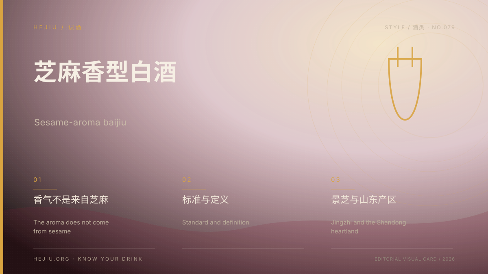

# 芝麻香型白酒

芝麻香型最容易被名字带偏：它不以芝麻为原料，也不是在酒里加芝麻香精。所谓“芝麻香”，是对一种焙炒、坚果、焦香复合气息的比喻。真正的来源是制曲、堆积、窖池与长期贮存共同形成的微生物与化学反应，尤其是含硫化合物、吡嗪类与烘烤香气物质的叠加。

图：芝麻香型白酒 双语视觉卡（项目自绘 SVG）。不是实拍。

> **先给结论**
> **一句话：** 这页判断芝麻香型白酒的风味位置，以及怎么选、怎么喝。
>
> - **适合谁：** 正在比较芝麻香型白酒与其他风格、准备购买或点单的人。
> - **不适合谁：** 只想要“哪个最好”的排名、不接受口味差异的人。
> - **先看这两点：**
>   - 芝麻香型白酒的原料表里没有芝麻。
>   - 芝麻香型的现行国家标准是 GB/T 10781.9-2021《白酒质量要求 第9部分：芝麻香型白酒》，于 2022 年 3 月 1 日实施。

## 香气不是来自芝麻

芝麻香型白酒的原料表里没有芝麻。它的香气更接近炒熟芝麻、烤坚果、轻微焦糊与陈年木香的混合，入口则有醇厚、绵柔、回味长的特点。把“芝麻香”当成添加香料的结果，既误解了工艺，也低估了这类酒的酿造难度。

这种香气也不是单一物质。研究通常把焙炒感归因于含硫化合物、吡嗪类、醛酮类与酚类等多种成分的共同作用；高温堆积与高温制曲提供了前体，长期贮存让这些物质重新组合。不同酒厂的火候、曲种与窖池条件不同，成品可以从清雅焙炒走到浓郁焦香。

## 标准与定义

芝麻香型的现行国家标准是 GB/T 10781.9-2021《白酒质量要求 第9部分：芝麻香型白酒》，于 2022 年 3 月 1 日实施，全部代替 GB/T 20824-2007。标准把芝麻香型白酒定义为：以粮谷为主要原料，或配以麸皮，以大曲、麸曲等为糖化发酵剂，经堆积、固态发酵、固态蒸馏、陈酿、勾调而成，不直接或间接添加食用酒精及非自身发酵产生的呈色呈香呈味物质，具有芝麻香型风格的白酒。

定义里有四个关键词：粮谷、麸皮、大曲与麸曲、堆积。它们分别对应原料、曲种与工艺路线。少了其中任何一项，产品可能仍然好喝，但不再是标准意义上的芝麻香型。标准还把产品按酒精度分为高度酒与低度酒，高度酒为 40%–68% vol，并注明不含 40% vol。

## 景芝与山东产区

芝麻香型的代表产区是山东，核心是潍坊安丘的景芝镇。景芝酒业长期以芝麻香型为旗号，参与标准制定与工艺推广，使“景芝”几乎成为该香型的代名词。山东之外，也有酒厂以麸曲、高温堆积与砖窖工艺生产芝麻香型产品，但产区规模与历史积累仍以鲁中一带最为集中。

产区不是质量保证。景芝镇的气候、水质与微生物环境提供了条件，但同一产区内的酒厂在曲种比例、堆积温度、窖池材质与贮存时间上差异很大。把“山东产”当成“正宗”，会把产区传统误当成法定等级；标准只规定工艺与理化边界，不规定某一个镇才能生产。

## 制曲：高温大曲与麸曲

芝麻香型通常采用高温大曲与麸曲并用的路线。高温大曲在较高温度下培养，富集耐热细菌与霉菌，带来焦香、酱香与复杂的酶系；麸曲以麸皮为载体，接种纯种或复合菌种，糖化力强、发酵效率高，能补足大曲在淀粉利用上的不足。两者并用，既保留大曲的香气复杂度，又提高出酒率与稳定性。

这种“双轨制曲”是芝麻香型与酱香、浓香的重要区别。酱香型以高温大曲为核心，强调多轮次发酵；浓香型以中偏高温大曲与老泥窖为核心；清香型以低温大曲与地缸为核心。芝麻香型把麸曲引入名酒工艺，曾被视为“用麸曲做名酒”的技术突破，也因此长期面对“麸曲是否低端”的争议。

## 堆积与泥底砖窖

蒸熟的粮醅在入窖前先进行高温堆积，参见[制曲](ref:qu-making)与[发酵](ref:fermentation)。堆积让微生物在开放环境中繁殖，温度上升，淀粉与蛋白质开始分解，香气前体大量生成。堆积的温度、时间与翻堆方式，直接决定成品有没有“焙炒感”，以及焦香是否过重。

发酵容器多为泥底砖窖：窖壁用砖砌，窖底铺泥。砖壁便于控制水分与温度，泥底提供己酸菌等微生物的栖息空间，兼顾芝麻香的干净与浓香型的窖香。与浓香型的全泥窖相比，砖窖的窖泥面积小，窖香更克制；与酱香型的石壁泥底窖相比，砖窖的透气性与微生物群落又不同。发酵周期、轮次与入窖水分随酒厂而变，没有全国统一的“芝麻香周期”。

## 蒸馏、贮存与勾调

发酵完成后进行固态蒸馏，参见[蒸馏](ref:distillation)。固态蒸馏的甑桶与分段摘酒方式，保留了更多高沸点香气物质；酒头、酒心、酒尾分开存放，酒心用于主体，酒头酒尾用于调味或回蒸。蒸馏火候过猛会带出焦苦与杂味，过软则香气不足。

新酒通常要经过较长时间贮存，让硫化物挥发、酒精与水分子缔合、香气从尖锐转向圆润。贮存容器多为陶坛或不锈钢罐；陶坛的微透气性有助于氧化与老熟，不锈钢则利于保香。勾调时，酒厂会用不同轮次、不同年份、不同曲种比例的原酒搭配，必要时用少量老酒提香。勾调是技术，不是“兑水”；标准允许加水降度，但不允许添加食用酒精或外来呈香物质。

## 关键参数

- 现行标准：GB/T 10781.9-2021，2022 年 3 月 1 日实施。
- 原料：粮谷为主，可配麸皮。
- 曲种：大曲、麸曲等。
- 工艺：堆积、固态发酵、固态蒸馏、陈酿、勾调。
- 高度酒酒精度：40%–68% vol，标准注明不含 40% vol。
- 香气关键词：焙炒芝麻、坚果、焦香、陈香。

这些参数来自国家标准，描述的是类别边界。酒精度、贮存时间与曲种比例都不能单独代表质量；一瓶酒好不好，仍要看香气是否干净、酒体是否协调、回味是否舒适。

## 与酱香、浓香、清香的边界

与酱香型的区别，在曲与窖。酱香型以高温大曲为核心，石壁泥底窖，多轮次发酵，香气偏酱香、焦糊与陈年；芝麻香型引入麸曲，砖窖泥底，强调堆积带来的焙炒香。两者都有高温与焦香，但酱香的“酱”来自多轮次高温发酵，芝麻香的“芝麻”来自堆积与曲种的复合香气。

与浓香型的区别，在窖与酯。浓香型以老泥窖、中偏高温大曲为核心，己酸乙酯突出，窖香浓郁；芝麻香型的砖窖窖泥面积小，己酸乙酯不是主角，焙炒香与含硫化合物更突出。与清香型的区别，在曲与容器。清香型用低温大曲、地缸、清蒸清烧，乙酸乙酯为主，干净爽利；芝麻香型用高温大曲与麸曲、砖窖、堆积，香气更复合、更厚重。

## 常见误解

第一，认为芝麻香型加了芝麻。原料中没有芝麻，香气是发酵与贮存的产物。第二，认为它是酱香型的分支。两者在曲种、窖池与轮次上都不同。第三，认为麸曲等于低端。麸曲是糖化发酵剂的一种，关键在菌种、工艺与控制。第四，认为焦香越重越好。过重的焦苦会掩盖花果与陈香，平衡才是目标。第五，把“山东产”当成法定保证。标准规定工艺与理化边界，不限定单一产地。第六，把“芝麻香”当成香精味。真正的芝麻香是复合的焙炒感，不是单一线性的香味。

## 延伸阅读

- [白酒](ref:baijiu)：中国白酒的总体分类与工艺框架。
- [高粱](ref:sorghum)与[小麦](ref:wheat)：芝麻香型的主要原料与制曲原料。
- [制曲](ref:qu-making)：大曲与麸曲的差别。
- [发酵](ref:fermentation)：堆积与窖池发酵的作用。
- [蒸馏](ref:distillation)：固态蒸馏与分段摘酒。

**关键事实。**

| 项目 | 内容 |
| --- | --- |
| 一句话定位 | 以粮谷为主要原料，可配以麸皮，用大曲、麸曲等糖化发酵剂，经堆积、固态发酵、固态蒸馏、陈酿与勾调而成，具有焙炒芝麻般香气；现行标准为 GB/T 10781.9-2021，高度酒酒精度 40%–68% vol |
| 上位风格 | 白酒 |
| 香气家族 | 焙炒香 |

## 相关图像

图：小麦。图片：kallerna，CC BY-SA 4.0，via Wikimedia Commons（[原图页面](https://commons.wikimedia.org/wiki/File:Vehn%C3%A4pelto_6.jpg)）。关联图像：芝麻香型白酒。
