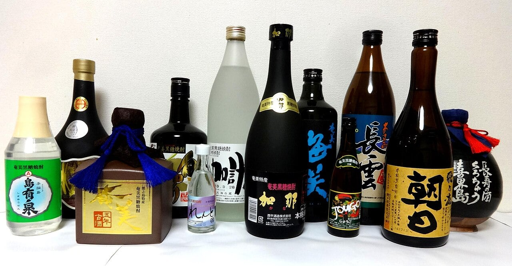

# 日本烧酒

日本烧酒不是一款酒，而是日本酒税法下的一条蒸馏酒分支。它按蒸馏方式分成两条路线：连续式蒸馏的甲类烧酒，酒体中性、产量大；单式蒸馏的乙类烧酒，保留原料个性，其中符合原料条件的一类可以在标签上写作“本格烧酒”。理解这条分岔，比记住某个品牌或某个产地更重要。

图：奄美黑糖烧酒（kokuto shochu）的瓶装样品，是日本烧酒的一个产地类型。图片：Hhaithait，CC BY-SA 4.0，via [原图页面](https://commons.wikimedia.org/wiki/File:Bottled_amami_kokuto_shochu.jpg)。

## 定义边界：酒税法里的烧酒

日本酒税法把烧酒定义为：以酒精含有物蒸馏得到，连续式蒸馏机蒸馏且酒精分低于 36%，或者以连续式以外的蒸馏机蒸馏且酒精分不超过 45%，并且不属于威士忌、白兰地、伏特加、朗姆、金酒等类别的酒。前者称连续式蒸馏烧酒，后者称单式蒸馏烧酒，也就是日常说的甲类与乙类。

这个定义说明两件事。第一，烧酒的边界由蒸馏设备和酒精度共同划定，不由原料单独决定。第二，甲类与乙类是并列的法定类别，不是“正品”与“次品”的关系。甲类适合做基酒，乙类适合表达原料，二者分工不同。

“本格烧酒”不是另一个税制类别，而是单式蒸馏烧酒中符合原料限定的一类标签用语。它以谷物或薯类及其麹、水为原料发酵后蒸馏；米烧酒可以只用米麹与水；黑糖烧酒则以砂糖、米麹与水为原料，产地限于鹿儿岛县的奄美诸岛。标签规则受公正竞争规约约束，不能随意使用。

## 原料、制曲与二次仕込み

烧酒的主原料可以是米、麦、甘薯、荞麦、黑糖或清酒酒粕。制曲通常用米，也有麦麹与黑麹；麹的作用是把淀粉分解为可发酵糖，同时提供香气前体。冲绳泡盛的特征之一，是只用黑麹菌制作的米麹。

本格烧酒普遍采用二次仕込み。第一次仕込み把麹、[水](ref:water)与酵母放入发酵罐，先培养出足够活跃的酒母；第二次仕込み再加入蒸熟的主原料与水，让糖化与[发酵](ref:fermentation)在同一罐内继续。相比于一次投料，二次仕込み能让酵母先站稳，降低染菌风险，也让主原料的香气更完整地进入醪液。

原料处理决定了风格的起点。甘薯需要蒸熟后打碎，麦要蒸煮到适度开花，米要蒸到外硬内软。蒸煮不足，淀粉释放不充分；蒸煮过度，醪液发黏，发酵与蒸馏都会变得难以控制。

## 蒸馏：常压与减压

单式蒸馏使用壶式蒸馏器，蒸馏次数通常为一次。酒厂可以在常压或减压下操作：减压会降低沸点，保留更轻盈、干净的香气；常压蒸馏则把更多高沸点物质带入酒液，酒体更厚、原料感更强。同一批醪液，换一种压力，成品可能像两款酒。

[蒸馏](ref:distillation)时的切酒同样关键。酒头刺激性高，酒尾杂味重，酒心才是装瓶的主体。酒厂会按香气与酒精度分段取舍，再把不同段、不同批次的原酒贮存、调合。甲类烧酒使用连续式蒸馏器，效率高、酒体中性，风味个性被刻意削平，这正是它作为基酒的价值。

## 产区谱系：九州、离岛与冲绳

本格烧酒的核心产区在九州。鹿儿岛与宫崎南部以甘薯烧酒著称，甜香与泥土感是常见描述；熊本县球磨地方以米烧酒闻名；长崎县壱岐与大分县以麦烧酒见长；宫崎县高千穗与长野县有荞麦烧酒；鹿儿岛县奄美诸岛则生产黑糖烧酒。冲绳的泡盛以米与黑麹酿造，是另一条传统。

这些对应关系是产区传统，不是法律等级。同一个县里，酒厂可以选择不同原料、曲种、蒸馏压力与贮存方式，成品差异可能大于产区之间的差异。把“鹿儿岛”直接当成某种固定风味，会忽略酒厂的技术选择。

## 贮存、调合与“古酒”

多数本格烧酒强调新鲜，装瓶前只做短期贮存，让新酒的刺激感稍微收敛。贮存容器多为不锈钢罐或陶坛；不锈钢利于保香，陶坛的微透气性会带来轻微氧化与柔化。部分麦烧酒使用橡木桶贮存，出现香草与木香，但这属于酒厂选择，不是本格烧酒的普遍要求。

泡盛有长期贮存的传统。按现行标示习惯，贮存三年以上的泡盛可称为“古酒”（クース），风味从锐利转向圆润，出现干果、香料与旧木的气息。古酒的价值来自时间与仓储条件，不是所有泡盛都适合无限期存放。

## 关键参数

- 甲类烧酒：连续式蒸馏，酒精分低于 36%，常见于基酒与调酒用途。
- 乙类烧酒：单式蒸馏，酒精分不超过 45%，是风味型烧酒的主体。
- 市售本格烧酒：常见 25% vol，加水稀释后装瓶；原酒强度可以更高。
- 泡盛古酒：贮存三年以上才使用“古酒”称谓。
- 本格烧酒的仕込み集中在 9 月至 12 月，11 月 1 日被定为“本格烧酒·泡盛之日”。

这些数字来自酒税法与国税厅的公开说明，属于类别与标示的边界，不是质量评分。酒精度高低只说明稀释程度，不能单独判断好坏。

## 与韩国烧酒、泡盛的区别

韩国烧酒（soju）与日本烧酒在法规、原料与工艺上都不同。韩国常见的稀释式烧酒以食用酒精加水、调味后制成，追求干净、低价与高周转；日本本格烧酒则从制曲、发酵开始，经单式蒸馏保留原料香。两者都可以叫“烧酒”的汉字，但不是同一个制度下的产品。

泡盛与日本本土烧酒的关系更近：它同样属于单式蒸馏烧酒，但只用米与黑麹，产地在冲绳，并有古酒传统。把泡盛当成“冲绳版甘薯烧酒”，会同时误解原料与历史。

## 饮用与品鉴

纯饮适合判断原料香与蒸馏干净度；加冰会压低香气、拉长入口；水割（加水）降低酒精刺激，让甘薯、麦或米的甜香展开；苏打割提升清爽感，适合佐餐；汤割（加热水）则在低温季节常见。25% vol 的成品已经过稀释，再加水时要少量多次，避免把香气冲淡。

品鉴时先闻静止香气，再小口含住，注意甜感、苦味、酸度与收口。温度过低会压住香气，过高会放大酒精。本页关于日本烧酒的内容涉及酒精饮料；过量饮酒有害健康，未成年人不应饮酒。

## 常见误解与争议

第一，把日本烧酒与韩国烧酒当成同一种酒。两者的原料、工艺与法规都不同。第二，认为本格烧酒越陈越好。多数本格烧酒以新鲜为上，长期陈年并非普遍做法。第三，把甲类烧酒当成劣质酒。甲类是合法类别，定位为中性基酒。第四，认为甘薯烧酒甜就是加了糖。甜香来自原料与发酵，不等于添加糖。第五，把泡盛当成普通烧酒。泡盛使用黑麹，产地与贮存传统都不同。第六，把“本格”当成质量等级。它描述的是蒸馏方式与原料条件。

## 延伸阅读

- [韩国烧酒](ref:soju)：与日本烧酒可对照的另一种东亚蒸馏酒。
- [蒸馏](ref:distillation)：连续蒸馏与单式蒸馏的差异。
- [米](ref:rice)与[水](ref:water)：烧酒的基础原料。
- [发酵](ref:fermentation)：制曲、糖化与二次仕込み的关系。
- [酒精度](ref:abv)：理解标签标注的基础概念。

**来源与边界。** 本页关于「日本烧酒」的关键事实，主要由以下来源交叉核对：国税庁（日本）（烧酒的类别、原料与酒精度规定）、国税庁 東京国税局（连续式与单式蒸馏烧酒的定义、本格烧酒的原料条件、主要产地与泡盛古酒年限）、全国公正取引協議会連合会（本格烧酒与泡盛的标签规则）等 6 条来源。价格、批次与状态会变，涉及这些字段时以页面所列来源的最新版本为准。正文为项目自写，来源只作核验，不复制原文。
