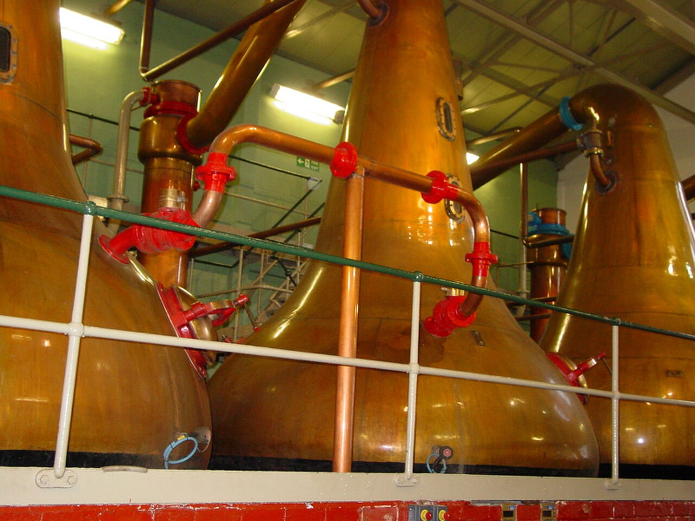

# 单一麦芽苏格兰威士忌

单一麦芽苏格兰威士忌（Single Malt Scotch Whisky）是[苏格兰威士忌](ref:scotch)五个法定类别之一：在同一家蒸馏厂内，用 100% 发芽大麦、以壶式蒸馏器分批蒸馏，并在苏格兰的橡木桶中陈年至少三年。它既不是“单一桶”，也不是“单一谷物”，更不是对所有苏格兰威士忌的统称。把这三个概念分开，是读懂酒标的第一步。

图：单一麦芽苏格兰威士忌。图片：Sansvase，CC BY-SA 3.0，via Wikimedia Commons（[原图页面](https://commons.wikimedia.org/wiki/File:Bowmore_whisky_12_years.JPG)）。

## 定义由四道锁扣住

《2009 年苏格兰威士忌条例》给出的定义可以拆成四条。第一是地点：糖化、发酵、蒸馏与陈年都必须在苏格兰完成，且只能在一家蒸馏厂内蒸馏。第二是原料：只用水与发芽大麦，不得加入其他谷物；这一点把它与允许使用玉米、小麦的单一谷物威士忌区分开。第三是设备：必须使用壶式蒸馏器分批蒸馏，连续式柱式蒸馏器做出的酒不能叫单一麦芽。第四是通用门槛：蒸馏酒精度低于 94.8% vol，只能装入容量不超过 700 升的橡木桶，在苏格兰陈年至少三年，装瓶酒精度不低于 40% vol，除水与普通焦糖色外不得添加其他物质。

这四条必须同时成立。[条例](ref:swr)用的是“单一蒸馏厂”而不是“单一品牌”，因此一家公司旗下不同酒厂的酒不能合并成一个“单一麦芽”；反过来，同一酒厂不同批次、不同桶型的酒可以混合装瓶，只要它们都来自这家酒厂。

## 单一酒厂不等于单一桶

“Single”修饰的是蒸馏厂，不是木桶。同一家酒厂可以把数十只、数百只桶的酒调和后装瓶，仍然叫单一麦芽。酒标上的 single cask、single barrel 才是“单桶”，指酒液来自一只或少数几只桶，通常不加水稀释，批次之间差异明显；cask strength 指不调整酒精度直接装瓶，与桶数无关。

[单一麦芽](ref:single-malt)这个词因此描述的是一种生产来源，而不是稀有程度。单桶可以很平庸，常规单一麦芽也可以非常复杂。把 single malt 理解为“单桶原酒”，会让价格判断完全失焦。

## 壶式蒸馏与切酒

[壶式蒸馏器](ref:pot-still)是分批工作的：每一锅醪液单独加热，酒精与香气一起蒸发，再经冷凝器变回液体。蒸馏器的高矮、颈部形状、林恩臂角度与加热方式，决定了回流比和铜接触量。高颈、长臂带来更多回流，酒体更轻；矮颈、短臂减少回流，酒体更厚、更油。

蒸馏师在出酒口按时间切分酒头、酒心与酒尾。酒头刺激、酒尾浑浊，只有中间那段酒心进入陈年。切点早晚是一种风格选择：早切得到干净、纤细的新酒，晚切保留更多油脂与谷物感。两家酒厂即使买同一批麦芽，切酒不同，成品也会走向两个方向。

## 发芽大麦与糖化

原料是[大麦](ref:barley)。大麦先浸水[发芽](ref:malting)，生成分解淀粉的酶；干燥时是否用泥煤烟熏，决定了麦芽带不带酚类香气。地板发芽如今只在少数酒厂保留，多数酒厂从中央发芽厂购买麦芽，再按订单指定泥煤酚值。

糖化把磨碎的麦芽与热水混合，让酶把淀粉转成可发酵糖。麦汁的清澈度、糖化温度与时间影响可发酵糖的比例，进而影响酒体。随后接种酵母发酵，发酵时间从数十小时到超过一百小时不等；长时间发酵生成更多酯类，为花果香打底，但也会改变酸度与微生物风险。

## 橡木桶里的三年

[橡木桶陈年](ref:oak-ageing)是单一麦芽的第二重原料。酒液在桶中同时发生萃取、氧化与挥发：木质素与单宁进入酒体，氧气让刺鼻的硫味变得柔和，酒精与水则通过桶壁缓慢散失。波本桶带来香草、椰子与奶油，雪莉桶带来干果、坚果与香料；桶的容量、烘烤程度与使用次数都会改变结果。

三年是法律下限，不是风味成熟的分界线。许多酒厂选择更长的陈年，也有酒厂用较小的桶加快萃取。酒标上的年份指瓶中最低酒龄，不是蒸馏年份，也不能保证每一滴都恰好等于这个数字。理解这一点，才不会把“年份”当成质量评分。

## 产区标签只有五个名字

法规保护五个地方名称：斯佩塞、高地、低地、艾雷岛与坎贝尔镇。只有在对应区域内蒸馏的苏格兰威士忌，才能在标签上使用该地名。斯佩塞集中了大量酒厂，常被概括为花果香与蜂蜜；[斯佩塞](ref:speyside)内部仍有从清淡花香到重雪莉的巨大差异。高地跨度最大，低地偏清淡，艾雷岛以泥煤闻名，坎贝尔镇产量最小。

产区名称描述的是地理与传统，不是配方，也不是等级。同一产区内，泥煤使用、蒸馏器形状、酵母与桶型可以完全不同。把“艾雷岛”直接等同于“重泥煤”，或把“斯佩塞”直接等同于“甜美”，都是把统计印象当成法律事实。

## 常见误解与选购

第一，认为单一麦芽必须来自单一桶。第二，认为年份越长越好，忽略过长的桶陈会让木质压过谷物。第三，认为单一麦芽一定优于[调和威士忌](ref:whisky)，两者是不同产品逻辑。第四，认为单一麦芽都很贵，实际上价格跨度极大。第五，认为所有单一麦芽都有泥煤味，许多酒厂常规款完全无泥煤。

选购时先看酒厂、酒龄与桶型，再看酒精度与是否单桶。纯饮适合判断结构，加几滴水可以打开香气；加冰会同时降温与稀释，适合酒精度较高的版本。无论怎么喝，都应控制饮用量，未成年人不应饮酒。

**关键事实。**

| 项目 | 内容 |
| --- | --- |
| 一句话定位 | 同一家苏格兰蒸馏厂、以 100% 发芽大麦为原料、经壶式蒸馏并在橡木桶中陈年至少三年的威士忌；蒸馏上限 94.8% vol 与装瓶下限 40% vol 共同划出它与单一桶、单桶原酒的界线 |
| 上位风格 | 苏格兰威士忌 |

**来源与边界。** 本页关于「单一麦芽苏格兰威士忌」的关键事实，主要由以下来源交叉核对：UK Government (legislation.gov.uk)（单一麦芽苏格兰威士忌的法定定义、蒸馏与陈年门槛）、Scotch Whisky Association（苏格兰五个产区的划分与风格概述）、Glenfiddich Distillery（单一麦芽酒厂的产区定位与产品表达）等 4 条来源。价格、批次与状态会变，涉及这些字段时以页面所列来源的最新版本为准。正文为项目自写，来源只作核验，不复制原文。

## 相关图像

图：壶式蒸馏器（pot still）。图片：see Source，CC BY-SA 3.0，via Wikimedia Commons（[原图页面](https://commons.wikimedia.org/wiki/File:Sjb_whiskey_still.jpg)）。关联图像：单一麦芽苏格兰威士忌。
