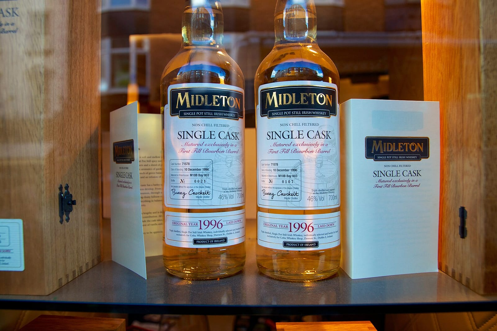
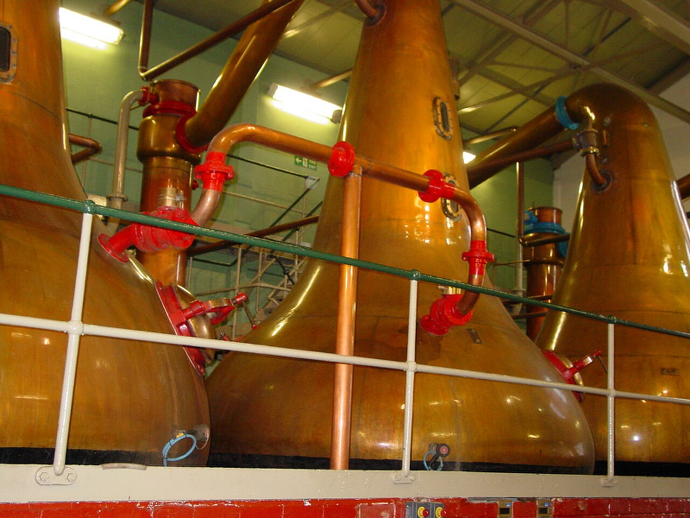

# 单一壶式威士忌

单一壶式威士忌（single pot still whiskey）是爱尔兰威士忌中唯一以“发芽大麦与未发芽大麦共同糖化”为核心的类别。名字里的两个限定词各有明确所指：single 指单一酒厂，pot still 指[壶式蒸馏器](ref:pot-still)；它既不表示“单一桶”，也不表示“单一麦芽”。理解这一点，是把它与苏格兰单一麦芽、爱尔兰单一麦芽区分开的前提。

图：单一壶式威士忌相关实景照片。图片：Der Robert，CC BY 2.0，via Wikimedia Commons（[原图页面](https://commons.wikimedia.org/wiki/File:Midleton_Single_Cask_Irish_Whiskey.jpg)）。

## 定义边界：四个必须同时成立的条件

按爱尔兰威士忌的类别规则，单一壶式威士忌必须同时满足四项要求。第一，蒸馏在单一酒厂完成；第二，醪液中发芽大麦不少于 30%、未发芽大麦不少于 30%；第三，其他谷物不超过 5%；第四，使用壶式蒸馏器，并在橡木桶中陈年至少 3 年。

此外，蒸馏后的酒精度必须低于 94.8% ABV。这个上限确保酒液保留足够的谷物与发酵副产物，而不是被提纯成接近中性的烈酒。四项条件加上蒸馏上限，共同构成类别边界；任何一项不满足，就不能使用这个名称。

## 未发芽大麦为什么重要

未发芽大麦是它与单一麦芽的关键差别。发芽大麦在制麦过程中产生淀粉酶，能把淀粉分解为可发酵糖；未发芽大麦没有这套酶系统，却保留了更多谷物蛋白、β-葡聚糖与蜡质表层。它们在糖化与蒸馏后带来更厚的酒体、更明显的谷物甜感与独特的辛香。

这种辛香常被描述为青苹果、梨、丁香、肉豆蔻与烤面包的混合。它不同于麦芽带来的花果香，也不同于黑麦的胡椒感。所谓“pot still character”并不是玄学，而是原料结构在蒸馏曲线上的直接结果。

## 糖化与壶式蒸馏

生产时，酒厂把发芽与未发芽大麦一起粉碎、糖化，借助发芽大麦的酶完成转化。由于未发芽大麦比例高，醪液黏度更大，过滤与糖化效率更难控制，这也是单一壶式威士忌产量有限、成本偏高的原因之一。

发酵后的酒液进入壶式蒸馏器。壶式蒸馏是间歇式过程，回流比例、蒸馏器形状与切割点决定酒体的轻重。爱尔兰传统上三重蒸馏较常见，但法规并不要求每一次都蒸馏三次；两次蒸馏会保留更多谷物与油脂感，三次蒸馏则更轻盈、更干净。把“爱尔兰威士忌”一律等同于三次蒸馏，是另一种简化。

## 陈年与桶型

最低 3 年的橡木桶陈年是类别要求，但不是风格的全部。传统上使用曾装过波本、雪莉或其他酒类的桶，桶型与桶龄会带来香草、坚果、干果与香料感。部分产品使用新桶或风味桶，以增加甜度与层次。

陈年时间从 3 年到 20 年以上不等。长时间陈年会让谷物辛香转向皮革、干果与木质调，但并非越老越好；原酒结构不足时，过长的陈年只会让木质与苦味占上风。关于[橡木桶陈年](ref:oak-ageing)的通用机制，可另见工艺条目。

## 风格谱系与代表产品

单一壶式威士忌的风格跨度，主要来自三个变量：未发芽大麦的比例、蒸馏次数与桶型。未发芽比例高、两次蒸馏的产品更厚重、更辛香；三次蒸馏、以波本桶为主的产品更轻盈、更偏向青苹果与奶油。

代表产品包括 Redbreast 系列、Green Spot、Yellow Spot 与 Powers John's Lane 等。它们都以单一壶式威士忌为类别，但在酒龄、桶型与酒精度上差异明显。部分桶强版本会把酒精度推到 55% 以上，风味更集中，也更需要加水打开。本页不评价具体品牌或批次。

## 与单一麦芽、调和威士忌的区别

单一麦芽威士忌通常要求 100% 发芽大麦、单一酒厂与壶式蒸馏；单一壶式威士忌刻意保留未发芽大麦，因此更偏“谷物与香料”，而不是纯粹的花果麦芽。二者都可以标注酒龄，也都属于[威士忌](ref:whisky)大类，但不能互相替代。

调和威士忌则是把壶式威士忌与谷物威士忌按比例调配，追求稳定与柔和。单一壶式威士忌不加入谷物威士忌，因此保留了更完整的壶式特征。把它理解为“爱尔兰版单一麦芽”或“爱尔兰版调和”，都会忽略原料与调配上的实质差异。

## 与波本、苏格兰的对照

与以玉米为主的[波本威士忌](ref:bourbon)相比，单一壶式威士忌的谷物结构更复杂，酒体更偏“厚”与“辛香”，甜感来自谷物而非玉米。与苏格兰单一麦芽相比，它通常更少泥煤，更多谷物与香料，口感也更圆润。

这种对照只有在确认原料、酒厂数量与蒸馏方式之后才有意义。把三者放在同一张“威士忌风格表”里，容易把产地、原料与工艺三条轴混为一谈。

## 常见误解与争议

第一，把 single pot still 当成“单一桶”。第二，认为所有单一壶式威士忌都经过三次蒸馏。第三，把它等同于单一麦芽。第四，认为未发芽大麦只是降低成本，实际上它是风格核心。第五，把“pure pot still”当成现行法定类别，它更多是历史用语。

争议主要集中在未发芽大麦比例的弹性、传统三次蒸馏的复兴，以及高酒龄产品的稀缺性。这些问题影响价格与供给，但不改变类别定义。

## 怎么喝

纯饮适合感受其奶油、谷物与香料质地；加少量水可以打开香气，但过量水会稀释酒体。它也可以用于调酒，不过高酒精度与香料感容易压过清淡配料。饮用温度以室温或稍凉为宜，不必刻意冰镇。关于[蒸馏](ref:distillation)对酒体的影响，可参见工艺条目。

对照阅读：[威士忌](ref:whisky)、[蒸馏](ref:distillation)。

相关条目：[波本威士忌](ref:bourbon)。

**关键事实。**

| 项目 | 内容 |
| --- | --- |
| 一句话定位 | 爱尔兰威士忌中以壶式蒸馏器处理“发芽大麦 + 未发芽大麦”混合醪液的类别；单一酒厂、30% 对 30% 的原料结构、3 年最低陈年与 94.8% 蒸馏上限构成其边界 |
| 上位风格 | 威士忌 |

**来源与边界。** 本页关于「单一壶式威士忌」的关键事实，主要由以下来源交叉核对：Drinks Ireland — Irish Whiskey Association（单一壶式威士忌的原料比例、壶式蒸馏与陈年要求）、European Union（爱尔兰威士忌作为地理标志与烈酒类别的一般法律框架）、Bord Bia (Irish Food Board)（爱尔兰威士忌类别与产业背景）等 5 条来源。价格、批次与状态会变，涉及这些字段时以页面所列来源的最新版本为准。正文为项目自写，来源只作核验，不复制原文。

## 相关图像

图：壶式蒸馏器（pot still）。图片：see Source，CC BY-SA 3.0，via Wikimedia Commons（[原图页面](https://commons.wikimedia.org/wiki/File:Sjb_whiskey_still.jpg)）。关联图像：单一壶式威士忌。
