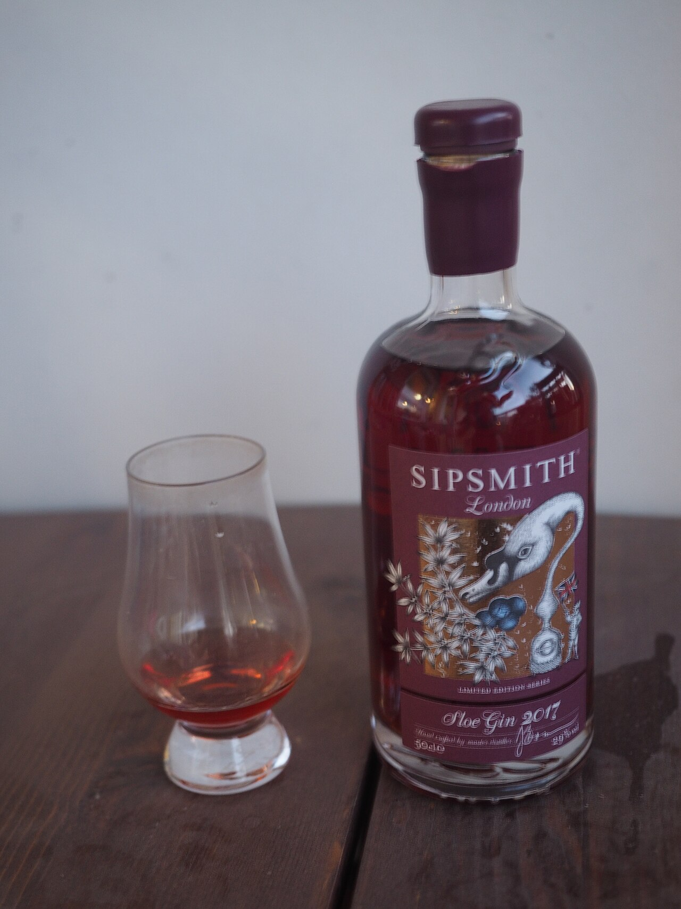
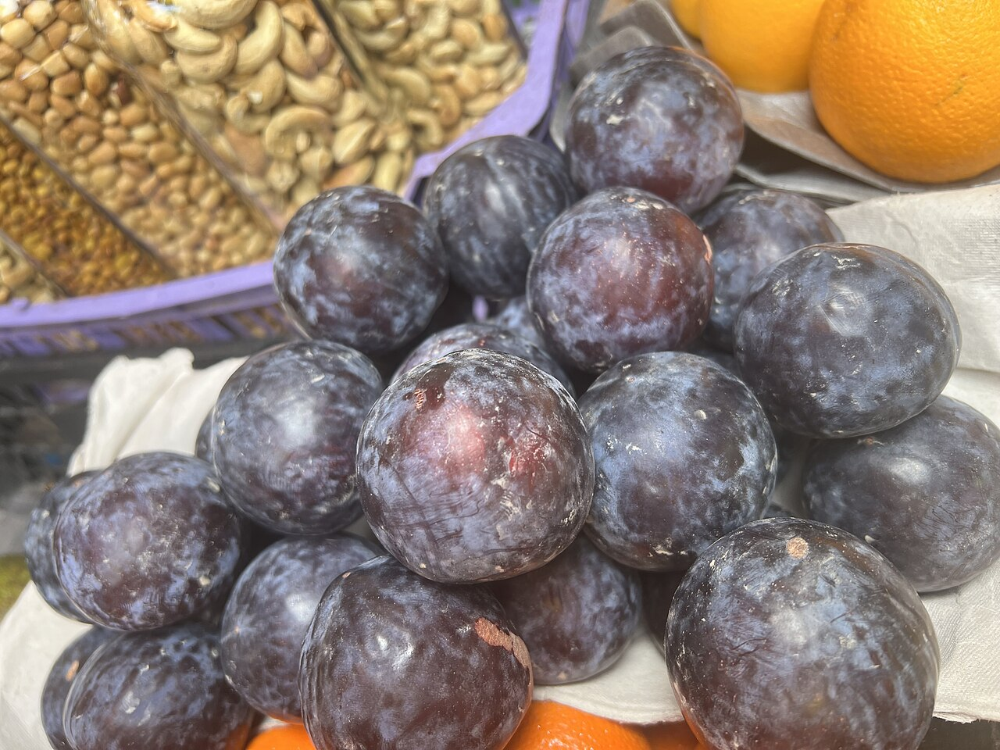

# 黑刺李金酒

英国传统金酒利口酒，将黑刺李果实浸泡在金酒中并加糖；酒色深红、甜中带酸，带杏仁与香料，酒精度通常较低。

黑刺李金酒是英国传统金酒利口酒，把黑刺李果实浸泡在金酒中并加糖，酒色深红、甜中带酸，带杏仁与香料，酒精度通常较低；它不是一种独立的金酒类别，也不能因为名字里有 gin 就当成伦敦干金。传统做法在秋季采收黑刺李，霜降后果实更甜，浸泡数周到数月，再按配方加糖；商业版本会用基酒、糖度与果实比例拉开差异。看标签要先看基酒、糖度、果实来源与 ABV，深红不代表更好，颜色可能来自添加物，也会随年份自然变淡。Plymouth Sloe Gin 以 Plymouth 金酒为基酒，风格平衡；Hayman’s 更甜、果味更浓；Sipsmith 以伦敦干金为基底，酸度与杜松子更清晰。饮用温度 10–12°C，用小号利口酒杯倒 30–40 mL，也可加苏打水做 Sloe Gin Fizz；开瓶后冷藏，三到六个月内喝完。它常被当成“甜金酒”，但真正的区别在果实浸泡与加糖，不在基酒本身；纯饮时加一片橙皮可以提亮果香。

图：Sloe Gin：Sipsmith Sloe Gin（Wikimedia Commons）。图片：JIP，CC BY-SA 4.0，via Wikimedia Commons（[原图页面](https://commons.wikimedia.org/wiki/File:Sipsmith_Sloe_Gin.jpg)）。

## 定义与边界

黑刺李金酒（sloe gin）是英国传统金酒利口酒：把黑刺李（Prunus spinosa）果实浸泡在金酒中，加糖调味，过滤后得到深红/紫红色的甜酸酒。它不是“黑色金酒”，也不是纯金酒；酒精度通常 15–30% vol。

欧盟与英国法规把它归入利口酒类别，要求最低酒精度与最低含糖量；名称“sloe gin”受标签规则约束，但不同品牌的基酒、糖度与浸泡时间差异很大。它与普通金酒的区别在加糖与果实浸泡，与果味利口酒的区别在黑刺李的酸涩与杏仁尾韵。

## 历史与命名

黑刺李在欧洲 hedgerow 中常见，秋季结出小而酸的深色果实；英国乡村在 17 世纪就有用金酒浸泡黑刺李、加糖保存的做法，常作为冬季饮品与家庭药酒。

传统配方在霜冻后采摘，因果实涩味降低；家庭做法把黑刺李、糖与金酒装入广口瓶，浸泡数月，期间定期摇晃，最后过滤。现代品牌用更稳定的基酒与糖度，把它做成全年销售的利口酒。

“sloe gin”在 19 世纪英国乡村常与狩猎、圣诞与冬季聚会联系在一起；旧配方会用针扎破果实，帮助颜色与风味释放，现代酒厂多用冷冻替代霜冻。

## 原料与工艺

黑刺李需经霜冻或冷冻，果皮破裂后才能释放颜色与风味；整颗果实浸泡在金酒中 2–3 个月，酒精提取果香、酸度与杏仁味，糖在浸泡后期加入，避免抑制提取。

基酒可以是伦敦干金、 Plymouth 金或中性金酒；金酒的杜松子与柑橘香气提供骨架，黑刺李带来酸、涩、杏仁与深红色。糖度从 100 g/L 到 300 g/L 都有，酒精度越低、糖越高，口感越像糖浆。

过滤后静置数周让风味融合；部分品牌会加少量杏仁香精或香料，但传统配方只靠果实与糖。颜色会随光照与时间变褐，储存时应避光。

黑刺李的涩味来自果皮单宁，霜冻后单宁下降、糖分上升；浸泡时间过长会带来苦味与杏仁过量，通常 2–3 个月足够。糖在浸泡后期加入，避免高糖抑制提取。

## 风格与味觉

酒液深红到紫红，香气带黑刺李、杏仁、樱桃、肉桂与杜松子；入口甜中带酸，单宁与涩感来自果皮，收口有杏仁与香料。酒精度低，质地从轻到糖浆状都有。

与普通金酒比，它更甜、更果味、酒精度更低；与樱桃利口酒比，它的酸度更高、杏仁味更明显。判断典型性，先看黑刺李比例、糖度与基酒，再看颜色是否自然。

酒精度 15–30% 的版本适合纯饮，20% 以下更像糖浆，适合调酒；酸度来自果实，糖度从 100 到 300 g/L 都有。颜色深红来自果皮，长时间光照会转褐。

## 代表产区与品牌

Plymouth Sloe Gin 是经典代表，基酒为 Plymouth 金酒，风格平衡；Hayman’s Sloe Gin 更甜、果味更浓；Sipsmith Sloe Gin 以伦敦干金为基底，酸度与杜松子更清晰。

英国各地的小型酒厂也做季节版，使用本地黑刺李；找酒时看基酒、糖度与果实来源，不要只看颜色深浅。深红不代表更好，颜色可能来自添加物。

## 怎么喝与配餐

纯饮温度 10–12°C，用小号利口酒杯，倒 30–40 mL；也可以加冰或苏打水，做成 Sloe Gin Fizz。配餐适合野味、烤肉、蓝纹奶酪、黑巧克力与杏仁甜点；甜度高，不适合配清淡海鲜。

开瓶后冷藏，3–6 个月内喝完；糖与低酒精度让它耐放，但果香会逐渐衰退。不要冷冻，低温会让糖浆变稠、香气闭塞。

黑刺李金酒适合冷藏后纯饮，也可以加苏打水做成清爽的长饮。

## 选购、储存与误区

先看酒精度与糖度，再看基酒与果实来源；糖度高的版本更像糖浆，适合调酒，不适合纯饮。价格高可能来自手工浸泡或品牌，不代表果实比例更高。

常见误读：把 sloe gin 当成一种金酒；以为颜色越深越好；以为它必须很甜。它可以酸、可以干，关键是黑刺李与糖的比例。

英国法规要求 sloe gin 的标签标明类别与酒精度，欧盟则按利口酒规则管理；进口到美国的版本可能因含糖量被归类为利口酒而不是金酒。购买时看 ABV 与糖度，不要只看“gin”。

黑刺李金酒的颜色会随年份变淡，这是天然色素的老化，不是变质；避免阳光直射。纯饮时加一片橙皮可以提亮果香。

## 延伸阅读与另见

- [金酒](ref:gin)：杜松子风味烈酒的基础。
- [利口酒](ref:liqueur)：加糖利口酒的类别。
- [浸渍（maceration）](ref:maceration)：果实浸泡提取。
- [李子](ref:plum)：黑刺李的近缘果实。
- [蒸馏](ref:distillation)：基酒的生产。

对照阅读：[金酒](ref:gin)、[浸渍（maceration）](ref:maceration)、[利口酒](ref:liqueur)。

**关键事实。**

| 项目 | 内容 |
| --- | --- |
| 一句话定位 | 英国传统金酒利口酒，将黑刺李果实浸泡在金酒中并加糖；酒色深红、甜中带酸，带杏仁与香料，酒精度通常较低 |
| 上位风格 | 金酒 |

**来源与边界。** 本页关于「黑刺李金酒」的关键事实，主要由以下来源交叉核对：European Union（烈酒类别、定义与标签规则）、US TTB（美国威士忌、朗姆与烈酒分类）、The Gin Guild（Sloe Gin 的浸渍工艺、最低酒度与标签规则）等 4 条来源。价格、批次与状态会变，涉及这些字段时以页面所列来源的最新版本为准。正文为项目自写，来源只作核验，不复制原文。

## 相关图像

图：Plum：Plum Fruit on Display（Wikimedia Commons）。图片：Iwai-Dialax，CC BY 4.0，via Wikimedia Commons（[原图页面](https://commons.wikimedia.org/wiki/File:Plum_Fruit_on_Display.jpg)）。关联图像：黑刺李金酒。
