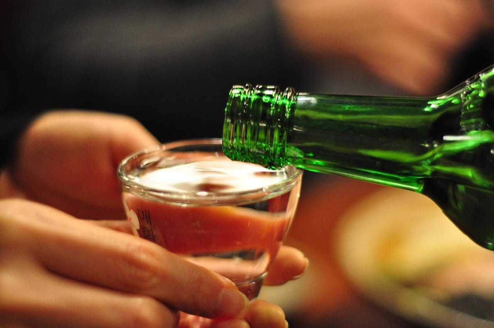

# 烧酒

烧酒（soju）是朝鲜半岛的传统酒类，今天既指传承蒸馏工艺的地方烧酒，也指占据大众市场的稀释型烧酒。两者共用同一个名称，却在原料、工艺、风味与价格上差别很大。理解烧酒，先要分清这两种产品，再谈品牌与喝法。

图：烧酒。图片：Graham Hills，CC BY 2.0，via Wikimedia Commons（[原图页面](https://commons.wikimedia.org/wiki/File:Soju.jpg)）。

## 定义与分类

在韩国酒类法规中，烧酒属于蒸馏酒类别，按工艺与原料可以分成蒸馏型烧酒、稀释型烧酒与其他配制型产品。传统烧酒以大米等谷物为原料，经发酵、蒸馏得到，酒精度较高；现代大众市场常见的烧酒则多为“稀释型烧酒”，以食用酒精为基底，加入水、甜味剂和调味成分。

稀释型烧酒的酒精度通常在 16% 至 25% 之间，常见规格在 17% 上下。蒸馏型烧酒的酒精度更高，风味也更集中。两者都叫 soju，但选购时看酒精度、原料与工艺标注，比看品牌更能判断自己买到的是哪一类。

## 「烧酒」的时间线
朝鲜半岛的烧酒传统可以追溯到蒸馏技术传入后的谷物酒生产。早期烧酒多在地方酒坊以小规模蒸馏制作，安东、全州等地保留了较完整的传统。20 世纪，工业化与城市消费改变了产品结构，稀释型烧酒逐渐成为主流。

1965 年，韩国因粮食短缺限制用大米酿造烧酒，稀释型烧酒由此扩张；1999 年相关限制解除后，传统蒸馏烧酒与地方烧酒重新获得发展空间。这段历史解释了为什么今天韩国市场上“烧酒”默认指清淡、低价、低酒精度的稀释型产品，而传统烧酒反而成为特色品类。

## 蒸馏型烧酒

蒸馏型烧酒保留谷物发酵与蒸馏的基本结构，风味更接近原料本身。大米烧酒通常干净、带米香与轻微甜感；加入小麦或其他谷物的配方会带来不同的香气层次。地方烧酒常用传统壶式蒸馏，产量小、价格高，适合纯饮或配餐。

蒸馏型烧酒的酒精度较高，入口刺激明显，因此更适合小杯慢饮。与[白酒](ref:baijiu)相比，它的香气强度与复杂度通常更低，强调干净与顺口；与日本[清酒](ref:sake)相比，它属于蒸馏酒而非发酵酒，保存与饮用方式也不同。

## 稀释型烧酒

稀释型烧酒的核心是食用酒精加水稀释，再通过甜味剂、酸味剂与香精调整口感。它的优势是成本低、产量大、口味稳定，适合餐馆与家庭日常消费；缺点是风味层次有限，更多依赖甜感与清爽感。

稀释型烧酒的技术重点在“干净”与“易饮”：水质、稀释比例、过滤与调配决定入口是否顺滑。不同品牌的差异往往体现在甜度、酒精刺激与回味上，而不是原料产地。把它当作佐餐酒而非品鉴对象，更符合这类产品的设计目标。

## 原料与工艺

蒸馏型烧酒的原料包括大米、小麦、大麦或混合谷物，工艺包括浸米、蒸煮、制曲、发酵、蒸馏与陈放。曲的种类与发酵温度影响香气；蒸馏时的切割点决定酒体的干净度与厚度。传统工艺常强调“多轮发酵”与“低温慢发酵”。

稀释型烧酒的工艺则以酒精稀释为主，辅以糖浆、柠檬酸、氨基酸调味料等。两种工艺都要求稳定的水质与卫生控制。标签上的原料表、酒精度与产品类别，是区分两类产品最直接的线索。

## 「烧酒」的闻与喝
蒸馏型烧酒的香气以米香、谷物甜感与轻微酯香为主，入口较有厚度，余味偏干净；部分地方烧酒会带明显的曲香或坚果感。稀释型烧酒香气较淡，入口甜、酒精感直接，余味短，冷藏后更顺口。

品鉴蒸馏型烧酒时，可用小杯常温少量，先闻再小口含住；加水或加冰会改变香气结构。稀释型烧酒更适合冷藏后直接饮用，重点在清爽与佐餐适配，而不是复杂香气。任何烧酒的酒精度都可以参考[酒精度](ref:abv)的标注方式来理解。

## 「烧酒」的饮用与搭配
烧酒通常冷藏后倒入小杯饮用，也常与烤肉、海鲜和辣味料理搭配。韩国常见的“炸弹酒”是把烧酒与啤酒混合，属于饮用方式而非独立酒类；混合比例会显著改变酒精感与气泡感。由于稀释型烧酒风味较轻，加果汁或苏打水也很常见。

餐食搭配上，清淡的稀释型烧酒适合辣味料理、烤肉与海鲜；蒸馏型烧酒更适合搭配口味较重的菜肴或纯饮。饮用时注意份量与节奏，烧酒的高温饮用场景容易让人低估酒精摄入。

## 「烧酒」容易被读错的地方
第一，把烧酒与日本烧酎混为一谈。二者原料、蒸馏制度与风味传统不同，中文里都含“烧”字，但不宜混用。
第二，认为烧酒都是低度酒。蒸馏型烧酒的酒精度可以很高。
第三，把“炸弹酒”当作酒类。它是混合饮用方式，不是独立产品类别。
第四，认为稀释型烧酒没有工艺。稀释、过滤与调配同样影响口感与稳定性。
第五，只看品牌不看类别。酒精度与原料标注才是判断产品类型的关键。

相关条目：[白酒](ref:baijiu)、[清酒](ref:sake)。

**来源与边界。** 本页关于「烧酒」的关键事实，主要由以下来源交叉核对：Oxford University Press（提供关于朝鲜半岛烧酒历史、蒸馏型与稀释型差异的条目）、National Tax Service of Korea（韩国酒类的法定分类与标示框架）、Korea Legislation Research Institute（《酒税法》相关条文与酒类定义）等 4 条来源。价格、批次与状态会变，涉及这些字段时以页面所列来源的最新版本为准。正文为项目自写，来源只作核验，不复制原文。

**并读。** 把「烧酒」与「白酒」、「清酒」、「酒精度（ABV）」放在一起读时，先确认它们是同一层级还是上下游关系：先确认定义与工艺，再比较原料、产区与代表品牌。本页负责给出酒类风格的基本坐标，对照条目补上具体案例与差异；读完再回到本页，才能分清哪些差别属于酒类风格本身，哪些只是产地、批次或品牌选择。

**适用边界。** 对「烧酒」而言，法定定义、原料比例与地域风格会随法规和行业分类更新；品牌案例不等于整个风格。

## 参考资料
- [白酒](ref:baijiu)：中国谷物蒸馏酒，可与蒸馏型烧酒对照。
- [清酒](ref:sake)：日本发酵米酒，与烧酒属于不同酒类。
- [酒精度](ref:abv)：理解烧酒标签上 ABV 标注的基础概念。

## 相关图像

图：清酒。图片：Intforce，CC BY-SA 4.0，via Wikimedia Commons（[原图页面](https://commons.wikimedia.org/wiki/File:Overflowing_sake_glass_in_masu.jpg)）。关联图像：烧酒。
