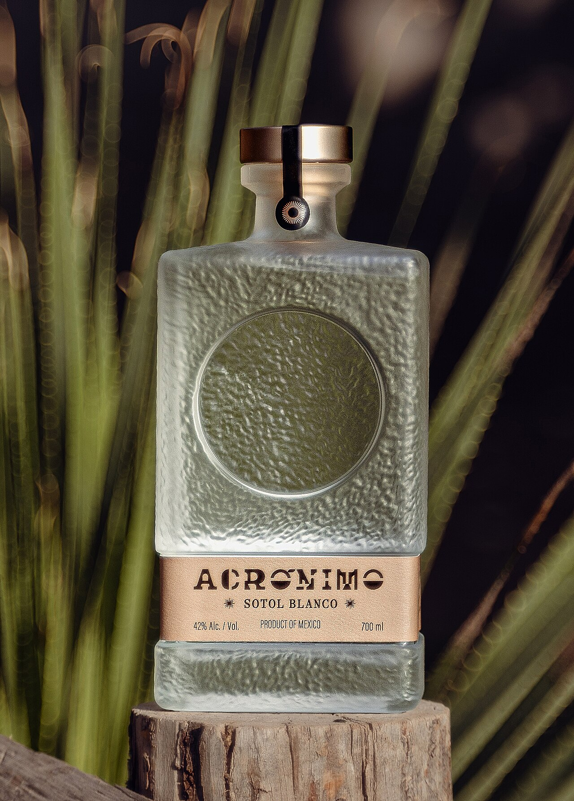

# 索托尔

索托尔（sotol）是墨西哥北部以沙漠勺（Dasylirion）为原料的蒸馏酒。它常被摆在[梅斯卡尔](ref:mezcal)旁边，但两者并不是同一种植物：梅斯卡尔用龙舌兰，索托尔用天门冬科的沙漠勺。这个植物学差异决定了它的法定身份、风味和产区。索托尔有原产地命名，覆盖奇瓦瓦、科阿韦拉和杜兰戈三个州，不是任何地方都能生产的“北部龙舌兰酒”。

图：索托尔。图片：Alessandra Camino，CC BY-SA 4.0，via Wikimedia Commons（[原图页面](https://commons.wikimedia.org/wiki/File:Sotol_Blanco_y_planta_Daysilirion_(cropped).jpg)）。

## 沙漠勺：一种不同的植物

沙漠勺的叶片呈细长放射状，边缘带齿，外形像一把插在沙地里的勺子，因此得名。它的心部富含可发酵糖，但纤维结构和龙舌兰不同，采收、烤制和研磨的方式也随之改变。野生植株生长缓慢，成熟需要多年；过度采挖是产区最现实的生态压力之一。

把索托尔简单归入“龙舌兰烈酒”，会掩盖它的独特性。[龙舌兰](ref:agave)属于天门冬科龙舌兰属，沙漠勺属于天门冬科沙漠勺属；两者亲缘相近，却不能互换原料。法规正是以植物属、产区和工艺来划定索托尔的身份，而不是以“像不像梅斯卡尔”来判断。

## 2002 年与三个州

索托尔的原产地命名在 2002 年获得墨西哥官方保护，覆盖奇瓦瓦、科阿韦拉和杜兰戈。奇瓦瓦是产量和知名度最高的产区，杜兰戈与科阿韦拉也有生产。原产地命名不是“三个州都能随意生产”的同义词：原料必须来自规定区域，蒸馏和装瓶也要符合对应的官方标准。

墨西哥标准 NOM-159-SCFI-2004 规定了索托尔的原料、工艺、酒精度、类别和标签要求。不同生产商可以在标准范围内选择野生或种植原料、传统或现代设备，但不能把其他植物的蒸馏酒标成索托尔。购买时，生产州、原料、酒精度与原料比例等标示需要分清，因为索托尔本来就不是龙舌兰。

## 坑烤、发酵、两次蒸馏

传统索托尔的流程与梅斯卡尔有相似之处：把沙漠勺的心部放入地下坑中，用石头和木柴加热，烤数天，让淀粉转化、糖分释放，并带来烟熏和焦糖气息；烤好的心部被捣碎，加水后进入发酵；发酵完成后，用[壶式蒸馏器](ref:pot-still)进行两次[蒸馏](ref:distillation)，切割头、心、尾，得到清澈的原酒。

坑烤是风味的核心，但不是唯一变量。发酵容器的材质、野生酵母、加水比例和蒸馏切割都会改变成品。现代生产者也会使用不锈钢发酵罐和更稳定的温控，以换取更干净的青草与柑橘香；传统派则保留土坑、木桶和开放发酵，让烟熏与微生物的复杂度更明显。两条路线都合法，差别在风格目标。

## 风味：青草、松脂与矿物

索托尔的香气通常比梅斯卡尔更“绿”：青草、芦荟、松针、茴香、柑橘皮和白色花朵，烟熏是背景而不是主角。入口干爽，酒体中等，矿物感和草本苦味明显，收口带有胡椒和树脂感。陈年版本会出现香草、奶油和干果，但很多生产者更愿意保留年轻酒款的植物线条。

与龙舌兰酒相比，索托尔少了甜熟的龙舌兰心香气，多了沙漠植物的清苦与树脂感；与梅斯卡尔相比，它的烟熏通常更克制，植物种类也更单一。品鉴时可以按“青草—树脂—烟熏—矿物”的顺序找线索，而不是只用“烟熏强度”一个维度打分。

索托尔的酒体通常比梅斯卡尔更轻，油脂感更少，适合纯饮时配一点盐和柑橘，也适合做以龙舌兰酒为基的鸡尾酒替代。

## 产区与生产者

奇瓦瓦的索托尔生产者多集中在沙漠与山谷交界地带，品牌规模从家庭作坊到出口型酒厂都有。杜兰戈和科阿韦拉的生产更分散，地方性品牌常以野生植株和传统坑烤为卖点。产区的共同点是干旱、昼夜温差大和生长缓慢的沙漠勺，这些条件让原料的糖分与香气更集中。

索托尔的市场规模远小于[龙舌兰酒](ref:tequila)，这既是劣势也是保护。小规模意味着更多手工操作和更明显的产地差异，也意味着更难建立统一的品质标准。由于产量小，索托尔的价格通常高于同等陈年的龙舌兰酒，且不同批次差异明显；这也是小产区烈酒的共同特征。消费者在选择时，应优先看是否标注原产地命名、生产州、原料比例和蒸馏方式，而不是只看“手工”或“沙漠”这样的形容词。

## 与梅斯卡尔、龙舌兰酒的差异

[梅斯卡尔](ref:mezcal)以龙舌兰为原料，法定产区更大、品种更多，烟熏和品种差异是它的核心叙事；[龙舌兰酒](ref:tequila)以蓝色龙舌兰为主，产区集中在哈利斯科等地，工业化程度更高。索托尔以沙漠勺为原料，产区限定在三个北部州，风味更偏青草、树脂和矿物。

三者都属于墨西哥蒸馏传统，但原料、产区和法规各自独立。把索托尔称为“梅斯卡尔的表亲”可以作为一个入口，却不能替代对植物属和原产地命名的理解。它不是龙舌兰酒的替代品，也不是梅斯卡尔的仿制品，而是一条独立的沙漠蒸馏路线。

对照阅读：[梅斯卡尔](ref:mezcal)、[龙舌兰（龙舌兰属）](ref:agave)。

**来源与边界。** 本页关于「索托尔」的关键事实，主要由以下来源交叉核对：Instituto Mexicano de la Propiedad Industrial / WIPO Lex（索托尔原产地命名的申请、覆盖州与法律依据）、Gobierno del Estado de Chihuahua（奇瓦瓦州的索托尔认证机构与产业管理）、Organización de los Estados Americanos — SICE（索托尔作为墨西哥受保护原产地命名的官方清单）等 4 条来源。价格、批次与状态会变，涉及这些字段时以页面所列来源的最新版本为准。正文为项目自写，来源只作核验，不复制原文。

**并读。** 把「索托尔」与「梅斯卡尔」、「龙舌兰酒」、「龙舌兰（龙舌兰属）」放在一起读时，先确认它们是同一层级还是上下游关系：先确认定义与工艺，再比较原料、产区与代表品牌。本页负责给出酒类风格的基本坐标，对照条目补上具体案例与差异；读完再回到本页，才能分清哪些差别属于酒类风格本身，哪些只是产地、批次或品牌选择。

**适用边界。** 对「索托尔」而言，法定定义、原料比例与地域风格会随法规和行业分类更新；品牌案例不等于整个风格。

**更新提示。** 「索托尔」最近核对于 2026-11-08；价格、状态与公开信息会变，引用前以本页来源的最新版本为准。
