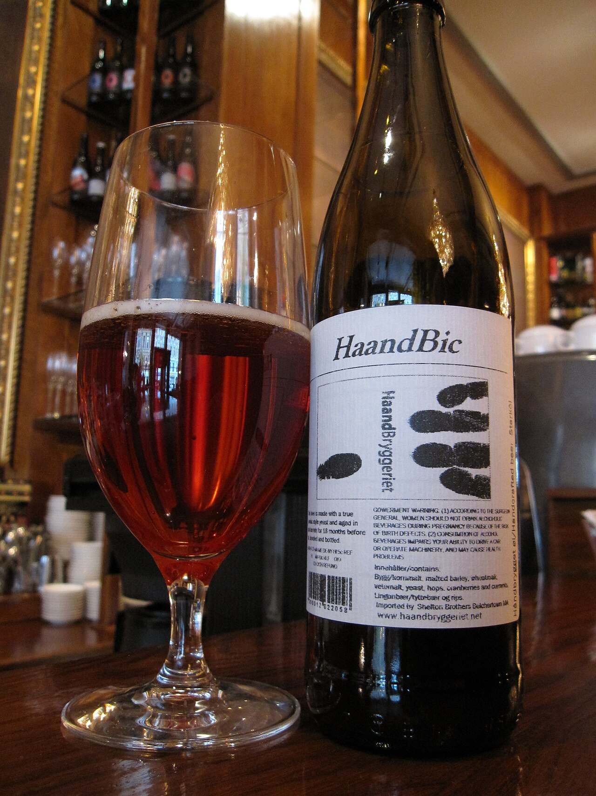

# 酸啤酒

酸啤酒（sour beer）指以微生物代谢产生明显酸度、并把酸作为风格核心的一类啤酒。酸主要来自乳酸发酵，也可能来自醋酸发酵；参与的不只是酿酒酵母，还有乳酸菌、醋酸菌与 Brettanomyces 等。比利时兰比克与红棕色艾尔、德国柏林酸小麦与戈斯，以及当代的壶式酸化，都属于这条谱系。酸度是一种风格维度，不是缺陷，也不是质量等级。

图：酸啤酒。图片：Bernt Rostad，CC BY 2.0，via Wikimedia Commons（[原图页面](https://commons.wikimedia.org/wiki/File:Norwegian_sour_beer.jpg)）。

## 定义与标准

酸啤酒没有统一的参数表。常见 pH 在 3.2–3.8，总酸以乳酸计大致 0.3–1.0%，但不同风格的测量口径并不相同，因此数字只宜作参考。酒精度跨度很大：柏林酸小麦常见 2.8–3.8%，戈斯 4.2–4.8%，兰比克 5.0–6.5%，法兰德斯红艾尔多在 5.0–6.5%。苦度通常偏低，多数在 5–15 IBU，因为酸与苦在感官上会相互竞争。

风格指南把欧洲酸艾尔、美式酸啤与野生发酵啤酒分列，说明“酸”是共同的风格轴，而不是一个单独风格。需要区分的是可感知的酸度、pH 值与总酸含量：三者相关但不相等。酸味明显也不等于酒已变质，判断要看酸的类型、干净程度与整体平衡。

## 历史与产地

在纯种酵母与巴氏杀菌普及之前，酸味在啤酒里并不罕见。木桶、空气与重复使用的容器带来多种微生物，19 世纪的酿酒师才开始系统控制它们。巴斯德与汉森的工作推动纯种酵母与卫生管理，酸味于是从常态变成需要刻意保留的特征。

[比利时](ref:belgium)保留了两种传统：帕约滕兰与森讷河谷的[兰比克](ref:lambic)依靠自发发酵与橡木桶长期陈放；法兰德斯红艾尔与 oud bruin 则在橡木桶中让醋酸菌缓慢作用，得到酸、果味与干爽收口。德国方面，柏林酸小麦以乳酸菌与酵母共发酵，传统上常加糖浆调和；[德国](ref:germany)哈茨地区的戈斯加入盐与芫荽，酸度相对柔和。

20 世纪后期，这些风格一度收缩到很小的产量，1980 年代以后随[精酿啤酒](ref:craft-beer)复兴重新进入市场。当代酒厂还发展出壶式酸化（kettle sour）：麦汁先煮沸杀菌，降温后接种乳酸菌，酸化完成再煮沸并加酒花，过程快速、可控，但风味层次通常不如混合发酵与桶陈。

## 原料与工艺

[小麦](ref:wheat)在柏林酸小麦与兰比克中占较高比例，为酒体与微生物提供养分；[大麦](ref:barley)麦芽仍是多数配方的基础。微生物的选择决定酸的性质：Lactobacillus 产生柔和的乳酸，Pediococcus 多见于兰比克，Brettanomyces 带来干爽与复杂香气，Acetobacter 需要氧气并产生醋酸。

工艺路线大致有四类：壶式酸化、混合发酵、自发发酵与桶陈。壶式酸化在糖化后进行，酸化麦汁经过二次煮沸，因此成品中通常没有活的乳酸菌，设备污染风险较低。混合发酵把酵母与细菌一起接种，风味更复杂。[橡木桶陈放](ref:oak-ageing)让微量氧气进入，促成醋酸菌活动与香气演化。酒花具有抗菌作用，投放过多会抑制乳酸菌，所以酸化阶段往往不加或只加少量酒花。

## 风味特征

乳酸带来的酸感柔和，常被形容为酸奶、柠檬或青苹果；醋酸更尖锐，过量时接近食醋。Brettanomyces 可以带来谷仓、干草、皮革与果香，令收口更干。碳酸高低、残糖多少与酒体厚薄，都会改变酸的观感。

判断质量时，先看酸是否干净明亮，再看香气是否复杂、口感是否平衡。刺鼻的溶剂味、纸板味、臭鸡蛋味与异常浑浊，通常指向卫生、氧化或发酵管理问题，而不是酸啤应有的特征。酸度高低本身不是分数：一款温和的柏林酸小麦与一款强烈的法兰德斯红艾尔，都可以做得很好。

## 品鉴与饮用

酸啤酒适饮温度约 8–12°C；郁金香杯或收口杯便于聚拢酸香与果香。倒酒宜缓慢，避免搅起沉淀。佐餐时，酸度能解腻，适合油炸食物、沙拉、海鲜与软质奶酪；法兰德斯红艾尔适合炖肉与野味，柏林酸小麦适合清淡菜肴。

开瓶后的酸啤不宜久放，氧气会继续改变酸与香气。低酒精度、低 pH 的版本宜趁新鲜饮用，高酒精度、结构完整的版本才具备一定陈年潜力。

## 常见误区

第一，认为酸就是坏了。故意酸化的啤酒与受污染的酒是两回事。
第二，认为越酸越好。平衡、干净与复杂度比酸度数值更重要。
第三，认为酸啤都要加水果。水果只是部分版本的做法。
第四，把壶式酸化等同于传统工艺。方法不同，风味层次也不同，但这不构成等级。
第五，认为所有酸啤都适合陈年。多数低酒精度的酸啤宜新鲜饮用。

对照阅读：[啤酒](ref:beer)、[酸度（acidity）](ref:acidity)。

## 延伸阅读

- [啤酒](ref:beer)：酸啤在啤酒风格体系中的位置。
- [兰比克](ref:lambic)：自发发酵与桶陈的比利时传统。
- [酸度](ref:acidity)：理解酸度、pH 与总酸的区别。
- [发酵](ref:fermentation)：混合发酵中不同微生物的作用。
- [橡木桶陈放](ref:oak-ageing)：微量氧气与醋酸菌的关系。
- [小麦](ref:wheat)：柏林酸小麦与兰比克的谷物基础。
- [大麦](ref:barley)：多数酸啤配方的基础麦芽。
- [比利时](ref:belgium)：兰比克与法兰德斯酸艾尔的产地。
- [德国](ref:germany)：柏林酸小麦与戈斯的传统。
- [精酿啤酒](ref:craft-beer)：当代酸啤复兴与壶式酸化的背景。

**关键事实。**

| 项目 | 内容 |
| --- | --- |
| 一句话定位 | 以乳酸或醋酸发酵获得明显酸度的一类啤酒；比利时兰比克与红棕色艾尔、德国柏林酸小麦与戈斯各成传统，现代壶式酸化让生产更可控，酸度是风格维度而非缺陷或等级 |
| 上位风格 | 啤酒 |
| 香气家族 | 酸香与发酵 |

**来源与边界。** 本页关于「酸啤酒」的关键事实，主要由以下来源交叉核对：Beer Judge Certification Program（欧洲酸艾尔、美式酸啤与野生发酵啤酒的强度、苦度与酸度边界）、Brewers Association（精酿行业对酸啤、壶式酸化与混合发酵的公开表述；未复制其文案）、Deutscher Brauer-Bund（柏林酸小麦与戈斯等德国酸味啤酒的公开表述）等 4 条来源。价格、批次与状态会变，涉及这些字段时以页面所列来源的最新版本为准。正文为项目自写，来源只作核验，不复制原文。

**并读。** 把「酸啤酒」与「啤酒」、「兰比克」、「酸度（acidity）」放在一起读时，先确认它们是同一层级还是上下游关系：先确认定义与工艺，再比较原料、产区与代表品牌。本页负责给出酒类风格的基本坐标，对照条目补上具体案例与差异；读完再回到本页，才能分清哪些差别属于酒类风格本身，哪些只是产地、批次或品牌选择。
