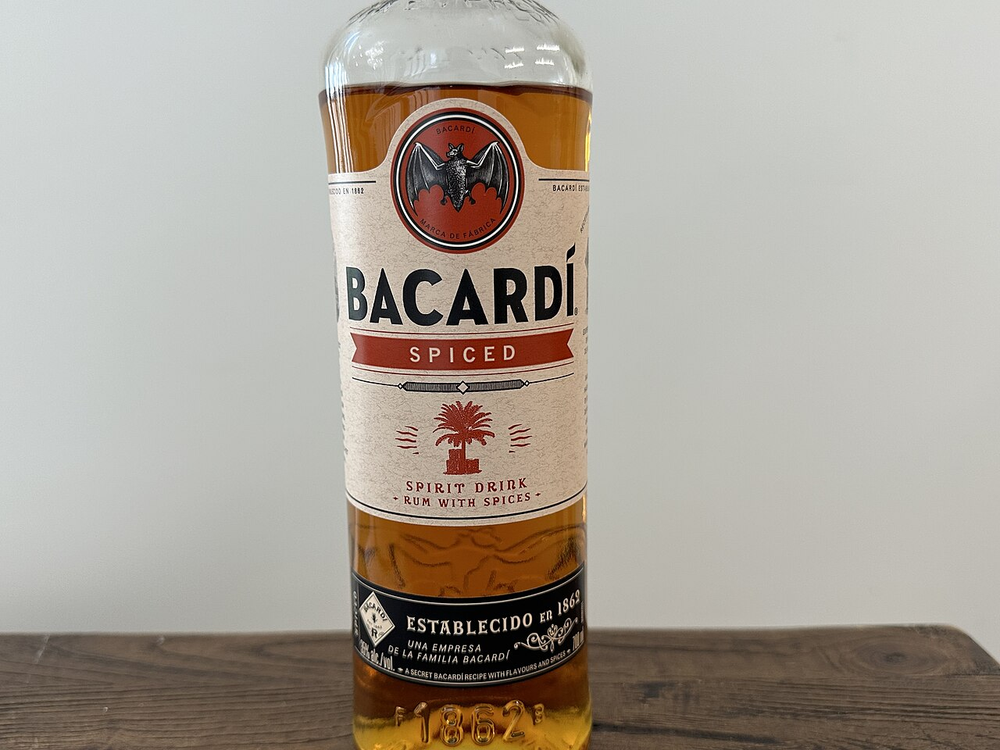

# 香料朗姆

香料朗姆（spiced rum）是以朗姆酒为基底，加入香草、肉桂、丁香、肉豆蔻等香料，再以糖或焦糖调味调色的调味烈酒；风格从清淡辛香到甜厚香草感都有，常见酒精度 35–40%，是加勒比饮法与现代调酒中很常见的一类产品。

图：Spiced Rum：Bacardi Spiced Rum 02（Wikimedia Commons）。图片：Indrajit Das，CC BY-SA 4.0，via Wikimedia Commons（[原图页面](https://commons.wikimedia.org/wiki/File:Bacardi_Spiced_Rum_02.jpg)）。

## 定义与边界

在欧盟烈酒法规（Regulation 2019/787）中，"朗姆"（rum）是一个有明确定义的烈酒类别：以甘蔗制糖副产品糖蜜、糖浆或甘蔗汁发酵蒸馏而成，蒸馏酒精度低于 96% vol，最低酒精度 37.5%，不得调味，只允许用焦糖调整颜色，加糖调味每升不得超过 20 克（折合转化糖）。一旦在朗姆中加入香料或其他风味，在欧盟法律下它就不再属于"朗姆"类别，而成为以朗姆为基底的"烈酒饮料"（spirit drink）。

美国的分类口径不同：调味朗姆归入"调味烈酒"（flavored spirit）类别，法定酒精度下限低于纯朗姆，标签规则见 27 CFR 5.22。因此超市里大字写"rum"的香料款，在不同市场的法律身份并不相同；判断一款产品要看基底酒、香料来源、糖度与酒精度，而不只看名字。它也不应与纯甘蔗汁蒸馏的 rhum agricole 混为一谈，后者强调甘蔗原汁风味与产区传统。

## 历史与命名

加勒比海有把香料加入朗姆饮用的长期民间传统：航海者与殖民者用肉桂、丁香、多香果、姜等香料掩盖劣质朗姆的粗粝感，也把香料与酒当作日常保健用途。这一传统更多停留在家庭与地方饮法层面，并没有形成统一的历史产品类别。

今天市场上的商业香料朗姆，主要是 20 世纪后期到 21 世纪在品牌营销推动下成型的品类。Captain Morgan 的品牌谱系可追溯到 1944 年 Seagram 开始生产的朗姆；其 Original Spiced Rum 于 1984 年进入美国市场，2001 年品牌归入 Diageo 旗下。Kraken 由 Proximo Spirits 于 2010 年推出，基底为特立尼达糖蜜朗姆，桶陈 1–2 年后与十一种香料调配。Sailor Jerry 之名来自美国传奇纹身师 Norman "Sailor Jerry" Collins，是品牌借用加勒比航海文化形象的例子。

## 原料与工艺

基底通常是年轻的柱式蒸馏糖蜜朗姆，有时经过轻度桶陈，本身风味干净，为香料留出空间。常用香料包括香草、肉桂、丁香、肉豆蔻、多香果、姜、橙皮、八角、胡椒与小豆蔻；具体配方是各品牌的商业秘密。香料进入酒液的方式有两种：把整粒香料在朗姆中浸渍数日到数周，缓慢萃取香气；或在蒸馏后加入香料提取物与浓缩物，保证批次稳定。多数商业产品两种方式兼用，比例很少公开。

调味环节通常补入糖与焦糖：商业香料朗姆每升含糖量大致在 15–40 克之间，焦糖主要负责深色外观。基底朗姆的产地决定了底层骨架——牙买加朗姆带酯类与果味，巴巴多斯偏圆润，特立尼达偏干净轻快，多米尼加偏甜厚；香料叠加之后，这些差别常被香草与肉桂感盖住，需要细品才能分辨。

## 风格与味觉

典型香料朗姆以香草、肉桂、丁香与甜焦糖为主导，入口甜顺，酒精感被糖与香料包裹；清淡版本辛香明确、酒体轻，适合混饮，甜厚版本香草与干果感重，接近甜利口酒的质地。苦度通常很低，酒花式苦味不是这类风格的元素；香气中常见烤面包、暖香料、葡萄干与橙皮。

质量判断上，香料应当与朗姆基底互相托住，而不是香精糖浆盖过一切。明显的人工香精味、齁甜挂嘴、溶剂感或颜色不均，通常指向原料等级或调配问题。温度影响表现：冰镇或加冰收敛甜度与酒精刺激，室温纯饮则放大香料与焦糖；它不是干型烈酒，平衡要看甜、辛、酒精与基底果香是否协调。

## 代表产区与品牌

Captain Morgan 是全球销量最大的香料朗姆之一，Original Spiced Gold 在欧洲市场酒精度 35%，以金色焦糖外观与香草肉桂风味为标识。Kraken Black Spiced 由 Proximo Spirits 于 2010 年推出，黑色瓶身与海怪标签是识别标志，黑标版本 47% ABV，金标版本 35% ABV，基底为特立尼达糖蜜朗姆，陈放 1–2 年后配十一种香料。Sailor Jerry 以牙买加风格朗姆为基底，香料路线偏肉桂与丁香；Chairman's Reserve 来自圣卢西亚，Bacardi Spiced 则是大型酒厂的混饮取向产品。

品牌之间的差别主要在基底朗姆产地、桶陈时长、香料路线与含糖量：有的偏干爽辛香，有的偏甜厚香草。读背标上的酒精度、配料与产地，比记住"典型香料朗姆"的笼统印象更可靠。

## 怎么喝与配餐

最常见的喝法是加冰纯饮，或兑可乐、姜啤、苏打水做成长饮；调酒中用于朗姆潘趣、热 grog、热带鸡尾酒与各类朗姆混合饮。清淡款适合混饮，高酒精度或长陈版本可以纯饮小口品味。它不像威士忌或白兰地那样强调专门杯型，古典杯或长饮杯依场景选择即可。

配餐上，香料朗姆配加勒比风味料理最协调： jerk 辣鸡、烤肉、烤猪肋排、烤玉米与带甜辣酱的菜肴，其甜辛感与烟熏、辣度互补；热带水果甜点、姜饼、坚果与葡萄干蛋糕也能承接其香草与干果味。清淡海鲜、清淡沙拉与酸味菜肴不适合搭配甜厚香料朗姆，会让甜味更腻。餐后少量慢饮，或作为派对长饮基底，是它最常见的场景。

## 选购、储存与误区

常见误区：把深色外观当作桶陈年份——深色常来自焦糖调色；以为香料朗姆都是朗姆法定类别——欧盟调味后已属烈酒饮料；把甜度高当成品质好；把品牌历史等同于产品工艺。实际上颜色、甜度与酒精度都要以背标为准，法律类别随市场规则变化。

买酒时先读背标：基底朗姆产地、香料与甜味来源、酒精度、含糖量标注是否清楚、生产者是谁；正面大字多为品牌营销。储存上，未开瓶避光、阴凉、直立存放；开瓶后酒精与香料香气会缓慢散失，建议在数月到一年内喝完。高糖产品长期静置可能析出沉淀，饮用前轻摇即可；价格高通常对应品牌与渠道，不必然代表风格更典型。

## 延伸阅读与另见

与香料朗姆相近的品类共享朗姆基底与调味工艺：[朗姆](ref:rum)是它所属的蒸馏酒大类，[蒸馏](ref:distillation)关系到基底朗姆的制备，[利口酒](ref:liqueur)提供了加糖调味烈酒的参照框架，[酒精度](ref:proof)是标签上最易比较的参数，[浸渍](ref:maceration)则是香料香气进入酒液的主要方式。

学习一类调味烈酒，可以先喝最标准的基准款，再试一个换香料或甜度的变体，最后接触一个高酒精度极端款；三步之后，风格边界会比读定义更清楚。

- 相关条目：[rum](ref:rum)、[distillation](ref:distillation)、[liqueur](ref:liqueur)、[proof-and-abv](ref:proof)、[maceration](ref:maceration)。

## 相关图像

图：四方朗姆酒厂的橡木桶仓库，热带陈年与桶型共同塑造朗姆风格。图片：Unknown author Unknown author，CC BY 2.5，via Wikimedia Commons（[原图页面](https://commons.wikimedia.org/wiki/File:Foursquare_Rum_Distillery_Barrel_Warehouse.jpg)）。关联图像：香料朗姆。
