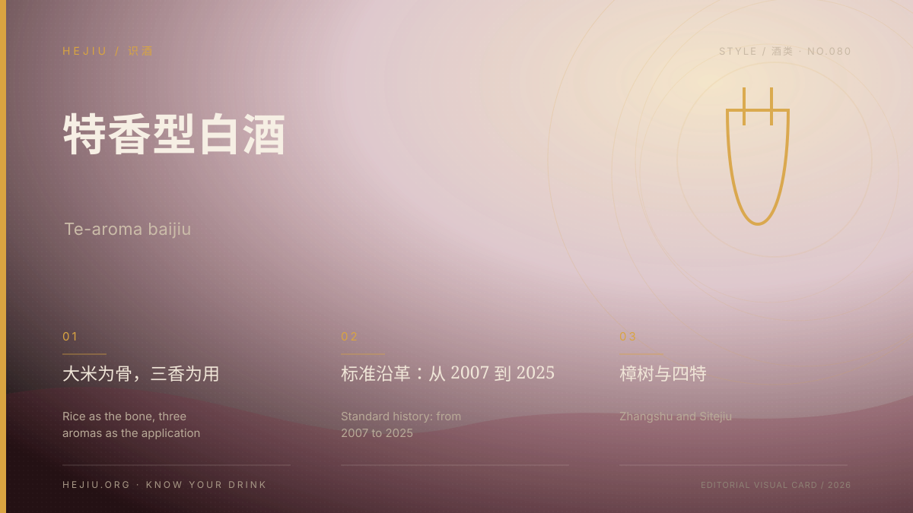

# 特香型白酒

特香型常被概括为“三香具备犹不靠”：有浓香的窖香、清香的净爽、酱香的焦香，却又不在任何一香里安身。这句话听起来玄，落到工艺上却很具体：大米为骨，面粉、麦麸和酒糟培制的大曲为魂，红褚条石窖池为床。三样东西凑在一起，才有了特香型的骨架。

图：特香型白酒 双语视觉卡（项目自绘 SVG）。不是实拍。

> **先给结论**
> **一句话：** 这页判断特香型白酒的风味位置，以及怎么选、怎么喝。
>
> - **适合谁：** 正在比较特香型白酒与其他风格、准备购买或点单的人。
> - **不适合谁：** 只想要“哪个最好”的排名、不接受口味差异的人。
> - **先看这两点：**
>   - 特香型的主体原料是大米，不是高粱。
>   - 特香型国家标准经历了三次版本。

## 大米为骨，三香为用

特香型的主体原料是大米，不是高粱。大米淀粉细腻、蛋白质与脂肪较少，发酵后酒体干净、绵甜，香气不靠高粱单宁的骨架支撑，而靠曲与窖的复合作用。这让它与以高粱为主的浓香、酱香、清香都拉开距离，也让它在南方稻作区有了原料基础。

“三香”不是添加三种香型的酒，而是同一套工艺产生的复合香气。入口有浓香的窖香与厚度，中段有清香的净爽，收口带酱香的焦糊与陈味。三者的比例随酒厂、轮次与年份变化，但“犹不靠”是底线：不能浓得像浓香，也不能酱得像酱香，否则就失去特香的独立性。

## 标准沿革：从 2007 到 2025

特香型国家标准经历了三次版本。GB/T 20823-2007 首次把特香型单独列标；GB/T 20823-2017 作了修订；现行标准是 GB/T 10781.7-2025《白酒质量要求 第7部分：特香型白酒》，2025 年 5 月 30 日发布，2025 年 12 月 1 日实施，全部代替 GB/T 20823-2017。

新标准把特香型白酒定义为：以大米为主要原料，以面粉、麦麸和酒糟培制的大曲为糖化发酵剂，经红褚条石窖池固态发酵，固态蒸馏、陈酿、勾调而成，不直接或间接添加食用酒精及非自身发酵产生的呈色呈香呈味物质的白酒。定义把“大米、面麸曲、红褚条石窖”三件事写死，这是理解特香型的关键。

## 樟树与四特

特香型的代表产区是江西樟树，核心企业是四特酒。四特酒位于樟树市，长期以特香型为旗号，并牵头组织起草 GB/T 10781.7-2025，参与单位还包括中国食品发酵工业研究院等。樟树地处赣江中游，气候温暖湿润，适合大米与曲料的微生物培养。

产区与品牌要分开看。四特酒是特香型的代表品牌，但特香型是一个香型类别，其他酒厂也可以按标准生产。把“特香型”等同于“四特”，会把品牌与香型混为一谈；反过来，把四特的所有产品都当成特香型，也不准确，企业产品线可能覆盖不同香型与等级。

## 整粒大米

特香型使用整粒大米，不粉碎或少粉碎。整粒米在蒸煮后保持颗粒完整，淀粉释放较慢，发酵更平稳，酒体更干净；粉碎过细则容易结块、升温过快，产生杂味。整粒米对蒸煮要求更高：要蒸到外熟内透、不夹生、不烂糊，才能让曲菌与酵母均匀作用。

与米香型相比，特香型同样以大米为主，但米香型使用小曲、半固态发酵，特香型使用大曲、固态发酵。与浓香型相比，特香型不用高粱做主料，窖香来自条石窖池与窖泥，而不是老泥窖的深厚窖泥。原料与曲种一换，风格就走到了另一条路上。

## 面麸曲

特香型的曲很特别：以面粉、麦麸和酒糟为原料培制大曲。面粉提供淀粉与蛋白质，麦麸增加透气性与表面积，酒糟带入发酵过的酸类与香味前体，三者共同培养出细菌、霉菌与酵母的复合群落。这种曲既不是纯小麦大曲，也不是纯麸曲，而是介于两者之间的“面麸曲”。

面麸曲的价值在香气。酒糟带来的酸度抑制杂菌，麦麸的疏松结构利于微生物生长，面粉提供持续的营养；成曲后既有大曲的酯化能力，又有麸曲的糖化效率。制曲温度、湿度、翻曲时机与曲房微生物，都会改变曲的酶活与香气，进而改变酒体的“三香”比例。

## 红褚条石窖

发酵容器是红褚条石窖池。红褚条石是丹霞地貌中的红色砂砾岩制成的条状石材，质地较硬、孔隙适中，砌成窖池后既能保水，又能让微量空气与微生物进入。石缝与窖底的窖泥是己酸菌等微生物的栖息地，为窖香提供来源。

这与浓香型的全泥窖、酱香型的石壁泥底窖、清香型的地缸都不同。全泥窖的窖泥面积大，窖香浓；石壁泥底窖兼顾透气与保水；地缸则隔离泥土，追求干净。红褚条石窖介于石与泥之间，窖香有但不压过米香，正好服务“三香具备犹不靠”的目标。

## 固态发酵、蒸馏、陈酿与勾调

发酵为固态，参见[发酵](ref:fermentation)。粮醅入窖后，靠曲与窖泥的微生物协同作用，糖化、发酵与生香同时进行；温度、水分与窖池养护决定发酵是否平稳。发酵周期与轮次随酒厂而变，没有全国统一的固定天数。

蒸馏为固态蒸馏，参见[蒸馏](ref:distillation)。甑桶蒸馏、分段摘酒，酒头、酒心、酒尾分开；酒心用于主体，酒头酒尾用于调味或回蒸。新酒经陶坛或不锈钢罐陈酿，让硫化物挥发、酒体柔和；勾调时用不同轮次、不同年份、不同窖池的原酒搭配，目标是把浓、清、酱三段调顺，而不是把某一香推到头。

## 关键参数

- 现行标准：GB/T 10781.7-2025，2025 年 12 月 1 日实施。
- 原料：大米为主要原料。
- 曲种：面粉、麦麸和酒糟培制的大曲。
- 发酵容器：红褚条石窖池。
- 工艺：固态发酵、固态蒸馏、陈酿、勾调。
- 酒精度：25.0%–68.0% vol。

这些参数来自国家标准，描述的是类别边界。酒精度、窖池年龄与曲的比例都不能单独代表质量；香气是否协调、酒体是否绵甜、回味是否干净，才是判断特香型的实际标准。

## 与米香、浓香、清香、酱香的边界

与米香型的区别，在曲与发酵方式。米香型用小曲、半固态发酵、釜式蒸馏，香气以乳酸乙酯、β-苯乙醇为主，清雅蜜香；特香型用面麸曲、固态发酵、红褚条石窖，香气更复合，带窖香与焦香。与浓香型的区别，在原料与窖池。浓香型以高粱为主、老泥窖、己酸乙酯突出；特香型以大米为主、条石窖，窖香有但不主导。

与清香型的区别，在曲与容器。清香型用低温大曲、地缸、清蒸清烧，乙酸乙酯为主，干净爽利；特香型用面麸曲、条石窖，香气更厚、更有层次。与酱香型的区别，在曲与轮次。酱香型用高温大曲、石壁泥底窖、多轮次发酵，酱香与焦糊香贯穿；特香型的酱感只在收口出现，主体仍是米香与窖香的平衡。

## 常见误解

第一，认为特香型是“浓清酱三香勾兑”。它是同一套工艺产生的复合香气，不是三种酒混合。第二，认为特香型就是米香型。两者都用大米，但曲、发酵方式与容器完全不同。第三，把四特等同于所有特香型。品牌与香型类别不是一回事。第四，认为大米只能做低度酒。特香型标准覆盖 25.0%–68.0% vol，高度酒同样常见。第五，把红褚条石窖当成普通石窖。红褚条石是丹霞地貌红色砂砾岩，孔隙与微生物条件不同。第六，认为面麸曲是低端曲。它是特香型定义的一部分，工艺价值在复合香气。

特香型的三香是风格描述，不是三种香型的拼配；大米、面麸曲与红褚条石窖共同构成它的工艺身份，不能只按香气命名，也不能用香气替代标准。

## 延伸阅读

- [白酒](ref:baijiu)：中国白酒的总体分类与工艺框架。
- [大米](ref:rice)与[小麦](ref:wheat)：特香型的主料与制曲原料。
- [制曲](ref:qu-making)：面麸曲的组成与作用。
- [发酵](ref:fermentation)：红褚条石窖池的固态发酵。
- [蒸馏](ref:distillation)：固态蒸馏与分段摘酒。

## 相关图像

图：大米。图片：China News Service，CC BY 3.0，via Wikimedia Commons（[原图页面](https://commons.wikimedia.org/wiki/File:20201102.Hengnan.Hybrid_rice_Sanyou-1.6.jpg)）。关联图像：特香型白酒。
