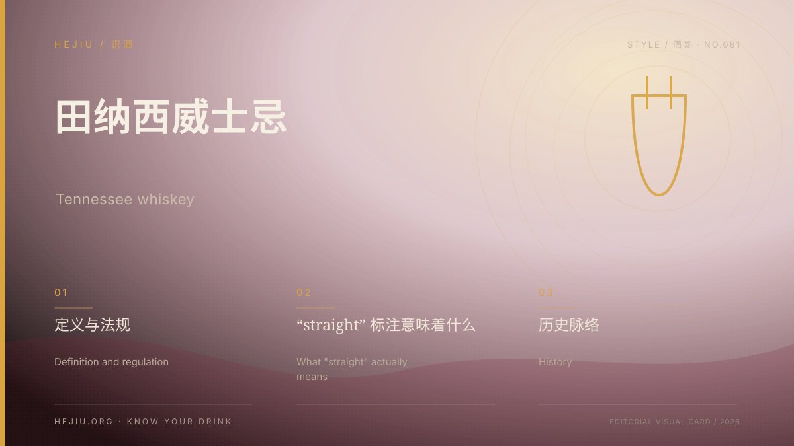
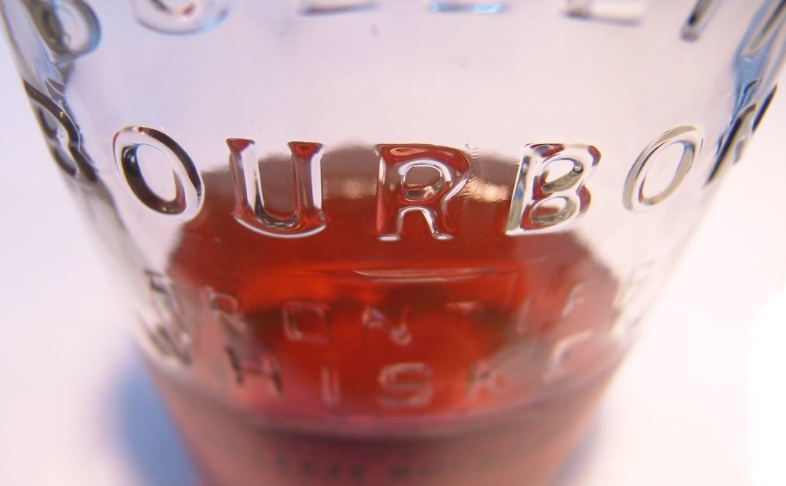

# 田纳西威士忌

田纳西威士忌常被当作“换了标签的波本”，这是对它最普遍也最省事的误解。它确实使用与波本相近的谷物配方和新烧焦橡木桶，但美国联邦标准为它单独设了一条产地要求，并要求新酒在入桶之前经糖枫木炭过滤。产地、过滤与陈年三件事叠在一起，才构成这个名称。

图：田纳西威士忌 双语视觉卡（项目自绘 SVG）。不是实拍。

> **先给结论**
> **一句话：** 这页判断田纳西威士忌的风味位置，以及怎么选、怎么喝。
>
> - **适合谁：** 正在比较田纳西威士忌与其他风格、准备购买或点单的人。
> - **不适合谁：** 只想要“哪个最好”的排名、不接受口味差异的人。
> - **先看这两点：**
>   - 用郁金香形杯纯饮，先闻香草、焦糖与香蕉，再找黑麦的辛香与桶底的椰子气息。
>   - 在美国联邦蒸馏酒标准中，田纳西威士忌是一个独立名称。

## 定义与法规

在美国联邦蒸馏酒标准中，田纳西威士忌是一个独立名称。它必须在美国田纳西州生产，发酵醪中玉米占比不低于 51%，蒸馏酒精度不超过 160 proof（80% vol），并且只能装入新的、经过烧焦的橡木桶陈年。与一般威士忌最不同的条款，是要求新酒在入桶前经过糖枫木炭过滤，也就是通常所说的林肯县工艺。

这套条件与[波本威士忌](ref:bourbon-whiskey)高度重叠：两者都以玉米为主、都使用新烧焦桶、都以 80% vol 作为蒸馏上限。差别集中在两点——生产地必须在田纳西州，以及必须完成木炭过滤。因此田纳西威士忌在法律上是与波本并列的名称，而不是波本的一个子类或营销别名。

## “straight” 标注意味着什么

酒标上的 straight 不是田纳西威士忌的同义词，而是一组更严格的陈年与配方条件。标为 straight 的威士忌必须在新的烧焦橡木桶中陈年至少两年，不得添加色素、香料或其他烈酒，也不得与其他威士忌混合。如果瓶中酒液不足四年，还必须标出具体酒龄。

一款产品可以同时是“straight”与“田纳西威士忌”，这时两套规则都要满足；也可以只是田纳西威士忌而没有 straight 标注。阅读标签时要把类别名称与陈年声明分开，不能因为看到 straight 就推断它一定来自田纳西，也不能因为它是田纳西威士忌就默认已经满足 straight 的全部条件。

## 历史脉络

田纳西中部的威士忌生产在 19 世纪随玉米种植、河流运输与石灰岩水源发展起来。Jack Daniel's 常以 1866 年注册为品牌起点，其早期历史与一位名叫 Nearest Green 的非裔蒸馏师密切相关；木炭过滤的技术传统也常被追溯到这一时期。George Dickel 则在 19 世纪后期于 Cascade Hollow 建立生产。

20 世纪初，田纳西州比联邦更早实施禁酒，许多酒厂被迫关闭，产业规模大幅收缩。禁酒令废除后，当地威士忌生产长期集中在少数品牌手中，直到近二十年才出现一批新的蒸馏厂。这段历史解释了为什么田纳西威士忌的品牌集中度很高，也解释了为什么“林肯县工艺”会成为全州共享的技术词汇，而不是某一家酒厂的专利。

## 原料与工艺

谷物配方以[玉米](ref:maize)为主体，常见比例在七成上下，辅以黑麦和发芽大麦。玉米带来甜润与饱满的酒体，黑麦提供辛香与骨架，发芽大麦则提供糖化所需的酶。原料经糖化、发酵后进入[蒸馏](ref:distillation)，多数酒厂使用柱式蒸馏器连续生产，再以较低强度切入酒心。

关键工序在蒸馏之后、入桶之前。新酒被缓慢地淋过一层厚厚的手工糖枫木炭，木炭由糖枫木烧制、堆叠并点燃炭化。酒液在穿过炭层时，部分油脂、硫化物与粗糙的香气被吸附，入口因此更干净、更柔顺。过滤完成后，酒液才进入新烧焦橡木桶开始[橡木桶陈年](ref:oak-ageing)。

## 分级与分类

田纳西威士忌没有像苏格兰那样的法定等级序列，市场上大致可以看到三层产品。第一层是基础款田纳西威士忌，强调品牌固定的风味轮廓；第二层是带 straight 标注的产品，陈年与配方受更严格约束；第三层是单桶、桶强或特殊桶型版本，强调批次差异与酒精度。

这些层级不是官方排名。基础款可能使用较大比例的调和原酒，单桶版本则可能来自某一桶或某一批次，两者的差异更多来自选桶与稀释策略，而不是“等级”高低。酒龄标注同样遵循最低酒龄原则：标 8 年的产品中不能含有不足 8 年的原酒，但可以含有更老的酒。

## 感官风格

典型的田纳西威士忌以香草、焦糖、烤玉米和香蕉类酯香开场，中段有椰子、奶油与轻微的黑麦辛香，收口偏甜，单宁与木味相对克制。木炭过滤削弱了部分尖锐的硫味与油脂感，使酒体在年轻时也显得圆润，这也是它常被描述为“顺口”的原因。

与波本相比，两者的风格差距往往小于品牌之间的差距。高玉米配方、新桶和温暖气候共同带来甜润与木质香气；过滤只改变一部分细节，并不会把酒变成另一种饮品。把田纳西威士忌想象成“完全没有辛香”的波本，会忽略黑麦与桶味仍然存在。

## 产区

产区限定在田纳西州全境，实际生产集中在纳什维尔以南的中部地带。Lynchburg 位于 Moore County，是 Jack Daniel's 的所在地；Cascade Hollow 位于 Coffee County，是 George Dickel 的所在地；近年纳什维尔市区及周边也出现了新的蒸馏厂。三地共享石灰岩地下水与四季分明的气候。

“林肯县工艺”得名于 Lincoln County，但并不意味着酒厂必须设在林肯县。它描述的是一套木炭过滤方法，而不是一个地理保护名称。把工艺名当成产地名，是阅读田纳西威士忌时常见的混淆。

## 代表产品

Jack Daniel's Old No. 7 是最广为人知的基础款，风格偏香草、香蕉与焦糖；Gentleman Jack 在陈年前后各经过一次木炭处理，入口更干净。George Dickel No. 12 以较高的玉米比例和明显的谷物甜感著称，风格比前者更厚。Uncle Nearest 1856 与 Nelson's Green Brier 则把注意力引向田纳西威士忌的非裔蒸馏传统与小批量生产。

这些产品代表不同的配方与选桶思路，而不是质量阶梯。同一品牌内部，桶强、单桶与常规款的差异往往比跨品牌的基础款差异更明显。

## 品鉴与饮用

用郁金香形杯纯饮，先闻香草、焦糖与香蕉，再找黑麦的辛香与桶底的椰子气息。加入几滴水可以打开香气，也能降低酒精的灼热感；一次加太多会稀释酒体。若用于调酒，Highball 能突出其甜润与气泡感，Old Fashioned 则放大桶味与苦精的对比。

加冰会压低香气释放，适合酒精度较高或风味较重的版本。无论纯饮还是调酒，都应控制饮用量；本页关于田纳西威士忌的内容涉及酒精饮料；过量饮酒有害健康，未成年人不应饮酒。

## 常见误区

第一，认为田纳西威士忌就是波本。它是联邦标准中的独立名称，多了田纳西产地与木炭过滤两项要求。第二，认为木炭过滤发生在装瓶前。规则要求的是入桶前过滤，过滤后的酒液仍要在新桶中陈年。第三，认为林肯县工艺必须在林肯县完成。工艺得名于该县，但生产可以分布在田纳西州其他县。第四，把 straight 当成田纳西威士忌的同义词。两者是两套可以叠加、也可以分开的规则。第五，认为木炭过滤会让酒变甜。过滤不添加糖，甜感来自玉米与橡木桶。第六，认为 Jack Daniel's 是波本。它在法律与市场上都以田纳西威士忌销售。

田纳西威士忌的糖枫木炭过滤是类别特征，但不是所有田纳西生产的威士忌都必须标注；Tennessee Whiskey 与 Bourbon 的法规边界要分开看。

## 延伸阅读

- [波本威士忌](ref:bourbon-whiskey)：与田纳西威士忌共享大部分谷物与桶规则，但产地与工艺要求不同。
- [蒸馏](ref:distillation)：理解柱式蒸馏与切酒如何塑造新酒。
- [橡木桶陈年](ref:oak-ageing)：新烧焦桶带来的香草、焦糖与木质风味。
- [玉米](ref:maize)：田纳西威士忌谷物配方的主体。
- [美国](ref:usa)：美国威士忌的地理与法规背景。

## 相关图像

图：一杯波本威士忌，杯壁压印 BOURBON FRONTIER WHISKEY，杯中为琥珀色酒液。图片：Markyboy81，CC BY 2.0，via Wikimedia Commons（[原图页面](https://www.flickr.com/photo.gne?id=1001040958)）。关联图像：田纳西威士忌。
