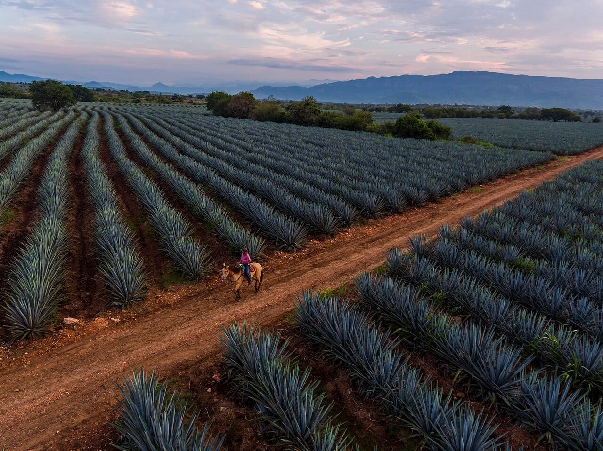
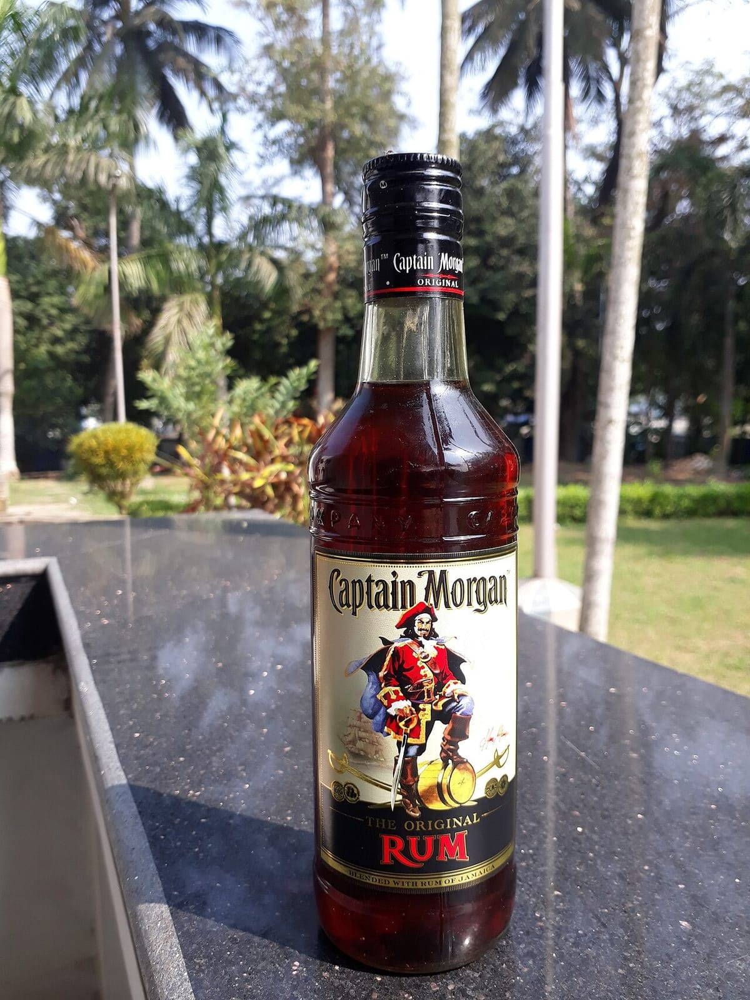

# 龙舌兰酒

龙舌兰酒（tequila）是以蓝色韦伯龙舌兰（Agave tequilana Weber var. azul）为原料、在墨西哥法定产区生产的蒸馏酒。它的风味来自龙舌兰心烘煮后的甜味与植物气息，工艺上则依赖蒸煮、压榨、发酵与[蒸馏](ref:distillation)四步。它和以其他龙舌兰为原料的梅斯卡尔（mezcal）属于不同类别。

图：龙舌兰酒。图片：T2O media México，CC BY-SA 4.0，via Wikimedia Commons（[原图页面](https://commons.wikimedia.org/wiki/File:Paisaje_agavero_de_Jose_Cuervo_en_Tequila,_Jalisco.jpg)）。

## 定义与法定框架

墨西哥官方标准 NOM-006-SCFI-2012 规定龙舌兰酒的原料、产区、类别、陈年与标签要求，由龙舌兰酒监管委员会（CRT）负责认证与监督。法定产区以哈利斯科州为主体，并包括瓜纳华托、米却肯、纳亚里特、塔毛利帕斯等州的指定区域。产品必须使用法定产区内种植的蓝色韦伯龙舌兰，并在规定区域内完成关键工序。

“龙舌兰酒”在部分国家被作为受保护的地理标志使用，因此不是所有以龙舌兰为原料的蒸馏酒都能这样标注。梅斯卡尔、索托尔（sotol）等是独立类别，原料与工艺不同。购买时应看是否有 CRT 认证信息与明确的类别标注。

## 龙舌兰植物与原料

蓝色韦伯龙舌兰是石蒜科植物，叶片含纤维与汁液，糖分集中在茎心（piña）。植株通常需要生长数年后才能收割，具体年限受气候与栽培方式影响。收割由“jimador”完成，去除叶片后得到龙舌兰心。

龙舌兰心的糖分以复杂果聚糖为主，必须经过蒸煮转化为可发酵糖。蒸煮方式影响风味：传统砖石坑（horno）带烟熏与泥土气息，现代高压蒸煮器（autoclave）更均匀、更干净。蒸煮后压榨或研磨取汁，再进行发酵。

## 「龙舌兰酒」的时间线
龙舌兰酒的现代形态与 19 世纪墨西哥的蒸馏技术、铁路与玻璃瓶工业相关。此前，中部高地的龙舌兰发酵饮料已有长期传统。20 世纪，龙舌兰酒在墨西哥国内与出口市场扩张，白色龙舌兰酒成为调酒基酒，陈年等级也逐渐标准化。

20 世纪后期，“100% 龙舌兰”与混合型的区分、产区保护与认证体系逐步完善。21 世纪，精品龙舌兰酒与高端陈年产品增长，消费者开始关注原料来源、蒸煮方式与是否添加糖或香精。与此同时，龙舌兰种植的生态压力与收割工人权益也成为产业讨论的一部分。

## 生产工艺

流程可以概括为：收割与去叶、蒸煮、压榨或研磨、发酵、蒸馏、陈年（可选）、调整酒精度与装瓶。发酵通常使用本土或商业酵母，时间从数十小时到数日不等。蒸馏多为两次，第一次得到低度酒液，第二次提高酒精度并做切割。

陈年使用橡木桶，参见[橡木桶陈年](ref:oak-ageing)。桶型、桶龄与陈年时间决定香草、焦糖与木质风味的强弱。部分产品会使用曾装过其他酒的桶，以增加复杂度。是否加糖、加焦糖色或香精，受标准约束，标签与认证信息是判断依据。

## 类别与陈年等级

- **Blanco / Plata**：未经陈年或短暂陈年，风味最直接，带植物、柑橘与胡椒感。
- **Joven**：字面意为“年轻”，通常指未经陈年或由不同批次调配的产品，不等于低质量。
- **Reposado**：橡木桶陈年至少两个月，口感更圆润，保留较多龙舌兰特征。
- **Añejo**：陈年至少一年，常见香草、焦糖与木质风味。
- **Extra Añejo**：陈年至少三年，风格更接近陈年烈酒，价格通常更高。

陈年等级是法定区间，不是精确年份。不同产品在同一等级内的实际陈年时间可能差别很大，标签上的“years”声明应以法规与认证为准。酒精度通常落在 35% 至 55% 之间，具体以标签为准，可参考[酒精度](ref:abv)的概念。

## 「龙舌兰酒」的闻与喝
白色龙舌兰酒的典型香气是熟龙舌兰的甜味、青椒、柑橘皮、胡椒与矿物感；口感偏直接，酒精感清晰。Reposado 会增加香草、肉桂与奶油感；Añejo 与 Extra Añejo 则向焦糖、干果、皮革与木质发展，龙舌兰本身的植物感相对后退。

品鉴时用小杯少量纯饮，先闻再小口含住，让酒液接触口腔两侧。加水或加冰会改变香气结构，适合用来比较不同批次。与传统“盐与青柠”的喝法相比，纯饮更能判断原料与工艺；盐与青柠更多是调制与社交场景的仪式，不是评价酒质的必要步骤。

## 「龙舌兰酒」的饮用与搭配
Blanco 适合纯饮或调制玛格丽特等鸡尾酒；Reposado 适合纯饮、加冰或用于需要圆润酒体的配方；Añejo 与 Extra Añejo 更适合纯饮。作为调酒基酒时，龙舌兰酒的植物感与柑橘搭配良好，但高酒精度会放大酸甜失衡。

餐食上，白色龙舌兰酒适合海鲜、酸味沙拉与墨西哥风味小食；陈年龙舌兰酒适合烤肉、黑巧克力与餐后甜点。与[朗姆酒](ref:rum)相比，龙舌兰酒更强调植物与矿物感，朗姆酒则更多呈现甘蔗甜味与陈年桶香。

## 「龙舌兰酒」容易被读错的地方
第一，认为所有龙舌兰酒都是“100% 龙舌兰”。混合型合法存在，区别在原料透明度。
第二，把龙舌兰酒与梅斯卡尔混为一谈。原料、工艺与法规类别都不同。
第三，认为陈年越久越好。陈年会改变风格，但未必保留龙舌兰本身的鲜明度。
第四，把盐与青柠当作品鉴标准。那是特定喝法，不是质量判断。
第五，忽视产区与认证。地理标志与 CRT 认证决定了产品能否使用“tequila”名称。

对照阅读：[蒸馏](ref:distillation)、[朗姆酒](ref:rum)。

**来源与边界。** 本页关于「龙舌兰酒」的关键事实，主要由以下来源交叉核对：Consejo Regulador del Tequila（龙舌兰酒的法定产区、原料、类别与陈年等级）、Secretaría de Economía, Mexico（NOM-006-SCFI-2012 的官方发布机构与监管框架）、Oxford University Press（提供关于龙舌兰蒸馏、梅斯卡尔与龙舌兰酒历史的条目）等 4 条来源。价格、批次与状态会变，涉及这些字段时以页面所列来源的最新版本为准。正文为项目自写，来源只作核验，不复制原文。

**并读。** 把「龙舌兰酒」与「蒸馏」、「橡木桶陈酿」、「朗姆酒」放在一起读时，先确认它们是同一层级还是上下游关系：先确认定义与工艺，再比较原料、产区与代表品牌。本页负责给出酒类风格的基本坐标，对照条目补上具体案例与差异；读完再回到本页，才能分清哪些差别属于酒类风格本身，哪些只是产地、批次或品牌选择。

## 参考资料
- [蒸馏](ref:distillation)：两次蒸馏与切割决定龙舌兰酒的香气走向。
- [橡木桶陈年](ref:oak-ageing)：Reposado 与 Añejo 风格差异的主要来源。
- [朗姆酒](ref:rum)：另一种以热带作物为原料的蒸馏酒，可对照其甜味与陈年风格。
- [酒精度](ref:abv)：理解标签上 ABV 标注的基础概念。

## 相关图像

图：一瓶 Captain Morgan 原味朗姆酒，深色酒液与品牌标签。图片：Pinakpani，CC BY-SA 4.0，via Wikimedia Commons（[原图页面](https://commons.wikimedia.org/wiki/File:Bottle_of_Captain_Morgan_Rum_01.jpg)）。关联图像：龙舌兰酒。
