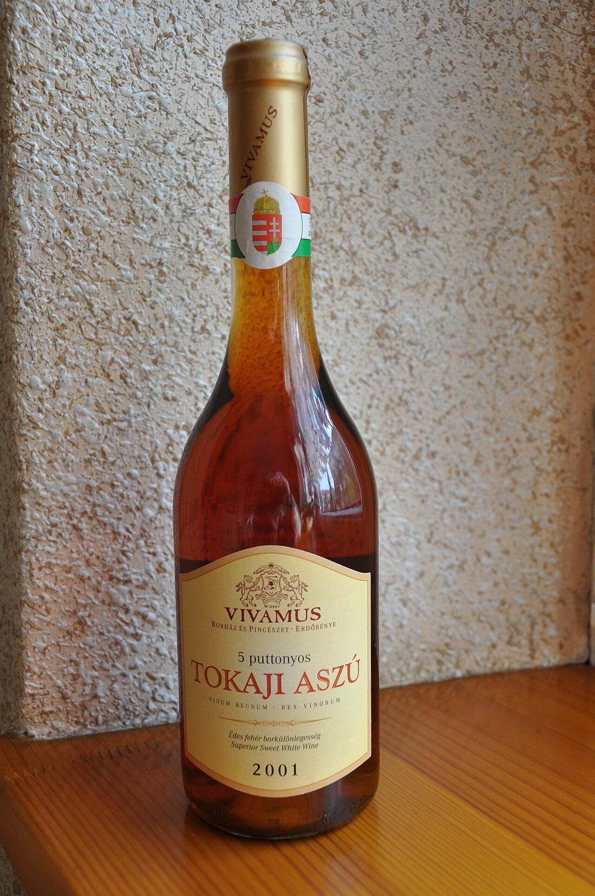
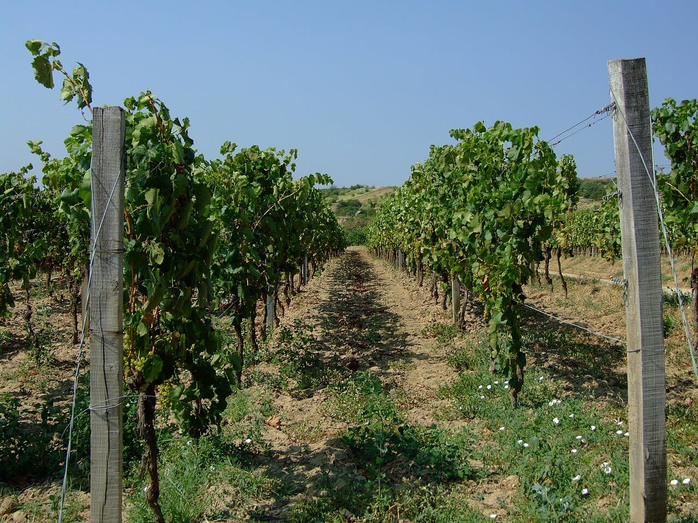

# 托卡伊

托卡伊（Tokaji）是匈牙利东北部[托卡伊产区](ref:tokaj)出产的甜型[葡萄酒](ref:wine)，也是世界上最早把贵腐甜酒写成制度的酒种之一。它的核心是 Aszú：手工挑选被贵腐菌感染的葡萄，浸入同一年份的基酒或正在发酵的葡萄汁中，经过数月浸渍与至少十八个月的木桶陈年，得到蜂蜜、杏脯与柑橘皮交织的甜酒。它的甜不是简单的糖水，而是由高酸托举起来的浓缩果味。

图：一瓶 Vivamus 5 puttonyos Tokaji Aszú，标签标着 2001 与 5 puttonyos。图片：Beemwej，CC BY-SA 3.0，via [原图页面](https://commons.wikimedia.org/wiki/File:Tokaji_Aszu.JPG)。

## 一套源自甜度的等级语言

在很长一段时间里，托卡伊用 puttonyos（普托尼）表示甜度。puttony 原是采收时使用的容器，传统上约装 25 公斤贵腐葡萄；把几桶这样的葡萄加入一只约 136 升的基酒桶，就得到几个 puttonyos 的酒。数字越大，贵腐葡萄的比例越高，酒越甜。这套语言直观，却依赖容器与地方习惯，不同酒庄之间很难精确比较。

## Aszú 是怎么做成的

Aszú 的生产分两段。第一段是正常采收健康葡萄，压榨、发酵得到基酒。第二段要等贵腐葡萄达到理想状态，由工人逐粒挑选，放进基酒或仍在发酵的葡萄汁中浸渍。浸渍时间从一天到数天不等，期间酒精与糖分从果皮进入酒液，随后压榨、发酵、陈年。

贵腐菌的作用在这里至关重要。它让葡萄果皮变薄、水分蒸发、糖与酸浓缩，并产生甘油与特殊香气物质。没有[贵腐](ref:noble-rot)，就没有 Aszú 的蜂蜜与杏脯，只剩普通晚收的果味。基酒可以是干型，也可以保留少量糖分；基酒的酸度与酒精度，会直接影响最终酒体的轻重。

## puttonyos 退场，2013 年之后

从 2013 年份开始，匈牙利修改了规则：所有 Aszú 的最低天然[残糖](ref:residual-sugar)统一为 120 克/升，3 个与 4 个 puttonyos 的类别被取消，Aszúeszencia 也不再作为独立类别。5 个与 6 个 puttonyos 仍可作为自愿标注，但必须分别达到 120 克/升与 150 克/升的糖度门槛，且需要符合相应的陈年要求。

这意味着今天买到的托卡伊，酒标上可能只写 Aszú 与残糖数值，也可能保留传统的 puttonyos 数字。两者不是新旧优劣之分，而是同一制度在不同时期留下的表达方式。读标时应以残糖与年份为准，而不是只看数字大小。

## Furmint 与 Hárslevelű 的分工

[富尔民特](ref:furmint)是托卡伊的主力品种，晚熟、皮厚、酸度高，容易感染贵腐菌，也能酿出结构紧实的干白。它提供柑橘、青苹果、烟熏与矿物感，是 Aszú 的骨架。Hárslevelű 带来花香、蜂蜜与更柔和的质地；Sárgamuskotály（小粒麝香）则贡献葡萄与花朵的香气。三者常混酿，比例由酒庄与年份决定。

品种之外，贵腐葡萄的比例、浸渍时间、基酒风格与木桶大小都会改变成品。托卡伊不是一种固定口味，而是一套可以调整的配方。

## 从 Eszencia 到 Szamorodni

托卡伊的甜度光谱很宽。Eszcencia 是最高端的一档，贵腐葡萄在不加压的情况下自流出的汁液，残糖至少 450 克/升，酒精极低，通常以小杯慢饮。Aszú 是核心产品，从 120 克/升起。Szamorodni 则是把贵腐葡萄与健康葡萄一起采收、一起酿造，甜型版本残糖至少 45 克/升，干型版本则发酵至干。Fordítás 与 Máslás 是两种较少见的做法，前者用基酒浸泡压榨后的贵腐葡萄渣，后者用 Aszú 或 Szamorodni 的酒泥加基酒。

这套分类说明：托卡伊不是一个单一名词，而是一整个以贵腐葡萄为核心的家族。它属于[甜酒](ref:dessert-wine)的大类，但工艺路径与苏玳、冰酒都不同，甜度之外还有浸渍与陈年带来的质地差异。这也是托卡伊与苏玳最容易被混淆的地方。

## 雾、河与火山土

托卡伊位于葡萄种植的北界，气候相对凉爽，年均气温约 9–10°C。博德罗格河与蒂萨河在秋季带来晨雾，雾气让贵腐菌在葡萄园中均匀发展，午后阳光又让果皮干燥，抑制有害霉菌。这是贵腐酒得以稳定生产的微气候条件。

土壤以火山岩为主，安山岩、流纹岩与凝灰岩风化后形成多种土质，夹杂黄土与河积物。火山土排水好、矿物感强，配合河流带来的湿度，形成托卡伊特有的香气轮廓。产区被划分为多个村庄与地块，Puttonyos 时代的等级也常与地块位置有关。

## 陈年、温度与配餐

Aszú 至少需要十八个月的木桶陈年，许多酒庄会陈放更久。新桶带来香草与烘烤感，旧桶则让果味与矿物更清晰。装瓶后的托卡伊可以陈年数十年，酸度与糖分让它比多数甜酒更耐放。陈年过程中，酒色会从浅金走向琥珀，香气从新鲜杏子转向果干、蜂蜜与茶。

饮用温度建议 10–12°C，年份较老的酒可以到 14°C。小号郁金香杯即可。配餐上，鹅肝、蓝纹奶酪、杏子甜点、坚果塔都是经典组合；也可以搭配带甜味的亚洲菜肴，例如蜜汁烤肉或微辣的咖喱。本页关于托卡伊的内容涉及酒精饮料；过量饮酒有害健康，未成年人不应饮酒。

## 读标的顺序

先看是不是 Aszú，再看残糖，然后看年份与酒庄。标着 "Tokaji" 但未写 Aszú 的酒，可能只是干白或晚收。标着 5 puttonyos 的酒，如果残糖没有达到 120 克/升，则不符合现行规则。标着 Eszencia 的酒，残糖应达到 450 克/升以上。理解这些门槛，比记住品牌更能避免买错；同一酒庄的不同年份，差异往往比品牌之间更大。

对照阅读：[富尔民特](ref:furmint)、[贵腐（noble rot）](ref:noble-rot)。

**关键事实。**

| 项目 | 内容 |
| --- | --- |
| 一句话定位 | 匈牙利托卡伊产区的贵腐甜酒体系，以 Aszú 为核心；2013 年起改用残糖克/升标注，Furmint 与 Hárslevelű 提供高酸骨架，风格从 Eszencia 到 Szamorodni 层层展开 |
| 上位风格 | 甜酒 |
| 香气家族 | 蜂蜜/杏脯/贵腐 |

**来源与边界。** 本页关于「托卡伊」的关键事实，主要由以下来源交叉核对：Wines of Tokaj（Aszú、Eszcencia、Szamorodni 等类别的残糖与陈年要求）、Wines of Hungary（托卡伊的历史、风土、品种与产区范围）、European Union（受保护原产地名称与葡萄酒标签框架）等 4 条来源。价格、批次与状态会变，涉及这些字段时以页面所列来源的最新版本为准。正文为项目自写，来源只作核验，不复制原文。

**并读。** 把「托卡伊」与「富尔民特」、「托卡伊」、「贵腐（noble rot）」放在一起读时，先确认它们是同一层级还是上下游关系：先确认定义与工艺，再比较原料、产区与代表品牌。本页负责给出酒类风格的基本坐标，对照条目补上具体案例与差异；读完再回到本页，才能分清哪些差别属于酒类风格本身，哪些只是产地、批次或品牌选择。

## 相关图像

图：Tokaj vineyard。图片：Jerzy Kociatkiewicz from Colchester, United Kingdom，CC BY-SA 2.0，via Wikimedia Commons（[原图页面](https://commons.wikimedia.org/w/index.php?curid=4591613)）。关联图像：托卡伊。
