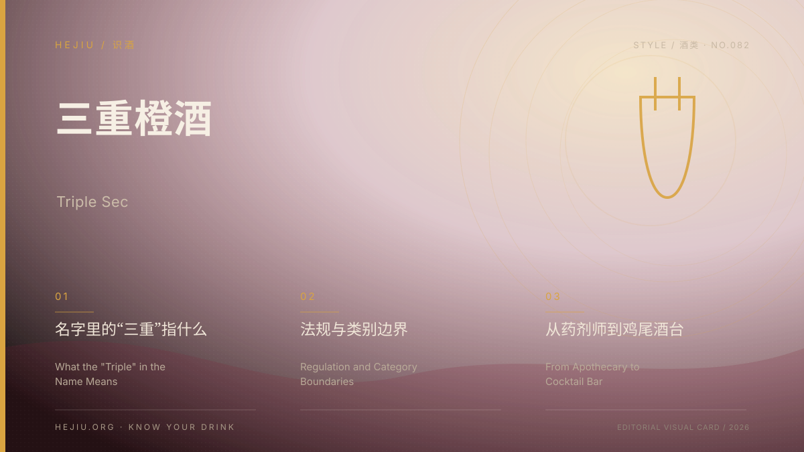

# 三重橙酒

三重橙酒（triple sec）是以中性烈酒浸提甜橙和苦橙的干燥果皮、再经蒸馏与加糖制成的清澈橙味利口酒。它不是一个受保护的商标，也不是单一品牌，而是一类在 19 世纪法国形成、后来被鸡尾酒文化推向全球的风格。判断一瓶酒是不是三重橙，关键不在名字，而在它是否以橙皮为主要香气来源、是否为无色或近无色的利口酒结构，以及甜度与酒精度落在什么区间。

图：三重橙酒 双语视觉卡（项目自绘 SVG）。不是实拍。

## 名字里的“三重”指什么

“triple sec”一半是法语、一半是英语式的拼读：sec 在法语里是“干”，指它比当时的橙味甜酒更少糖；triple 则被解释为“三重”。最常见的三种说法是三次蒸馏、三倍橙皮用量、以及三种橙皮原料。三种说法都能在品牌史里找到影子，却没有一个被法规固定为定义。君度在官方说明里把“三重”讲成风味浓度是当时同类产品的三倍、甜度却更低，这提醒我们：名字是营销史的一部分，不是化学公式。

因此，看到“triple sec”不应自动联想到“非常干”。它仍然是甜酒，只是相对库拉索一类的橙味利口酒更清爽、更强调橙皮的精油感。真正决定风格的，是原料比例、蒸馏方式和加糖量。

## 法规与类别边界

在欧盟烈酒法规中，三重橙属于[利口酒](ref:liqueur)大类：最低酒精度 15% vol，含糖量至少 100 克/升。法规没有为“triple sec”单列定义，也没有给它地理标志，所以不同国家的产品可以在 15% 到 40% 以上的酒精度之间摆动。君度常见装瓶为 40% vol，一些超市品牌则靠近 20% 到 30% 区间。糖分同样跨度很大，从一百多克/升到三百克/升都可能出现。

这条边界很重要：三重橙不是橙味伏特加，也不是橙汁加酒精。它需要从橙皮中取得香气，通常还要经过蒸馏，让酒体清澈、香气集中。它和库拉索的区别也不是“一个高级、一个低级”：库拉索可以用朗姆或白兰地作基酒，允许明显着色，风味可以从干到甜；三重橙通常用中性酒精、保持无色、风格更直接。

## 从药剂师到鸡尾酒台

法国卢瓦尔河谷的索米尔町常被写进三重橙的起源故事。孔比耶家族在 1834 年制作出以干橙皮浸提的透明橙味利口酒，并把它称为最早的三重橙之一。安茹的君度酒庄成立于 1849 年，1885 年推出后来广为人知的君度橙酒。两者都把“干橙皮 + 中性酒精 + 糖”的结构固定下来，也把法国西部变成了橙味利口酒的技术中心。

19 世纪末，这类酒进入巴黎的咖啡馆和英美调酒书；20 世纪，玛格丽特、边车、白色佳人、大都会等配方让三重橙从餐后甜酒变成了调酒台的“结构件”。它提供的不是单纯的甜味，而是柑橘香气、酒体与一丝苦味，能把酸味与烈酒连接起来。

## 橙皮、酒精与糖的三段式

原料通常混合甜橙皮与苦橙皮。甜橙提供圆润的果香，苦橙提供精油感和轻微苦味；有些配方还会加入橙花水或少量其他柑橘皮。果皮先在中性酒精中浸泡，让精油、色素与香气物质溶出，再把浸提液送入壶式蒸馏器。蒸馏时弃去头段与尾段，只取中段，得到更干净、更集中的橙香。之后加糖浆、加水调整酒精度、过滤并静置。

[蒸馏](ref:distillation)在这里不是为了提高酒精度，而是为了把橙皮香气从固体原料中“搬”进酒液，同时去掉粗糙的植物味。加糖则决定了入口的圆润度与尾段的长度；糖太少会显得尖，糖太多会盖住苦橙的细节。部分低价产品改用香精直接调配，成本更低，但香气的层次和留香通常不同。

## 闻香与入口：清橙的层次

优质三重橙通常无色透明，或带极浅的稻草黄。闻香以橙皮精油为主，前端是新鲜橙皮的亮度，中段出现橙花、蜜饯与轻微树脂感，苦橙则把香气往干燥、微苦的方向拉。入口先甜，随后是酒精带来的温热，酸度不高，尾段常有一点点苦和柑橘皮的油润感。

温度会明显改变表现：室温下香气打开，但酒精感也更明显；轻微冷藏后口感更紧致，适合纯饮或加冰。评价时不必追求“越甜越好”，而应看橙香是否像真实的果皮、苦味是否有支撑、甜度与酒精是否彼此平衡。[残糖](ref:residual-sugar)的高低只说明风格，不直接说明质量。

## 法国、意大利与荷兰的牌子

法国的君度与孔比耶是两种典型：前者以橙皮混合与高酒精度见长，后者更强调索米尔的历史与手工小批量。意大利的卢卡多 Triplum 把三重橙做得更浓郁，常出现在意式调酒与甜点中。荷兰的波士、德凯珀，以及法国的玛丽·布里扎尔，则提供了更易买到、价格更亲民的版本。Grand Marnier 虽然常被放在同一货架，但它以干邑为基酒，严格说是橙味干邑利口酒，而不是典型三重橙。

选购时可以先看酒精度与配料表：40% 左右的产品通常香气更集中，适合调酒；20% 到 30% 的产品更柔顺，纯饮或加苏打水更轻松。颜色不是判断标准，无色不代表没有橙皮，有色也不代表更好。

## 怎么喝，以及它和库拉索的分界

三重橙最常出现在[玛格丽特](ref:margarita)里：龙舌兰、青柠汁与橙味利口酒构成酸、烈、甜的三脚架。边车用干邑替换龙舌兰，大都会用伏特加与蔓越莓汁，白色佳人则把它与金酒、柠檬汁组合。纯饮时用小杯、轻微冷藏，或加一块大冰；加苏打水可以拉长饮用时间，但会稀释香气。

它与库拉索的分界可以记成三句话：三重橙通常无色、以中性酒精为基、风格更干；库拉索允许着色、可用朗姆或白兰地作基酒、风味跨度更大；两者在配方中经常可以互换，但互换后甜度、颜色与酒体都会变化。把三重橙当作“橙味糖浆”会低估它的酒精度，也容易让配方失衡。

## 选购与保存

购买时优先选择标注“triple sec”或“orange liqueur”且列出橙皮原料的产品，注意酒精度、糖分与是否人工着色。开瓶后避免高温和直射光，拧紧瓶盖、放在阴凉处即可；高酒精版本可以保存数年，低酒精版本建议在一年内用完。

补充阅读：[修道院啤酒](ref:c-extra-1)。

相关条目：[利口酒](ref:liqueur)、[蒸馏](ref:distillation)、[玛格丽特](ref:margarita)。
