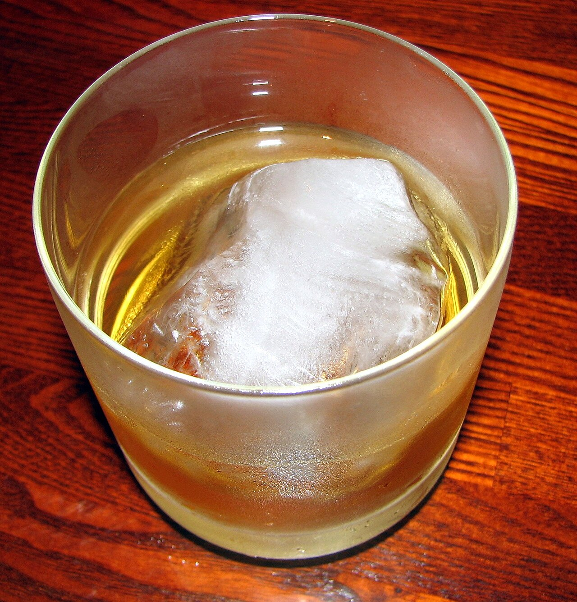
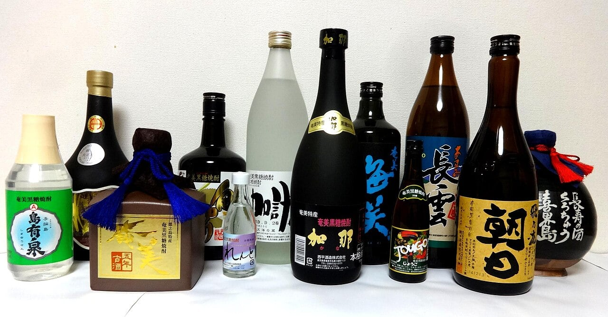

# 梅酒

梅酒（umeshu）是把青梅、糖与酒一起放进容器浸渍而成的[日本](ref:japan)甜味利口酒。它不经过发酵，酒精来自基酒，梅子负责酸度、香气与颜色，糖则把酸味托住。成品通常呈浅金色到琥珀色，酒精度在 10% 到 15% 之间，入口甜酸，带明显的杏仁与蜂蜜气息。它与“梅子发酵酒”不是一回事，也不是简单的梅子泡酒。

图：梅酒。图片：Wikimedia Commons contributor，CC BY-SA 3.0，via Wikimedia Commons（[原图页面](https://commons.wikimedia.org/wiki/File:Umeshu_on_the_rocks.jpg)）。

## 梅、糖与酒的三件事

梅酒的三件核心原料是梅、糖和酒。梅是蔷薇科李属植物，酿酒用的是未成熟青果。糖通常是冰糖或白砂糖，负责甜度与渗透压；酒可以是烧酒、白兰地、伏特加或中性酒精，负责把梅子的香气与酸味提取出来。

因为不发酵，梅酒的香气更接近“新鲜果实 + 糖”，而不是酵母的发酵味。它属于[利口酒](ref:liqueur)大类，在日本酒税法中也被归入リキュール；这解释了它为何甜度高、酒精度中等，却不像清酒那样需要低温冷藏。

## 酒税法与“本格梅酒”

日本酒税法把リキュール定义为以酒类与糖类等为原料、浸出物在 2 度以上的酒类。梅酒落在这个类别里，但“梅酒”这个名字本身并不要求原料只有梅、糖、酒；市面上有些梅酒可以加入酸味料、香料、着色料，甚至用其他果汁调配。

“本格梅酒”是更严格的自主标示。日本洋酒酒造组合的基准规定：只有以梅、糖类和酒类为原料，且不使用酸味料、着色料、香料的产品，才可以标“本格梅酒”。这套基准在 2015 年正式实施，属于行业自主标准，而不是酒税法本身。购买时看到“本格梅酒”，意味着配料表更接近传统做法；“梅酒”则可能包含添加物。

## 从《本朝食鉴》到家庭玻璃罐

日本文献中最早的梅酒制作记载之一出现在 1697 年的《本朝食鉴》。江户时代糖是贵重品，梅酒因此更像节庆或药用的饮品，而不是日常饮料。近代家庭用玻璃罐浸泡梅酒成为夏季习惯：青梅上市，买回冰糖与烧酒，放在阴凉处，秋天或冬天开封。

商业化生产在 20 世纪逐渐成形。CHOYA 在 1914 年以葡萄种植起家，1959 年开始生产梅酒，把家庭自制饮品变成全国商品。此后，梅酒进入酒吧、餐厅与出口市场，也出现了以白兰地、清酒或蜂蜜为基酒的变体。

## 青梅、冰糖与基酒

传统做法在梅雨季节前后采购青梅，挑选果皮完整、没有伤痕的果实。青梅先去掉果蒂、洗净、晾干，再与冰糖分层放入玻璃罐；糖与梅交替铺放，最后倒入基酒，确保梅子完全浸没。常见比例是梅、糖、酒大致等量，糖可按口味减少。

基酒的选择直接影响风格。35% 左右的白酒提取力强、保存稳定；20% 的烧酒更柔和，成品酒精度更低，适合尽早饮用。也有人用白兰地增添香草与橡木气息，或用清酒做更清淡的版本。浸泡时间从三个月到一年不等，越久颜色越深、酸味越圆。

## 浸出而不是发酵

梅酒的制作是浸出（maceration），不是发酵。糖在梅子表面形成高渗透压，把果汁、有机酸与香气物质“抽”进酒液；酒精则溶解果皮中的芳香化合物。整个过程没有酵母把糖转化成酒精，因此酒精度不会上升，甜度也不会下降。

梅子的特征香气来自苯甲醛等化合物，闻起来像杏仁、樱桃核或杏仁糖。酸味主要来自柠檬酸与苹果酸，糖则平衡酸度、增加黏稠感。浸泡完成后，生产者会过滤掉果肉，必要时进行澄清或低温静置；部分产品会保留少量果肉，让酒液更浑浊、更有“手工感”。[残糖](ref:residual-sugar)的高低，是梅酒风格最直接的指标之一。

## 甜酸与杏仁香

梅酒通常呈浅金到深琥珀色，清澈或轻微浑浊。闻香是青梅、杏仁、蜂蜜与白花；入口先甜，随后酸度上来把甜味切开，尾段带轻微的苦与酒精的温热。好的梅酒在甜、酸、酒精之间有一条清楚的线。

温度会改变它的表现。冰镇后甜感收敛、酸度更利落；室温下香气更展开，但甜味更重；加热水则让杏仁与蜂蜜气息上扬。评价时看三点：梅香是否像真实果实、酸度是否有支撑、甜度是否盖住酒精。

## 和歌山、大阪与品牌

和歌山县是日本最重要的梅产地，南高梅以果大、皮薄、香气浓著称，常被用作高价梅酒的原料。大阪是 CHOYA 的根据地与出口中心；长野、群马、山梨则有小型生产商，强调本地梅与手工浸泡。

品牌方面，CHOYA 是最广为人知的名字，Suntory、Takara、Ozeki、Nakano 等也提供不同价位与甜度的产品。选购时可以看“本格梅酒”字样、原料表与梅的产地；若酒标强调“完熟梅”“南高梅”“长期熟成”，通常意味着更浓的果香与更高的价格。

## 加冰、苏打与热水

梅酒最日常的喝法是加冰，或与苏打水按一份梅酒、两份苏打混合，做成梅酒苏打。冬天可以兑热水，夏天可以加冰块、薄荷与柠檬片。它也可以作为鸡尾酒基酒，与琴酒、伏特加或起泡酒搭配，或淋在香草冰淇淋上。

配餐时，梅酒的酸度适合油炸食物、烤肉、奶酪与日式甜点。它也能配寿司、天妇罗与炸鸡，但甜度高的版本不适合生鱼片。饮用时用小杯或高球杯，重点是酸甜平衡。

## 与梅子酒、梅酒风味酒的区别

中文语境里的“梅子酒”有时指以葡萄或其他水果酒为基底的梅味酒，也可能指梅子发酵酒；日本梅酒则是浸出型利口酒。另一个混淆是“梅酒风味饮料”：酒精度可能很低甚至为零，靠香精与糖模拟，不能与“本格梅酒”相提并论。

与[烧酒](ref:shochu)的关系也值得说明：烧酒是蒸馏酒，梅酒可以用烧酒作基酒，但梅酒本身是加糖浸出的利口酒。把梅酒当作“梅子烧酒”，会低估它的糖分与甜味，也会误判它的饮用方式。

## 选购与保存

购买时优先看“本格梅酒”与配料表：只有梅、糖类、酒类的产品更接近传统；若出现酸味料、香料、着色料，说明它属于普通梅酒。再看酒精度与糖分，10% 到 15% 是常见区间，甜度则从清爽到浓稠都有。梅的产地与品种能提示香气方向，南高梅通常更饱满、更杏仁感。

开瓶后建议冷藏，尤其是低酒精度或加果肉的产品；高酒精、高糖版本可常温避光保存，但风味仍会变平。自制要用食用级容器、避光，并确保梅子浸没；若酒液出现异味、浑浊异常或瓶盖鼓起，不要饮用。

补充阅读：[修道院啤酒](ref:c-extra-1)。

相关条目：[利口酒](ref:liqueur)、[日本烧酒](ref:shochu)、[残糖（residual sugar）](ref:residual-sugar)。

## 相关图像

图：奄美黑糖烧酒（kokuto shochu）的瓶装样品，是日本烧酒的一个产地类型。图片：Hhaithait，CC BY-SA 4.0，via Wikimedia Commons（[原图页面](https://commons.wikimedia.org/wiki/File:Bottled_amami_kokuto_shochu.jpg)）。关联图像：梅酒。
