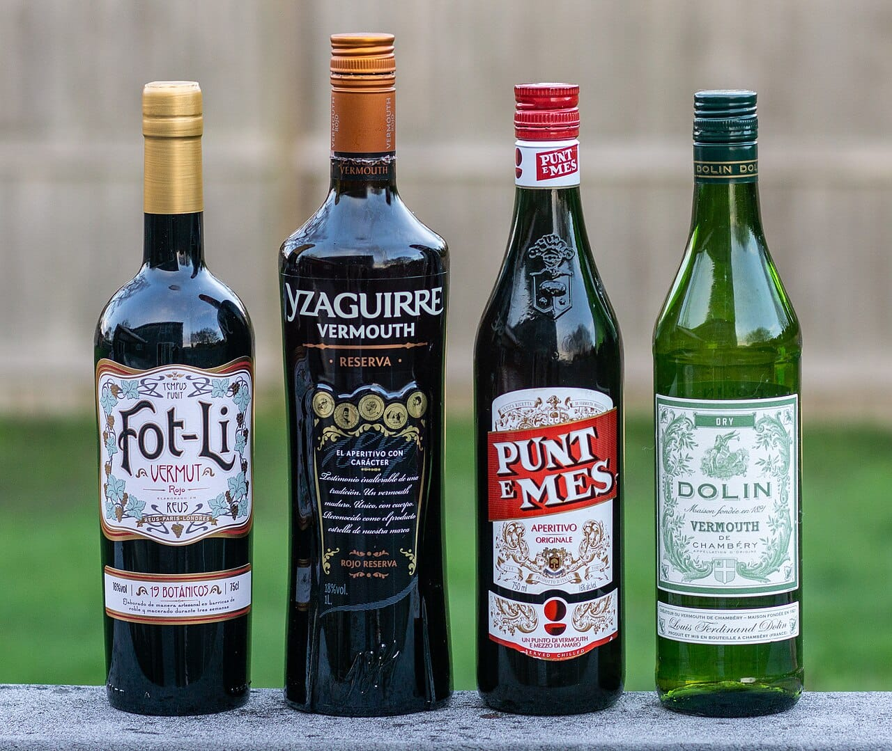
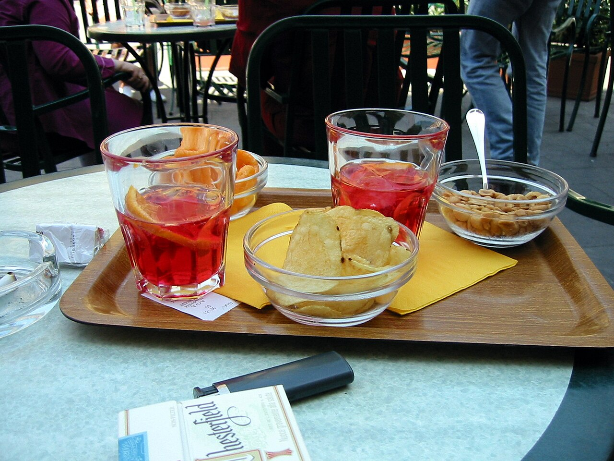

# 味美思

味美思是一种加香葡萄酒：以葡萄酒为基酒，加入苦艾、丁香、肉桂、柑橘皮等草本与香料，按产品类型加强并调整糖分。它既有葡萄酒的酸度与果味，又有烈酒般的苦味与香气，因此既能纯饮，也能作为鸡尾酒的配料。与普通[加强葡萄酒](ref:fortified-wine)相比，它的核心不是提高酒精度，而是用植物重新塑造香气结构。

图：味美思。图片：Kenneth C. Zirkel，CC BY-SA 4.0，via Wikimedia Commons（[原图页面](https://commons.wikimedia.org/wiki/File:Four_bottles_of_vermouth.jpg)）。

## 定义边界：什么算味美思

欧盟把味美思归入“加香葡萄酒产品”（aromatised wine products）。法规要求以葡萄酒为基酒，并用苦艾（Artemisia）等植物形成特征风味；实际酒精度须不低于 14.5% 且低于 22%，总酒精度不低于 17.5%。它不是“泡了草药的葡萄酒”这种模糊说法可以覆盖的家酿，而是有类别、酒精度与标签规则的加工酒。

不算味美思的产品包括：以中性酒精为基酒、只加香料与糖的利口酒；以葡萄酒为基酒但不用苦艾形成特征的普通加香酒；以及苦艾风味烈酒（absinthe）。它们可能颜色相近、中文译名相近，但类别完全不同。

## 基酒与加强

味美思的基酒通常是中性白葡萄酒：酸度足、香气不过分突出、酒体中等，便于草本配方发挥。基酒经过澄清与稳定处理，再与酒精、糖浆和草本浸提液调配。加强既提高酒精度，也提高稳定性，让酒液在开瓶后比普通葡萄酒更耐氧化，但并不能让它“永不坏”。

加强方式与比例因产品而异。干型产品通常糖分较少；红型产品糖分更高、酒体更重，以承载更重的苦味与香料。加强不是味美思的定义性步骤，苦艾加香才是；这一点在比较不同国家的产品时尤其重要。

## 草本配方的机制

味美思的苦味来自苦艾、龙胆、金鸡纳等植物，而不是人工苦精。香气则来自柑橘皮、芫荽籽、丁香、肉豆蔻、香草、藏红花等。生产方法大致有两类：把草本直接浸入酒液或酒精中提取，或先蒸馏草本再与传统酒液调配；多数产品会兼用两种方法。

配方的差异往往比产地差异更明显。同一产区的一家酒厂可以把红味美思做得偏苦、偏甜或偏香草；另一家则可能更强调柑橘与花香。配方是商业机密，酒标通常只给风格与酒精度，不给完整草本表。

## 干型、白型与红型

干型味美思（dry / extra dry）颜色浅、糖分低，带苦味、柑橘、草本与轻微的咸感，适合冰镇纯饮或调制干马天尼。白味美思（bianco）颜色金黄，香气更圆润，甜度中等，常加冰与苏打水。红味美思（rosso）颜色深，带焦糖、香草、香料与苦味，是意大利餐前酒与鸡尾酒的常见基酒。

此外还有琥珀色、玫瑰色与“苦味加香酒”等地方风格。把味美思当成一个单一品类来讨论，会忽略干型与红型在配方、糖分与用途上的巨大差异：干型更接近“带苦味的葡萄酒”，红型更接近“低酒精的香料利口酒”。

## 产区与传统

意大利都灵与法国香贝里是最常被提到的两个传统中心。都灵以红味美思和苦味风格著称，香贝里以干型、清爽的白味美思著称。两地的产品都受到地理标志或传统名称的保护，具体规则以欧盟与本国登记为准。

法国南部、意大利米兰与西班牙加泰罗尼亚也有长期生产传统。产区名称描述的是历史与工艺传统，不自动等于质量等级；同一产区内的产品可以从极干到甜型，从清淡到浓重。

## 代表产品与风格坐标

代表品牌包括 Martini、Cinzano、Carpano、Dolin 与 Noilly Prat。它们覆盖了从商业干型到手工红型的广泛区间：有的强调柑橘与苦味，有的强调香草与焦糖，有的强调草本的新鲜感。Vermouth di Torino 与 Vermouth de Chambéry 则把产地传统写进了名称。

选择时可以先确定用途：调干马天尼需要干型、清爽、苦味克制的产品；调内格罗尼需要红型、结构强、甜苦平衡的产品；纯饮则可以选风味更复杂、酒精度稍高的手工款。关于[残糖](ref:residual-sugar)如何影响口感，可另见术语条目。

## 鸡尾酒中的角色

干型味美思是[干马天尼](ref:dry-martini)的关键配料，用量从“洗杯”到三分之一不等，直接改变酒的苦味与香气。红味美思是[内格罗尼](ref:negroni)与[曼哈顿](ref:manhattan)的核心，承担甜味、苦味与香料层次。白味美思则常见于 Americano 等长饮。

味美思在鸡尾酒里不是“可有可无的调味品”。它的酒精度、糖分与苦味会改变整杯酒的平衡；用量、品牌与开瓶时间都会留下明显痕迹。把味美思换成普通葡萄酒或干型雪莉，通常会得到结构完全不同的酒。

## 保存与服务

味美思开瓶后会被氧化，香气从新鲜草本转向坚果、焦糖与醋感。已开瓶的味美思应冷藏，并尽量在数周至三个月内用完；不要把它长期放在室温酒柜里当作“不会坏”的加强酒。若用于调酒，开瓶日期比品牌更能决定当天这杯酒的表现。

纯饮时建议倒少量、充分冰镇，并用橙皮或柠檬皮提香。味美思的酒精度通常高于普通葡萄酒，但低于多数烈酒；它的风味浓度高，过量饮用仍然会摄入大量酒精。它也是[开胃酒](ref:aperitif)传统的一部分：份量小、温度低、苦味与酸度刺激食欲。

## 常见误解与争议

第一，把中文“苦艾酒”一律理解为味美思。第二，认为味美思是烈酒，实际上它是加香葡萄酒。第三，认为干型等于完全无糖，实际干型仍有少量残糖。第四，认为红味美思是用红葡萄酿的，颜色也可能来自配方与焦糖。第五，认为加强酒开瓶后不会变质。

争议主要集中在两个方面：一是什么程度的加香与加糖仍算“味美思”，二是地理标志名称能否被用作通用风格词。前者由法规与行业惯例共同界定，后者则在国际贸易谈判中反复出现。关于[葡萄酒](ref:wine)基酒的分类与[加强](ref:fortification)工艺，可回到相应条目。

对照阅读：[加强葡萄酒](ref:fortified-wine)、[内格罗尼](ref:negroni)。

**关键事实。**

| 项目 | 内容 |
| --- | --- |
| 一句话定位 | 以葡萄酒为基酒、用苦艾等草本加香并按类别加强的加香葡萄酒；欧盟法规为它设定 14.5% 起、低于 22% 的实际酒精度区间与 17.5% 的总酒精度下限，干型、白型与红型在配方与用途上几乎像三种配料 |
| 上位风格 | 加强葡萄酒 |

## 相关图像

图：开胃酒。图片：Wikimedia Commons contributor，Public domain，via Wikimedia Commons（[原图页面](https://commons.wikimedia.org/wiki/File:Aperitif_Campari_Soda.jpg)）。关联图像：味美思。
