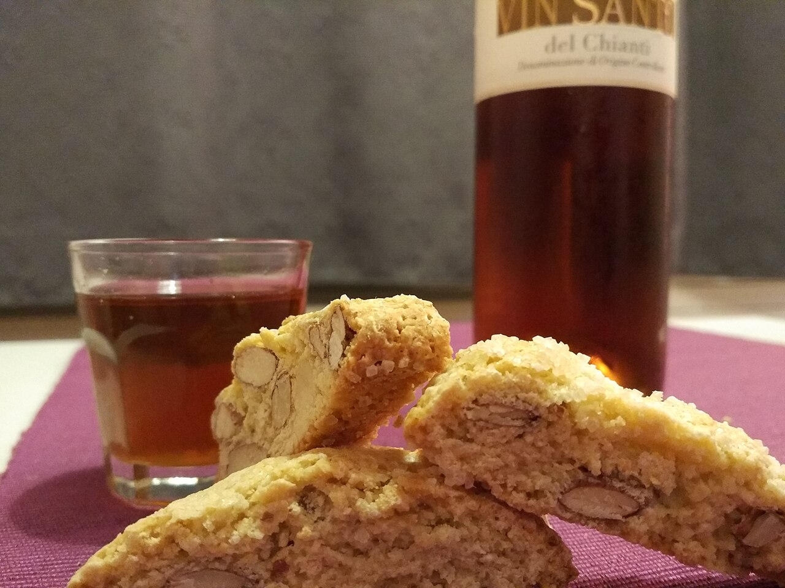

# 圣酒

圣酒（Vin Santo）是意大利中部、尤其托斯卡纳传统的风干葡萄甜型（也有半干型）葡萄酒：葡萄先在通风处所风干浓缩，缓慢发酵后在小型木桶中长期陈年，酒色金珀，带杏干、葡萄干、无花果、蜂蜜、坚果与焦糖气息，传统上配 cantucci 杏仁饼食用。

图：Vin Santo：Vin santo（Wikimedia Commons）。图片：Popo le Chien，CC BY-SA 3.0，via Wikimedia Commons（[原图页面](https://commons.wikimedia.org/wiki/File:Vin_santo.jpg)）。

## 定义与边界

Vin Santo 是一类以风干葡萄（passito）酿制的特种葡萄酒，核心工艺是先脱水浓缩糖分，再经历缓慢发酵与多年木桶陈放。托斯卡纳的 Vin Santo del Chianti 自 1996 年起拥有 DOC 产区称谓；翁布里亚、托斯卡纳其他地区与意大利中部也有同名或同类产品，法规与品种组合各有差异。它属于[甜型葡萄酒](ref:dessert-wine)家族，与靠中途加强酒精中断发酵的波特、雪莉等加强酒路线不同。

判断一款 Vin Santo 要看品种、风干方式、陈年年限与含糖风格，而不只看"圣酒"这个名字。白 Vin Santo 与红葡萄酿制的 Occhio di Pernice 是两个常见分支；后者以桑娇维塞为主，颜色更深、单宁与酸感更明确。需要注意，Vin Santo 的氧化风味来自阁楼通风处的自然陈放与小桶缓慢透氧，并不经过马德拉式的人工加热（estufagem），两者工艺路线不同。

## 历史与命名

"Vin Santo"的名称起源有多种传说。一种说法与教堂弥撒用酒有关，葡萄酒长期在宗教仪式中使用，"圣"字由此而来；另有 1348 年黑死病时期，多明我会修士用祖先品类的葡萄酒安抚病人的故事。流传最广的说法指向 1439 年佛罗伦萨大公会议：Medici 家族设宴招待东西方教会代表团，席间上了一款 passito 葡萄酒，尼西亚主教 Bessarione 感叹"Hoc Xanthos est"（这是金黄之酒），在场者把 xanthos 与拉丁语 sanctus（圣）联系在一起，名称由此传开。

这些叙事属于传说与词源解释，不能当作可考证的史实。可以确认的是，托斯卡纳农庄长期在阁楼（vinsantaia）中挂放葡萄、用小桶跨季节酿酒，这套做法与家庭节庆、教堂传统交织在一起，是 Vin Santo 真正的历史基础。近代以来，Chianti Classico、San Gimignano、Montepulciano 等产区先后形成自己的 Vin Santo 称谓与规则。

## 原料与工艺

法定品种组合上，Vin Santo del Chianti 以 Trebbiano Toscano 与 Malvasia Bianca Lunga 为主，两者合计不低于 70%，其余可加入当地其他白或红葡萄，比例不超过 30%；若桑娇维塞（Sangiovese）占比达到 50% 以上，可标注为 Vin Santo Occhio di Pernice DOC。葡萄在 vineyard 上经挑选后手工采入小筐，送入通风的 vinsantaia 阁楼或专用房间，铺在草席（cannicci、graticci）上或悬挂风干。

风干从九月开始，持续 3–6 个月，期间剔除霉烂与破损果串；压榨所得汁仅为葡萄重量的三分之一到四分之一，浓稠高糖。之后转入名为 caratelli 的小木桶：容量多在 50–200 升，木材常用栗木、樱桃木、刺槐、桑木，少量使用橡木；桶内留少量空气，封口常以水泥封严。高糖汁在冬季低温下由桶内与环境酵母缓慢启动发酵，冷暖季节交替中反复启停，氧化随桶板缓慢透入酒液，这是 Vin Santo 坚果与氧化香气的来源。

陈年年限受法规约束：Vin Santo del Chianti 至少在小木桶中陈年 3 年，标 Riserva 的版本不少于 4 年；实际生产中不少产品陈放更久，Felsina 的 Chianti Classico Vin Santo 在阁楼区陈放约 7 年，Avignonesi 的 Occhio di Pernice 桶陈超过 10 年。发酵能否耗尽糖分、酵母活动何时停止，决定了成品是干型、半干还是甜型；同一酒窖不同小桶的结果也可能不同，最后由酿酒师调配装瓶。

## 风格与味觉

典型白 Vin Santo 呈金黄到琥珀色，酒体浓稠温暖，香气集中：杏干、葡萄干、无花果、椰枣、蜂蜜、杏仁与核桃壳，辅以柑橘皮、蜜饯与少量挥发酒精气息；入口甜润但有酸度托底，不会只剩糖浆感。Occhio di Pernice 颜色偏深橙红，桑娇维塞带来单宁、酸樱桃与皮革感，结构更硬朗，常偏干或半干。传统 Vin Santo 多为甜型，历史上的版本则更干，风格随生产者与年份变化明显。

DOC 规则下，白 Vin Santo 最低酒精度 16%，Occhio di Pernice 最低 17%；市场上常见商业版本酒精度多在 13.5–15% 区间，具体以瓶标为准。好的 Vin Santo 甜、酸、苦与酒精互相平衡，氧化坚果感清晰而不腐败；醋味过重、霉味或溶剂感则属于缺陷。瓶中仍可继续演化多年，发展出焦糖、干果与皮革的复合层次。

## 代表产区与品牌

Chianti Classico 是最受关注的 Vin Santo 产区之一。Felsina 位于 Castelnuovo Berardenga，其 Vin Santo del Chianti Classico 以 Trebbiano、Malvasia 与 Sangiovese 调配，在阁楼陈放约 7 年，风格在残留甜感与氧化复杂度之间求平衡。Avignonesi 的 Occhio di Pernice 以桑娇维塞为骨干，桶陈 10 年以上，是干型红 Vin Santo 的代表之一；Isole e Olena 与 Carmignano 的 Capezzana 也是托斯卡纳 Vin Santo 领域受认可的生产者。

除 Chianti 地带外，San Gimignano、Montepulciano 以及 Rufina、Montalbano、Colli Fiorentini、Colline Pisane、Colli Aretini、Colli Senesi、Montespertoli 等子分区都有各自的 Vin Santo 产品。品牌与酒窖之间，品种比例、风干时长、桶木种类与陈年年限差别很大，读标签上的 DOC 称谓、品种与陈年说明，比记住笼统的"圣酒"印象更可靠。

## 怎么喝与配餐

Vin Santo 传统上作为餐后甜酒饮用，适饮温度约 12–15°C，略凉即可，不必冰镇到很低；杯型用白葡萄酒杯或小型郁金香杯，给香气留出展开空间。最经典的搭配是 cantucci 杏仁硬饼，把饼干浸入酒中软化，杏仁的油脂与苦味和酒的甜润干果味互补。

配餐范围还包括陈年佩科里诺奶酪、戈贡佐拉蓝纹奶酪、panforte 干果糕、无花果干、核桃与奶油布丁、坚果塔等甜点；偏干的 Occhio di Pernice 可以像 Oloroso 雪莉一样配冷切肉、坚果或单独慢饮。清淡海鲜、蔬菜沙拉与酸味菜肴不适合搭配甜 Vin Santo，会放大甜腻感。小杯慢饮、餐后少量品尝，是它最传统的饮用方式。

## 选购、储存与误区

常见误区：把 Vin Santo 等同于马德拉式加热酒——两者都有氧化坚果味，但 Vin Santo 靠阁楼自然风干与小桶透氧，不做人工加热；以为所有 Vin Santo 都很甜——干型、半干与甜型并存；把颜色深当作陈年久——颜色也来自品种与氧化程度；把高糖度当成品质等级。

买酒时读背标：DOC 称谓与子分区、品种构成（白葡萄还是桑娇维塞为主）、陈年年限、酒精度与含糖风格是否标注清楚；正面大字多为品牌营销。储存上，未开瓶避光、阴凉、直立存放，避免温度波动；Vin Santo 瓶中寿命很长，可存放多年。开瓶后氧化与香气散失加快，建议在一两周内喝完，密封冷藏可稍延长。价格高通常对应长陈与小批量生产，不必然代表风格更典型。

## 延伸阅读与另见

与 Vin Santo 相近的品类共享风干工艺与甜酒框架：[甜型葡萄酒](ref:dessert-wine)是它所属的大类，[晚收/风干](ref:late-harvest)对应葡萄脱水浓缩的环节，[橡木桶陈](ref:oak)与小桶跨季节陈年决定氧化与木质层次，[托斯卡纳](ref:tuscany)是其核心产区背景，[葡萄酒](ref:wine)提供基础品类参照。

学习一类特种葡萄酒，可以先喝最标准的基准款，再试一个换品种或甜度的变体，最后接触一个长陈极端款；三步之后，风格边界会比读定义更清楚。

- 相关条目：[dessert-wine](ref:dessert-wine)、[late-harvest](ref:late-harvest)、[oak-ageing](ref:oak)、[tuscany](ref:tuscany)、[wine](ref:wine)。
