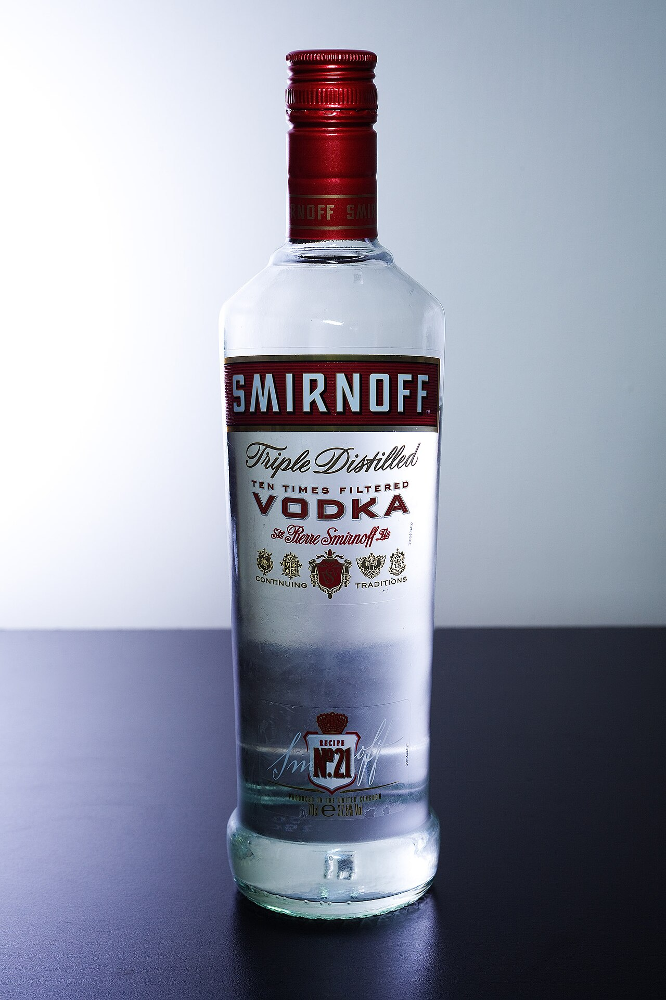

# 伏特加

伏特加（vodka）是以谷物、马铃薯、糖蜜等农产品为原料，经发酵、[蒸馏](ref:distillation)，再通过过滤或处理得到的中性烈酒。它并不必然是“完全无味”的：原料、蒸馏方式、过滤强度与微量残留都会影响口感，只是这些差异通常比威士忌或金酒更细微。

图：伏特加。图片：Ashley Pomeroy，CC BY 4.0，via Wikimedia Commons（[原图页面](https://commons.wikimedia.org/wiki/File:Smirnoff_Red_Label_8213.jpg)）。

## 定义与法规

欧盟法规把伏特加列为烈酒类别，要求其以农产品来源的乙醇为基，具有应有的感官特征，最低瓶装酒精度为 37.5% vol。美国的规定更强调“中性”：伏特加应经蒸馏或处理后不带明显特征、香气、味道与颜色，最低瓶装酒精度为 40% vol。两地标准的差异说明，伏特加的定义既有工艺成分，也有市场习惯成分。

法规只划定底线，不规定风格。也就是说，只要满足原料、纯度与酒精度要求，生产者仍可以通过原料选择、蒸馏次数、过滤方式与微量添加来塑造产品。理解伏特加，应先看“中性”这个目标，再看它在不同市场上被如何解释。

## 原料与风格

- 谷物伏特加：小麦、黑麦、玉米、大麦等常见。小麦通常带来柔和甜感，黑麦可能更辛香，玉米更饱满。
- 马铃薯伏特加：口感常被认为更圆润、更厚，风味取决于品种、成熟度与蒸煮工艺。
- 糖蜜伏特加：以甘蔗糖蜜为原料，成本较低，风格通常更中性，适合大规模生产。
- 其他原料：葡萄、乳清等也可用于伏特加，法规通常允许“其他农产品”，但标签会说明原料来源。

原料差异不是质量等级。谷物与马铃薯都能做出高质量伏特加，差别在风格与成本结构。“单一原料”也不等于更好，混合原料同样可以稳定生产。消费者能观察到的主要是口感轻重、甜感与刺激程度。

## 生产工艺

伏特加的公开流程是：原料糖化（把淀粉转为可发酵糖）、发酵、蒸馏提纯、过滤、加水调整酒精度、装瓶。谷物原料需要糖化，马铃薯需要蒸煮，糖蜜可直接稀释发酵。发酵产生乙醇与少量酯类、高级醇，蒸馏则把这些物质按沸点分离。

蒸馏方式分为间歇壶式蒸馏与连续塔式蒸馏。连续蒸馏效率高、纯度高，适合稳定的大规模生产；壶式蒸馏保留更多风味细节，但批次差异更明显。过滤常用活性炭，吸附部分杂醇与异味，过度过滤会让酒体变得单薄。生产者的目标通常是在“干净”与“保留少量原料特征”之间取平衡。

## 主要类别

伏特加可按是否加味分为原味与调味两类。原味伏特加强调中性、干净；调味伏特加在基酒中加入水果、香草、蜂蜜或香料，属于调味烈酒，糖分与风味明显高于原味产品。两者在调酒中的用途不同，不能把调味版本的甜度当成伏特加本身的特征。

按地域看，波兰与俄罗斯有长期的伏特加传统，瑞典、芬兰、美国与法国也有强势品牌。地域风格并非法规概念，而是历史、原料与市场共同形成的印象。与[金酒](ref:gin)相比，伏特加不以植物香气为主导；金酒的杜松子与植物复配是设计核心，伏特加则追求中性。

## 「伏特加」的闻与喝
伏特加的香气通常清淡，可能有谷物甜香、轻微奶油感、柑橘或酒精气息。入口的差异更明显：有的柔顺、有的刺激、有的带轻微甜味或苦尾。温度会显著改变感知，低温压低刺激与香气，室温则让酒精感与原料特征更突出。

品鉴时用小杯、少量，先闻香，再小口入口，让酒液接触口腔两侧与舌根，观察甜感、刺激与余味。可以对比同一品牌的原味与调味版本，或对比谷物与马铃薯原料的产品。不要用大口吞咽评价伏特加，高酒精度会迅速麻痹味觉。

## 「伏特加」的饮用与搭配
纯饮时通常充分冷藏，搭配咸味小食、腌黄瓜、鱼子酱、烟熏鱼或油脂较重的菜肴。调酒方面，莫斯科骡子（伏特加、姜汁啤酒、青柠）、血腥玛丽（伏特加、番茄汁、香料）、伏特加马天尼与大都会都很常见。由于风味中性，它在配方中更像结构骨架，但高酒精度会明显改变成品平衡。

作为基酒，伏特加适合需要干净底味的配方；如果配方依赖基酒提供复杂香气，它可能显得过于中性。与高糖饮料混合时，应控制总糖量与稀释比例，避免成品过甜或过烈。餐食搭配上，它适合咸鲜、酸味与油脂，不太适合精致甜点。

## 「伏特加」容易被读错的地方
第一，认为伏特加完全无味。原料与工艺会留下细微差异，只是表达方式更克制。
第二，把蒸馏次数当成质量排名。次数影响纯度与风格，不等于更好喝。
第三，把调味伏特加当原味伏特加。调味产品有额外糖分与风味，标签会注明。
第四，认为伏特加只能冷冻纯饮。它同样是重要的调酒基酒，服务方式取决于配方。
第五，忽视酒精度与容量。37.5% vol 与 40% vol 都常见，应以标签为准。

对照阅读：[蒸馏](ref:distillation)、[水](ref:c-extra-1)。

相关条目：[金酒](ref:gin)。

**来源与边界。** 本页关于「伏特加」的关键事实，主要由以下来源交叉核对：European Union（伏特加的定义、原料范围与最低酒精度）、U.S. Alcohol and Tobacco Tax and Trade Bureau（美国伏特加的类别与标识要求）、Oxford University Press（提供关于伏特加原料、蒸馏与地域风格的条目）等 4 条来源。价格、批次与状态会变，涉及这些字段时以页面所列来源的最新版本为准。正文为项目自写，来源只作核验，不复制原文。

**并读。** 把「伏特加」与「蒸馏」、「金酒」、「水」放在一起读时，先确认它们是同一层级还是上下游关系：先确认定义与工艺，再比较原料、产区与代表品牌。本页负责给出酒类风格的基本坐标，对照条目补上具体案例与差异；读完再回到本页，才能分清哪些差别属于酒类风格本身，哪些只是产地、批次或品牌选择。

**适用边界。** 对「伏特加」而言，法定定义、原料比例与地域风格会随法规和行业分类更新；品牌案例不等于整个风格。

**更新提示。** 「伏特加」最近核对于 2026-11-21；价格、状态与公开信息会变，引用前以本页来源的最新版本为准。

## 参考资料
- [蒸馏](ref:distillation)：伏特加提纯与风味保留的核心环节。
- [金酒](ref:gin)：同样以中性酒精为基、但以杜松子与植物香气为目标的烈酒。

补充阅读：[水](ref:c-extra-1)。
