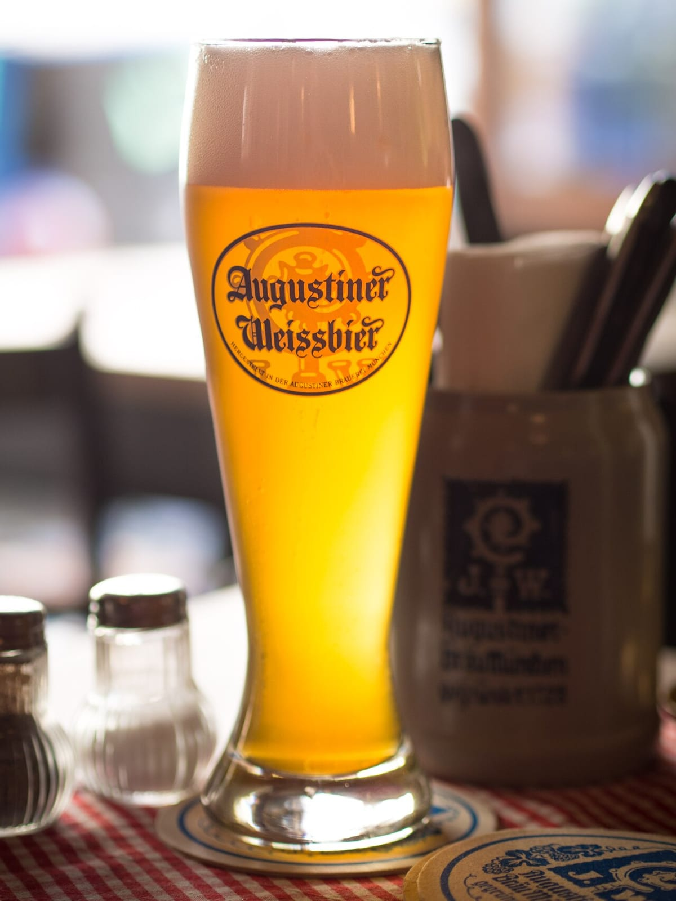

# 小麦啤酒

小麦啤酒（wheat beer）指以小麦在谷物配方中占较大比例、经上层发酵酿成的啤酒。德国的小麦啤酒以丁香与香蕉酯香、瓶内二次发酵为标志；比利时的 witbier 以橙皮与芫荽籽调味；美国小麦艾尔则更清淡、强调干净与易饮。小麦带来的蛋白质与淀粉特性，直接影响酒体、泡沫与浑浊度。

图：小麦啤酒。图片：Takeaway，CC BY-SA 3.0，via Wikimedia Commons（[原图页面](https://commons.wikimedia.org/wiki/File:2013_Augustiner_Weissbier_Munich_pub.jpg)）。

## 定义与标准

小麦比例通常占谷物配方的 50% 以上，德国 Weissbier 常见 50–70%。德式小麦啤酒酒精度多在 4.9–5.6%，苦度约 8–15 IBU；比利时 witbier 常见 4.5–5.5%，苦度约 8–20 IBU；美国小麦艾尔常见 4.0–5.5%，苦度约 15–30 IBU。分类依据是原料比例、酵母与调味方式，而不是颜色。小麦啤酒多属上层发酵，但并非所有含小麦的啤酒都适合称为小麦啤酒。

风格名称容易混淆。Weissbier、Weizen 通常指德式小麦啤酒，Hefeweizen 强调保留酵母，Dunkles Weissbier 指深色版本；witbier 是比利时小麦啤酒的通行叫法。读标签时，小麦比例、酵母类型与是否加香料，比“小麦”二字更有信息量。

## 历史与产地

巴伐利亚是德式小麦啤酒的核心产地。1516 年的《纯净法》把啤酒原料限定为大麦、酒花与水，小麦酿造长期受宫廷特许与专卖安排约束，因此德式小麦啤酒形成了独立而稳定的传统。20 世纪中期，小麦啤酒一度式微，后经酒厂与消费者重新关注而恢复。

比利时 witbier 在 1950 年代几近消失，1966 年霍赫哈登（Hoegaarden）的复兴让它重新进入市场。美国小麦艾尔则在 1980 年代的[精酿啤酒](ref:craft-beer)浪潮中成形，酿造者借用德式原料，却采用更中性的酵母与更克制的香气。今天，[德国](ref:germany)与[比利时](ref:belgium)仍是两个最重要的传统产地。

## 原料与工艺

[小麦](ref:wheat)可以以麦芽形式使用，也可以使用未发芽小麦；比利时 witbier 还常加入燕麦。小麦蛋白质与 β-葡聚糖含量较高，能带来更饱满的酒体与更持久的泡沫，也会造成过滤困难与浑浊。由于小麦谷粒没有大麦那样的外壳，糖化后的过滤常需添加稻壳等助滤材料。

[发酵](ref:fermentation)为上层发酵。德式小麦啤酒使用特定酵母，发酵温度通常 17–20°C，产生丁香酚类（4-乙烯基愈创木酚）与香蕉酯（乙酸异戊酯）；装瓶时加入少量麦汁进行二次发酵，二氧化碳与酵母因此留在瓶中。witbier 在煮沸或发酵后期加入橙皮与芫荽籽；美国小麦艾尔多用中性酵母，以突出麦芽与酒花。

## 风味特征

德式小麦啤酒呈淡金色、浑浊，泡沫厚而持久。香气以丁香、香蕉为主，可能带泡泡糖与谷物甜香；入口酒体中等，苦味低，收口清爽。witbier 更强调柑橘、芫荽与辛香，酸度略高，口感柔和。美国小麦艾尔通常更干净，面包香与轻微柑橘酒花并存，酵母酯香较弱。

浑浊是酵母与小麦蛋白带来的正常现象，不等于变质。若出现刺鼻溶剂味、明显酸败或纸板味，才更可能是工艺或卫生问题。

## 品鉴与饮用

小麦啤酒适饮温度约 6–10°C，witbier 可稍低至 4–8°C。高身小麦杯有利于保留泡沫；德式 Hefeweizen 倒酒时可将瓶底酵母轻轻摇起，使香气与浑浊更完整。佐餐适合白香肠、沙拉、海鲜与软质奶酪，witbier 也适合清淡的亚洲菜肴。

小麦啤酒宜趁新鲜饮用，久放后酒花与酯香会衰减。保存应避光、阴凉，避免反复升温。瓶内二次发酵的产品可能有少量沉淀，倒酒时按个人偏好决定是否混入。

## 常见误区

第一，认为小麦啤酒必须 100% 使用小麦。多数配方中小麦占一半左右，其余仍以大麦为基础。
第二，认为所有小麦啤酒都有丁香与香蕉香。witbier 与美国小麦艾尔的酵母表达完全不同。
第三，把浑浊当成变质。小麦蛋白与酵母会带来正常浑浊。
第四，认为小麦啤酒不含麸质。小麦本身含有麸质，不等于无麸质产品。
第五，认为小麦啤酒只属于德国。比利时与美国都形成了稳定风格。

小麦啤酒的核心是较高比例小麦带来的酒体、泡沫与浑浊度，加上上层发酵的果香；德国小麦啤酒以丁香与香蕉酯香和瓶内二次发酵为标志，比利时 witbier 用橙皮与芫荽籽，美国小麦艾尔更清淡。它们共享原料，却不是同一风格。德国小麦啤酒的香蕉与丁香来自特定酵母与温度，比利时 witbier 的橙皮与芫荽则是调味选择；美国小麦艾尔又常以清澈与轻酒体为特点。先看酵母、香料与麦芽比例，再谈风格。

对照阅读：[啤酒](ref:beer)、[大麦](ref:barley)。

## 延伸阅读

- [啤酒](ref:beer)：小麦啤酒在啤酒风格体系中的位置。
- [小麦](ref:wheat)：小麦蛋白、酒体与泡沫的物质基础。
- [大麦](ref:barley)：小麦啤酒中基础麦芽的来源。
- [发酵](ref:fermentation)：上层发酵与酵母酯香的形成。
- [德国](ref:germany)：巴伐利亚小麦啤酒传统与《纯净法》背景。
- [比利时](ref:belgium)：witbier 的产地与香料传统。
- [精酿啤酒](ref:craft-beer)：美国小麦艾尔的兴起背景。

**关键事实。**

| 项目 | 内容 |
| --- | --- |
| 一句话定位 | 以较大比例小麦、经上层发酵酿成的啤酒；德国小麦啤酒以丁香与香蕉酯香和瓶内二次发酵为标志，比利时 witbier 以橙皮与芫荽籽调味，美国小麦艾尔更清淡，小麦主要影响酒体、泡沫与浑浊度 |
| 上位风格 | 啤酒 |
| 香气家族 | 谷物与酵母 |

**来源与边界。** 本页关于「小麦啤酒」的关键事实，主要由以下来源交叉核对：Beer Judge Certification Program（德式小麦啤酒、比利时 witbier 与美国小麦艾尔的强度、苦度与香气边界）、Deutscher Brauer-Bund（德国啤酒传统、小麦啤酒与《纯净法》相关公开表述）、Brewers Association（美国精酿行业对小麦艾尔及其变体的公开表述；未复制其文案）等 4 条来源。价格、批次与状态会变，涉及这些字段时以页面所列来源的最新版本为准。正文为项目自写，来源只作核验，不复制原文。

**并读。** 把「小麦啤酒」与「啤酒」、「小麦」、「大麦」放在一起读时，先确认它们是同一层级还是上下游关系：先确认定义与工艺，再比较原料、产区与代表品牌。本页负责给出酒类风格的基本坐标，对照条目补上具体案例与差异；读完再回到本页，才能分清哪些差别属于酒类风格本身，哪些只是产地、批次或品牌选择。

**适用边界。** 对「小麦啤酒」而言，法定定义、原料比例与地域风格会随法规和行业分类更新；品牌案例不等于整个风格。

**更新提示。** 「小麦啤酒」最近核对于 2026-11-05；价格、状态与公开信息会变，引用前以本页来源的最新版本为准。

## 相关图像

图：比利时类别配图。图片：Falk2，CC BY-SA 4.0，via Wikimedia Commons（[原图页面](https://commons.wikimedia.org/wiki/File:J33_542_Walplein,_%C2%BBDe_halve_Maan%C2%AB.jpg)）。关联图像：小麦啤酒。
