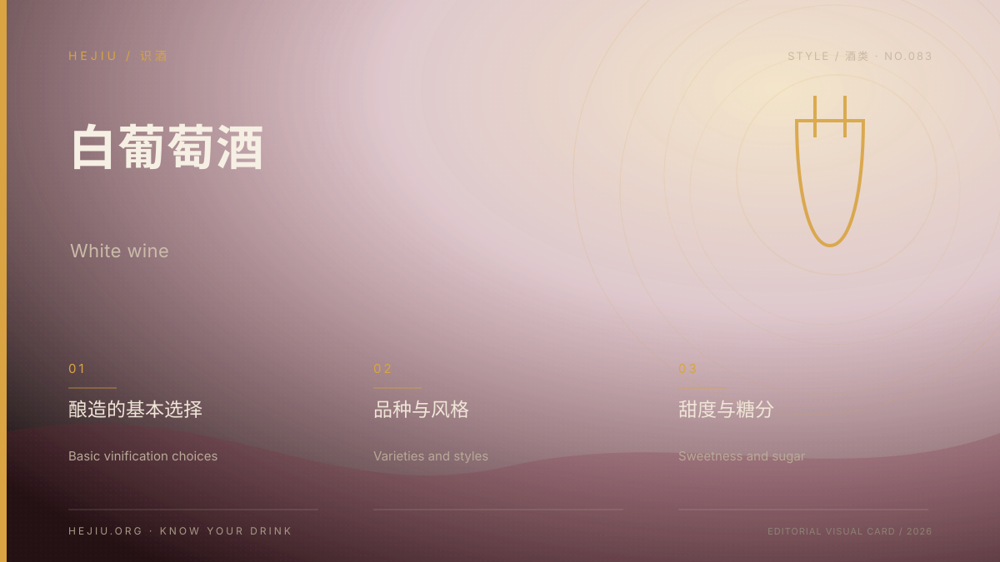

# 白葡萄酒

白葡萄酒是用白葡萄品种，或去皮后的深色葡萄品种酿造的葡萄酒。与红葡萄酒不同，白葡萄酒通常不让酒液长时间接触果皮，因此颜色较浅、单宁很少，酸度和香气成为主要的结构支柱。它的风格跨度很大：从清脆、干型、适合即饮的酒，到经过橡木桶和酒泥处理、质感浓厚的酒，再到作为起泡酒基酒的酒。

图：白葡萄酒 双语视觉卡（项目自绘 SVG）。不是实拍。

## 酿造的基本选择

白葡萄酒的第一步通常是尽快压榨，把果汁与果皮、种子分开，减少颜色和单宁的提取。压榨后，果汁可以静置澄清，也可以直接进入发酵。发酵温度通常比红葡萄酒低，以保留细腻的果香和花香；温度过高会让香气变得粗糙，温度过低则可能让发酵停滞。

发酵完成后，生产者面临几个关键选择。是否进行苹果酸-乳酸发酵，会改变酸度轮廓和奶油类香气；是否带酒泥陈酿，会影响质感和面包、坚果类气息；是否使用橡木桶，会影响香草、烘烤和香料感。这些选择没有统一答案，取决于品种、产区和目标风格。

## 品种与风格

霞多丽（Chardonnay）本身风味相对中性，容易吸收橡木和酒泥带来的质感，因此可以酿成清脆的未过桶风格，也可以酿成浓郁、带黄油感的风格。雷司令（Riesling）通常酸度高、香气清晰，从干型到甜型都有；长相思（Sauvignon Blanc）常带青草、柑橘和热带水果气息；灰皮诺（Pinot Grigio）通常清淡、易饮。

白葡萄酒也可以用品丽珠、黑皮诺等深色品种酿造，只要尽早分离果皮，果汁本身颜色很浅。这类酒有时被称为“黑中白”（blanc de noirs），在香槟和起泡酒中尤其常见。

## 甜度与糖分

OIV 对葡萄酒的糖分等级给出了可核查的阈值：干型（dry）最高为 4 g/L 糖，或在总酸度比糖分低不超过 2 g/L 时可到 9 g/L；半干型（medium dry）可到 12 g/L，或在特定酸度条件下到 18 g/L；半甜型（semi-sweet）可到 45 g/L；甜型（sweet）最低为 45 g/L。这些数字描述的是残糖范围，不是甜味强度的主观感受，因为酸度、酒精和香气都会改变感知。

甜白葡萄酒的甜度可以来自晚收、贵腐菌、冰酒或中止发酵，而不一定来自加糖。具体工艺和允许做法受产区法规约束。看到“甜型”标签时，最好同时查看残糖、酸度和酒精度，而不是只凭口感判断。

## 产区与标签

白葡萄酒的产区标签同样首先是地理与法规信息。法国的阿尔萨斯、勃艮第、卢瓦尔河谷，德国的摩泽尔、莱茵高，意大利的弗留利，西班牙的下海湾，都是常见的白葡萄酒产区。欧盟的 PDO/PGI、法国的 AOC、意大利的 DOCG 等制度，会规定允许品种、产量、酿造方法和标签用语。

同一品种在不同气候下表现差异明显。冷凉产区的白葡萄酒通常酸度更高、酒体更轻；温暖产区的白葡萄酒可能果味更成熟、酒精度更高。海拔、坡向、土壤排水性和昼夜温差也会影响成熟节奏。把这些条件简单归结为“风土”会掩盖具体的栽培与酿造选择。

## 怎么喝

白葡萄酒通常适合比红葡萄酒更低的饮用温度，以保留酸度和香气。温度过低会让香气闭塞，温度过高则会让酒精感突出。轻酒体、干型白葡萄酒适合稍凉饮用；经过橡木桶处理、酒体较重的白葡萄酒可以稍高一些。具体温度没有唯一标准，可以根据酒的结构和个人偏好调整。

配餐时，高酸度的白葡萄酒适合与海鲜、沙拉、酸味或油炸食物搭配，酸度可以切开油脂、清理口腔。甜白葡萄酒与甜点搭配时，酒的甜度最好不低于甜点的甜度，否则会显得寡淡。经过橡木处理的白葡萄酒与奶油酱、烤禽肉等较浓郁菜肴更合拍。

## 酒泥、搅桶与氧化管理

发酵结束后的酒泥，是白葡萄酒风格的重要变量。酒泥主要由死亡的酵母细胞组成，长期接触可以增加质感、圆润度和面包、坚果类香气；搅桶则通过定期搅动酒泥，让更多成分进入酒液。接触时间越长、搅动越频繁，影响通常越明显，但也需要控制，避免出现浑浊或过于厚重的口感。

氧化管理同样关键。白葡萄酒对氧气比红葡萄酒更敏感，过度接触会让新鲜果香过早消失，颜色变深；适度的氧气接触则可以帮助酒体打开、减少还原性气味。惰性容器、温控、二氧化硫使用和装瓶时的溶氧控制，都是生产者用来平衡这一点的工具。

## 常见误区

第一，白葡萄酒不等于简单易饮。经过酒泥和橡木处理的白葡萄酒可以非常复杂，也可以长期陈年。

第二，白葡萄酒不都适合冰镇。温度过低会压抑香气，轻酒体干型可以稍凉，浓郁型则应稍高。

第三，甜白不等于加糖。晚收、贵腐、冰酒和中止发酵都可以带来甜度，具体做法受产区法规约束。

## 参考边界

本页描述白葡萄酒的类别与基本方法，不评价具体酒庄、年份或价格。具体酒款的品种比例、残糖、酒精度、橡木使用和陈年潜力，应以酒标、生产者资料和专业评审为准。白葡萄酒也可以是[起泡酒](ref:sparkling)的基酒，但起泡酒的工艺与标签规则另有专门条目。

对照阅读：[葡萄酒](ref:wine)、[葡萄](ref:c-extra-1)。

## 延伸阅读

- [葡萄酒](ref:wine)：葡萄酒的总览，包括静止酒、起泡酒、加强酒与甜酒。
- [起泡酒](ref:sparkling)：二次发酵、气泡压力与甜度等级。

补充阅读：[葡萄](ref:c-extra-1)、[发酵](ref:c-extra-2)。

相关条目：[发酵](ref:c-extra-2)。

**来源与边界。** 本页关于「白葡萄酒」的关键事实，主要由以下来源交叉核对：International Organisation of Vine and Wine (OIV)（葡萄酒的糖分等级、二氧化碳含量与最低酒精度）、European Union（欧盟葡萄酒类别、地理标志与标签规则）、Oxford University Press（提供关于白葡萄酒酿造、酒泥与橡木处理的条目）等 4 条来源。价格、批次与状态会变，涉及这些字段时以页面所列来源的最新版本为准。正文为项目自写，来源只作核验，不复制原文。

**并读。** 把「白葡萄酒」与「葡萄酒」、「起泡酒」、「葡萄」放在一起读时，先确认它们是同一层级还是上下游关系：先确认定义与工艺，再比较原料、产区与代表品牌。本页负责给出酒类风格的基本坐标，对照条目补上具体案例与差异；读完再回到本页，才能分清哪些差别属于酒类风格本身，哪些只是产地、批次或品牌选择。

## 相关图像

图：起泡酒。图片：bgvjpe，CC BY 2.0，via Wikimedia Commons（[原图页面](https://commons.wikimedia.org/wiki/File:Glass_of_champagne.jpg)）。关联图像：白葡萄酒。
