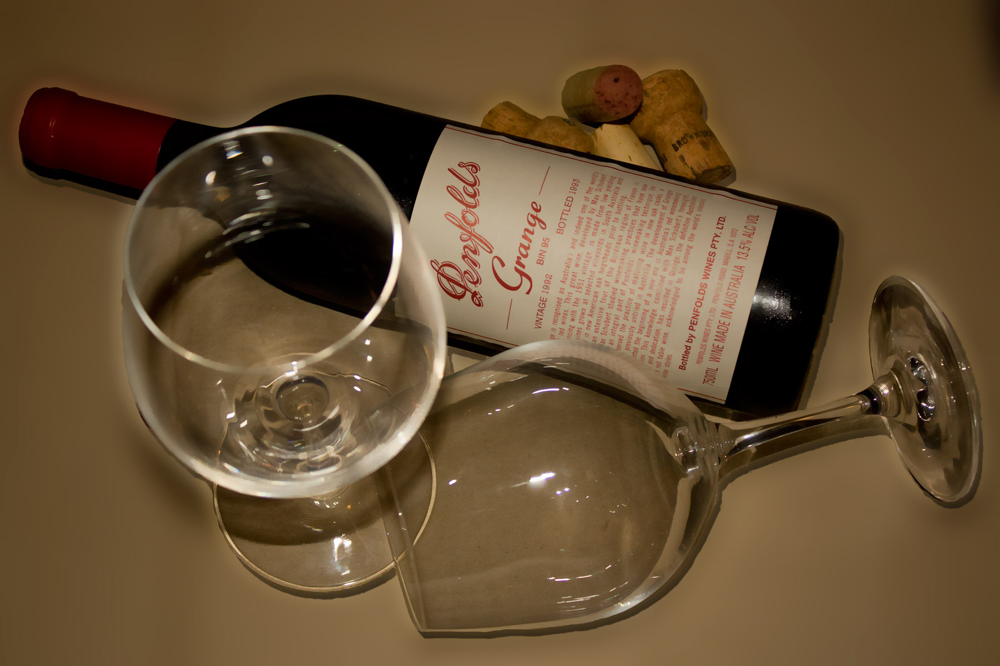

# 奔富葛兰许

奔富葛兰许是澳大利亚奔富酒庄的旗舰酒，由马克斯·舒伯特于 1951 年首创。它以设拉子为主、常混少量赤霞珠，在美国橡木桶中陈年，是澳大利亚最具代表性的细酒之一。

图：奔富葛兰许相关实景照片。图片：Rexness，CC BY-SA 2.0，via Wikimedia Commons（[原图页面](https://commons.wikimedia.org/wiki/File:Penfold%27s_Grange_(4553358229).jpg)）。

## 定义与定位

葛兰许是单一产品名称，不是葡萄品种，也不是产区名。它属于[葡萄酒](ref:wine)中的干红类型，由奔富酒庄生产。奔富本身创建于 1844 年，葛兰许则是二战后实验性酿造的产物，1951 年首次酿造，早期曾借用“Hermitage”之名，后来成为独立品牌。

理解葛兰许要区分三个层级：奔富是企业与品牌，葛兰许是旗舰产品，设拉子是主要品种。把它当作“澳大利亚的拉菲”只是类比，不能替代对品种、工艺与年份的具体判断。

## 产区与环境

葛兰许是跨产区混酿，葡萄来自南澳大利亚多个产区，常见包括巴罗萨谷、麦克拉伦谷、克莱尔谷与库纳瓦拉等。不同产区的气候与土壤贡献不同：温暖产区的设拉子带来成熟黑色水果与酒体，较凉爽产区提供酸度与香气层次。

跨产区混酿的目的不是掩盖产地，而是通过组合稳定风格、平衡年份差异。澳大利亚南部夏季炎热干燥，灌溉与水分管理直接影响成熟度；采收时机的判断，决定了酒精度、酸度与单宁的走向。酒标上的年份是葡萄采收年，不是装瓶年。

同一产区的不同年份，降雨、热浪与采收窗口都会变化，果实的酸度与风味随之不同。酒庄通过多产区组合来降低单一产区的年份波动，这也是葛兰许风格相对稳定的原因之一。但组合并不能消除年份差异，只会让差异以另一种方式呈现；因此比较葛兰许时，年份仍是首要变量。

## 原料与品种

主要品种是设拉子（Shiraz，即 Syrah），常混少量赤霞珠以增加结构与酸度。设拉子带来黑莓、黑胡椒、甘草与肉感；赤霞珠补充骨架与陈年潜力。混酿比例随年份调整，不由固定配方决定。

葡萄的成熟度决定糖、酸、[单宁](ref:tannin)与香气前体。葛兰许追求成熟但不过熟的果实，以避免果酱感与过高酒精。原料来自多个地块，发酵前会分地块处理，再在后期组合，这是理解其风格稳定性的关键。

## 「奔富葛兰许」怎么做出来
典型流程是：采收、除梗破碎、发酵、浸渍、压榨、苹果酸-乳酸发酵、橡木桶陈年、调配、澄清与装瓶。葛兰许传统上使用美国橡木桶，新桶比例较高，带来香草、椰子和雪松气息，并使单宁更柔和。

[橡木桶陈酿](ref:oak-ageing)是风格的重要组成部分。美国桶的香气表达更直接，与设拉子的果味形成对比；陈年时间与桶型组合由酒庄按年份调整。装瓶后还会进行瓶陈，单宁与香气在瓶中继续整合，因此年轻年份与成熟年份的表现差异明显。

## 「奔富葛兰许」的闻与喝
葛兰许通常酒体饱满，带有黑莓、黑胡椒、摩卡、雪松与烟草气息，单宁厚实，酸度支撑良好，余味长。年轻时果味与橡木较突出，陈年后香料、皮革与泥土气息增加，结构趋于融合。

品鉴时先观色，再看香气是否干净、是否有挥发酸或过量橡木；入口感受酒体、单宁质地与酸度平衡。酒精度以 [酒精度](ref:abv) 标示，通常在 14%–14.5% vol 左右，具体年份可能略有差异。高酒精会放大灼热感，适饮温度与醒酒时间因此很重要。

## 产品体系与标签

奔富的产品体系从日常餐酒到旗舰酒跨度很大，葛兰许位于顶端。酒标上的年份、品种、产区信息与酒精度，是核对身份的基本信息；葛兰许不标单一葡萄园，而以混酿与品牌为核心。

“Bin”编号是奔富的产品编号体系，不等于质量等级；不同编号对应不同定位与风格。购买时应通过正规渠道，核对防伪与进口标签。价格与稀缺性不等于每个年份都同样出色，年份差异仍是判断的核心。

## 「奔富葛兰许」的饮用与搭配
饮用温度约 16–18°C。年轻年份可醒酒 1–2 小时，老年份应缩短醒酒时间并注意沉淀，必要时使用滗酒器。搭配烤牛肉、羊排、炖肉与硬质奶酪较合适；重辣与重酸菜肴会干扰单宁与果味的平衡。

开瓶后应尽快喝完，剩余酒液可分装、避光、低温保存。加冰会稀释香气与结构，不适合传统干红。饮酒应适量，避免空腹快速饮用；陈年酒款的保存对温度与湿度要求更高。

## 「奔富葛兰许」容易被读错的地方
第一，把葛兰许当成一个产区。它是跨产区混酿的产品。
第二，认为酒标年份越老越好。葛兰许有适饮区间，过长或过短的陈年都不理想。
第三，把 Bin 编号当作质量等级。编号是产品体系，不是评分。
第四，认为设拉子与西拉是两个品种。它们是同一品种在不同语境下的名称。
第五，用价格替代品鉴。年份、保存状态与渠道同样影响体验。

对照阅读：[葡萄酒](ref:wine)、[单宁（tannin）](ref:tannin)。

**关键事实。**

| 项目 | 内容 |
| --- | --- |
| 一句话定位 | 澳大利亚奔富酒庄的旗舰酒，由马克斯·舒伯特于 1951 年首创，以设拉子为主、常混少量赤霞珠，在美国橡木桶中陈年 |
| 酒种/风格 | 葡萄酒 |
| 酒精度 | 14–14.5% vol |

**来源与边界。** 本页关于「奔富葛兰许」的关键事实，主要由以下来源交叉核对：Penfolds（葛兰许的历史、品种与酿造信息）、OIV（葡萄酒的国际技术口径）、Oxford University Press（提供关于奔富、葛兰许与澳大利亚设拉子的条目；由原条目末尾参考资料迁移，未逐条复核访问日期）。价格、批次与状态会变，涉及这些字段时以页面所列来源的最新版本为准。正文为项目自写，来源只作核验，不复制原文。

**并读。** 把「奔富葛兰许」与「葡萄酒」、「橡木桶陈酿」、「单宁（tannin）」放在一起读时，先确认它们是同一层级还是上下游关系：先确认酒种与产区，再比较年份、酒精度、价格与饮用场景。本页负责给出酒款的基本坐标，对照条目补上具体案例与差异；读完再回到本页，才能分清哪些差别属于酒款本身，哪些只是产地、批次或品牌选择。

## 参考资料
- [葡萄酒](ref:wine)：葡萄酒的大类与基本分类。
- [橡木桶陈酿](ref:oak-ageing)：美国桶如何影响香气与单宁。
- [单宁](ref:tannin)：红葡萄酒结构感与陈年潜力的来源。
- [酒精度](ref:abv)：理解 14%–14.5% vol 的标签含义。
