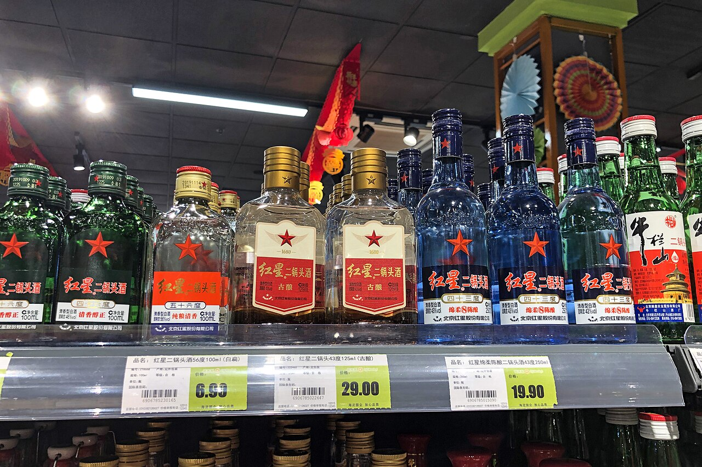

# 二锅头

二锅头是北京传统白酒工艺和产品类别，因蒸馏时只取第二锅冷却流出的酒液而得名。它以高粱为主料，采用麸曲或大曲发酵，常见酒精度为 43%–56% vol，风格清香、直接。

图：二锅头。图片：N509FZ，CC BY-SA 4.0，via Wikimedia Commons（[原图页面](https://commons.wikimedia.org/wiki/File:Red_Star_Erguotou_on_shelves_(20200202160825).jpg)）。

## 定义与定位

二锅头既是一种工艺称谓，也是一类产品名称。它属于[白酒](ref:baijiu)中的清香型路线：清蒸清烧、地缸或水泥池发酵、蒸馏时掐头去尾取中段。名称来自“第二锅”：蒸馏初期流出的酒头刺激性强，后期酒尾杂味多，第二锅的中段被认为最干净。

需要区分的是，二锅头不是某一个品牌的专属名称，而是北京地区形成并被多家企业使用的工艺与品类。红星、牛栏山等都有二锅头产品，原料、曲种、度数与勾调差异明显。

## 产区与环境

北京位于华北平原北部，属温带季风气候，冬季寒冷干燥、夏季温热多雨。干燥的冬季有利于制曲与贮存，昼夜温差则影响发酵温度管理。北京周边的水源与高粱供应，构成了二锅头生产的基础条件。

二锅头的产地叙事与北京城市生活紧密相连。它长期作为大众消费酒存在，价格带跨度大，既有日常口粮酒，也有强调传统工艺的中高端产品。理解这一点，有助于避免把“便宜”直接等同于“低质”。

## 原料与制曲

主料是高粱，要求淀粉含量高、杂质少。部分产品使用麸曲，糖化力强、发酵周期短；也有产品使用大曲，香气更复杂、成本更高。两种路线没有绝对高下，差别在风格目标与生产成本。

[制曲](ref:qu-making)决定糖化效率与香气前体。麸曲清香通常更直接、干净，大曲清香更有层次。原料粉碎度、蒸煮程度与曲的用量，都会影响发酵启动与出酒率。生产标准与标签上的原料表，是判断工艺路线的第一手信息。

## 「二锅头」怎么做出来
典型流程包括：原料粉碎、润料、蒸煮、摊凉、加曲、入缸或池发酵、蒸馏、分级贮存、勾调、装瓶。清香型强调清蒸清烧，避免酒醅与窖泥接触，减少杂菌与异味来源。

[蒸馏](ref:distillation)是二锅头名称的来源：蒸馏过程中分段摘酒，头段与尾段分开，中段作为主要基酒。不同企业对“第二锅”的具体操作与切点并不完全相同，因此名称是传统概括，不是统一的技术参数。

贮存通常使用陶坛或不锈钢罐。陶坛透气，利于缓慢氧化与香气整合；不锈钢罐密封性好，便于控温和大批量保存。勾调以不同等级、不同酒龄的基酒按比例组合，目标是稳定风格，而不是简单加水降度。降度用水需经处理，避免引入异味；勾调后的静置与过滤也会影响入口的干净程度。

## 「二锅头」的闻与喝
二锅头通常入口冲、香气直接、尾味干净，以乙酸乙酯为主的清香、粮香和轻微果香较为常见。高度版本的酒精刺激明显，低度版本更柔和。它不以复杂层次见长，评价重点在干净度、协调性与收口。

品鉴时用小杯，先闻香气是否干净，是否有明显杂味；再小口品尝，感受入口的冲击与回甜。高度酒不宜大口快饮，加水可以降低刺激，但会改变香气结构。与浓香、酱香比较时，应使用清香型的评价框架。

## 产品体系与标签

二锅头覆盖 43%–56% vol 等多个度数，产品从光瓶酒到礼盒装都有。核对二锅头时，应把生产商、香型、酒精度、执行标准与净含量五项对齐，再查批次。二锅头的仿冒风险多集中在近似商标、同名系列与礼盒改包，购买时应通过正规渠道并核对防伪。

“传统工艺”“年份”等表述需要结合企业说明与标签理解。二锅头并非越陈越好，长期贮存可能损失清爽香气；家庭存放应避光、阴凉，避免高温与异味污染。

## 「二锅头」的饮用与搭配
传统上用小杯纯饮，也常被用于调制鸡尾酒或浸泡果酒。由于酒精度较高，不宜快饮；搭配北京小吃时注意咸味和油脂会改变对酒精刺激的感受。涮肉、烤鸭与卤味都适合，但重辣会放大刺激。

二锅头用于调制时，高酒精度会显著改变成品平衡，配方中的糖与酸需要重新调整。加冰会降低香气释放，适合追求清爽的个人偏好，但不是传统方式。开瓶后应尽快喝完，避免长时间暴露在空气与光照中。

## 「二锅头」容易被读错的地方
第一，认为二锅头是一个品牌。它是工艺与品类名称，多家企业都有产品。
第二，认为度数越高越正宗。度数服务于产品设计，低度版本也有完整目标。
第三，认为便宜就等于低质。价格带跨度大，应以标签与工艺判断。
第四，认为所有二锅头都是麸曲。大曲路线同样存在，风味不同。
第五，用包装或价格判断真伪。防伪、渠道与标签核对才可靠。

相关条目：[酒精度（ABV）](ref:abv)。

**关键事实。**

| 项目 | 内容 |
| --- | --- |
| 一句话定位 | 北京传统白酒工艺与产品类别，因取第二锅冷却流出的酒液而得名，风格清香、直接，常见酒精度 43%–56% vol |
| 酒种/风格 | 白酒 |
| 酒精度 | 43–56% vol |

**来源与边界。** 本页关于「二锅头」的关键事实，主要由以下来源交叉核对：国家市场监督管理总局、国家标准化管理委员会（二锅头工艺与清香型白酒术语；白酒在饮料酒分类中的位置）、中国酒业协会（北京二锅头的传统工艺背景）、Oxford University Press（提供关于中国白酒与清香风格的条目；由原条目末尾参考资料迁移，未逐条复核访问日期）。价格、批次与状态会变，涉及这些字段时以页面所列来源的最新版本为准。正文为项目自写，来源只作核验，不复制原文。

**并读。** 把「二锅头」与「白酒」、「制曲」、「蒸馏」放在一起读时，先确认它们是同一层级还是上下游关系：先确认酒种与产区，再比较年份、酒精度、价格与饮用场景。本页负责给出酒款的基本坐标，对照条目补上具体案例与差异；读完再回到本页，才能分清哪些差别属于酒款本身，哪些只是产地、批次或品牌选择。

## 参考资料
- [白酒](ref:baijiu)：二锅头所属的大类与香型体系。
- [制曲](ref:qu-making)：麸曲与大曲如何影响清香风格。
- [蒸馏](ref:distillation)：掐头去尾与“第二锅”的工艺背景。
- [酒精度](ref:abv)：比较 43%–56% vol 不同版本的指标。
