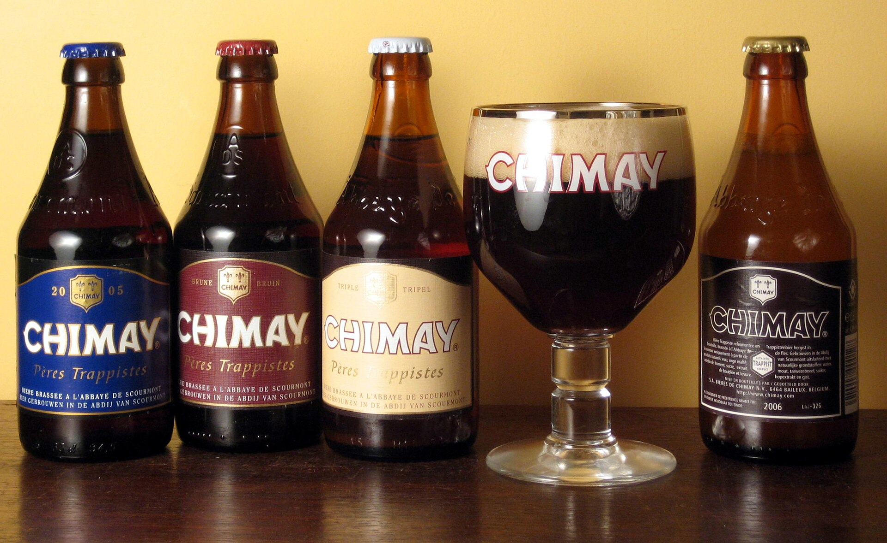

# 智美蓝帽

智美蓝帽（Chimay Bleue）是比利时斯库尔蒙修道院（Abbaye Notre-Dame de Scourmont）酿造的深色[特拉普斯特艾尔](ref:abbey-beer)，常见 [9% vol](ref:abv)，装瓶后再进行约 21 天的[瓶内二次发酵](ref:fermentation)。它的 75 cl 版本另有一个更常用于陈年的名字——Grande Réserve。这不是两款酒，而是同一款酒的两个容量与叙事。

图：智美蓝帽相关实景照片。图片：Uploaded by photographer.，CC BY-SA 3.0，via Wikimedia Commons（[原图页面](https://commons.wikimedia.org/wiki/File:Chimays.jpg)）。

## 1956 年：蓝帽从圣诞啤酒里走出来

智美官方把蓝帽的前身记在 1954 年：修道院先做了一款只在年末节日销售的圣诞啤酒（Spéciale Noël）。1956 年，它变成全年供应的“蓝帽”，从此成为智美产品线的固定成员。也就是说，蓝帽不是从建厂第一天就存在的“祖传配方”，而是二战后修道院重新酿酒、并试验新酵母之后的产物。

## 斯库尔蒙：1850 年建院，1862 年第一锅

1850 年，来自 Westvleteren 圣西斯笃修道院的一批修士，在希迈亲王捐赠的斯库尔蒙高地上建立修道院；1862 年，修道院酒厂建成并酿出第一批啤酒；1876 年，修士又学会了半软质奶酪，智美奶酪由此诞生。今天蓝帽与智美奶酪共用同一套修道院经济：啤酒、奶酪、旅馆与慈善基金，而不是一个孤立的“网红酒厂”。

## 1948 年的酵母与 21 天的瓶内二次发酵

1948 年，Théodore 神父分离出智美至今仍在使用的酵母菌株；同年，修道院用新酵母做了第一批试验。装瓶时的酒液是“平的”——没有气泡，酒厂在装瓶前加入糖与新鲜酵母，再让它在瓶中完成二次发酵。官方工艺页给出的数字是：装瓶速度约 55,000 瓶/小时，瓶内二次发酵在恒温恒湿环境里持续 21 天。二氧化碳由此产生，酒精度略微上升，口感也更易消化。

## 9% 的蓝帽、7% 的红帽、8% 的白帽

三款核心酒的差异不是“颜色深浅”四个字能概括的：红帽 7% vol，1862 年首次酿造，是智美最古老的啤酒，75 cl 装称 Première，风味偏橙、桃、杏与太妃糖；白帽（Triple）8% vol，1966 年由 Théodore 神父创制，是金色、偏啤酒花与柑橘的路线；蓝帽 9% vol，最深色，走干果、焦糖、可可、摩卡与香料路线。再往上还有 10% 的 Green 与 4.8% 的 Dorée，但它们不是本文的比较对象。

## 两口井与沼泽高原的水

智美官方把水称为啤酒的首要原料，并明确说酿造用水只取自修道院范围内的两口井。修道院建在沼泽高原上，当年修士正是因为这里水源充沛才决定酿酒。水的矿物组成会直接影响糖化效率、发酵表现与成品的“干爽感”；这也是为什么同样的 9% 配方，搬到别处很难复制出完全一样的蓝帽。

## 55,000 瓶/小时与 33 cl–6 L 的规格

蓝帽的常见规格包括 33 cl、75 cl、1.5 L、3 L、6 L 与桶装；红帽另有易拉罐。55,000 瓶/小时的装瓶线说明它是一款规模化生产的修道院啤酒，而不是小批量手工试验。规模并不与“特拉普斯特”身份矛盾：认证看的是生产地点、修士监督与收入用途，不是产量大小。

## Grande Réserve：75 cl 的另一个名字

75 cl 的蓝帽在官方体系里叫 Grande Réserve，强调它适合在瓶中继续陈年。智美每两年推出一款 75 cl 收藏版瓶身，官方列出的年份从 2014 年一直到 2026 年；收藏版改变的是瓶身设计，不是酒液配方。买普通 75 cl 还是收藏版，取决于你想喝还是想留，不必把“收藏版”当成更高等级的酒。

## 10–12 °C 的饮用温度

官方建议蓝帽在 10–12 °C 饮用。温度太低会把干果与可可压成单纯的苦味，太高则让 9% 的酒精显得突出。用郁金香形或智美专用杯，沿杯壁缓慢倒入，留出泡沫空间；瓶底少量酵母沉淀是瓶内二次发酵的正常结果，可以保留，也可以避开。9% 不是“烈酒”，但它的酒精感会在回温后逐渐放大，慢喝比快喝更合适。

## 配餐：为什么蓝帽要配红啤奶酪

智美官方说蓝帽适合搭配所有智美奶酪，尤其是用红啤洗/浸的 Chimay à la bière rouge。原因是蓝帽的可可与焦糖能接住奶酪的坚果与奶香，9% 的酒精又能切开脂肪；红啤奶酪本身的麦芽甜则与蓝帽的干果形成回声。相比之下，红帽 7% 更轻、更偏水果，适合作为开胃；白帽 8% 更干、更偏柑橘，适合鱼类与沙拉。把三款酒混着点，反而会失去各自的配餐优势。

## 修道院商店 €4.20 / €10.50 的价格

智美修道院商店 2021 年版价目表把蓝帽 33 cl 标为 €4.20、Grande Réserve 75 cl 标为 €10.50；这是酒厂/修道院渠道的价格，不是全球零售价。超市、酒吧与出口市场会因税费、运费、批次与促销出现明显差异，购买时以当地货架价为准。把“修道院价”当成“最低价”也不准确：它的意义是提供一个未被二级市场放大的基准。

## 常见误解：Trappist 只是营销标签？

Authentic Trappist Product（ATP）不是随便印的图案。国际特拉普斯特协会要求：产品必须在修道院内或紧邻修道院生产；生产受修士监督；收入的大部分用于修道院生活、团结项目与慈善。智美还设立了 Chimay-Wartoise 基金会（1996 年），把商业公司与修道院的宗教生活分开。另一个常见混淆是“Abbey beer”与“Trappist beer”：前者是风格或商业称谓，后者需要修道院与协会的双重约束。

## 选购与存放

买蓝帽时先看瓶身或背标的灌装日期，再看容量与酒精度；瓶内二次发酵意味着它有一定陈年能力，但不等于越久越好。存放在阴凉、避光、直立的位置，避免温度剧烈波动；开瓶后尽量一次喝完，剩下的部分会快速失去碳酸感。若想体验陈年差异，可以同场对比新鲜瓶与存放两三年的瓶，而不是只凭年份想象。

对照阅读：[啤酒](ref:beer)、[修道院啤酒](ref:abbey-beer)。

## 延伸阅读

- [啤酒](ref:beer)：大类与风格框架。
- [比利时](ref:belgium)：修道院啤酒的产区背景。
- [修道院艾尔](ref:abbey-beer)：Abbey 与 Trappist 的区别。
- [大麦](ref:barley)与[水](ref:water)：蓝帽的两项主要原料。
- [发酵](ref:fermentation)：瓶内二次发酵的关键工艺。
- [罗什福尔 10 号](ref:rochefort)与[西麦尔三料](ref:westmalle)：同属特拉普斯特体系的两个对照。

**关键事实。**

| 项目 | 内容 |
| --- | --- |
| 一句话定位 | 比利时斯库尔蒙修道院出产的深色特拉普斯特艾尔，9% vol，瓶内二次发酵 21 天；以干果、焦糖、可可与香料著称，75 cl 装又称 Grande Réserve |
| 酒种/风格 | 啤酒 |
| 产区 | 比利时 |
| 酒精度 | 9–9% vol |

**来源与边界。** 本页关于「智美蓝帽」的关键事实，主要由以下来源交叉核对：Chimay Trappist Brewery（9% vol、1948/1954/1956 年产品史、75 cl 的 Grande Réserve 名称与配餐；1850 年建院、1862 年首次酿酒、1876 年奶酪、1948 年酵母与两口井）、International Trappist Association（Authentic Trappist Product 的申请与三项条件）、未注明（由原条目末尾参考资料迁移，未逐条复核访问日期）。价格、批次与状态会变，涉及这些字段时以页面所列来源的最新版本为准。正文为项目自写，来源只作核验，不复制原文。
