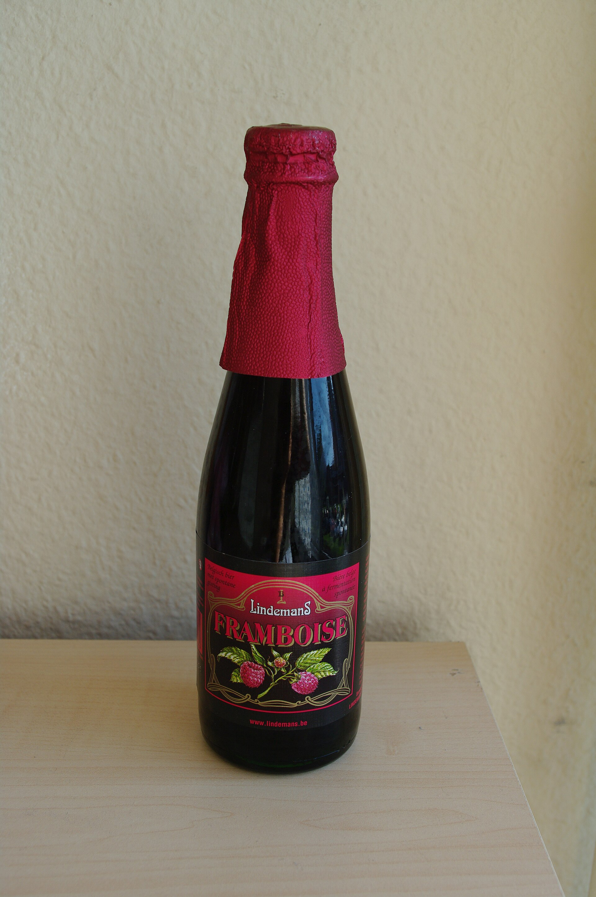

# 林德曼树莓兰比克

林德曼树莓兰比克是比利时帕约滕兰地区林德曼家族酒厂的产品，以自然发酵的兰比克为基酒，加入树莓后装瓶，常见 2.5%–4% vol、250 mL 或 750 mL。它风格偏甜，与传统干型兰比克属于不同的产品取向。

图：林德曼树莓兰比克相关实景照片。图片：Soti，CC BY-SA 3.0，via Wikimedia Commons（[原图页面](https://commons.wikimedia.org/wiki/File:Lindemans_Framboise.JPG)）。

## 定义与定位

先分层：啤酒是大类，兰比克是自然发酵传统，比利时是产区，林德曼是酒厂与品牌，树莓兰比克是具体产品。四层分开看，才不会把“水果啤酒”与“传统兰比克”混为一类。

这款酒不是修道院艾尔，也不属于受控酵母的上面发酵路线。它的基酒依赖空气与木桶中的野生微生物，成品再以水果调味；甜味主要来自后期加糖或果汁，而不是自然发酵本身的结果。与[智美蓝帽](ref:chimay)对照，能看出两条传统的差别。

## 生产者与品牌

林德曼是位于比利时弗莱岑贝克（圣彼得斯-莱乌）的家族酒厂，地处布鲁塞尔西南的帕约滕兰地区，公开资料把其历史追溯到 1822 年。酒厂以兰比克基酒与水果系列产品线为主，是这一传统中流通面较广的生产者之一。

酒厂、品牌与产品是三个层级：酒厂回答基酒与工艺，品牌回答定位与产品线，产品回答水果种类、酒精度与容量。家族经营与历史年份属于企业叙事，不能替代瓶标上的具体规格与批次。

## 「林德曼树莓兰比克」的产地与原料
产品产自[比利时](ref:belgium)的帕约滕兰地区，这一带被视为兰比克的核心产区。当地气候温和、湿度较高，空气与酒厂环境中的微生物群落是自然发酵能否顺利进行的条件之一，因此产地与酒厂环境本身就是工艺的一部分。

原料是[大麦](ref:barley)、[小麦](ref:wheat)与[水](ref:water)，另加啤酒花与树莓。兰比克通常使用陈年啤酒花，主要取其防腐作用而非苦味；小麦比例较高，影响酒体与微生物营养。水果的品种、比例与处理方式因产品线而异。

## 「林德曼树莓兰比克」怎么做出来
麦汁煮沸后放入浅盘冷却，让空气中的野生酵母与细菌自然接种，再装入木桶进行长时间[陈酿](ref:oak-ageing)。这一阶段以年计，酒液逐渐变酸、变干，形成柑橘、谷物与木质气息，构成后续调和的基酒。

装瓶前，酒厂会把不同年份的兰比克调和，加入树莓与糖，再进行[发酵](ref:fermentation)与装瓶。加糖与果汁让成品更甜、更易入口，也让酸度降低；这与不加糖的传统干型兰比克是不同取向，不能用一个标准评价两者。

## 「林德曼树莓兰比克」的瓶型与标签
常见[酒精度](ref:abv)为 2.5%–4% vol，不同市场版本的标注可能不同，容量常见 250 mL 与 750 mL。标签应核对产品名、水果种类、酒精度、净含量、原料、生产商与批次信息。

酒标上若出现“lambic”或“自然发酵”等用语，应结合产品线说明阅读；这些词缺少统一的强制定义，甜型水果兰比克与干型传统兰比克可能都使用类似表述。中文背标、进口商与防伪信息是核对身份的依据。

## 「林德曼树莓兰比克」的闻与喝
典型香气是新鲜树莓、草莓酱与柑橘皮，伴随谷物与轻微酸味；入口甜，酸度低到中等，酒体偏轻，余味带果香与淡淡麦香。它更接近“水果味啤酒”的体验，而不是传统兰比克的酸干风格。

品鉴时建议冷藏至约 5–7 摄氏度，用敞口杯饮用；温度过低会压制果香，过高则甜感发腻。注意瓶底沉淀，倒酒时可留底。开瓶后气泡与果香会较快流失，应尽快饮用。

## 「林德曼树莓兰比克」的饮用与搭配
适合搭配水果甜点、软质干酪、沙拉与轻食；甜酸果香能衬托乳脂与水果，但不适合搭配重口味红肉。也可作为餐前或下午的低酒精度饮品。避免与强苦或重辣食物同饮，容易产生味觉冲突。

酒精度较低，但仍应适量饮用。开瓶后冷藏并尽快喝完，避免反复回温；存放应避光、直立、阴凉。本页关于林德曼树莓兰比克的内容涉及酒精饮料；过量饮酒有害健康，未成年人不应饮酒。

## 「林德曼树莓兰比克」的购买与保存
购买时优先选择正规渠道，核对防伪、中文背标、进口商与批次编号，并确认产品名与水果种类。价格随市场与渠道波动，本页不给出具体数字；酒厂的其他水果系列与传统兰比克应分别核对，不能用一个规格概括整个品牌。

未开瓶应避光、阴凉存放，直立以减少沉淀扰动；长期存放不必冷冻，但要避免高温与剧烈温差。水果兰比克不适合长期陈放，具体适饮期以酒厂建议与瓶标为准。

## 「林德曼树莓兰比克」容易被读错的地方
第一，把水果兰比克等同于传统兰比克。前者甜、后者干酸，工艺取向不同。
第二，认为兰比克都是修道院啤酒。修道院艾尔与兰比克是两条传统。
第三，把甜味当作自然发酵的结果。甜味多来自后期加糖或果汁。
第四，认为酒精度低就不醉人。容量与饮用速度同样重要。
第五，用包装或产地故事判断品质。原料、工艺与标签信息更可靠。

对照阅读：[啤酒](ref:beer)、[大麦](ref:barley)。

**关键事实。**

| 项目 | 内容 |
| --- | --- |
| 一句话定位 | 比利时帕约滕兰地区林德曼家族酒厂的树莓兰比克，以自然发酵的兰比克为基酒加入树莓，常见 2.5%–4% vol、250 mL 或 750 mL；风格偏甜，与传统干型兰比克属于不同产品取向 |
| 酒种/风格 | 啤酒 |
| 产区 | 比利时 |
| 酒精度 | 2.5–4% vol |

**来源与边界。** 本页关于「林德曼树莓兰比克」的关键事实，主要由以下来源交叉核对：Lindemans Brewery（树莓兰比克的产品定位、容量与酒精度区间；由原条目末尾参考资料迁移，未逐条复核访问日期）、Belgian Brewers（兰比克与自然发酵的公开分类信息；由原条目末尾参考资料迁移，未逐条复核访问日期）、Oxford University Press（提供关于兰比克、自然发酵与水果兰比克的条目；由原条目末尾参考资料迁移，未逐条复核访问日期）。价格、批次与状态会变，涉及这些字段时以页面所列来源的最新版本为准。正文为项目自写，来源只作核验，不复制原文。

## 参考资料
- [啤酒](ref:beer)：啤酒的分类与基本工艺。
- [比利时](ref:belgium)：修道院艾尔与兰比克两条传统。
- [大麦](ref:barley)：糖化与发酵的主要原料。
- [小麦](ref:wheat)：兰比克的原料基础。
- [水](ref:water)：水质与环境微生物的影响。
- [发酵](ref:fermentation)：自然发酵与后期调味。
- [橡木桶陈酿](ref:oak-ageing)：兰比克基酒的陈酿逻辑。
- [酒精度](ref:abv)：2.5%–4% vol 的标签差异。
- [智美蓝帽](ref:chimay)：修道院艾尔的对照阅读。
