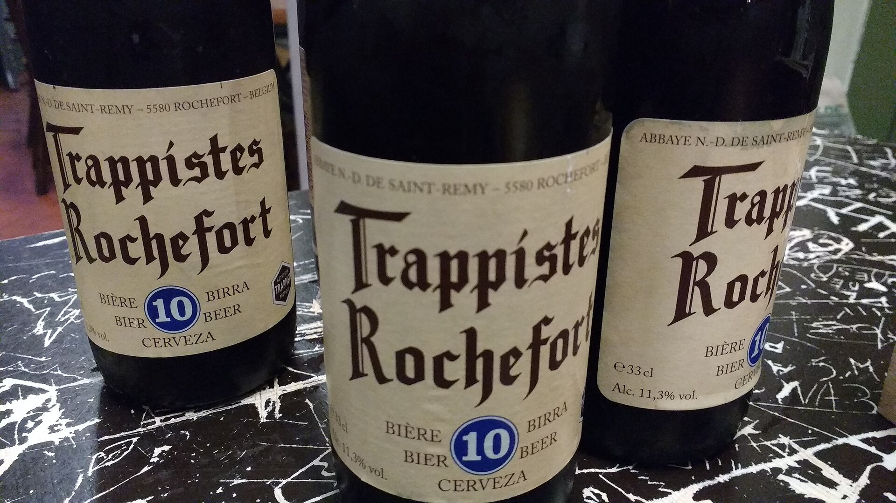

# 罗什福尔 10 号

罗什福尔 10 号（Rochefort 10）是比利时罗什福尔圣雷米修道院（Abbaye Notre-Dame de Saint-Rémy）酿造的深色[特拉普斯特艾尔](ref:abbey-beer)，常见 [11.3% vol](ref:abv)、33 cl。它最容易被读错的地方就在名字里：官方明确说，“10”不是酒精度，而是旧比利时用来表示麦汁密度的单位。把编号当酒精度的误读，几乎出现在每一篇中文介绍里。

图：罗什福尔 10 号相关实景照片。图片：Fernando Losada Rodríguez，CC BY-SA 4.0，via Wikimedia Commons（[原图页面](https://commons.wikimedia.org/wiki/File:Trappistes_Rochefort_10_(Caf%C3%A9_Kafka).001_-_Brussel.JPG)）。

## “10”不是 10%：一个旧密度单位

罗什福尔官方的三款核心产品页都写了同一句话：编号来自旧比利时测量单位，用来表达麦汁的密度，与最终酒精度无关。10 号的实际酒精度是 11.3% vol，6 号是 7.5% vol，8 号是 9.2% vol。这个单位与今天的[原麦汁浓度](ref:original-gravity)概念相近，但不要把它直接换算成柏拉图度或糖度；不同历史时期的测量方式并不统一。理解这一点，就不会把“10 号”当成“10% 的烈性啤酒”。

## 1230 年的圣雷米修道院

圣雷米修道院建于 1230 年，位于比利时那慕尔省，至今仍是一座在运作的修道院。修士遵循圣本笃会规“ora et labora”（祈祷与劳动），每天按七个日课划分时间。修道院在法国大革命期间被弃置、出售，直到 1887 年修士才回到罗什福尔重建教堂与酒厂；它的院训“Curvata resurgo”（弯下又站起）正好概括了这段历史。

## 1595 年的第一份酿酒记录

修道院的第一份酿酒文字记录出现在 1595 年。当时啤酒主要作为“液体面包”供修士日常饮用，并不是面向市场的商品；修道院的经济支柱长期是农业、采石与大理石开采，罗什福尔的大理石甚至出现在罗马圣彼得大教堂与凡尔赛宫。1910 年，修道院才正式靠售酒补充收入；1952 年，酿酒从“副业”转为专业化；1960 年，新酒厂建成。

## 1950 年的 6 号与“奇迹”10 号

今天的产品线从 1950 年的 6 号开始，官方称它为“Trappiste”，是三者中最早、最轻的一款。8 号原本是 1950 年代为圣诞季酿造的“Spéciale”，后来才进入常规产品线。10 号在 1950 年代初上市，是当时产品线里的第二款，曾被昵称为“Merveille”（奇迹）。三款酒的上市顺序不是 6→8→10 的简单升级，而是先有 6，再有 10，8 号最后补进常规线。

## 1960 年的“啤酒大教堂”与 2020 年新车间

1960 年建成的罗什福尔酒厂有彩绘玻璃与铜制糖化锅，被称作“啤酒大教堂”（the cathedral of beer），在很长一段时间里是修道院啤酒的视觉符号。2020 年，修道院启用新的糖化车间，旧的“大教堂”退出生产、只作为遗产保留。新设备让酒厂得以补上 Triple Extra——罗什福尔产品线里唯一的一款金色艾尔。规模仍然有限：官方强调罗什福尔啤酒“以有限规模生产，以尊重修道院的价值与传统”。

## 11.3% 的四料：6 号 7.5%、8 号 9.2%

三款核心酒的参数可以直接排开：6 号 7.5% vol，琥珀/红宝石色，口感平衡、带谷物与焦糖；8 号 9.2% vol，深色，焦糖与深色浆果更突出，是比利时本土最受欢迎的一款；10 号 11.3% vol，深棕、奶油色泡沫，烘焙、咖啡、巧克力与香料最集中。所谓“四料”（quadrupel）是习惯分类，不是法定等级；罗什福尔官方用的是“深色艾尔”与编号，而不是“四料”这个词。

## Tridaine 泉水与修道院的井

罗什福尔的水来自修道院所在的 Tridaine 山泉。官方酒厂页讲了一个细节：修士当年在山坡采矿时，Tridaine 的水从岩层里涌出；懂行的人认为，正是这股水给了罗什福尔啤酒独特的风味。官方配料表写的是水、大麦芽、糖、酵母、啤酒花与香料——水排在第一位，这不是排版习惯，而是它确实是占比最大的原料。

## 每周五的修士品评

罗什福尔官方说，每周五都会在一位修士在场的情况下举行品评，通过之后啤酒才会发往世界各地。这个细节比“修道院啤酒”四个字更能说明制度：酿酒师负责工艺，修士负责监督与最终判断。它也解释了为什么罗什福尔的产量小、产品线窄——规模被有意控制在修道院能亲自照看的范围内。

## 12–14 °C、33 cl 与慢饮

官方建议 10 号在 12–14 °C 饮用，标准包装是 33 cl。这个温度比普通拉格高，目的是让烘焙、咖啡与巧克力的香气展开；温度太低，11.3% 的酒精会被压成单纯的苦，温度太高又会显得灼热。倒酒时沿杯壁缓慢注入，给泡沫留出空间；11.3% 不是可以“一口闷”的强度，慢喝才能分辨 6 号、8 号与 10 号之间的层次差。

## 配餐：11.3% 为什么适合炖菜

10 号的烘焙、咖啡、巧克力与香料，适合法兰德斯式啤酒炖牛肉（carbonnade flamande）、红酒炖肉、硬质成熟奶酪和 70% 以上的黑巧克力；11.3% 的酒精能切开脂肪，烘焙苦味又能接住焦糖化的洋葱与肉汁。和智美蓝帽相比，10 号更偏“烘焙与苦”，蓝帽 9% 更偏“巧克力与焦糖的圆润”；所以蓝帽配洗浸奶酪更顺，10 号配炖肉与硬奶酪更有力量。

## 罗什福尔与智美：两套修道院体系

两者都持有 Authentic Trappist Product 认证，但体系不同：智美 1850 年建院、1862 年建酒厂，装瓶线约 55,000 瓶/小时，规格从 33 cl 一直到 6 L，出口与餐饮覆盖更广；罗什福尔 1230 年建院、1595 年有酿酒记录，产量有限、核心规格是 33 cl，靠每周五的修士品评把关。风味上，智美蓝帽 9% 以巧克力、焦糖与糖渍水果为主，罗什福尔 10 号 11.3% 以烘焙、咖啡与香料为主。认证相同，经营规模与风味方向并不相同。

## 修道院 €4.50 的 33 cl 价格带

以 2026 年 11 月可查的修道院商店价格为例，33 cl 的罗什福尔 10 号约 €4.50；其他零售与酒吧渠道通常更高，具体取决于税费、运费与场所。价格会随渠道、批次波动，修道院商店价只是一个基准，不是全球统一价。把“稀缺”直接等同于“昂贵”也不准确：罗什福尔不是智美那种大规模出口品牌，但它的常规款并不属于拍卖级定价。

## 常见误解：编号越大越值得陈年？

编号表达的是麦汁密度，不是年份、等级或陈年潜力。10 号是当前核心线里最烈的一款，但 6 号才是 1950 年最早的产品；编号大不代表“更好”，也不代表“更适合久放”。另一条常见误解是把 Trappist 当成 Abbey beer 的同义词：Abbey beer 可以是商业酒厂对修道院风格的模仿，Trappist 则需要修道院内生产、修士监督与收入用于修道院及慈善三项同时成立。

## 选购与存放

买的时候先看瓶身的 11.3% vol、33 cl 与灌装日期，再和修道院商店 €4.50 的 33 cl 价对照；明显高于这个数字，通常是进口与渠道溢价。存放在阴凉、避光、直立的位置，避免温度剧烈变化；11.3% 的深色艾尔有一定稳定性，但“能放”不等于“越放越好”，建议同场对比新鲜瓶与陈放瓶再决定是否囤货。

## 延伸阅读

- [啤酒](ref:beer)：大类与风格框架。
- [比利时](ref:belgium)：修道院啤酒的产区背景。
- [修道院艾尔](ref:abbey-beer)：Abbey 与 Trappist 的区别。
- [大麦](ref:barley)与[水](ref:water)：罗什福尔的两项主要原料。
- [发酵](ref:fermentation)：深色艾尔的发酵基础。
- [原麦汁浓度](ref:original-gravity)：理解“10”这个编号的关键。
- [智美蓝帽](ref:chimay)与[西麦尔三料](ref:westmalle)：同属特拉普斯特体系的对照。
