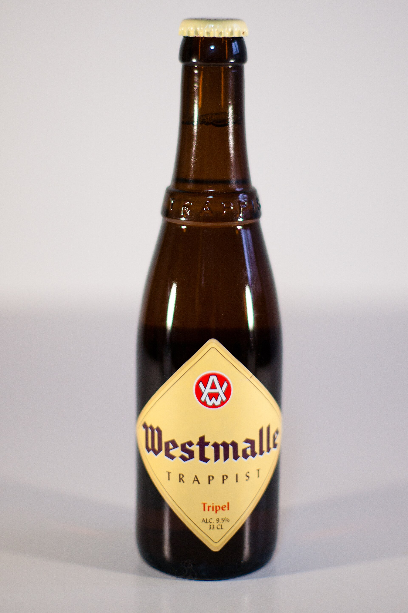

# 西麦尔三料

西麦尔三料是比利时西麦尔修道院酿造的浅色三料修道院艾尔，常见 9.5% vol、330 mL，装瓶后仍在瓶内进行二次发酵。它以香蕉、柑橘、香料与干爽苦味著称，是 tripel 风格的基准款之一。

图：西麦尔三料相关实景照片。图片：Ludovic Péron，CC BY-SA 3.0，via Wikimedia Commons（[原图页面](https://commons.wikimedia.org/wiki/File:Westmalle_-_Tripel.jpg)）。

## 定义与定位

先分层：啤酒是大类，修道院艾尔是传统与制度背景，比利时是产区，西麦尔是修道院与品牌，三料是具体产品。四层分开看，才不会把风格名称、认证标识与瓶中风味混为一谈。

“Tripel”是风格名称，指酒精度较高、颜色偏浅、苦味较明显的比利时艾尔，通常带有香料与果香；它不是法定等级，也不指“三次发酵”。不同酒厂的三料在配方与酒精度上差异很大，具体规格应回到瓶标核对。

## 生产者与品牌

西麦尔啤酒由比利时安特卫普省马勒的西麦尔修道院生产，修道院与酒厂有直接监督关系，属于修道院啤酒体系。酒厂产品线以浅色三料与深色双料为主，风格稳定，是比利时修道院啤酒的代表生产者之一。

修道院、酒厂与产品是三个层级：修道院回答监督与收益去向，酒厂回答设备与工艺，产品回答酒精度、容量与风格。公开资料把三料的推出时间定在 20 世纪 30 年代，具体年份以酒厂资料为准。

## 「西麦尔三料」的产地与原料
产品产自[比利时](ref:belgium)法兰德斯地区。比利时啤酒的两条主要传统是修道院艾尔与兰比克自然发酵，西麦尔属于前者：使用受控酵母、在相对封闭的设备中发酵，追求可重复的稳定风格。

原料是[大麦](ref:barley)、[小麦](ref:wheat)与[水](ref:water)，另加啤酒花与糖。大麦提供糖化所需的淀粉与酶，小麦增加柔顺度，糖在部分高酒精度产品中用于提高可发酵物比例。具体配方与比例不公开，本页不把单一原料当成风格的全部解释。

## 「西麦尔三料」怎么做出来
麦芽经糖化得到麦汁，加入酵母进行[发酵](ref:fermentation)，再经陈放与调配后装瓶。三料通常使用浅色麦芽与糖，酒体偏浅而酒精度较高；较高的发酵温度带来香蕉与香料类香气。

装瓶时加入糖与酵母，使瓶中继续产生二氧化碳与香气，形成二次发酵。瓶底沉淀是酵母与蛋白质的正常沉积，倒酒时可留底。具体工艺参数属于修道院酒厂信息，公开程度有限，本页不给出统一数值。

## 「西麦尔三料」的瓶型与标签
常见[酒精度](ref:abv)为 9.5% vol，容量常见 330 mL，另有礼盒与不同市场版本。标签应核对产品名、风格名称、酒精度、净含量、原料、生产商与批次；修道院认证标识是否存在，也应逐瓶核对。

“Tripel”是风格描述，不等于所有同名产品都来自修道院；部分商业产品使用“abbey beer”一类表述，与认证体系不同。中文背标、进口商与防伪信息是核对身份的依据。

## 「西麦尔三料」的闻与喝
典型香气是香蕉、梨、柑橘与丁香，伴随面包麦香与轻微胡椒；入口甜感明显，酒体中等偏厚，苦味在后段出现，余味干爽且带香料。9.5% vol 让香气集中，也让酒精感更明显，温度过低会压抑层次。

品鉴时建议在 8–10 摄氏度饮用，用郁金香形杯聚拢香气；温度过低会使风味封闭，过高则酒精感突出。倒酒时注意瓶底沉淀，避免把沉积物全部倒入杯中。开瓶后应冷藏并尽快饮用。

## 「西麦尔三料」的饮用与搭配
适合搭配烤肉、禽类、成熟干酪与海鲜；干爽苦味能切开油脂，也能衬托鲜味，是少数适合搭配鱼类的高酒精度啤酒之一。避免与过甜或强酸菜肴同饮，容易掩盖细腻香气。

高酒精度意味着更应控制饮用量与速度。开瓶后气泡会逐渐流失，建议在数日内喝完；存放时应避光、直立、冷藏。本页关于西麦尔三料的内容涉及酒精饮料；过量饮酒有害健康，未成年人不应饮酒。

## 「西麦尔三料」的购买与保存
购买时优先选择正规渠道，核对防伪、中文背标、进口商与批次编号，并确认瓶身认证标识与产品名。价格随市场与渠道波动，本页不给出具体数字；同厂的双料产品应分别核对，不能用三料的规格概括整个酒厂。

未开瓶应避光、阴凉存放，直立以减少沉淀扰动；长期存放不必冷冻，但要避免高温与剧烈温差。瓶内二次发酵意味着酒液仍在缓慢变化，具体适饮期以酒厂建议与瓶标为准。

## 「西麦尔三料」容易被读错的地方
第一，把 Tripel 理解为“三次发酵”。它是风格名称，不指发酵次数。
第二，把“修道院风格”当成认证。认证有专门标识与制度要求。
第三，认为浅色啤酒酒精度低。三料的酒精度通常高于普通拉格。
第四，把瓶底沉淀当成变质。它是二次发酵的正常沉积。
第五，用包装或故事判断品质。原料、工艺与标签信息更可靠。

对照阅读：[啤酒](ref:beer)、[大麦](ref:barley)。

**关键事实。**

| 项目 | 内容 |
| --- | --- |
| 一句话定位 | 比利时西麦尔修道院出产的浅色三料修道院艾尔，常见 9.5% vol、330 mL，瓶内二次发酵；以香蕉、柑橘、香料与干爽苦味著称，是 tripel 风格的基准款之一 |
| 酒种/风格 | 啤酒 |
| 产区 | 比利时 |
| 酒精度 | 9.5–9.5% vol |

**来源与边界。** 本页关于「西麦尔三料」的关键事实，主要由以下来源交叉核对：Abdij van Westmalle（三料产品的酒精度、容量与修道院归属；由原条目末尾参考资料迁移，未逐条复核访问日期）、International Trappist Association（修道院产品认证的公开规则；由原条目末尾参考资料迁移，未逐条复核访问日期）、Oxford University Press（提供关于 tripel 风格与修道院啤酒的条目；由原条目末尾参考资料迁移，未逐条复核访问日期）。价格、批次与状态会变，涉及这些字段时以页面所列来源的最新版本为准。正文为项目自写，来源只作核验，不复制原文。

## 参考资料
- [啤酒](ref:beer)：啤酒的分类与基本工艺。
- [比利时](ref:belgium)：修道院艾尔与兰比克两条传统。
- [大麦](ref:barley)：糖化与发酵的主要原料。
- [小麦](ref:wheat)：小麦啤酒的原料基础。
- [水](ref:water)：水质对发酵与风味的影响。
- [发酵](ref:fermentation)：上面发酵与瓶中二次发酵。
- [酒精度](ref:abv)：9.5% vol 在标签上的含义。
- [智美蓝帽](ref:chimay)：深色修道院艾尔的对照阅读。
- [罗什福尔 10 号](ref:rochefort)：另一款高酒精度修道院艾尔的对照阅读。
