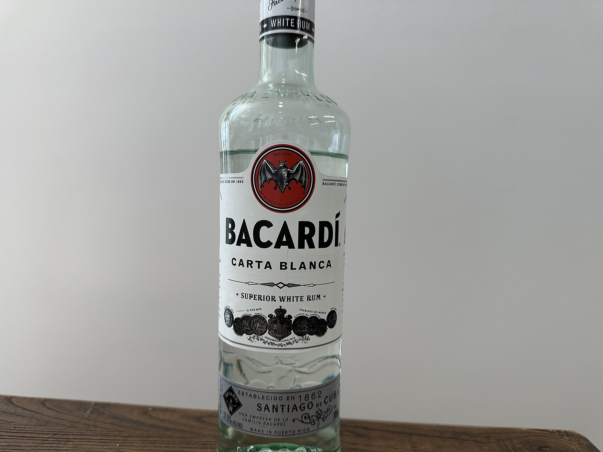

# 百加得白朗姆

百加得白朗姆以糖蜜为原料，经发酵、蒸馏和活性炭过滤，常见酒精度为 40% vol。品牌起源于 1862 年的古巴圣地亚哥，现总部位于百慕大，是全球流通最广的朗姆酒品牌之一。

图：百加得白朗姆相关实景照片。图片：Indrajit Das，CC BY-SA 4.0，via Wikimedia Commons（[原图页面](https://commons.wikimedia.org/wiki/File:Bacardi_Carta_Blanca_Rum_02.jpg)）。

## 定义与定位

百加得白朗姆属于[朗姆酒](ref:rum)中的白色朗姆，是一种以甘蔗糖蜜或蔗汁为原料的蒸馏酒。它不是“甘蔗味的酒精饮料”，而是有明确原料、蒸馏与过滤工艺的烈酒类别。白朗姆强调干净、轻盈，与深色朗姆的陈年、焦糖风格相对。

需要区分品牌与产品：百加得是品牌，Carta Blanca 是具体产品名称。品牌下还有金朗姆、黑朗姆与陈年朗姆等系列，原料与工艺目标不同，不能用一个描述概括全部产品。

在朗姆酒的分类中，白朗姆、金朗姆与陈年朗姆并不是按颜色简单排列。白朗姆强调发酵与蒸馏后的干净酒体，金朗姆可能经过短时木桶接触或调色，陈年朗姆则以橡木桶时间与调配复杂度为核心。消费者若只按颜色选购，容易忽略工艺差异。此外，朗姆酒在产地法规上还有以甘蔗汁为原料的农业朗姆分支，与糖蜜路线并行。

## 产地与历史

百加得由法昆多·百加得·马索于 1862 年在古巴圣地亚哥创立。古巴的甘蔗种植与制糖业为朗姆酒提供了充足原料，加勒比海地区的蒸馏传统也影响了早期工艺。品牌在20 世纪逐步国际化，后因古巴革命将生产与总部迁出。

今天的百加得在波多黎各、墨西哥等地设有生产设施，产品行销多国。产地迁移意味着同一品牌不同产品可能来自不同工厂，具体产地应看标签。朗姆酒的“古巴风格”是风味与历史的描述，不是所有产品都在古巴生产。

## 原料

主要原料是甘蔗糖蜜，即制糖过程中的副产品。糖蜜含有可发酵糖与矿物质，发酵前通常加水稀释并调整糖度。部分朗姆酒使用甘蔗汁直接发酵，风味更接近新鲜甘蔗，但白朗姆的主流路线仍是糖蜜。

原料质量影响发酵起点。糖蜜的储存与处理不当会带来焦味或杂味，因此生产商需要控制温度与卫生。水在稀释、发酵与降度中反复使用，水质同样影响最终口感。

## 「百加得白朗姆」怎么做出来
典型流程是：糖蜜稀释、发酵、[蒸馏](ref:distillation)、稀释、活性炭过滤、调配与装瓶。发酵时间从十几小时到数天不等，温度与酵母菌株决定风味前体；蒸馏多在连续蒸馏器中进行，以获得较高的酒精浓度与较干净的酒体。

活性炭过滤是白朗姆的关键步骤，它去除部分颜色、杂醇与较重的风味，使酒体更轻盈。过滤程度由生产商决定，过度过滤会损失个性，不足则可能留下不悦的杂味。过滤后通常加水降度至 40% vol，再静置、调配与装瓶。

## 「百加得白朗姆」的闻与喝
白朗姆通常轻盈、干净，带有甘蔗甜香、轻微香草与柑橘气息，入口柔和，回味短。它与陈年朗姆的香草、焦糖、香料风格不同，评价重点在干净度与平衡，而不是复杂度。

品鉴时可以纯饮一小口，感受甜感与酒精刺激；再加冰或加水，观察香气是否变化。白朗姆不适合用重桶味标准评价；若出现明显刺鼻、溶剂味或甜腻感，说明品质或保存有问题。

## 产品体系与标签

百加得的产品体系包括白朗姆、金朗姆、黑朗姆与陈年朗姆等。酒标上的酒精度、容量、产地与产品名称，是核对身份的基本信息。白朗姆的“白”指过滤后的颜色与风格，不代表未陈年或未经处理。

部分市场存在仿冒与相似命名，应通过正规渠道购买。调酒用的白朗姆与纯饮用的陈年朗姆定位不同，价格差异来自工艺与陈年，而不是单纯的品牌溢价。具体酒款的甜度与是否添加糖，应以标签与官方信息为准。

## 「百加得白朗姆」的饮用与搭配
白朗姆最适合调制鸡尾酒：莫吉托、代基里、自由古巴都以它为基酒。调制时注意青柠酸度、糖浆甜度与冰块稀释的平衡，白朗姆的干净酒体能承接这些风味而不喧宾夺主。

纯饮时可以加冰，但不建议大口快饮。搭配清淡海鲜、热带水果与柑橘类甜点较合适；重辣或重酱汁菜肴会掩盖其细微香气。开瓶后应避光保存，长期暴露在空气与高温中会使香气变钝。

## 「百加得白朗姆」容易被读错的地方
第一，认为白朗姆没有陈年。白朗姆可以短期陈放后过滤，颜色白不等于未经处理。
第二，把百加得当作品类名。它是品牌，朗姆酒才是类别。
第三，认为所有朗姆酒都来自古巴。产地已多元化。
第四，认为白朗姆只能调酒。纯饮也可以，只是风味较轻。
第五，用甜味判断品质。添加糖与工艺选择不同，甜不等于好。

对照阅读：[朗姆酒](ref:rum)、[酒精度（ABV）](ref:abv)。

相关条目：[蒸馏](ref:distillation)。

**关键事实。**

| 项目 | 内容 |
| --- | --- |
| 一句话定位 | 以糖蜜为原料的白色朗姆酒，经发酵、蒸馏与活性炭过滤，常见酒精度 40% vol，适合调制莫吉托和代基里 |
| 酒种/风格 | 朗姆酒 |
| 酒精度 | 40–40% vol |

**来源与边界。** 本页关于「百加得白朗姆」的关键事实，主要由以下来源交叉核对：Bacardí（品牌历史、原料与产品信息）、European Union（朗姆酒的定义与最低酒精度）、Oxford University Press（提供关于朗姆酒与百加得的条目；由原条目末尾参考资料迁移，未逐条复核访问日期）。价格、批次与状态会变，涉及这些字段时以页面所列来源的最新版本为准。正文为项目自写，来源只作核验，不复制原文。

**并读。** 把「百加得白朗姆」与「朗姆酒」、「蒸馏」、「酒精度（ABV）」放在一起读时，先确认它们是同一层级还是上下游关系：先确认酒种与产区，再比较年份、酒精度、价格与饮用场景。本页负责给出酒款的基本坐标，对照条目补上具体案例与差异；读完再回到本页，才能分清哪些差别属于酒款本身，哪些只是产地、批次或品牌选择。

## 参考资料
- [朗姆酒](ref:rum)：朗姆酒的定义、原料与主要类型。
- [蒸馏](ref:distillation)：连续蒸馏如何影响酒体干净度。
- [酒精度](ref:abv)：理解 40% vol 标签与降度工艺。
