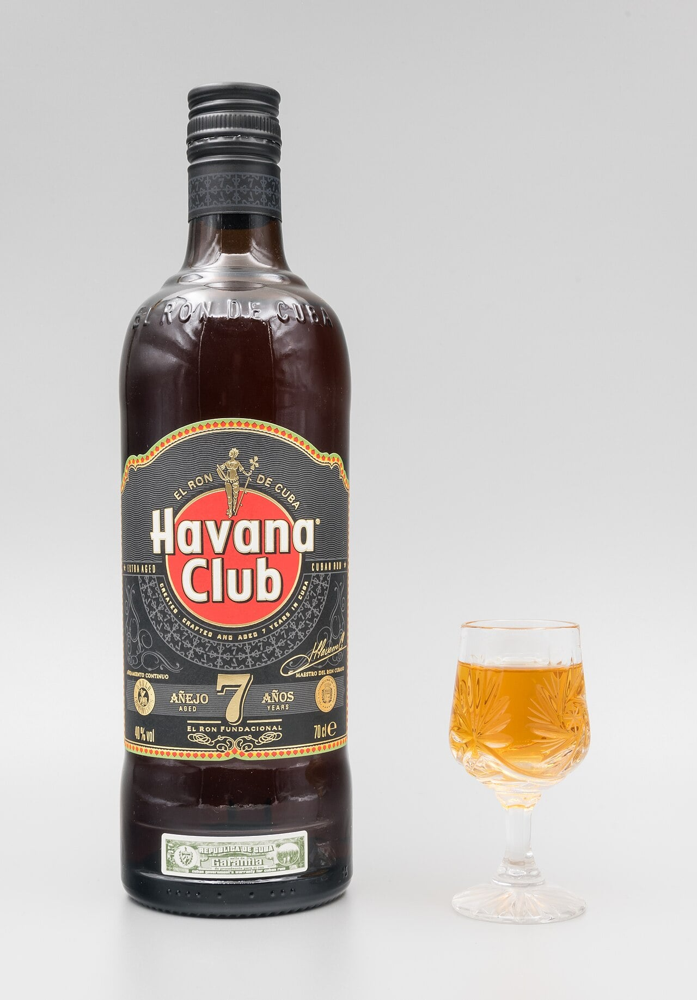

# 哈瓦那俱乐部7年

哈瓦那俱乐部 7 年是古巴朗姆酒品牌，由古巴糖蜜蒸馏的朗姆酒调配并陈年，常见酒精度为 40% vol。风味以香草、焦糖、烟草和热带水果为主。

图：哈瓦那俱乐部 7 年陈酿瓶与一只盛酒的郁金香杯，瓶身标签上的“7 Años”清晰可见。图片：Jacek Halicki，CC BY-SA 4.0，via [原图页面](https://commons.wikimedia.org/wiki/File:2023_Havana_Club_A%C3%B1ejo_7_A%C3%B1os_(3).jpg)。

## 定义与定位

哈瓦那俱乐部是品牌，7 年是产品名称，朗姆酒是类别。它属于[朗姆酒](ref:rum)中的陈年朗姆，而不是白色朗姆。品牌名称中的“哈瓦那”指向古巴首都与朗姆酒传统，但不表示每一瓶都在哈瓦那生产。

品牌归属存在长期争议：古巴国营企业与法国保乐力加合作生产，另一家企业在部分市场使用相似商标。消费者购买时应看标签上的生产商、产地与进口信息，而不是只凭品牌名判断。

陈年朗姆与白朗姆的差别不仅在颜色，还在木桶接触带来的单宁、香草醛与酯类变化。过滤与添加糖也会改变最终口感，因此“深色”不等于“陈年更久”，“甜”也不等于“品质更高”。

## 产地与历史

古巴的甘蔗种植与制糖业为朗姆酒提供了原料基础，加勒比海的蒸馏传统也影响了当地工艺。哈瓦那俱乐部品牌创建于 20 世纪 30 年代，后来在古巴革命后经历国有化与国际合作，形成了今天的生产与销售格局。

产地与历史的复杂性意味着“古巴朗姆”既是一个地理描述，也是一个市场叙事。理解产品时，应把品牌历史、生产地与具体批次分开，避免用故事替代标签信息。

## 原料

主要原料是甘蔗糖蜜。糖蜜经稀释、调整糖度后发酵，酵母与温度决定风味前体。部分朗姆酒使用甘蔗汁，但陈年朗姆的主流路线仍是糖蜜，以获得稳定的糖分与较完整的口感。

水在发酵、稀释与降度中反复使用，水质影响最终口感。原料与水的处理不当会带来杂味，因此生产商需要控制储存温度与卫生条件。具体配方属于生产者信息。

## 「哈瓦那俱乐部7年」怎么做出来
典型流程是：糖蜜处理、发酵、[蒸馏](ref:distillation)、陈年、调配、降度与装瓶。陈年通常使用橡木桶，[橡木桶陈酿](ref:oak-ageing)带来香草、焦糖、香料与木质气息，并使酒体更圆润。

陈年后的调配是陈年朗姆的关键：不同桶龄、不同风格的原酒按比例组合，以达到稳定的香气与口感。酒名中的“7 年”是产品标示，具体原酒的年龄结构与比例由生产者决定，不等于瓶中最年轻酒液一定是 7 年。

陈年仓库的温度与湿度影响酒液与木桶之间的交换，也影响“天使分享”的比例。热带气候下熟成速度通常更快，风味变化更明显；这也是古巴朗姆与温带陈年朗姆风格差异的来源之一。

## 「哈瓦那俱乐部7年」的闻与喝
哈瓦那俱乐部 7 年通常表现为香草、焦糖、烟草、热带水果与轻微香料，口感圆润，甜感明显，余味中等。它比白朗姆更复杂，但仍属于调配型陈年朗姆，不以单一桶的极端个性见长。

品鉴时可以先纯饮一小口，感受甜感与木质香气；再加一块大冰，观察香气是否展开。若出现明显的溶剂味、过重甜腻或苦尾，说明品质或保存有问题。甜感可能来自陈年与添加糖，具体应以标签与官方信息为准。

## 产品体系与标签

哈瓦那俱乐部的产品包括白朗姆、陈年朗姆与高端系列，7 年位于中端陈年产品。酒标上的酒精度、容量、产地、生产商与陈年标示，是核对身份的基本信息。

不同市场的版本可能存在配方与标签差异，进口产品应有中文标签与合规信息。购买时应通过正规渠道，核对防伪与进口商信息；价格与稀缺性不等于品质，批次差异仍需实际品鉴。

调配师会根据不同桶龄原酒的香气特征进行组合，目标是在甜感、木质与果香之间取得平衡。批次差异因此存在，同一产品不同装瓶年份可能略有不同，这正是需要实际品鉴而非只看标签的原因。

## 「哈瓦那俱乐部7年」的饮用与搭配
适合纯饮或加冰，也可以用于调制古巴风格的鸡尾酒。纯饮时加一块大冰能降低刺激并缓慢释放香气；加可乐会遮盖大部分细节，适合轻松饮用而非品鉴。

搭配雪茄、黑巧克力、焦糖甜点与烤肉较合适；清淡海鲜会被甜感与木质气息压过。开瓶后应避光、阴凉保存，尽快喝完，避免长期氧化。

## 「哈瓦那俱乐部7年」容易被读错的地方
第一，把“7 年”当成瓶中酒液的最低年龄。它是产品标示，具体年龄结构由生产者决定。
第二，认为所有古巴朗姆都在古巴生产。品牌与产地关系复杂，应看标签。
第三，把陈年朗姆当作白朗姆的加色版本。两者工艺与风格目标不同。
第四，认为甜感越强越好。甜度是风格选择，不是品质标准。
第五，用鸡尾酒体验替代纯饮品鉴。加料会掩盖细节。

对照阅读：[朗姆酒](ref:rum)、[橡木桶陈酿](ref:oak-ageing)。

**关键事实。**

| 项目 | 内容 |
| --- | --- |
| 一句话定位 | 古巴朗姆酒品牌，以糖蜜蒸馏的朗姆酒调配并陈年，常见酒精度 40% vol，风味以香草、焦糖与热带水果为主 |
| 酒种/风格 | 朗姆酒 |
| 酒精度 | 40–40% vol |

**来源与边界。** 本页关于「哈瓦那俱乐部7年」的关键事实，主要由以下来源交叉核对：Havana Club（产品系列、陈年与酒精度信息）、European Union（朗姆酒的定义与类别）、Oxford University Press（提供关于古巴朗姆与哈瓦那俱乐部的条目；由原条目末尾参考资料迁移，未逐条复核访问日期）。价格、批次与状态会变，涉及这些字段时以页面所列来源的最新版本为准。正文为项目自写，来源只作核验，不复制原文。

**并读。** 把「哈瓦那俱乐部7年」与「朗姆酒」、「蒸馏」、「橡木桶陈酿」放在一起读时，先确认它们是同一层级还是上下游关系：先确认酒种与产区，再比较年份、酒精度、价格与饮用场景。本页负责给出酒款的基本坐标，对照条目补上具体案例与差异；读完再回到本页，才能分清哪些差别属于酒款本身，哪些只是产地、批次或品牌选择。

## 参考资料
- [朗姆酒](ref:rum)：朗姆酒的定义、原料与主要类型。
- [蒸馏](ref:distillation)：蒸馏方式如何影响酒体。
- [橡木桶陈酿](ref:oak-ageing)：陈年朗姆的香气来源。
- [酒精度](ref:abv)：理解 40% vol 与降度工艺。
