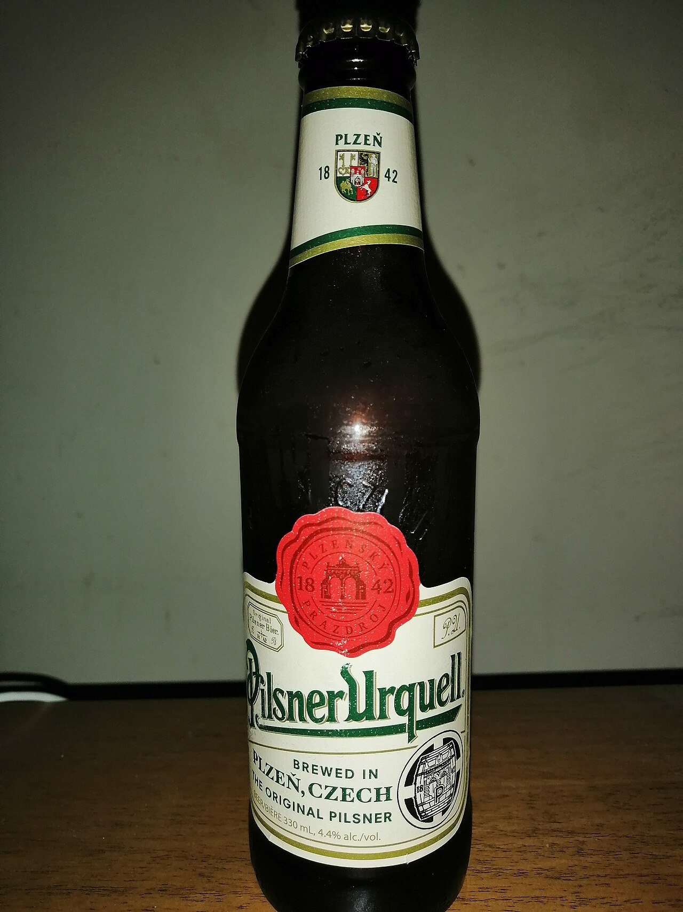

# 皮尔森之源

皮尔森之源产自捷克皮尔森市，1842 年首次酿造，是淡色拉格啤酒的原型之一。它使用当地软水、萨兹酒花、三重煮出糖化和开放式发酵，酒精度约 4.4% vol。

图：皮尔森之源。摄影：Pilsner Urquell 330mL Bottle。署名：Latterdaystan，CC BY-SA 4.0，来自 Wikimedia Commons（[来源](https://commons.wikimedia.org/w/index.php?curid=92861055)）。

## 定义与定位

皮尔森之源是具体品牌与产品，同时被视为“皮尔森”风格的开端。[啤酒](ref:beer)中的淡色拉格，指下面发酵、低温熟成、颜色浅、苦味清晰的啤酒；皮尔森之源是这一风格的历史原型，但不是所有叫“Pilsner”的产品都来自皮尔森。

“Pilsner”后来成为风格名，许多国家都生产自己的皮尔森型啤酒。原产地标识与风格名是两回事：前者指向特定产地与生产者，后者只描述工艺与风味方向。阅读酒标时，应区分品牌、风格与产地；看到“Pilsner”时，先确认它指风格还是品牌。

## 产区与环境

皮尔森位于捷克西部，属温带大陆性气候，冬季寒冷、夏季温和，降水适中。当地水源以软水著称，低矿物含量有利于突出酒花的苦味与香气，也影响糖化与发酵的稳定性。这种水一度是皮尔森风格形成的关键条件。

[风土](ref:terroir)在这里更多体现为水、土壤与农业条件，而不是葡萄酒语境中的地块差异。捷克的啤酒大麦与萨兹酒花（Žatec）构成原料基础；酒花带来草本、辛香与细微的柑橘感，是皮尔森苦味与香气的核心。

## 原料

主要原料是大麦芽、水、酒花与酵母。大麦经发芽、烘干制成麦芽，提供可发酵糖与颜色；皮尔森使用浅色麦芽，因此酒体呈金黄色。萨兹酒花香气细腻、苦味干净，是风格识别的重要线索。

水质影响糖化 pH 与矿物质平衡。软水使酒花苦味显得直接而不粗糙，也帮助酵母工作。原料比例、麦芽烘焙程度与酒花添加时机，都会改变最终的香气与苦度。

## 「皮尔森之源」怎么做出来
典型流程包括：麦芽粉碎、糖化、过滤、煮沸、冷却、接种酵母、主发酵、后发酵与低温熟成。皮尔森之源传统上采用三重煮出糖化，分次取出部分醪液煮沸再返回，以提高糖化效率并影响风味。

主发酵使用开放式发酵槽，便于观察泡沫与排出杂质；之后进行低温熟成，使酵母沉降、风味稳定。过滤与杀菌方式影响货架期与新鲜度。具体工厂的工艺细节属于生产者信息，本页只描述公开的传统路线。

萨兹酒花的香气需要适当的苦味支撑。酒花添加通常分多次进行：早期添加提供苦味，后期添加保留香气。捷克皮尔森的苦味被描述为“干净”，这与软水、浅色麦芽和较低的矿物含量有关，而不是单纯增加酒花用量。

捷克啤酒消费文化深厚，皮尔森常作为日常佐餐酒，而不是只在节庆出现。这种消费场景也影响了产品的酒精度与包装规格，使淡色拉格成为当地最普遍的啤酒类型。

## 「皮尔森之源」的闻与喝
皮尔森之源通常表现为麦芽甜香、萨兹酒花的草本与辛香，苦味清晰但平衡，收口干净，酒体中等偏轻。它不是重酒体或高苦度的 IPA，也不以浓郁果香见长；评价重点在干净度、苦味质感与麦芽支撑。

品鉴时先观察颜色与泡沫，再闻麦芽与酒花；入口感受苦味出现的时机与持续长度。温度过低会压抑香气，过高则显得松散。与其它皮尔森比较时，应使用同一风格框架，而不是用 IPA 的苦度标准评判。

## 产品体系与标签

皮尔森之源的产品包括不同包装与市场的版本，酒精度与原麦汁浓度可能因产品而异。酒标上的品牌、产地、酒精度、原麦汁浓度与保质期，是核对身份的基本信息。[饮料酒分类](ref:gbt-17204)将啤酒归入发酵酒，理解分类有助于避免把它与蒸馏酒混淆。

“原装进口”“捷克原产”等表述需要结合进口标签与生产商信息判断。不同市场的配方调整可能改变酒精度与风味；购买时应查看标签，而不是只凭品牌名与包装。

## 「皮尔森之源」的饮用与搭配
冷藏至约 6–8°C，使用洁净的玻璃杯。捷克常见的倒酒方式会产生不同厚度的泡沫，影响香气与口感；在家中不必追求复杂仪式，但应避免泡沫过厚或过薄。开瓶后尽快喝完，反复升温会加速氧化。

搭配烤猪肘、炸鸡、香肠与面包较合适；清淡海鲜与沙拉也能衬托其苦味与麦芽甜。重辣菜肴会掩盖细腻的酒花香气。啤酒应适量饮用，避免空腹快速饮用。

## 「皮尔森之源」容易被读错的地方
第一，把所有淡色拉格都叫皮尔森。皮尔森是特定风格，不是所有浅色啤酒。
第二，认为苦味越强越正宗。苦味需要麦芽与酒体支撑。
第三，把“Pilsner”当作产地保证。它已演变为风格名。
第四，认为啤酒越冰越好。过低温度会压抑香气。
第五，用 IPA 的标准评价皮尔森。两者目标不同。

对照阅读：[啤酒](ref:beer)、[风土（terroir）](ref:terroir)。

**关键事实。**

| 项目 | 内容 |
| --- | --- |
| 一句话定位 | 捷克皮尔森市的淡色拉格啤酒，1842 年首次酿造，使用软水、萨兹酒花与三重煮出糖化，酒精度约 4.4% vol |
| 酒种/风格 | 啤酒 |
| 酒精度 | 4.4–4.4% vol |

**来源与边界。** 本页关于「皮尔森之源」的关键事实，主要由以下来源交叉核对：Plzeňský Prazdroj（品牌历史、原料与酿造信息）、Beer Judge Certification Program（捷克淡色拉格的风格描述）、Oxford University Press（提供关于皮尔森、捷克啤酒与煮出糖化的条目；由原条目末尾参考资料迁移，未逐条复核访问日期）。价格、批次与状态会变，涉及这些字段时以页面所列来源的最新版本为准。正文为项目自写，来源只作核验，不复制原文。

**并读。** 把「皮尔森之源」与「啤酒」、「GB/T 17204-2021《饮料酒术语和分类》」、「风土（terroir）」放在一起读时，先确认它们是同一层级还是上下游关系：先确认酒种与产区，再比较年份、酒精度、价格与饮用场景。本页负责给出酒款的基本坐标，对照条目补上具体案例与差异；读完再回到本页，才能分清哪些差别属于酒款本身，哪些只是产地、批次或品牌选择。

## 参考资料
- [啤酒](ref:beer)：啤酒的大类、原料与基本工艺。
- [饮料酒分类](ref:gbt-17204)：啤酒在饮料酒体系中的位置。
- [风土](ref:terroir)：水与农业条件如何影响风格。
- [酒精度](ref:abv)：理解 4.4% vol 与低度发酵酒。
