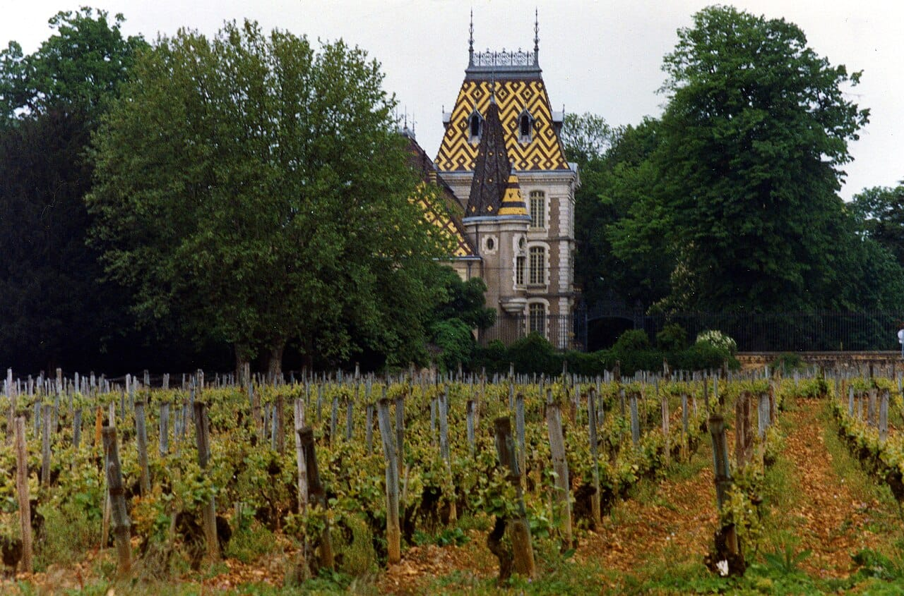

# 阿洛斯-科尔通

阿洛斯-科尔通（Aloxe-Corton）是[法国](ref:france)[勃艮第](ref:burgundy)伯恩丘最北端的村庄之一，葡萄园从村舍背后直接爬上一座孤立的山丘。1862 年，阿洛斯村把山上最值钱的略地之名加进村名，才有了今天这个双名——在欧洲葡萄酒史上，这是村庄向名园借光的典型案例。村内以[黑皮诺](ref:pinot-noir)酿[红葡萄酒](ref:red-wine)，以[霞多丽](ref:chardonnay)酿[白葡萄酒](ref:white-wine)；常见 750 mL，[酒精度](ref:abv)约 12.5%–13.5% vol。

图：阿洛斯-科尔通。图片：PhillipC，CC BY 2.0，via Wikimedia Commons（[原图页面](https://commons.wikimedia.org/wiki/File:Aloxe-corton-21.jpg)）。

> **先给结论**
> **一句话：** 这页判断阿洛斯-科尔通适不适合你，以及怎么喝、怎么搭。
>
> - **适合谁：** 想弄懂阿洛斯-科尔通是什么、怎么喝、适合什么场景的人。
> - **不适合谁：** 只找最低价购买链接、不关心风味和使用场景的人。
> - **先看这两点：**
>   - 2026 年欧洲零售的常见区间大致是：村庄级红 30–45 欧元，一级园 45–75 欧元，科尔通特级园 90–180 欧元。
>   - 红的高单宁与高提取需要蛋白质与脂肪来“卸力”：烤牛排、红酒炖牛肉、烤野禽、硬质或洗皮奶酪（Époisses、Ami du Chambertin）都合适。

## 一座山，两种身份

先要把三件事拆开：村庄级 AOC、特级园 AOC、以及地块所在的行政村。阿洛斯-科尔通村庄级是独立产区，葡萄必须来自阿洛斯-科尔通与拉多瓦-塞里尼两村的划定地块；科尔通（Corton）与科尔通-查理曼（Corton-Charlemagne）则是另外两个特级园产区，横跨阿洛斯、拉多瓦与佩尔南三村。同一座山，三套法规身份，酒标上写哪一个，决定了它是村酒还是特级园。

时间线也要分开：村庄级 AOC 自 1938 年起，科尔通与科尔通-查理曼两个特级园则自 1937 年 7 月 31 日起。村庄级之下再分两级：普通村庄级，以及 14 个一级园气候（climat）。其中 8 个在阿洛斯村内，6 个在拉多瓦村内——这一点常被忽略：买一瓶“Aloxe-Corton Premier Cru”，地块未必在阿洛斯。

## Corton 山丘的坡度、朝向与泥灰岩

科尔通山海拔约 250–330 米，形似一座半圆剧场，这种地形在伯恩丘并不多见。山体剖面几乎是教科书：中坡平缓，土壤呈红棕色、多砾石，来自褐色石灰岩与富含钾的泥灰岩；坡上则是更年轻的牛津阶石灰岩，与拉多瓦至默尔索一线相连。村庄级葡萄园多在 200–300 米，坡向以正东为主，日照充足，成熟较早。

白特级园的地块更高：科尔通-查理曼位于 280–330 米，坡度 20%–23%，且以西南向为主——在普遍朝东的伯恩丘，这是罕见的朝向。土壤是黄、赭、褐色的泥灰岩，黏土丰富，石灰岩层与泥灰岩交替，上面只覆一层薄薄的 rendzina。红与白的分界，本质上是海拔、坡度与泥灰岩比例的分界，不是简单一句“山南山北”。

## 特级园名单与共享关系

科尔通特级园 2022 年有红 87.04 公顷、白 3.95 公顷，1937 年 7 月 31 日获 AOC。它是伯恩丘唯一以红葡萄酒为主体的特级园；红可以在地块名后标注气候，白则没有这个权利。阿洛斯村内的白特级园主要是 Le Charlemagne 气候。

科尔通-查理曼共 57.70 公顷，同样自 1937 年 7 月 31 日起，由阿洛斯、拉多瓦、佩尔南三村共享。三个村的对应气候不同：阿洛斯是 Le Charlemagne，佩尔南是 En Charlemagne，拉多瓦是 Pougets、Corton、Languettes 等。还有一条极特殊的规则：同一块地若种黑皮诺，可申报科尔通；若种霞多丽，可申报科尔通-查理曼，由生产者按品种选择。这条规则让“红白分界”在地块层面变得可逆。

## Le Charlemagne：皇帝的地块

775 年，查理曼把这块葡萄园捐给索略（Saulieu）的圣安多什教堂，此后近一千年它都留在教会产业里。今天科尔通-查理曼仍以“皇帝”为名，把 Charlemagne 与 En Charlemagne 两个气候以及若干相邻地块收拢在同一面旗帜下。至于“皇帝胡子被红酒染红、于是改种白葡萄”的故事，属于流传已久的传说，不宜当作史实引用；可核实的是捐赠年份、教会持有与 1937 年的 AOC 日期。

## 法规细则：面积、产量与酒精度

按 2018 年 BIVB 数据，村庄级红 118.53 公顷（含一级园 35.91 公顷）、白仅 1.36 公顷（含一级园 0.27 公顷），年均红 4,789 hl、白 49 hl。产量上限：村庄级红 50 hl/ha、白 57 hl/ha；一级园红 48、白 55；对应的 butoir 分别为 58/64 与 56/62。最低天然酒精度：村庄级红 10.5%、白 11%；一级园红 11%、白 11.5%。种植密度不得低于 9,000 株/公顷，行距不超过 1.25 米。

特级园更严：科尔通红 42 hl/ha、白 48 hl/ha，最低天然酒精度红 11.5%、白 12%。这些数字随 cahier des charges 修订可能微调，具体以最新法规文本与 BIVB 公布为准。

## 村庄级白葡萄酒为何只有 1.36 公顷

官方 cahier 自己写道：2008 年全村约 120 公顷，年产约 4,500 hl，其中 98% 是红。白的稀少不是市场选择，而是历史与地块结构的结果——适合霞多丽的高处泥灰岩，大多已被划进科尔通-查理曼特级园。于是出现一个奇特局面：阿洛斯在白的世界里名声很大，但村庄级白葡萄酒几乎可以忽略不计。

## 代表生产者：DRC 的三个地块

罗曼尼-康帝（Domaine de la Romanée-Conti）自 2008 年 11 月 11 日起，以租佃方式接手 Prince Florent de Mérode 名下的科尔通特级园地块，共 2.2746 公顷，分布在 Clos du Roi、Les Bressandes、Les Renardes 三个气候，2009 年首次采收。年产量极不稳定，从不足 3,000 瓶到 8,000 余瓶都有，这也是它价格高企的原因之一。

香东-德-布里亚伊（Chandon de Briailles）则以萨维尼为基地，12 个 cru 分布在萨维尼、佩尔南与阿洛斯三村；2005 年起全面转生物动力。它的阿洛斯酒通常强调整串与低萃取，与 DRC 的路线相反，却同样说明这个村的红不是单一模板。

## 风格坐标：与两个邻居的对比

阿洛斯的红通常颜色深、单宁实、酸度中等偏上，年轻时有黑樱桃、覆盆子与泥土，陈年后转向皮革、蘑菇与落叶。与西侧的佩尔南相比，它更早熟、更厚重；与南侧的萨维尼相比，它更有骨架、更少“讨喜的圆润”。白（几乎都来自特级园）则偏榛子、蜂蜜、燧石与烤苹果，质感厚，酸度被包裹得很好。

这种差异来自地形而非酿酒师：正东坡位与红棕色砾石土让黑皮诺容易达到较高成熟度，泥灰岩提供中间酸度；佩尔南的谷地与更高海拔则把成熟窗口推后，酒体更轻、更花香。

## 价格带：从村庄级到 Corton

2026 年欧洲零售的常见区间大致是：村庄级红 30–45 欧元，一级园 45–75 欧元，科尔通特级园 90–180 欧元；DRC 的科尔通通常在 1,500 欧元以上。白特级园（科尔通-查理曼）约 90–150 欧元，名庄可更高。价格随年份、评分、酒商与汇率明显波动，以上只作量级参考，不是报价。

## 配餐的因果逻辑

红的高单宁与高提取需要蛋白质与脂肪来“卸力”：烤牛排、红酒炖牛肉、烤野禽、硬质或洗皮奶酪（Époisses、Ami du Chambertin）都合适。白的厚质地则适合龙虾、螯虾、奶油汁禽肉与蓝纹奶酪。反过来，清蒸鱼或生蚝会压不住特级园白的桶味与酒体——这不是酒不好，而是搭配错位。

## 一条常见误解：阿洛斯只有红酒

这句话只对了一半。村庄级白确实只有 1.36 公顷，几乎可以忽略；但阿洛斯村内的白特级园地块并不小，科尔通-查理曼有相当部分落在 Le Charlemagne。准确说法是：阿洛斯的村庄级以红为绝对主体，白的名声来自特级园，而不是村庄级。第二个常见误解是把“Aloxe-Corton”直接当成“Corton”：前者是村，后者是特级园，价格与法规都不同。

## 选购核对清单

看酒标时依次核对：村名或特级园名、是否标 premier cru 与气候名、红白类型、年份、装瓶者。特级园必须出现 GRAND CRU 字样；白的科尔通-查理曼不标气候名。村庄级与一级园的价格差通常在一倍以内，特级园则可能翻数倍，遇到“村庄级价格买特级园”的宣传，先查装瓶者与进口商。

## 交叉索引

- [红葡萄酒](ref:red-wine)与[白葡萄酒](ref:white-wine)：本页两个大类。
- [黑皮诺](ref:pinot-noir)与[霞多丽](ref:chardonnay)：红白品种。
- [葡萄](ref:grape)、[发酵](ref:fermentation)、[橡木桶陈年](ref:oak-ageing)：从原料到工艺的三个环节。
- [法国](ref:france)、[勃艮第](ref:burgundy)：产区框架。
- [酒精度](ref:abv)：标签上的酒精标识。
- [科尔通](ref:corton)：与本村共享山丘的特级园条目。
- [佩尔南-韦尔热莱斯](ref:pernand-vergelesses)：山丘西侧的另一产区条目。

对照阅读：[红葡萄酒](ref:red-wine)、[法国](ref:france)。

**关键事实。**

| 项目 | 内容 |
| --- | --- |
| 一句话定位 | 法国勃艮第伯恩丘北端的村庄级法定产区，村庄级葡萄园约 118.5 公顷红、1.4 公顷白；村内拥有伯恩丘唯一以红葡萄酒为主的特级园科尔通（Corton），并与佩尔南、拉多瓦共享白特级园科尔通-查理曼 |
| 酒种/风格 | 红葡萄酒、白葡萄酒 |
| 产区 | 法国、勃艮第 |
| 酒精度 | 12.5–13.5% vol |
