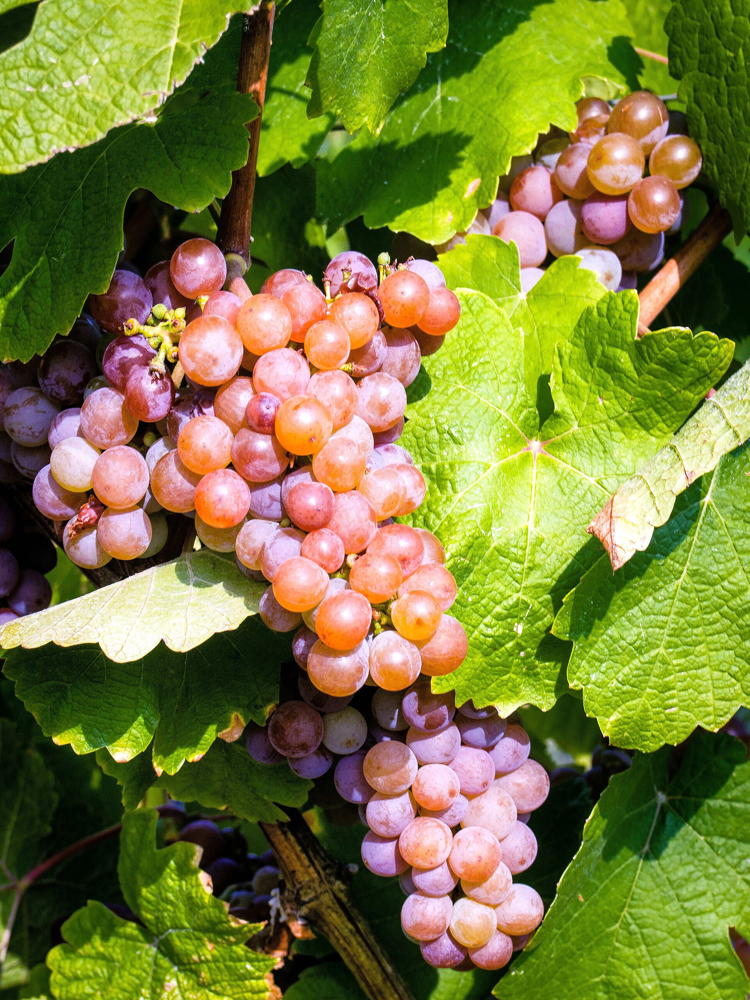

# 阿尔萨斯琼瑶浆

阿尔萨斯琼瑶浆是法国阿尔萨斯产区的[琼瑶浆](ref:gewurztraminer)白葡萄酒。阿尔萨斯以品种单独标注为特色，琼瑶浆通常不与其他品种混酿。酒款可产干型、晚收（Vendanges Tardives，VT）与贵腐精选（Sélections de Grains Nobles，SGN），以荔枝、玫瑰、姜与肉桂香气著称，常见 750 mL，干型[酒精度](ref:abv)约 12.5%–14% vol。

图：阿尔萨斯琼瑶浆相关实景照片。图片：Rolf Kranz，CC BY-SA 4.0，via Wikimedia Commons（[原图页面](https://commons.wikimedia.org/wiki/File:Gewurztraminer_(Andlau,_Alsace).jpg)）。

## 定义与定位

先分层：[白葡萄酒](ref:white-wine)是大类，琼瑶浆是品种，阿尔萨斯是产区，具体酒庄与酒款是生产者层面。阿尔萨斯酒标常直接标注品种名，这是产区制度的特征，不代表每一款都是同一风格。

“阿尔萨斯琼瑶浆”不等于甜酒。同一产区、同一品种可以产出干型、晚收与贵腐精选等不同等级，甜度与浓度差异很大。看到酒标时，应同时确认是否有 VT 或 SGN 标注，以及酒精度与年份。

## 生产者与品牌

阿尔萨斯以家族酒庄为主，也有酒商与合作社。酒庄规模差异很大，有的自有地块并自行装瓶，有的收购葡萄或酒液再调配。阿尔萨斯琼瑶浆的酒标上，装瓶者信息是区分酒庄酒与酒商酒的关键。

生产者、产区与产品是三个层级：产区回答法规与品种制度，生产者回答谁种植、谁酿造、谁装瓶，产品回答年份、等级与规格。同一品种在不同酒庄的风格差异明显，不能用一款酒概括整个产区。

## 「阿尔萨斯琼瑶浆」的产地与原料
阿尔萨斯位于[法国](ref:france)东部，紧邻莱茵河与德国的普法尔茨。产区受山脉屏障影响，降水较少、日照充足，秋季较为干燥，有利于晚收与贵腐菌发展。土壤类型多样，花岗岩、石灰岩、片岩与泥灰岩交错分布。

原料是[葡萄](ref:grape)，品种为[琼瑶浆](ref:gewurztraminer)。阿尔萨斯的品种制度要求单一品种标注时使用规定的品种名，混酿则标注为 Alsace 或相应等级名称，具体以法规为准。

## 「阿尔萨斯琼瑶浆」怎么做出来
干型阿尔萨斯琼瑶浆通常在控温容器中完成[发酵](ref:fermentation)，以保留香气并控制酒精；部分酒庄使用旧橡木桶增加质地。晚收与贵腐精选依赖更高的采收成熟度与贵腐菌，发酵终止点决定最终甜度。

琼瑶浆酸度天然偏低，发酵温度过高或过度萃取会让酒显得松散、酒精感突出。这类酒的发酵温度、残糖与是否用旧桶，酒庄之间差异很大；琼瑶浆的低酸意味着一点工艺偏差就容易被察觉，因此应以酒庄资料与瓶标为准。

## 「阿尔萨斯琼瑶浆」的瓶型与标签
常见容量为 750 mL，干型[酒精度](ref:abv)约 12.5%–14% vol，晚收与贵腐精选可能更高。标签应核对产区名、品种名、年份、等级标注（VT、SGN）、酒精度、装瓶者与进口商信息。

阿尔萨斯酒标常用德语式地名与园地名，中文背标会音译。不同市场的标签语言不同，以瓶身实际标注为准；等级词有法规含义，不能当作营销词随意使用。

## 「阿尔萨斯琼瑶浆」的闻与喝
典型香气是荔枝、玫瑰花瓣、姜、肉桂与葡萄柚皮，香气外放、辨识度高。干型酒款入口酸度偏低、酒体中等偏饱满，酒精感明显；晚收与贵腐精选会增加蜂蜜、杏子与干果气息，甜度高但仍需酸度支撑。

品鉴时建议温度约 8–10 摄氏度，干型可略高。温度过高会让酒精与甜感突出，掩盖香气层次。判断质量时，香气的自然度、酸度与酒体的平衡比香气浓烈程度更重要。

## 「阿尔萨斯琼瑶浆」的饮用与搭配
干型适合搭配亚洲香料菜、泰式酸辣、姜葱类菜肴与软质奶酪；香气与香料感能形成呼应。晚收与贵腐精选适合搭配水果甜点、蓝纹奶酪与鹅肝，但应避免与过甜的食物叠加。

干型适合在 3–8 年内饮用，晚收与贵腐精选可以更久；具体适饮窗口因年份与等级而异。开瓶后应冷藏并尽快饮用。本页关于阿尔萨斯琼瑶浆的内容涉及酒精饮料；过量饮酒有害健康，未成年人不应饮酒。

## 「阿尔萨斯琼瑶浆」的购买与保存
购买时优先选择正规渠道，核对产区名、品种名、等级、年份与装瓶者信息。价格随等级、年份与酒庄声誉差异明显，本页不给出具体数字；等级标注不是质量排序，风格适配更重要。

就「阿尔萨斯琼瑶浆」而言，未开瓶应避光、平放于阴凉处，理想温度为 10–13 摄氏度，避免高温与剧烈温差。软木塞封瓶需保持湿度；长期存放可平放。开瓶后冷藏并尽快饮用，甜酒氧化较慢，但香气仍会下降。

## 「阿尔萨斯琼瑶浆」容易被读错的地方
第一，把阿尔萨斯琼瑶浆当成甜酒。干型酒款同样常见。
第二，认为香气越浓质量越高。酸度与平衡同样重要。
第三，把 VT 与 SGN 当成营销词。它们是有法规含义的等级。
第四，认为琼瑶浆不能搭配咸味菜肴。干型与香料菜、奶酪适配度高。
第五，用价格或包装判断真伪。渠道、背标与装瓶者信息更可靠。

对照阅读：[白葡萄酒](ref:white-wine)、[阿尔萨斯](ref:alsace)。

**关键事实。**

| 项目 | 内容 |
| --- | --- |
| 一句话定位 | 法国阿尔萨斯产区的琼瑶浆白葡萄酒，按品种单独标注，可产干型、晚收（VT）与贵腐精选（SGN）；以荔枝、玫瑰、姜与肉桂香气著称，酸度偏低、香气外放，常见 750 mL、干型酒精度约 12.5%–14% vol |
| 酒种/风格 | 白葡萄酒 |
| 产区 | 法国、阿尔萨斯 |
| 酒精度 | 12.5–14% vol |

**来源与边界。** 本页关于「阿尔萨斯琼瑶浆」的关键事实，主要由以下来源交叉核对：INAO（阿尔萨斯单一品种标注、晚收与贵腐精选等级规则；由原条目末尾参考资料迁移，未逐条复核访问日期）、Conseil Interprofessionnel des Vins d'Alsace（阿尔萨斯琼瑶浆的风格与等级体系）、Oxford University Press（提供关于阿尔萨斯与琼瑶浆的条目；由原条目末尾参考资料迁移，未逐条复核访问日期）等 6 条来源。价格、批次与状态会变，涉及这些字段时以页面所列来源的最新版本为准。正文为项目自写，来源只作核验，不复制原文。

## 参考资料
- [白葡萄酒](ref:white-wine)：阿尔萨斯琼瑶浆所属的葡萄酒大类。
- [琼瑶浆](ref:gewurztraminer)：本页酒款的唯一品种。
- [法国](ref:france)：法国葡萄酒法规与产区体系。
- [阿尔萨斯](ref:alsace)：阿尔萨斯产区的地理、品种与分级制度。
- [葡萄](ref:grape)：阿尔萨斯琼瑶浆所用葡萄的成熟度、酸度与单宁判断。
- [发酵](ref:fermentation)：控温发酵与残糖控制的基本逻辑。
- [酒精度](ref:abv)：12.5%–14% vol 在标签上的含义。
