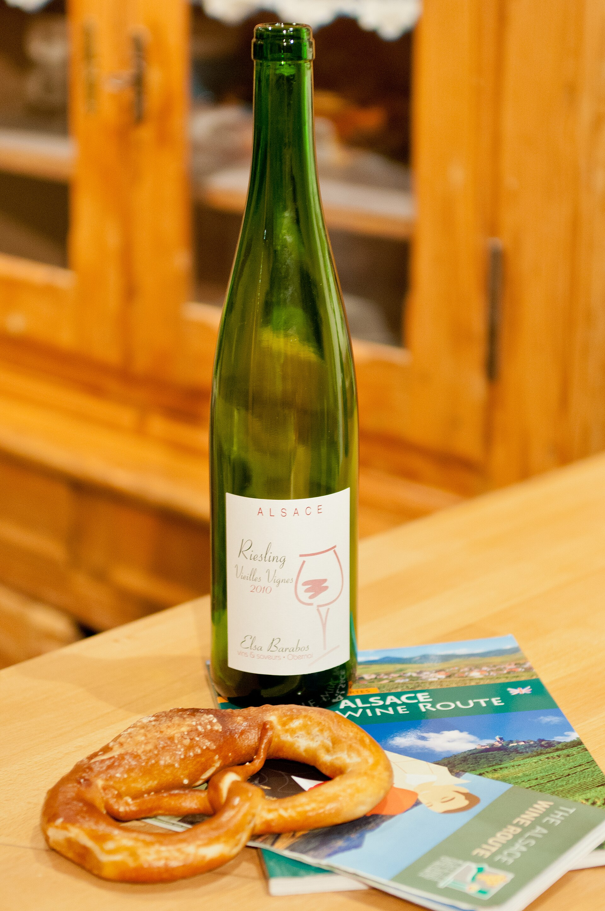

# 阿尔萨斯雷司令

阿尔萨斯雷司令是法国阿尔萨斯的雷司令白葡萄酒，以干型为主，酸度高、香气清澈，以柑橘、白花、燧石矿物感与陈年后的汽油气息著称。阿尔萨斯以品种名标注酒款，并设有特级园与晚收、贵腐等标注。常见 750 mL、酒精度约 12%–13.5% vol。

图：阿尔萨斯雷司令相关实景照片。图片：Michal Osmenda from Brussels, Belgium，CC BY-SA 2.0，via Wikimedia Commons（[原图页面](https://commons.wikimedia.org/wiki/File:2010_Riesling_Vieilles_Vignes_from_Elsa_Barabos,_Obernai,_Alsace_(6711020535).jpg)）。

## 定义与定位

分层看：[白葡萄酒](ref:white-wine)是大类，雷司令是品种，阿尔萨斯是产区，阿尔萨斯雷司令是“产区＋品种”的酒款标识，具体酒庄与园地是生产者层面。它不是品牌，也不是一个法定产区的专有名。

阿尔萨斯的特别之处在于以品种名标注，这与法国多数以产区名标注的传统不同。当地四个“贵族品种”常被单独讨论，雷司令是其中最重要、种植最广的一种，风格从干型到甜型都有。

## 生产者与品牌

产区内有大量家族酒庄、合作社与酒商，规模差异明显。酒标上的酒庄名、装瓶者与园地名是判断身份的依据；阿尔萨斯的分级比勃艮第简单，但特级园与特定园地名仍是重要的风格线索。

阿尔萨斯的 AOC 体系在 20 世纪中期确立，1962 年获得正式承认，此后逐步加入特级园与甜型标注规则。酒庄常以细长的 flute 瓶型作为产区识别特征之一。

## 「阿尔萨斯雷司令」的产地与原料
产区位于[法国](ref:france)东北部，莱茵河西岸，孚日山脉与莱茵河之间的狭长地带。孚日山脉形成雨影，使产区降雨较少、日照充足，秋季干燥有利于晚收与贵腐。

土壤类型非常多样：花岗岩、片岩、石灰岩、火山岩与泥灰岩在不同园地交替出现，直接影响酸度、矿物感与成熟节奏。原料是[葡萄](ref:grape)，品种为[雷司令](ref:riesling)，晚熟、酸度高、香气清澈。

## 「阿尔萨斯雷司令」怎么做出来
雷司令通常在九月下旬至十月采收，压榨后低温发酵，多数酒款在不锈钢罐中完成，以保留香气与酸度；部分酒庄使用旧桶并延长酒泥接触，增加质感。是否进行苹果酸乳酸发酵因酒庄而异，多数会避免以保留酸度。

[发酵](ref:fermentation)结束后，干型酒款通常尽快装瓶；晚收（Vendanges Tardives）与贵腐（Sélection de Grains Nobles）则需要更严格的果实筛选与更长的发酵周期。甜型标注对应不同的采收标准，不能与干型混为一谈。

## 「阿尔萨斯雷司令」的瓶型与标签
常见容量为 750 mL，[酒精度](ref:abv)约 12%–13.5% vol，甜型酒款可能更高。标签应核对产区名 Alsace、品种名 Riesling、年份、酒庄名、装瓶者、净含量与进口商信息；特级园会标注 Grand Cru 与具体园地名。

中文背标与进口商信息是核对身份的入口。不同市场的标签语言不同，以瓶身实际标注为准；以“阿尔萨斯风格”描述的非产区酒，不属于法定产区产品。

## 「阿尔萨斯雷司令」的闻与喝
典型香气是柠檬、柚子、白花、青苹果与燧石，酸度高、酒体中等，余味清澈。陈年后常出现蜂蜜、干果与特征性的“汽油”气息，这是雷司令的典型演化，不是缺陷。

与[伊慕](ref:egon-muller)这类德国雷司令相比，阿尔萨斯多以干型呈现，酒精度更高、甜度更低；德国传统则更常见半干与甜型。品鉴温度建议 8–11 摄氏度，甜型可略高。

## 「阿尔萨斯雷司令」的饮用与搭配
干型适合搭配阿尔萨斯本地菜肴、猪肉、禽类、河鱼、酸菜与中等强度的干酪；高酸度能平衡油脂与咸味。甜型适合搭配鹅肝、蓝纹奶酪或水果类甜点，不宜与过甜的蛋糕同食。

开瓶后冷藏保存并尽量在两三日内饮用完毕；甜型酒款可稍长。阿尔萨斯雷司令多数适合年轻时饮用，特级园与优质年份可以短期至中期存放。本页关于阿尔萨斯雷司令的内容涉及酒精饮料；过量饮酒有害健康，未成年人不应饮酒。

## 「阿尔萨斯雷司令」的购买与保存
购买时优先选择正规渠道，核对年份、品种名、Grand Cru 标注、酒庄名与进口商信息。价格随年份、园地与酒庄声誉波动，本页不给出具体数字；普通款、特级园与贵腐甜型属于不同层级。

就「阿尔萨斯雷司令」而言，未开瓶应避光平放或直立存放于阴凉处，理想温度为 10–13 摄氏度，避免高温与剧烈温差。开瓶后冷藏并尽快饮用，不宜反复取出回温。

## 「阿尔萨斯雷司令」容易被读错的地方
第一，认为阿尔萨斯雷司令都是甜的。多数是干型，甜型有明确标注。
第二，把“汽油”气息当成变质。这是陈年雷司令的典型香气之一。
第三，把阿尔萨斯雷司令与德国雷司令当成同一种风格。酒精度、甜度与标注体系不同。
第四，认为阿尔萨斯只产单一品种酒。也有混酿与不同品种的标注。
第五，只看品种名，不看 Grand Cru 与甜型标注。

对照阅读：[白葡萄酒](ref:white-wine)、[阿尔萨斯](ref:alsace)。

**关键事实。**

| 项目 | 内容 |
| --- | --- |
| 一句话定位 | 法国阿尔萨斯的雷司令白葡萄酒，以干型为主，酸度高、香气清澈，以柑橘、白花、燧石矿物感与陈年后的汽油气息著称；阿尔萨斯以品种名标注酒款，并设有特级园与晚收、贵腐等标注 |
| 酒种/风格 | 白葡萄酒 |
| 产区 | 法国、阿尔萨斯 |
| 酒精度 | 12–13.5% vol |

**来源与边界。** 本页关于「阿尔萨斯雷司令」的关键事实，主要由以下来源交叉核对：Conseil Interprofessionnel des Vins d'Alsace（阿尔萨斯的 AOC 体系、品种标注与特级园框架）、INAO（阿尔萨斯法定产区的生产规范与标签要求）、Oxford University Press（提供关于阿尔萨斯、雷司令与特级园的条目；由原条目末尾参考资料迁移，未逐条复核访问日期）等 6 条来源。价格、批次与状态会变，涉及这些字段时以页面所列来源的最新版本为准。正文为项目自写，来源只作核验，不复制原文。

## 参考资料
- [白葡萄酒](ref:white-wine)：阿尔萨斯雷司令的品种、酸度与酿造工艺。
- [法国](ref:france)：法国葡萄酒版图与 AOC/AOP 制度。
- [阿尔萨斯](ref:alsace)：阿尔萨斯产区的地理、品种与分级制度。
- [雷司令](ref:riesling)：核心品种的植物学特征与香气。
- [伊慕](ref:egon-muller)：德国雷司令，与阿尔萨斯形成对照。
- [葡萄](ref:grape)：阿尔萨斯雷司令所用葡萄的成熟度、酸度与单宁判断。
- [发酵](ref:fermentation)：低温发酵与酒泥接触的作用。
- [酒精度](ref:abv)：12%–13.5% vol 在标签上的含义。
