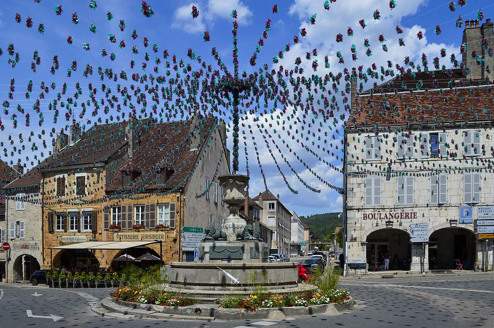

# 阿尔布瓦

阿尔布瓦（Arbois）是[法国](ref:france)[汝拉](ref:jura)地区最早拿到 AOC 的产区，也是汝拉产量最大的产区。它同时生产[红葡萄酒](ref:red-wine)、[白葡萄酒](ref:white-wine)与[黄酒](ref:yellow-wine)，五种当地品种全部可用。常见 750 mL，[酒精度](ref:abv)约 12.5%–14.5% vol。

图：阿尔布瓦。图片：Wikipedro，CC BY-SA 4.0，via Wikimedia Commons（[原图页面](https://commons.wikimedia.org/wiki/File:Arbois,_la_place_de_la_Libert%C3%A9.jpg)）。

## 1936 年 5 月 15 日：汝拉的第一张 AOC

阿尔布瓦的 AOC 由 1936 年 5 月 15 日法令确立，是汝拉四张元老级 AOC 中最早的一张，也比法国多数产区更早完成法定化。当时汝拉葡萄园刚经历根瘤蚜、霜霉与两次大战的重创，法定产区的意义不只是"命名"，而是把品种、地块与酿造方式重新钉死，阻止葡萄园继续改种杂牌或荒废。今天回看，这一步为战后重建保留了品种骨架。

## 12 个村庄、766 公顷与 291 万升

产区分成 12 个村庄，法定面积约 766 公顷，年均产量约 29,100 hl；按协会数据，它生产了汝拉约 70% 的红葡萄酒和约 30% 的白葡萄酒。这个比例常被误解为"阿尔布瓦以红酒为主"，更准确的说法是：红葡萄占地面积和产量都占优，但白葡萄酒、黄酒与稻草酒才是它在国际市场上的辨识度来源。它常被拿来与范围更广的[汝拉坡](ref:cotes-du-jura)比较，差别正在于村庄身份的密度。村庄包括 Arbois、Pupillin、Les Arsures、Montigny-lès-Arsures、Mesnay、Vadans、Villette-lès-Arbois 等。

## 五种品种的两套主次

法规把五个品种分成两组。白葡萄以 Savagnin 与[霞多丽](ref:chardonnay)为主，红葡萄以 Poulsard（当地叫 Ploussard）、Trousseau 与[黑皮诺](ref:pinot-noir)为主；在混酿中，另一组的品种只能作辅助。Poulsard 皮薄、颜色浅、酸度高，常被用来做轻快型红酒或与 Pinot Noir 混酿；Trousseau 更晚熟、单宁更硬，给酒提供骨架。白葡萄酒里，Savagnin 的酸度与氧化潜力是黄酒的根基，Chardonnay 则负责 ouillé 路线的圆润。无论红白，[葡萄](ref:grape)都经控温[发酵](ref:fermentation)，需要结构的酒款再进入[橡木桶陈年](ref:oak-ageing)。

## marnes irisées：彩色泥灰岩上的崩积坡

阿尔布瓦的地形是"被撕开的坡地"：石灰岩崩积物、深层的彩色泥灰岩（marnes irisées）与黏土-硅质土交错。marnes irisées 因含铁而呈红、紫、灰绿相间，质地紧凑、保水性强，能在干旱年份把水留给葡萄；崩积的石灰岩碎块则改善排水与根系穿透。坡向多为南或西南，海拔大致在 200–400 米之间，昼夜温差让酸度得以保留。这也是为什么同一品种在阿尔布瓦能同时做出轻盈与厚实两种版本。

## Vin Jaune 的 6 年 3 个月

黄酒是阿尔布瓦最严格的酒种，只能用 Savagnin。发酵完成后，酒被放进橡木桶，故意不添桶（sans ouillage），让酒液表面长出一层酵母酒膜；酒膜下至少 60 个月，整体须陈酿到采收后第 6 年的 12 月 15 日——也就是俗称的"6 年 3 个月"。最早到第 7 年 1 月 1 日才能上市。装瓶只用 62 cl 的 clavelin 瓶，这是法律专门为黄酒保留的容量。汝拉各产区的黄酒规则以此为准绳，[夏隆堡](ref:chateau-chalon)则把黄酒做成了唯一产品。

## ouillé 与 sous voile：同一块地的两种白

同一片葡萄园可以走出两条完全不同的白葡萄酒路线。ouillé 是"补液"：桶始终保持满，隔绝氧气，酒色浅、果味清、酸度锐利，适合年轻时喝；sous voile 是"留空"：不补液，让酒膜生长，乙醛与 sotolon 带来核桃、咖喱、蜂蜡与咸鲜。ouillé 的 Chardonnay 常带榛子与黄苹果，sous voile 的 Savagnin 则明显更"黄酒"。判断一瓶阿尔布瓦白，先问是 ouillé 还是 sous voile，比问年份更有用。

## Vin de Paille：20 hl/ha 的"稻草酒"

稻草酒（Vin de Paille）不是加烈酒，也不是贵腐酒。葡萄采下后要在稻草或架子上风干至少六周，让水分蒸发、糖分浓缩，再压榨发酵。因为出汁极少，法规把产量压到 20 hl/ha；成品通常呈琥珀色，有杏干、蜂蜜与橙皮，酒精度不低但靠酸度维持平衡。它在阿尔布瓦只是少量产品，却常被误当作"甜型黄酒"——两者工艺与风味都不同。

## Pupillin：可以写进酒标的村子

Pupillin 是阿尔布瓦下辖的补充地理名（dénomination géographique complémentaire），酒标可以写 "Arbois-Pupillin"。这个村子以 Poulsard 和 Trousseau 的红酒著称，坡向与土壤让酒比阿尔布瓦主体更细、更香。补充地理名不是独立 AOC，法规对它的地块、品种比例和产量另有约束；买酒时看到 Pupillin，可以理解为"同一产区内的一个更具体的村子"，而不是另一个法定产区。

## Henri Maire：把 Arbois 从废墟里拉回来的人

Henri Maire（1917–2004）是汝拉现代史上绕不开的名字。二战后他接手家族生意，把零散地块重新整合，葡萄园扩张到 300 公顷以上，并用 "Vin Fou" 这一品牌把汝拉酒推进巴黎与出口市场。他的做法在今天是争议的：大规模、重营销、部分产品偏离传统；但没有他把产能和现金流重新做起来，阿尔布瓦很难在 20 世纪后半叶保住这么多地块。理解这段历史，才能理解今天"传统派"与"市场派"的张力。

## 酒庄与酒款

Domaine André et Mireille Tissot（Stéphane Tissot）是生物动力与低产量的代表，Chardonnay、Savagnin 与红混酿都有稳定表现；Domaine Rolet 历史长、产品线完整；Domaine de la Pinte 在 Pupillin 以 Poulsard 和 Savagnin 见长；Maison Henri Maire 仍是产量最大的名字之一。合作社与酒商在阿尔布瓦同样重要，酒标背面的"装瓶者"与地块信息，比正面的大名字更能说明风格。

## 价格带：€15 的口粮与 €60 以上的黄酒

法国零售市场 2026 年的常见区间（随年份与渠道波动）：普通红/白约 €15–22，村庄级或单一园 €25–40，黄酒多在 €35–60，名庄老年份可到 €80 以上。黄酒贵在时间：6 年多的库存占用、蒸发损失与低产量，都是成本。稻草酒产量更小，价格通常不低于黄酒；如果看到 €12 的"Vin Jaune"，先怀疑是不是同名不同物。

## 误解：Vin Jaune 不是甜酒

黄酒最常被误认为甜酒，因为颜色金黄、香气里有蜂蜜和杏干。实际上它是干型：发酵完全，残糖很低，风味来自酒膜与长期氧化，而不是糖。第二个误解是"黄酒越老越好"；它确实耐放，但开瓶后氧化极快，最好在两天内喝完。第三个误解是把"jaune"理解成贵腐或晚收——汝拉黄酒与贵腐没有任何关系。

## 配餐：孔泰、核桃与鸡油菌

黄酒配陈年孔泰（Comté 24 个月以上）几乎是教科书组合：奶酪的坚果与咸鲜接住酒里的核桃与咖喱。家常菜里，奶油蘑菇鸡、鸡油菌炒蛋、核桃沙拉都合适；红葡萄酒则适合烤猪肉、香肠与炖牛肉。ouillé 白葡萄酒更百搭，配河鱼、蜗牛与软质奶酪都行。侍酒温度上，黄酒不宜过低，13–15 °C 更能释放香气。

阿尔布瓦的复杂，不在于它有多少个品种，而在于它允许同一块地同时存在"新鲜"与"氧化"两种时间观。理解 ouillé 与 sous voile，就理解了这个产区的另一半。

对照阅读：[红葡萄酒](ref:red-wine)、[黄酒](ref:yellow-wine)。
