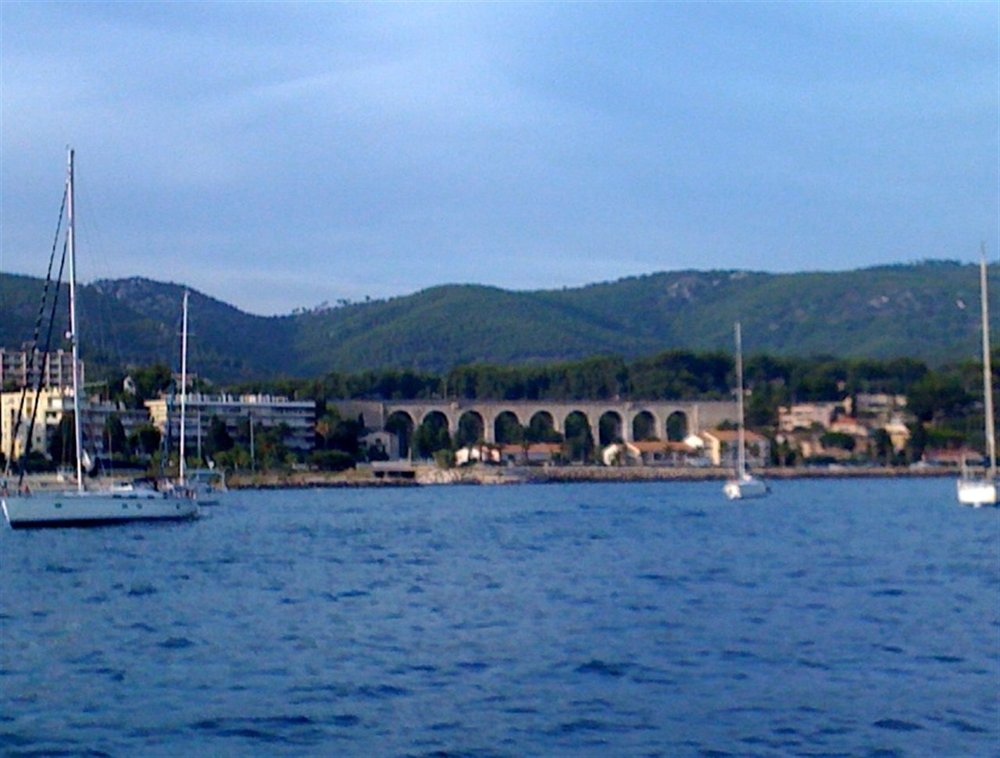

# 邦多勒

邦多勒（Bandol）是[法国](ref:france)[普罗旺斯](ref:provence)地中海沿岸的法定产区，以慕合怀特为主的红葡萄酒著称。产区法定要求[红葡萄酒](ref:red-wine)中慕合怀特至少占 50%，并在橡木桶中陈年不少于 18 个月。它同时生产[桃红葡萄酒](ref:rose-wine)与少量[白葡萄酒](ref:white-wine)。常见 750 mL，[酒精度](ref:abv)约 12.5%–14.5% vol。

图：邦多勒。图片：A.Schneider83，CC BY-SA 3.0，via Wikimedia Commons（[原图页面](https://commons.wikimedia.org/wiki/File:Viaduc_de_Bandol.jpeg)）。

## 定义与定位

先分层：[红葡萄酒](ref:red-wine)是大类，慕合怀特是主要品种，邦多勒是法定产区，具体酒庄与酒款是生产者层面。邦多勒既是镇名，也是可以单独标注在酒标上的产区名。

邦多勒在普罗旺斯内部定位特殊：产区以耐久红葡萄酒建立声誉，而不是以桃红为主。红葡萄酒有明确的品种比例与最短橡木桶陈年要求，因此风格比多数普罗旺斯红酒更有结构与陈年潜力。

## 生产者与品牌

产区以家族酒庄为主，也有合作社与酒商。邦多勒红葡萄酒需要较长时间陈年才能上市，资金占用高，因此生产者数量有限、规模不大。

生产者、产区与产品是三个层级：产区回答法规与地块范围，生产者回答种植、酿造与装瓶，产品回答年份、颜色与规格。同为邦多勒，不同酒庄的慕合怀特比例与陈年长度会有差别。

## 「邦多勒」的产地与原料
邦多勒位于普罗旺斯地中海沿岸，葡萄园分布在邦多勒镇周围的沿海丘陵与坡地，呈半圆形面向大海。气候属地中海型，夏季炎热干燥、冬季温和，密史脱拉风影响明显。土壤以石灰岩、黏土与砾石为主，排水好、肥力低。

坡向与海风影响成熟度：朝南的坡面更温暖，沿海地块受海风调节。原料是[葡萄](ref:grape)。红葡萄以慕合怀特为主，搭配[歌海娜](ref:grenache)、神索与[西拉](ref:syrah)；慕合怀特成熟晚、皮厚、单宁强，是结构的主要来源。

## 「邦多勒」怎么做出来
红葡萄酒通常去梗后较长浸渍，以提取颜色、单宁与香料气息；发酵温度与浸渍时间决定结构强度。法定要求红葡萄酒在橡木桶中陈年不少于 18 个月，部分酒庄会延长陈年。大桶与小桶、新桶与旧桶的比例影响香气与单宁质感。

桃红葡萄酒浸皮时间短，追求浅色与清爽；白葡萄酒产量小，以清新风格为主。发酵的基本逻辑可参见[发酵](ref:fermentation)，桶陈环节可参见[橡木桶陈年](ref:oak-ageing)。

## 「邦多勒」的瓶型与标签
常见容量为 750 mL，[酒精度](ref:abv)约 12.5%–14.5% vol，具体随年份与酒庄变化。标签应核对产区名、颜色、年份、装瓶者与进口商信息。

邦多勒红、桃红与白葡萄酒使用同一产区名，颜色通常由酒标或酒液呈现。核对邦多勒时，中文背标与进口商信息是身份依据，以瓶身实际标注为准。

## 「邦多勒」的闻与喝
红葡萄酒以黑樱桃、黑莓、皮革、甘草与香料气息为主，单宁强、酸度中等，酒体饱满，余味长。慕合怀特比例高的酒款结构更强，年轻时单宁明显，陈年后转向皮革、松露与干果气息。

桃红葡萄酒以红果、柑橘与白花为主，酒体轻、酸度清晰；白葡萄酒以柑橘、白花与矿物感为主。品鉴红葡萄酒建议温度约 16–18 摄氏度，可用醒酒器帮助打开香气。

## 「邦多勒」的饮用与搭配
红葡萄酒适合烤肉、炖肉、野味、菌菇与硬质奶酪；较强的结构适合风味浓郁的菜肴。桃红适合海鲜、沙拉与地中海菜肴，建议低温饮用；白葡萄酒适合海鲜与软质奶酪。

红葡萄酒通常适合在 5–15 年内饮用，顶级年份可以更久，具体窗口因年份与酒庄而异。开瓶后应冷藏并在数日内喝完；本页关于邦多勒的内容涉及酒精饮料；过量饮酒有害健康，未成年人不应饮酒。

## 「邦多勒」的购买与保存
购买时核对产区名、颜色、年份与装瓶者，注意红葡萄酒的品种比例与陈年要求。邦多勒产量小、陈年时间长，价格通常高于普通普罗旺斯桃红，本页不给出具体数字。

邦多勒以慕合怀特为主，单宁与结构较强，未开瓶可平放在 12–15°C 的稳定环境中，避免靠近暖气与震动。软木塞需要湿度，长期存放保持平放；开瓶后抽真空或充惰性气体冷藏，最好两三天内喝完，慕合怀特的香料味不耐反复回温。

## 「邦多勒」容易被读错的地方
第一，把邦多勒当成普罗旺斯桃红的代表。产区声誉主要建立在红葡萄酒上。
第二，认为所有邦多勒红酒都很粗犷。年份、慕合怀特比例与陈年方式会带来明显差异。
第三，把邦多勒与普罗旺斯丘混为一谈。两者相邻，但法定产区与规则不同。
第四，认为桃红不能陈年。邦多勒桃红中少数结构型酒款可以短期存放，但多数宜早饮。
第五，只用价格判断质量。产区、年份与装瓶者信息更具体。

对照阅读：[红葡萄酒](ref:red-wine)、[白葡萄酒](ref:white-wine)。

**关键事实。**

| 项目 | 内容 |
| --- | --- |
| 一句话定位 | 法国普罗旺斯地中海沿岸的法定产区，以慕合怀特为主的红葡萄酒著称，法定要求红葡萄酒中慕合怀特至少占 50%，并在橡木桶中陈年不少于 18 个月；风格结构强、香料与深色果味明显，也生产桃红与少量白葡萄酒，常见 750 mL、酒精度约 12.5%–14.5% vol |
| 酒种/风格 | 红葡萄酒、桃红葡萄酒、白葡萄酒 |
| 产区 | 法国、普罗旺斯 |
| 酒精度 | 12.5–14.5% vol |

**来源与边界。** 本页关于「邦多勒」的关键事实，主要由以下来源交叉核对：INAO（邦多勒法定产区的范围、品种比例与陈年规则；由原条目末尾参考资料迁移，未逐条复核访问日期）、European Union（欧盟葡萄酒类别、地理标志与标签规则）、Oxford University Press（提供关于邦多勒与慕合怀特的条目；由原条目末尾参考资料迁移，未逐条复核访问日期）。价格、批次与状态会变，涉及这些字段时以页面所列来源的最新版本为准。正文为项目自写，来源只作核验，不复制原文。

## 参考资料
- [普罗旺斯](ref:provence)：邦多勒所属产区与酒种框架。
- [红葡萄酒](ref:red-wine)：邦多勒最具代表性的类型。
- [桃红葡萄酒](ref:rose-wine)与[白葡萄酒](ref:white-wine)：产区的另外两个类型。
- [歌海娜](ref:grenache)与[西拉](ref:syrah)：邦多勒红葡萄酒的主要搭配品种。
- [葡萄](ref:grape)：邦多勒所用葡萄的成熟度、酸度与单宁判断。
- [发酵](ref:fermentation)与[橡木桶陈年](ref:oak-ageing)：红葡萄酒的基础工艺环节。
- [酒精度](ref:abv)：12.5%–14.5% vol 在标签上的含义。
