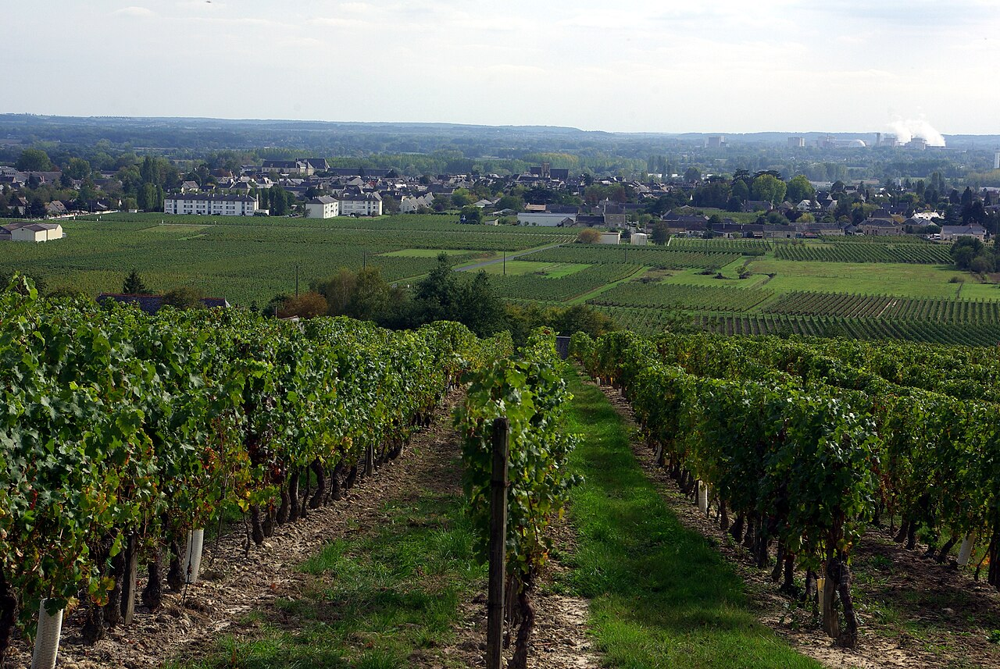

# 布尔格伊

布尔格伊（Bourgueil）是[法国](ref:france)[卢瓦尔河谷](ref:loire)都兰地区的[红葡萄酒](ref:red-wine)法定产区，位于卢瓦尔河右岸、图尔以西。它以[品丽珠](ref:cabernet-franc)为绝对主体，1937 年 7 月 31 日获 AOC；常见 750 mL 瓶装，[酒精度](ref:abv)多在 12%–13.5%，风格从砾石台地上的轻快果味到石灰岩坡上的紧实陈年型都有。

图：布尔格伊。图片：Duch.seb，CC BY-SA 3.0，via Wikimedia Commons（[原图页面](https://commons.wikimedia.org/wiki/File:Bourgueil.jpg)）。

## 右岸的两级台阶：砾石台地与石灰岩坡

布尔格伊的葡萄园可以粗分为两类。靠近卢瓦尔河的是砂与砾石组成的“graves/graviers”台地，排水极快、根系深，酒体轻、果味向前；往坡上走，是覆盖在都兰石灰岩（当地称 tuffeau，坡地土壤称 tufs）上的黏土-石灰岩，酒更厚、单宁更多、陈年更长。两者不是“好与坏”，而是两种节奏：前者适合年轻时喝，后者需要时间。

## 1937 年 7 月 31 日：都兰最早一批 AOC

布尔格伊在 1937 年 7 月 31 日通过法令获得 AOC，属于都兰最早一批受保护的产区之一。这个时间点解释了它的规则为何带有“两次修订”的层累：1937 年的框架、2009 年的国家法令、2019 年的欧盟单文件修订，数字与表述会随版本变化。读旧资料时看到 55 hl/ha，不一定是错，而是旧口径。

## 砾石层上的品丽珠：柔顺不等于单薄

砾石台地的酒常被描述为“轻”，但更准确的说法是“柔顺、早熟、单宁圆”。砾石白天升温快，葡萄容易达到生理成熟，品丽珠的青椒与草本感被压低，红醋栗、覆盆子与紫罗兰更突出。砾石层薄、含砂多，根系往往要扎到下面的石灰岩才能找到水分，这也限制了产量。原料是[葡萄](ref:grape)，[发酵](ref:fermentation)与[橡木桶](ref:oak-ageing)处理各家不同。它不适合与重酱汁对抗，却非常适合冷藏到 14–16°C 配熟食、白肉与软奶酪。把“轻”理解成“水”，是布尔格伊最常见的误读。

## 石灰岩坡：可以放很久的酒

坡地上的黏土-石灰岩给品丽珠更长的成熟窗口与更硬的骨架。朝南坡面获得更多直射光，北面的 Gâtine 森林挡住冷风，成熟更均匀，采摘顺序也因此不同。酒年轻时可能显得紧、甚至有点封闭，但 5–10 年后会展开石墨、雪松、烟草与干花。产区协会说最好的年份可以放“一个世纪”，这当然是极端说法，但它想强调的是：布尔格伊的上限不在“果味小酒”，而在结构型红。橡木桶在这里通常只是容器，不是风味主角；旧桶与大桶更常见，以免遮住品丽珠的草本线条。

## 七个市镇与一条容易忽略的规则

产区协会按现行行政口径写 7 个市镇：Bourgueil、Benais、La Chapelle-sur-Loire、Chouzé-sur-Loire、Ingrandes-de-Touraine、Restigné、Saint-Patrice。欧盟 2019 年单文件还把 Saint-Nicolas-de-Bourgueil 列入地理范围，合并后对应 8 个市镇。由此产生一条冷知识：Saint-Nicolas-de-Bourgueil 的酒可以挂 Bourgueil 出售，反过来不行。看到酒标写 Bourgueil，不一定葡萄全部来自 Bourgueil 村。

## 从 55 到 65 hl/ha：一个旧数字的读法

旧的国家法令把布尔格伊的基础产量定为 55 hl/ha，上限 67 hl/ha；2019 年欧盟单文件修订后，目标产量调整为 65 hl/ha。最低天然酒精度为 10.5%，品丽珠为主，赤霞珠允许不超过 10%。这两个数字放在一起看，说明布尔格伊不是“低产高浓度”的产区，而是靠风土与筛选做结构；单看产量数字判断质量会失真，具体以最新 cahier des charges 为准。

## Chevalerie、Amirault 与 Chesnaies：三种尺度

Domaine de la Chevalerie 在 Restigné，家族在同一地点经营近 400 年，品丽珠老藤 30–70 年，2008 年有机认证、2012 年转生物动力，由 Laurie、Emmanuel 与 Stéphanie Caslot 兄妹主持；它的酒更像“坡地派”，结构深、需要时间。Domaine Yannick Amirault 约 20 公顷，三分之二在布尔格伊、三分之一在 Saint-Nicolas，1977 年以 3.4 公顷起家；祖父 Eugène 早在 1947 年就装瓶 Les Malgagnes，今天的 Le Grand Clos 是观察其风格的窗口。Domaine des Chesnaies（Lamé Delisle Boucard）的 Cuvée Prestige 则是更日常、更容易入门的样本，零售约 €12.90。

## 风格坐标：比希农更直、更“北”

把布尔格伊与[希农](ref:chinon)放在一起，最稳妥的差别不是“谁更轻”，而是“谁更直”。布尔格伊的葡萄园集中在卢瓦尔河右岸一条主要朝南的坡面上，北面有 Gâtine 森林挡风，成熟更均匀，酒线条更直、石墨感更强；希农横跨维埃纳河两岸 26 个市镇，土壤从砾石到石灰岩高原都有，风格跨度更大。与[索米尔-尚皮尼](ref:saumur-champigny)相比，布尔格伊更少“图法岩的粉感”，更多砾石与黏土的骨架。三页若都写“卢瓦尔品丽珠”，就把这些差别丢了。

## 配餐：从 rillettes 到野猪炖锅

砾石型布尔格伊适合熟肉酱（rillettes de Tours）、烤鸡、白肉与山羊奶酪；坡地型适合鸭胸、野猪炖锅（civet de sanglier）、红酒炖牛肉与硬质奶酪。饮用温度上，轻酒体 14–16°C，结构型 16–18°C；过冷会把品丽珠的草本与石墨感压成“单调的酸”。配餐的逻辑不是“红酒配红肉”，而是单宁与脂肪、酸度与油脂的对应。

## 价格带与两个误解

零售样本中，布尔格伊入门与中档多在 €9–22，名庄与老藤特酿可到 €22–35；这些数字随年份、渠道与汇率波动。两个误解值得纠正：第一，“布尔格伊只是更轻的希农”。它的坡地酒可以比许多希农更紧、更耐放，关键看地块而不是产区名。第二，“布尔格伊只能是品丽珠，不能有赤霞珠”。法规允许赤霞珠最多 10%，只是多数酒庄选择不用。把品种纯度当作品质保证，是另一种简化。

## 协会、法规与酒庄资料

本页数字取自 InterLoire 的产区与风土页、布尔格伊产区协会的风土说明、欧盟 2019 年单文件修订，以及 Chevalerie、Yannick Amirault 的官方资料；价格仅取 Vinatis 的在售样本。所有来源均在 2026 年 11 月 8 日实际打开核对。

**关键事实。**

| 项目 | 内容 |
| --- | --- |
| 一句话定位 | 法国卢瓦尔河谷都兰地区的品丽珠红葡萄酒法定产区，位于卢瓦尔河右岸、图尔以西，1937 年 7 月 31 日获 AOC；葡萄园约 1,200–1,400 公顷，分砾石台地与黏土-石灰岩坡两类风土，前者柔顺果味、后者结构紧实可久藏，另产约 4% 桃红，常见 750 mL、酒精度约 12%–13.5% vol |
| 酒种/风格 | 红葡萄酒 |
| 产区 | 法国、卢瓦尔河谷 |
| 酒精度 | 12–13.5% vol |

**来源与边界。** 本页关于「布尔格伊」的关键事实，主要由以下来源交叉核对：InterLoire（1937 年 AOC、7 个市镇、砾石与黏土-石灰岩两类风土及桃红比例）、Syndicat viticole de Bourgueil（约 1,400 公顷、55 hl/ha 的旧口径与年产 6–7 万 hl）、European Union（65 hl/ha、10.5% 最低酒精度、市镇范围与坡地/台地土壤描述）等 6 条来源。价格、批次与状态会变，涉及这些字段时以页面所列来源的最新版本为准。正文为项目自写，来源只作核验，不复制原文。

**并读。** 把「布尔格伊」与「红葡萄酒」、「法国」、「卢瓦尔河谷」放在一起读时，先确认它们是同一层级还是上下游关系：先确认酒种与产区，再比较年份、酒精度、价格与饮用场景。本页负责给出酒款的基本坐标，对照条目补上具体案例与差异；读完再回到本页，才能分清哪些差别属于酒款本身，哪些只是产地、批次或品牌选择。
