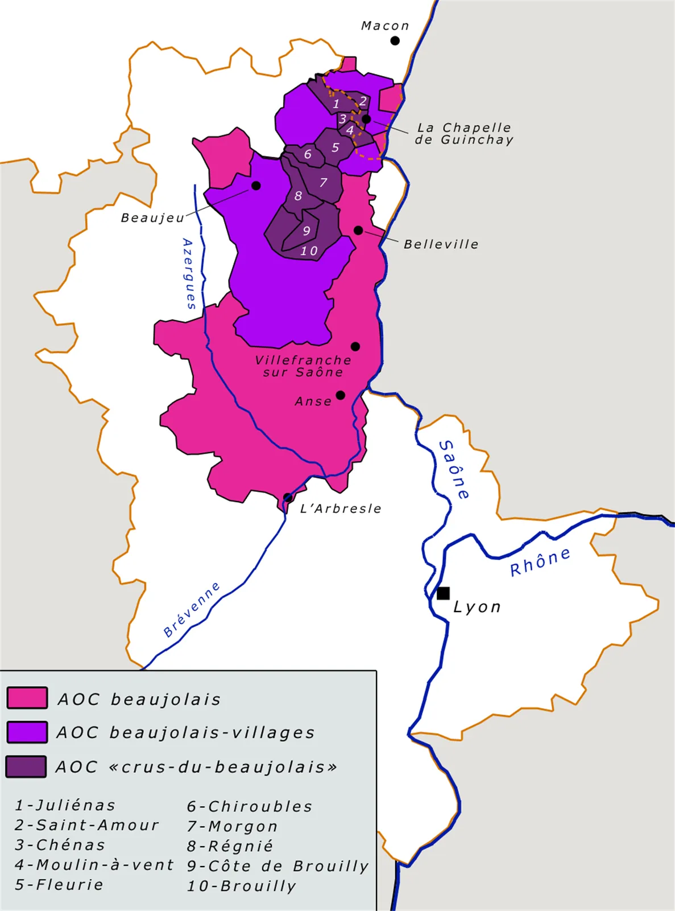

# 布鲁伊

在博若莱的酒单上，布鲁伊经常被放在最前面：它产量大、名字好记，价格也常常是 cru 里最亲民的一档。但这种“入门”印象会遮住它的另一面——它同时是十个 cru 中面积最大的一支，覆盖六个村庄，村与村之间的坡地差异，比一个“轻快易饮”的标签复杂得多。常见 750 mL，[酒精度](ref:abv)约 12.5%–13.5% vol。

图：布鲁伊。图片：Cyril5555，CC BY-SA 3.0，via Wikimedia Commons（[原图页面](https://commons.wikimedia.org/wiki/File:Carte_vignoble_beaujolais.png)）。

## 酒单上的“入门”印象

餐厅与酒商愿意推布鲁伊，原因很实际：产量在 cru 中最大，货源稳定，风格讨喜，不需要太多解释。于是它常被当作“博若莱 cru 的第一课”，和博若莱新酒一起出现在入门酒单上。

这个定位有用，也有代价。新手容易把布鲁伊理解为“轻、简单、随便喝”，忽略产区内部的差异；老手则可能因为它太常见而跳过。更合适的看法是：布鲁伊是 cru 体系的入口，但不是风格的终点，山脚与山坡、北部与南部的酒并不相同。

## 环绕布鲁伊山的六个村庄

布鲁伊的葡萄园环绕布鲁伊山（Mont Brouilly）分布，产区覆盖六个村庄。山体在中央，村庄与坡地在外围，形成一个近似环状的范围；这也是它面积最大的地理原因。

六个村庄的位置不同，土壤与坡度不同，酒的风格因此分成几路。靠近山脚与北部的块地偏砂质、排水好，酒体更轻；南部与平缓地带的黏土与石灰岩比例更高，果实成熟更充分，酒体相对饱满。具体界线与村庄归属以官方划界为准。

## 山脚花岗岩与南部黏土石灰岩

北部与山坡地带以花岗岩风化砂为主，土层薄、排水快、肥力低，佳美在这里表现出红樱桃、覆盆子与清晰的花香，酒体通常比北部 cru 轻。花岗岩的砂质结构让根系扎得深，也限制了产量。

南部与山脚平缓地带的黏土与石灰岩比例更高，土壤更肥沃，保水能力更强，成熟节奏与北部不同，酒体也更圆润。同一个 cru 内部因此出现“轻”与“圆”两种走向，酒标上的村庄名，往往比“Brouilly”更能提示你买到的是哪一路。

## 面积最大带来的产量与酒商角色

面积最大意味着总产量在 cru 中居前，酒商与合作社的参与比例也相对高。大酒商需要稳定、统一的风格，容易把不同村庄的葡萄混合；家族酒庄则更愿意强调自家地块的个性。

酒标上的装瓶者信息因此是关键。酒庄自装的布鲁伊通常地块来源更清楚，风格也更有辨识度；酒商装瓶的版本可能更便宜、更稳定，但村与村的差异会被抹平。购买时先确定自己想要“稳定”还是“个性”，再决定看哪一类装瓶者。

## 短浸渍与早饮取向

布鲁伊常用整串发酵，部分酒庄采用半二氧化碳浸渍：整串葡萄在充满二氧化碳的容器中先行细胞内发酵，再压榨并完成常规[发酵](ref:fermentation)。这套做法带来直接的果香与较轻的单宁，正好服务“早饮”的定位。

浸渍通常偏短，萃取偏轻，以保留果味与柔顺口感。部分酒庄会用一小部分旧[橡木桶](ref:oak-ageing)陈年，让结构更完整，但新桶比例一般很低。目标不是做出厚重的酒，而是让酒在装瓶后不久就能入口。

## 与布鲁伊丘、雷尼耶的差异

典型香气是红樱桃、覆盆子、草莓与紫罗兰，部分酒款带矿物感。入口酸度清晰，单宁细，酒体轻到中等，收尾柔顺，整体比山坡上的[布鲁伊丘](ref:cote-de-brouilly)更早适饮。

具体差别可以这样记：论厚度与骨架，布鲁伊丘更紧、更矿、更晚熟，布鲁伊更轻、更直接；论香气，弗勒里更外放，布鲁伊更偏红果；与西南方向的雷尼耶（Régnié）相比，雷尼耶通常更轻、更柔和，布鲁伊则果味更集中一些。四者各有分工，没有高下。

## 六个村庄在暖年与冷年的温差

暖年成熟度高，果味更甜熟，酒精度靠近区间上端，酒体比常年圆一些，酸度不如冷年鲜明；冷年酸度清晰，酒体更轻，红果与花香更突出，但成熟不足时会出现青梗与生青味。

对饮用者来说，暖年的布鲁伊适合烤禽、带油脂的猪肉与熟食，冷年则适合冷盘、沙拉与清淡海鲜。这里只做定性描述，不给出年份评分；具体某一年表现如何，仍要看村庄、坡位与酒庄的采收决定。

## 入门价位带里的布鲁伊怎么挑

布鲁伊在 cru 中属于入门到中档价位，通常高于大区级博若莱，低于布鲁伊丘与穆兰-阿旺的常规酒款；只标村名的版本多在入门档，标出具体村庄、由酒庄自装的版本会再上一档。这里只谈相对档位，不写具体价格。

判断方法有三条：一看村庄名，六个村庄的风格不同；二看装瓶者，酒庄自装更能体现地块差异；三看年份与酒精度，暖年偏高、冷年偏低，是风格选择而非等级高低。渠道正规、背标完整，比包装更能说明问题。未开瓶应避光平放，理想温度 12–15 摄氏度。

## 关于“最大即最普通”的误会

第一，认为面积最大就等于品质最普通。布鲁伊内部也有风格突出的村庄与酒庄，规模与品质不是一回事。
第二，把布鲁伊与布鲁伊丘混为一谈。两者是相邻但独立的 cru，海拔、土壤与风格都不同。
第三，以为布鲁伊都只能早饮。部分村庄与地块的酒款可以有数年陈年潜力。
第四，把布鲁伊当成博若莱新酒。它是独立的 cru，虽然易饮，但酿造逻辑与销售定位不同。
第五，用价格或包装判断真伪。村庄名、装瓶者与背标信息更可靠。

对照阅读：[红葡萄酒](ref:red-wine)、[博若莱](ref:beaujolais)。

## 延伸阅读

- [红葡萄酒](ref:red-wine)：本页所属的葡萄酒大类。
- [佳美](ref:gamay)：布鲁伊唯一的葡萄品种。
- [法国](ref:france)：法国葡萄酒法规与产区体系。
- [博若莱](ref:beaujolais)：十个 cru 的框架与南部产区。
- [葡萄](ref:grape)：酿酒葡萄的结构与成熟指标。
- [发酵](ref:fermentation)：整串发酵与半二氧化碳浸渍。
- [橡木桶陈年](ref:oak-ageing)：旧桶陈年与香气整合。
- [酒精度](ref:abv)：12.5%–13.5% vol 的标签含义。
- [布鲁伊丘](ref:cote-de-brouilly)：同一座山体上只取山坡的相邻 cru。

**关键事实。**

| 项目 | 内容 |
| --- | --- |
| 一句话定位 | 法国博若莱南部环绕布鲁伊山的 cru 级红葡萄酒，以佳美酿造；产区覆盖六个村庄、是十个 cru 中面积最大的一支，风格以轻盈果味与较早适饮著称，常见 750 mL、酒精度约 12.5%–13.5% vol |
| 酒种/风格 | 红葡萄酒 |
| 产区 | 法国、博若莱 |
| 酒精度 | 12.5–13.5% vol |
