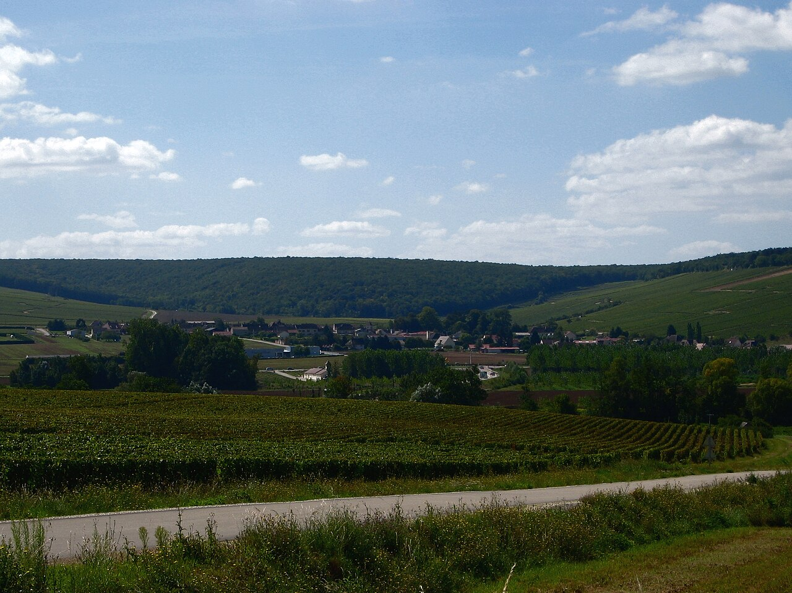

# 夏布利

夏布利是法国勃艮第北部的法定产区干白，只用霞多丽酿造，以启莫里阶石灰岩土壤与清瘦、矿物感强的风格著称。常见 750 mL、酒精度约 12%–13% vol，产区内部又分小夏布利、夏布利、一级园与特级园。

图：夏布利。图片：CocktailSteward，CC BY 3.0，via Wikimedia Commons（[原图页面](https://commons.wikimedia.org/wiki/File:Chablis_and_Premier_Cru_Vaulorent.jpg)）。

## 定义与定位

先分层：白葡萄酒是大类，霞多丽是品种，夏布利是法定产区（AOC），具体酒庄与酒款是生产者层面。四层分开看，才不会把“夏布利”当成一个品牌或一种葡萄。

夏布利是地理名称与法定产区标识，不是商标。只有在划定范围内、按产区规则种植与酿造的酒，才能标注 Chablis；市面上以“Chablis 风格”描述的其他产品，不等于法定产区酒。产区内部的分级按地块划分，与勃艮第其他子产区类似。

## 生产者与品牌

夏布利产区内有大量独立酒庄、合作社与酒商，规模从家族小庄到大型酒商都有。生产者名称通常出现在酒标正面或背标，酒庄、酒商与合作社的角色需要区分：酒商可能收购葡萄或酒液，酒庄则自有园地。

生产者、产区与产品是三个层级：产区回答法规与风土范围，生产者回答谁种植、谁酿造、谁装瓶，产品回答年份、等级与规格。购买时应核对装瓶者信息，不能只凭“Chablis”字样推断酒庄身份。

## 「夏布利」的产地与原料
产区位于[法国](ref:france)[勃艮第](ref:burgundy)北部的约讷省，是勃艮第最靠北的白葡萄酒产区之一。气候偏凉，成熟期长，启莫里阶石灰岩与泥灰岩土壤富含化石，排水性好，被认为赋予酒液矿物与紧致感。

原料是[葡萄](ref:grape)，品种为[霞多丽](ref:chardonnay)，产区规则要求白葡萄酒以霞多丽酿造。[水](ref:water)不进入成品，但降水与灌溉条件影响果实成熟与稀释程度。土壤与坡向影响成熟节奏，但同一产区内不同地块的差异依然明显。

## 「夏布利」怎么做出来
采收后的葡萄经压榨取汁，低温静置澄清，再由酵母进行[发酵](ref:fermentation)。传统做法多在不锈钢罐中发酵，以保留柑橘与矿物香气；部分生产者使用旧橡木桶或带渣接触，增加质地与复杂度。

苹果酸乳酸发酵会降低酸度、增加奶油感，是否进行取决于生产者的风格取向。发酵温度、酵母选择与桶型都会改变最终风味；这些细节属于生产者工艺信息，本页不给出统一参数。

## 「夏布利」的瓶型与标签
常见容量为 750 mL，[酒精度](ref:abv)约 12%–13% vol，不同年份与等级可能略有差异。标签应核对产区名、等级（小夏布利、夏布利、一级园、特级园）、年份、酒精度、净含量、装瓶者与进口商。

一级园与特级园通常标注具体的园地名（climat），特级园有明确的园地名清单。核对夏布利时，中文背标、进口商与防伪信息是身份依据；不同市场标签语言可能不同，以瓶身为准。

## 「夏布利」的闻与喝
典型香气是青苹果、柠檬、白花与湿石矿物感，部分酒款带轻微燧石与蜂蜜；入口酸度清晰，酒体偏轻至中等，余味干净且带咸鲜矿物感。与温暖产区的霞多丽相比，夏布利通常更清瘦、更少热带水果。

品鉴时充分冰镇至约 8–10 摄氏度，用郁金香形或专用白葡萄酒杯。温度过低会压抑香气，过高则酒精感突出。闻香时注意是否有明显的橡木味过重或氧化味，后者可能与存放条件有关。

## 「夏布利」的饮用与搭配
适合搭配生蚝、贝类、清蒸鱼、白肉与山羊奶酪；高酸度与矿物感能切开油脂，也能衬托海鲜的鲜味。避免与重酱汁红肉或强辣菜肴搭配，容易掩盖香气或放大酒精感。

开瓶后应冷藏并在数日内饮用完毕，接触空气后香气会逐渐减弱。多数夏布利适合在数年内饮用，部分一级园与特级园可中长期存放；具体适饮窗口因年份与生产者而异。本页关于夏布利的内容涉及酒精饮料；过量饮酒有害健康，未成年人不应饮酒。

## 「夏布利」的购买与保存
购买时优先选择正规渠道，核对等级、年份、园地名、装瓶者与进口商信息。价格随等级、年份与渠道波动，本页不给出具体数字；小夏布利与特级园属于不同层级，不能用一款概括整个产区。

就「夏布利」而言，未开瓶应避光、平放或直立存放于阴凉处，理想温度为 10–13 摄氏度，避免高温与剧烈温差。软木塞封瓶需保持湿度，长期存放可平放；开瓶后冷藏并尽快饮用，不宜反复取出回温。

## 「夏布利」容易被读错的地方
第一，把夏布利当成品牌。它是法定产区名称。
第二，认为夏布利一定是“无橡木”风格。部分生产者使用旧桶或带渣接触。
第三，把小夏布利与特级园混为一谈。它们是产区内的不同层级。
第四，把矿物感当成土壤直接进入酒液。它更多来自酸度、成熟度与整体结构的综合感知。
第五，用价格或包装判断真伪。渠道、标签与防伪信息更可靠。

**关键事实。**

| 项目 | 内容 |
| --- | --- |
| 一句话定位 | 法国勃艮第北部的夏布利法定产区干白，只用霞多丽酿造，以启莫里阶石灰岩土壤与清瘦、矿物感强的风格著称；常见 750 mL、酒精度约 12%–13% vol，分小夏布利、夏布利、一级园与特级园 |
| 酒种/风格 | 白葡萄酒 |
| 产区 | 法国、勃艮第 |
| 酒精度 | 12–13% vol |

**来源与边界。** 本页关于「夏布利」的关键事实，主要由以下来源交叉核对：Bureau Interprofessionnel des Vins de Bourgogne（夏布利产区的分级、品种与风土特征）、INAO（夏布利法定产区的范围与标签规则；由原条目末尾参考资料迁移，未逐条复核访问日期）、Oxford University Press（提供关于夏布利与启莫里阶土壤的条目；由原条目末尾参考资料迁移，未逐条复核访问日期）等 6 条来源。价格、批次与状态会变，涉及这些字段时以页面所列来源的最新版本为准。正文为项目自写，来源只作核验，不复制原文。

## 参考资料
- [白葡萄酒](ref:white-wine)：夏布利的品种、酸度与酿造工艺。
- [霞多丽](ref:chardonnay)：品种特性与风格弹性。
- [法国](ref:france)：法国葡萄酒版图与勃艮第的位置。
- [勃艮第](ref:burgundy)：夏布利所属产区的分级与子产区框架。
- [葡萄](ref:grape)：夏布利所用葡萄的成熟度、酸度与单宁判断。
- [水](ref:water)：降水与土壤水分对成熟的影响。
- [发酵](ref:fermentation)：低温发酵与苹果酸乳酸发酵。
- [酒精度](ref:abv)：12%–13% vol 在标签上的含义。
