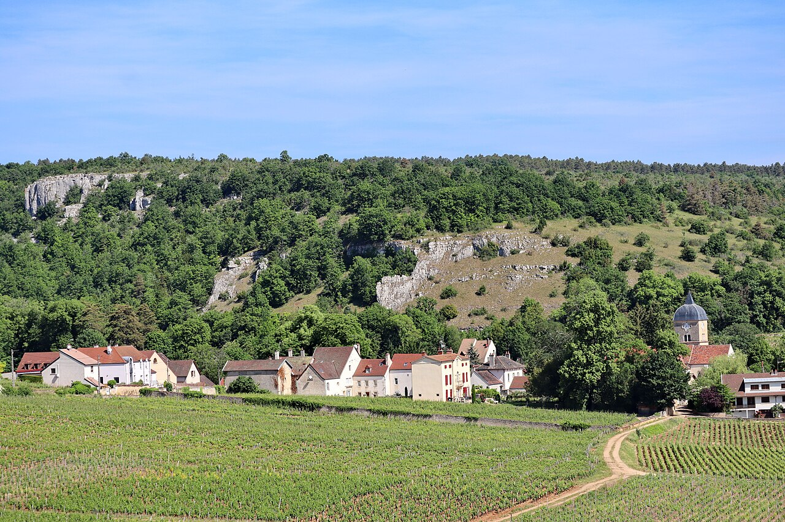

# 香波-米西尼

把一瓶香波-米西尼转过来，很多人的目光会先落在“Premier Cru”后面那个小字上：爱侣园（Les Amoureuses）。这座村庄的脾气就在这里——村名只是入口，真正被反复谈论的永远是具体地块。作为勃艮第夜丘的村庄级[红葡萄酒](ref:red-wine)法定产区，香波-米西尼全部以[黑皮诺](ref:pinot-noir)酿造，村内有两个特级园：米西尼（Musigny）与博纳-马尔（Bonnes-Mares）。常见容量 750 mL，[酒精度](ref:abv)约 12.5%–13.5% vol。

图：香波-米西尼。图片：Jean de l'Auxois，CC BY-SA 4.0，via Wikimedia Commons（[原图页面](https://commons.wikimedia.org/wiki/File:Village_et_vignes_de_Chambolle-Musigny_(C%C3%B4te-d%27Or)_07.jpg)）。

## 米西尼与博纳-马尔：两块特级园的分界

米西尼与博纳-马尔常被并列提起，其实它们并不相邻。米西尼在村庄上方，坡面朝东偏南，表土薄，石灰岩碎屑多，排水很快；博纳-马尔在村庄北端，与莫雷-圣丹尼接壤，黏土比例更高，酒体也更沉。博纳-马尔的法定范围跨越香波-米西尼与莫雷-圣丹尼两个市镇，这一点在[勃艮第](ref:burgundy)的地块地图上写得很清楚。

米西尼本身还分为 Les Musigny 与 Les Petits Musigny 两个地块，由多家酒庄分别持有，所以同样标着 Musigny 的酒款之间也会有差别。买这一档酒时，酒庄名和地块名要一起看，只看“Musigny”三个字不够。

## 爱侣园与“一级园之上的名声”

爱侣园（Les Amoureuses）是一级园，不是特级园，但市场常把它当作特级园来对待。它紧贴米西尼下缘，坡势平缓，土层比米西尼厚，酒风打开得更早，花香与红果更外放，单宁也更柔和。把它与米西尼对比，能清楚看到同一村内“厚度”和“精细”如何互换。

同村另一块常被拿来比较的一级园是 Les Charmes，面积更大、位置更靠南，酒体通常更实，香气不如爱侣园飘逸。村南还有 Les Fuées 等一级园，风格介于两者之间。一级园名单很长，真正决定酒质的是具体地块的坡位、土层与酒庄的萃取尺度。

## 石灰岩坡地与被反复引用的“细腻”

香波-米西尼的葡萄园大多落在海拔中等的东坡上，坡面不算陡，但排水顺畅。表土薄，底层是侏罗纪石灰岩与泥灰岩，含碎石多，根系容易扎进裂隙。这样的[法国](ref:france)坡地让[葡萄](ref:grape)成熟偏慢，酸度保留得好，单宁颗粒也细。

所谓“细腻”并不玄。薄土、低产量与克制的萃取，让黑皮诺的香气以花香和红果为主，酒体轻到中等。村南一些土层较厚的地块会给出更实的酒体，所以“香波一定轻”只是平均印象，不是每块地都成立。

## 与莫雷-圣丹尼、伏旧的结构对照

往北，莫雷-圣丹尼的酒整体更厚，黑果、泥土与野味感更明显，单宁也更有抓力；再往北的热夫雷-香贝丹更硬朗，骨架更大。伏旧（Clos Vougeot 一带）则是另一种结构感，酒体和单宁都更外显。相比之下，香波-米西尼的优势在于香气层次和中段的丝滑。

把香波与伯恩丘的[沃尔奈](ref:volnay)并排也有意思：两者都以花香见长，但沃尔奈更轻盈，酸度更靠前；香波的果味更集中，矿物感更清楚，收尾也更长一些。与北邻[热夫雷-香贝丹](ref:gevrey)相比，香波少一分力量，多一分精细。

## 整串与橡木：香气从何而来

红葡萄酒以[发酵](ref:fermentation)为基础，浸渍的温度、时长与萃取强度，决定酒是偏花香还是偏果酱。部分酒庄使用较高比例的整串发酵，为酒增加香料、茎叶与清凉感；这类做法在香波很常见，但要与成熟度匹配，否则会带来生青。之后是[橡木桶陈年](ref:oak-ageing)，新桶比例因酒庄和等级而异。

香波的香气很容易被过度萃取或重桶盖住。判断一款酒是否做得克制，可以看它在中段是否仍有清楚的花香，而不是只剩香草和烟熏。具体参数属于酒庄，本页不给统一数值，以酒庄资料和瓶标为准。

## 酒标上的村庄、地块与装瓶者

常规容量 750 mL，[酒精度](ref:abv)约 12.5%–13.5% vol。村庄级酒标写 Chambolle-Musigny；一级园写 Chambolle-Musigny Premier Cru，再加地块名；特级园通常只写 Musigny 或 Bonnes-Mares，村名反而省略。这一点常让新手误以为特级园“没有村庄”。

还要看装瓶者。酒庄自装、酒商装瓶与收购酒液装瓶，是三种不同的责任链。同一地块不同装瓶者的酒，风格和稳定性都可能不同。背标上的进口商信息只能说明流通渠道，不能替代对酒庄的了解。

## 暖年与冷年：香波的花香如何变化

暖年（生长季偏热、采收偏早）通常给出更熟的果味、更低的酸度和更饱满的酒体，香波的花香会往熟果和香料方向偏，细腻感可能被厚度盖住。冷年（生长季偏凉、成熟期拉长）保留更高的酸度和更清楚的花香，单宁也更明显，但中段可能偏空，需要时间整合。

多雨或冰雹影响大的年份，产量下降、成熟不均，酒可能更紧、更薄，挑选酒庄和地块比挑村名更重要。这里只谈方向，不列年份评分；同一村不同地块对同一个年份的反应也不一样。

## 从档位到瓶况：香波的买法

按相对档位看：村庄级是入门，一级园居中，特级园最高；爱侣园这类名声在外的一级园，价位常接近甚至超过部分特级园。米西尼与博纳-马尔内部还要看地块与酒庄，不能只按“特级园”三个字排序。

判断方法比记价格有用：先确认产区名与等级写法，再看地块名与装瓶者，最后看瓶况（酒标、液面、来源）。拍卖与二级市场的低价酒要留意储存历史；同一款酒的价差，往往来自渠道而不是酒本身。本页不写具体价格。

## 关于香波与两个特级园的误解

第一，认为香波-米西尼只产轻盈酒。米西尼与博纳-马尔都有结构和陈年潜力，博纳-马尔尤其偏厚。
第二，把爱侣园当成特级园。它是著名的一级园，等级上与特级园不同。
第三，以为博纳-马尔全部在香波-米西尼境内。它的范围跨香波与莫雷-圣丹尼两个市镇。
第四，以为米西尼只有一款酒。它包含 Les Musigny 与 Les Petits Musigny 两个地块，且由多家酒庄持有。
第五，认为颜色浅就代表酒薄。黑皮诺本身色浅，质地、香气与余味更能说明问题。

对照阅读：[红葡萄酒](ref:red-wine)、[勃艮第](ref:burgundy)。

**关键事实。**

| 项目 | 内容 |
| --- | --- |
| 一句话定位 | 法国勃艮第夜丘香波-米西尼的村庄级法定产区，以黑皮诺酿造红葡萄酒；村内有两个特级园米西尼与博纳-马尔，一级园以爱侣园为代表，风格细腻、花香突出，常见 750 mL、酒精度约 12.5%–13.5% vol |
| 酒种/风格 | 红葡萄酒 |
| 产区 | 法国、勃艮第 |
| 酒精度 | 12.5–13.5% vol |
