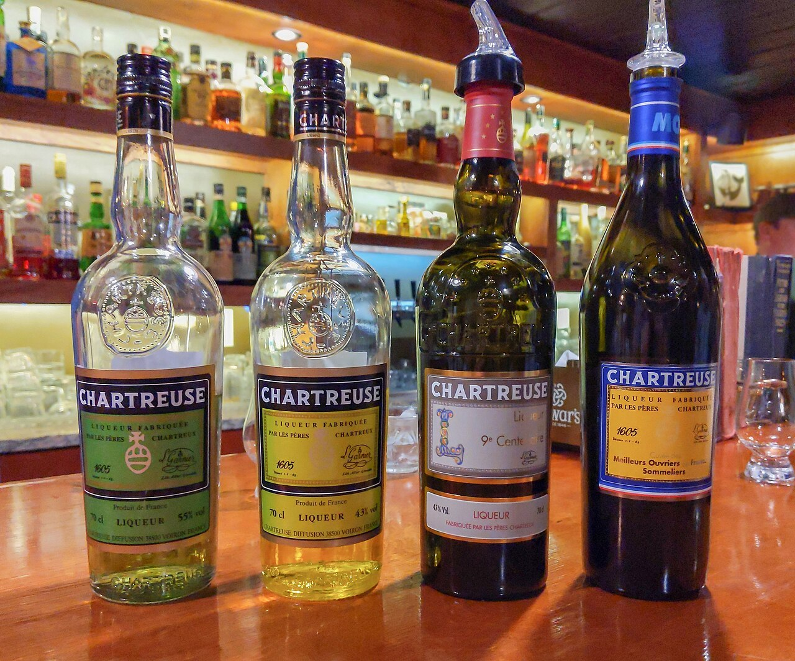

# 查特酒

查特酒（Chartreuse）是法国加尔都西会修士传统下生产的草本利口酒，酒液呈绿色或黄色，配方据称包含约 130 种植物、花、根、浆果与树皮。绿查特酒精度为 55% vol，黄查特为 40% vol。它属于[利口酒](ref:liqueur)这一大类，而不是葡萄酒或单纯的白兰地。

图：查特酒。摄影：Chartreuse bottles。署名：Ɱ，CC BY-SA 4.0，来自 Wikimedia Commons（[来源](https://commons.wikimedia.org/w/index.php?curid=132058135)）。

## 定义与身份

利口酒是“酒精 + 糖 + 风味物质”的总称，查特酒正落在这一框架内：以中性酒精或蒸馏酒为基酒，把植物原料通过浸渍、蒸馏或两者结合的方式取得香气，再加入糖或蜂蜜调整口感。因此它既不是“药”，也不是“药酒”的法定类别。修道院历史、草药传统和“长生酊剂”的故事属于品牌叙事，不能替代产品标签上的酒精度、容量与配料信息。

从产区看，查特酒是法国产品，主要生产与陈酿地点在伊泽尔省瓦龙（Voiron）一带，靠近格勒诺布尔附近的 Grande Chartreuse 修道院。法国只是它的法定与历史产地，不等于所有法国草本利口酒都叫查特酒；同名或近名的产品需要看生产者与商标。

## 「查特酒」的时间线
据酒厂与地方旅游机构公开的时间线，加尔都西会于 1084 年在 Chartreuse 山地建立修道院。1605 年，François Hannibal d'Estrées 元帅把一份记载“长寿酊剂”配方的手稿交给巴黎 Vauvert 修道院的修士；手稿列出约 130 种植物，但完整配方始终没有公开。此后修士用了一个多世纪改进工艺，1764 年形成后来称为“Elixir Végétal de la Grande Chartreuse”的酊剂产品。

19 世纪，修道院在药剂与蒸馏传统的基础上发展出今天的利口酒形态，并逐渐建立品牌。1903 年，修士曾被逐出法国，生产一度转移到西班牙塔拉戈纳（Tarragona），后来才回到法国。今天，据说只有极少数修士掌握完整配方；这一“秘密配方”既是品牌资产，也是外界无法独立复核的部分。涉及“包治百病”“万能药”的说法，应视为历史宣传而非现代医学结论。

## 配方与工艺

查特酒的公开工艺框架并不复杂：植物原料经过浸渍与[蒸馏](ref:distillation)，得到香气浓缩液，再与基酒、糖或蜂蜜调配，最后在酒窖中陈放使风味融合。真正不可复现的是植物种类、比例、温度、时间与调配顺序。绿查特与黄查特不是“同一配方加不同色素”，而是两个独立产品：绿色的酒精度更高、草本与薄荷感更强；黄色更甜、更柔和，酒精度更低。

从食品化学角度，草本利口酒的香气来自萜烯、芳香醛、酚类与内酯等多种化合物；糖分和酒精度会影响这些物质的挥发与感知。高酒精度有利于香气保存，却也会带来更强的口腔刺激；糖分则让酒体显得圆润、掩盖部分苦味。因此“绿查特更烈、黄查特更甜”是可以从规格与配方方向上解释的，不需要借助神秘叙事。

## 产品与规格

| 项目 | 绿查特（Green Chartreuse） | 黄查特（Yellow Chartreuse） |
| --- | --- | --- |
| 类型 | 草本利口酒 | 草本利口酒 |
| 酒精度 | 55% vol | 40% vol |
| 风味方向 | 草本、茴香、薄荷、松针 | 蜂蜜、草本、柑橘与香料 |
| 常见用法 | 纯饮、加冰、经典鸡尾酒 | 纯饮、加冰、较柔和的调酒 |
| 生产地 | 法国瓦龙一带 | 法国瓦龙一带 |

表内规格用于说明两个主线的差异，不覆盖限定版、陈年版或特殊包装。购买时应以瓶身标签与生产批次为准；同一产品在不同市场可能有容量与标签差异。

## 「查特酒」的闻与喝
绿查特的香气强度很高，开瓶即可感到薄荷、茴香、松针与草本的复合气息，入口甜度被高酒精度压住，回味长且带苦感。黄查特更接近“甜蜜的草本茶”，蜂蜜与花香更突出，酒精度低，适合纯饮入门。两者都不是“越陈越好”的葡萄酒型产品；开瓶后应避免长时间高温与强光，以免香气衰减。

品鉴时可以分三步：先闻静态香气，判断草本、甜香与酒精刺激的比例；再加少量水或冰，观察香气是否打开；最后小口吞咽，注意苦味、甜味与余味的长度。不要用大口干杯的方式评价这类高酒精度利口酒，因为口腔刺激会掩盖细节。

## 「查特酒」的饮用与搭配
最常见的喝法是冰镇后纯饮，或加一块大冰缓慢稀释；在调酒中，绿查特常用于 Last Word、Champs-Élysées 等经典配方，用量通常很小，以免压过其他材料。黄查特可以用于较柔和的鸡尾酒，也可以与苏打水、汤力水搭配，但会明显改变甜苦平衡。作为餐后酒，它适合搭配黑巧克力、坚果或香料类甜点；不建议与清淡海鲜同饮，因为草本与高酒精度会盖住食材本味。

## 「查特酒」容易被读错的地方
第一，把“修士秘方”当成可核查的配方。公开资料只确认植物数量约为 130 种，完整配方并不公开。
第二，把绿查特当成“更高级”的版本。绿色与黄色是风格与规格差异，不是质量等级。
第三，把它当药或保健品。它是含酒精的食品，任何“疗效”说法都不应替代医疗建议。
第四，认为所有“Chartreuse”都是同一产品。法国还有 Chartreuse 山地、修道院与同名地名，购买时应认生产者与酒标。
第五，忽视开瓶后的保存。高酒精度不等于不会走味，光照、温度与剩余空间都会影响香气。

对照阅读：[利口酒](ref:liqueur)、[蒸馏](ref:distillation)。

相关条目：[法国](ref:france)。

**关键事实。**

| 项目 | 内容 |
| --- | --- |
| 一句话定位 | 法国加尔都西会修士在瓦龙生产的草本利口酒，以约 130 种植物配方著称；绿查特酒精度 55% vol，黄查特 40% vol |
| 酒种/风格 | 利口酒 |
| 产区 | 法国 |

**来源与边界。** 本页关于「查特酒」的关键事实，主要由以下来源交叉核对：Pères Chartreux / Chartreuse Diffusion（1605 年手稿、130 种植物、1764 年酊剂与品牌历史时间线）、Agence départementale du tourisme de la Savoie / Isère（交叉核对修道院起源、手稿与生产地点）、Oxford University Press（提供关于查特酒、修道院利口酒与调酒应用的条目）等 4 条来源。价格、批次与状态会变，涉及这些字段时以页面所列来源的最新版本为准。正文为项目自写，来源只作核验，不复制原文。

**并读。** 把「查特酒」与「利口酒」、「法国」、「蒸馏」放在一起读时，先确认它们是同一层级还是上下游关系：先确认酒种与产区，再比较年份、酒精度、价格与饮用场景。本页负责给出酒款的基本坐标，对照条目补上具体案例与差异；读完再回到本页，才能分清哪些差别属于酒款本身，哪些只是产地、批次或品牌选择。

## 参考资料
- [利口酒](ref:liqueur)：查特酒所属的更大品类。
- [蒸馏](ref:distillation)：草本香气浓缩与基酒制造的基本工艺。
- [法国](ref:france)：产区、法规与酒类体系的总览。
