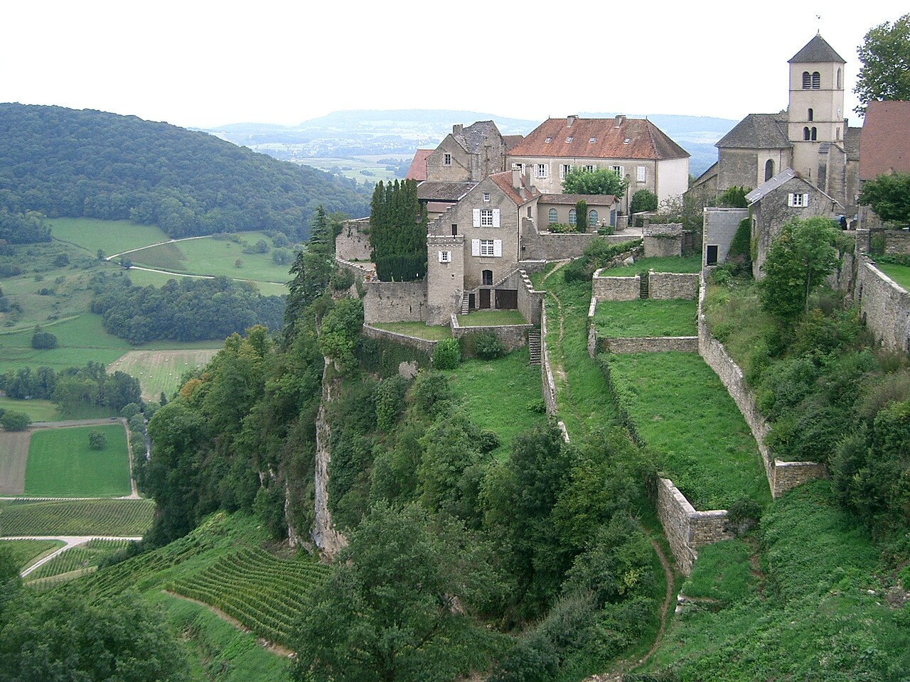

# 夏托沙隆

夏托沙隆（Château-Chalon）是[法国](ref:france)[汝拉](ref:jura)的法定产区，只生产[黄酒](ref:yellow-wine)，只用萨瓦涅酿造。酒液在旧桶中以 sous voile 方式长期氧化陈年，法定最短陈年不少于 6 年 3 个月。常见 620 mL 细颈瓶，[酒精度](ref:abv)约 13.5%–15% vol。

图：夏托沙隆。图片：PRA，CC BY 3.0，via Wikimedia Commons（[原图页面](https://commons.wikimedia.org/wiki/File:Ch%C3%A2teau-Chalon_-_site.JPG)）。

## 定义与定位

先分层：[白葡萄酒](ref:white-wine)是大类，黄酒是氧化型白葡萄酒，夏托沙隆是只产黄酒的法定产区，具体酒庄与酒款是生产者层面。夏托沙隆既是村名，也是产区名，酒标上通常直接标注“Château-Chalon”。

夏托沙隆的定位特殊：产区范围内只允许黄酒一种酒种，不生产常规干白、红葡萄酒或起泡酒。因此它的风格变化主要来自地块、年份与酒庄的氧化管理，而不是酒种选择。

## 生产者与品牌

产区面积小，生产者以家族酒庄为主，也有少量酒商。黄酒需要长期占压库存，产量又低，因此生产者规模普遍有限。

生产者、产区与产品是三个层级：产区回答法规与范围，生产者回答种植、酿造与装瓶，产品回答年份与瓶型。同为夏托沙隆，不同酒庄的酵母膜管理与陈年长度会有差别。

## 「夏托沙隆」的产地与原料
夏托沙隆位于汝拉西部，葡萄园分布在夏托沙隆村周围的坡地与台地上，海拔约 250–450 米。土壤以石灰岩与泥灰岩为主，排水好、肥力低，坡向以朝南或东南为主。

原料是[葡萄](ref:grape)，品种只有萨瓦涅。萨瓦涅成熟较晚、酸度高，皮薄，既能在 ouillé 路线下做出清爽干白，也能在 sous voile 路线下形成坚果与香料气息。夏托沙隆只使用后一条路线。

## 「夏托沙隆」怎么做出来
关键在“sous voile”与“ouillé”的区分。ouillé 是补液陈酿：定期添满桶中蒸发减少的酒液，减少氧气接触，得到纯净的柑橘、白花与矿物风格。sous voile 是酒面下陈酿：不添满，让酒面形成一层酵母膜，酒液在氧化的环境中缓慢演化。夏托沙隆走的是 sous voile。

发酵完成后，酒液进入旧桶长期陈年，法定最短为 6 年 3 个月。酵母膜消耗氧气并产生坚果、咖喱与咸鲜类物质；桶材与桶龄影响透气速度。装瓶使用 620 mL 细颈瓶，这一容量与陈年过程中的自然损耗相对应。发酵与[橡木桶陈年](ref:oak-ageing)的基础逻辑可分别参见[发酵](ref:fermentation)与橡木桶条目。

## 「夏托沙隆」的瓶型与标签
标准容量为 620 mL 细颈瓶，[酒精度](ref:abv)约 13.5%–15% vol，具体随年份与酒庄变化。标签应核对“Château-Chalon”产区名、年份、装瓶者与进口商信息。

夏托沙隆不标注“vin jaune”作为唯一名称，但酒种属于黄酒；部分酒标会同时说明陈年方式。核对夏托沙隆时，中文背标与进口商信息是身份依据，以瓶身实际标注为准。

## 「夏托沙隆」的闻与喝
典型香气是核桃、杏仁、蜂蜡、咖喱、干果与咸鲜，部分酒款带蜂蜜与酵母气息；入口酸度高、口感浓缩，余味很长。与 ouillé 白葡萄酒的清爽柑橘风格相比，夏托沙隆更厚重、更偏氧化。

品鉴建议温度约 12–14 摄氏度，用小杯少量饮用。开瓶后香气会持续变化，应先闻香再入口，注意坚果、香料与咸鲜的层次，避免用重口味菜肴掩盖细节。

## 「夏托沙隆」的饮用与搭配
适合坚果、菌菇、鹅肝、硬质奶酪与带咸鲜味的菜肴；也可作为餐后酒单独饮用。搭配时避免过甜或过辣的菜式，容易压住氧化香气。

黄酒开瓶后氧化速度快，应冷藏并在数周内喝完，具体时长因酒款而异。本页关于夏托沙隆的内容涉及酒精饮料；过量饮酒有害健康，未成年人不应饮酒。

## 「夏托沙隆」的购买与保存
购买时核对产区名、年份与装瓶者，注意 620 mL 细颈瓶这一特征。夏托沙隆产量小、陈年时间长，价格通常高于常规汝拉白葡萄酒，本页不给出具体数字。

未开瓶应避光、平放于阴凉处，理想温度为 12–15 摄氏度，避免高温与剧烈温差。长期存放应保持温度稳定；开瓶后抽真空或充惰性气体并冷藏，不宜反复回温。

## 「夏托沙隆」容易被读错的地方
第一，把夏托沙隆当成普通干白。它是 sous voile 陈酿的黄酒。
第二，把“黄”理解为甜。黄指颜色与氧化风格，不等于高糖。
第三，认为 sous voile 与 ouillé 只是陈年时间不同。两者是氧气参与方式不同的两条路径。
第四，认为夏托沙隆也产红酒或起泡酒。产区只允许黄酒。
第五，认为陈年越久越好。开瓶后氧化会加速衰退，应尽快饮用。

夏托沙隆的关键是萨瓦涅在旧桶中“酒面下”长期氧化，形成坚果、蜂蜡、咖喱与咸鲜的复合香气，而不是普通白葡萄酒的果香路线。它属于汝拉黄酒，法定陈年要求以年为单位计算；酒精度与容量只是规格，不能据此判断陈年长短或质量高低。

对照阅读：[黄酒](ref:yellow-wine)、[法国](ref:france)。

**关键事实。**

| 项目 | 内容 |
| --- | --- |
| 一句话定位 | 法国汝拉夏托沙隆法定产区的黄酒，只用萨瓦涅酿造，在旧桶中以 sous voile 方式长期氧化陈年不少于 6 年 3 个月；风格以坚果、蜂蜡、咖喱与咸鲜为主，与 ouillé 补液陈酿的汝拉白葡萄酒形成对照，常见 620 mL 细颈瓶、酒精度约 13.5%–15% vol |
| 酒种/风格 | 黄酒、白葡萄酒 |
| 产区 | 法国、汝拉 |
| 酒精度 | 13.5–15% vol |

**来源与边界。** 本页关于「夏托沙隆」的关键事实，主要由以下来源交叉核对：INAO（夏托沙隆法定产区的范围、品种与黄酒陈年规则；由原条目末尾参考资料迁移，未逐条复核访问日期）、European Union（欧盟葡萄酒类别、地理标志与标签规则）、Oxford University Press（提供关于夏托沙隆、黄酒与 sous voile 的条目；由原条目末尾参考资料迁移，未逐条复核访问日期）。价格、批次与状态会变，涉及这些字段时以页面所列来源的最新版本为准。正文为项目自写，来源只作核验，不复制原文。

## 参考资料
- [黄酒](ref:yellow-wine)：夏托沙隆所属的氧化型白葡萄酒类别。
- [白葡萄酒](ref:white-wine)：黄酒在颜色分类上的上位类别。
- [汝拉](ref:jura)：夏托沙隆所属产区与酒种框架。
- [阿尔布瓦](ref:arbois)：同时生产红白与黄酒的汝拉产区。
- [葡萄](ref:grape)：夏托沙隆所用葡萄的成熟度、酸度与单宁判断。
- [发酵](ref:fermentation)与[橡木桶陈年](ref:oak-ageing)：黄酒的两道基础工艺环节。
- [酒精度](ref:abv)：13.5%–15% vol 在标签上的含义。
