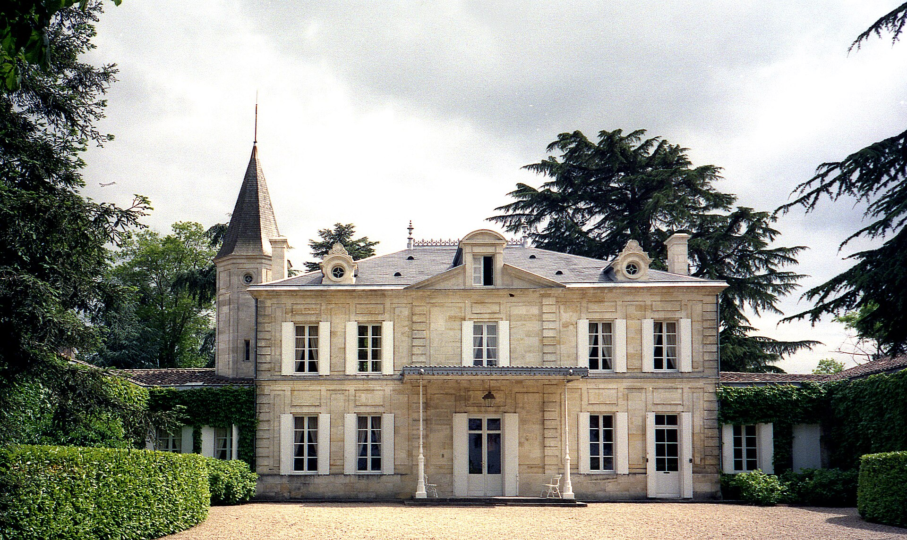

# 白马酒庄

白马酒庄（Château Cheval Blanc）位于法国波尔多圣埃美隆（Saint-Émilion）产区，紧邻波美侯边界。葡萄园约 39 公顷，以[品丽珠](ref:cabernet-franc)与[梅洛](ref:merlot)为主，风格以香气复杂度、柔顺质地与陈年潜力著称。常见 750 mL，[酒精度](ref:abv)约 13%–14% vol。

图：白马酒庄相关实景照片。图片：Benjamin Zingg, Switzerland，CC BY-SA 2.5，via Wikimedia Commons（[原图页面](https://commons.wikimedia.org/wiki/File:Ch%C3%A2teau_Cheval-Blanc.jpg)）。

## 定义与定位

先分层：[红葡萄酒](ref:red-wine)是大类，品丽珠与梅洛是品种，圣埃美隆是产区，白马是具体酒庄与正牌酒。四层分开，才不会把品牌名当成品种或分级头衔。

圣埃美隆有自己的分级制度，与左岸 1855 年分级不同。白马在 1955 年首次圣埃美隆分级中列为一级特等（Premier Grand Cru Classé A）；2021 年酒庄宣布退出该分级体系，此后的官方名单不再列入。讨论其“级别”时，需要说明年份与制度背景，不能简单沿用旧头衔。

## 生产者与品牌

酒庄位于圣埃美隆与波美侯交界的高地，园地跨越两个产区的土壤类型。1998 年起由路威酩轩集团与比利时企业家阿尔贝·弗雷尔（Albert Frère）家族共同持有，此后由专业团队管理。

酒庄、品牌与产品是三个层级：酒庄回答园地、团队与工艺，品牌回答市场定位，产品回答年份与规格。白马有正牌与副牌（Le Petit Cheval），两者园地来源与筛选标准不同，不能混为一谈。

## 「白马酒庄」的产地与原料
圣埃美隆位于[法国](ref:france)[波尔多](ref:bordeaux)右岸，气候受大西洋影响，黏土与石灰岩土壤交错分布。白马的园地靠近波美侯一侧，土壤含砾石、黏土与砂质成分，排水与保水的平衡影响品丽珠与梅洛的成熟节奏。

原料是[葡萄](ref:grape)，品种以[品丽珠](ref:cabernet-franc)与[梅洛](ref:merlot)为主，另有少量其他品种，具体比例随地块与年份调整。品丽珠提供香气与结构，梅洛提供柔顺与果味；两者的比例是白马风格的重要变量。

## 「白马酒庄」怎么做出来
采收后按地块与品种分批发酵，控温浸渍以萃取颜色与单宁，同时避免过度萃取。发酵完成后进入[橡木桶陈年](ref:oak-ageing)，新桶比例较高，具体比例随年份调整。

橡木桶的作用是整合香气与柔化单宁，而不是掩盖果味。装瓶前的澄清与过滤处理因年份而异；酒庄会根据地块的成熟度与酒体决定混酿比例，具体参数以酒庄公开信息为准。

正牌与副牌共享部分园地，但筛选与用桶不同，副牌 Le Petit Cheval 通常更早适饮；圣埃美隆分级每十年左右修订，2021 年退出后，白马的市场地位更多由酒评与二级市场决定。

## 「白马酒庄」的瓶型与标签
常见容量为 750 mL，[酒精度](ref:abv)约 13%–14% vol，具体随年份变化。标签应核对酒庄名、年份、产区、净含量、装瓶者与进口商信息；副牌名称与正牌不同，购买时需确认。

中文背标、进口商与防伪信息是核对身份的依据；白马酒庄在不同市场的标签语言不同，以瓶身实际标注为准。高价值酒款在二级市场交易时应查看来源与储存记录。

## 「白马酒庄」的闻与喝
典型香气是黑醋栗、黑樱桃、紫罗兰、石墨与烟草，陈年后发展出皮革、松露与雪松；入口单宁细密，酸度中等，酒体中等偏饱满，质地柔顺，余味长。品丽珠比例较高的年份，香气更偏花香与石墨。

品鉴时建议温度约 16–18 摄氏度，用较大的酒杯。年轻酒款可醒酒 1–2 小时；老酒应缩短醒酒时间，先试一小杯。温度过高会让酒精感突出，掩盖香气层次。

## 「白马酒庄」的饮用与搭配
适合搭配红肉、烤肉、菌菇菜肴与硬质奶酪；油脂与蛋白质能缓冲单宁，让酒体更圆润。避免与过甜或强酸的菜肴同饮，容易破坏平衡。

多数年份适合在 10 年以上饮用，优质年份可以更长；具体适饮窗口因年份与储存条件而异。开瓶后应冷藏并尽快饮用。本页关于白马酒庄的内容涉及酒精饮料；过量饮酒有害健康，未成年人不应饮酒。

## 「白马酒庄」的购买与保存
购买时优先选择正规渠道，核对年份、酒标、背标、进口商与防伪信息。价格随年份与市场波动明显，本页不给出具体数字；正牌与副牌价格差异大，需确认名称。

白马以品丽珠与梅洛为主，酒体并不厚重，但陈年潜力长。未开瓶应平放于 12–15°C、避光且温差小的位置；软木塞保持湿润。开瓶后抽真空或充惰性气体冷藏，分次饮用时让酒液回温到 16–18°C，不要反复加热。

## 「白马酒庄」容易被读错的地方
第一，把白马当成葡萄品种。它是酒庄与酒款，品种是品丽珠与梅洛。
第二，把 1955 年分级头衔当作永久身份。2021 年酒庄已退出该分级。
第三，把正牌与副牌混为一谈。两者筛选标准与价格不同。
第四，认为右岸酒只靠梅洛。白马的品丽珠比例很高。
第五，用价格或包装判断真伪。渠道、背标与来源记录更可靠。

对照阅读：[红葡萄酒](ref:red-wine)、[法国](ref:france)。

2021 年退出圣埃美隆分级，不等于酒质下降；分级、市场评价与酒庄选择是几套不同体系。

2021 年退出分级后仍可标圣埃美隆产区；退出的是分级名单，不是 AOC 资格。

**关键事实。**

| 项目 | 内容 |
| --- | --- |
| 一句话定位 | 法国波尔多圣埃美隆产区的红葡萄酒，位于圣埃美隆与波美侯交界，葡萄园约 39 公顷，以品丽珠与梅洛为主；1955 年圣埃美隆分级中列为一级特等 A 级，2021 年退出该分级，常见 750 mL、酒精度约 13%–14% vol |
| 酒种/风格 | 红葡萄酒 |
| 产区 | 波尔多、法国 |
| 酒精度 | 13–14% vol |

**来源与边界。** 本页关于「白马酒庄」的关键事实，主要由以下来源交叉核对：Château Cheval Blanc（酒庄位置、园地面积、品种构成与所有者关系；由原条目末尾参考资料迁移，未逐条复核访问日期）、CIVB（圣埃美隆产区范围与分级制度的公开信息；由原条目末尾参考资料迁移，未逐条复核访问日期）、Oxford University Press（提供关于白马、圣埃美隆分级与品丽珠的条目；由原条目末尾参考资料迁移，未逐条复核访问日期）。价格、批次与状态会变，涉及这些字段时以页面所列来源的最新版本为准。正文为项目自写，来源只作核验，不复制原文。

## 参考资料
- [红葡萄酒](ref:red-wine)：白马所属的葡萄酒大类。
- [品丽珠](ref:cabernet-franc)：白马的核心品种之一。
- [梅洛](ref:merlot)：与品丽珠共同构成混酿主体。
- [法国](ref:france)：法国葡萄酒法规与产区体系。
- [波尔多](ref:bordeaux)：圣埃美隆在波尔多版图中的位置。
- [葡萄](ref:grape)：白马酒庄所用葡萄的成熟度、酸度与单宁判断。
- [发酵](ref:fermentation)：分批发酵与浸渍的基本逻辑。
- [橡木桶陈年](ref:oak-ageing)：白马酒庄的桶陈时长、香气整合与结构变化。
- [酒精度](ref:abv)：13%–14% vol 在标签上的含义。
