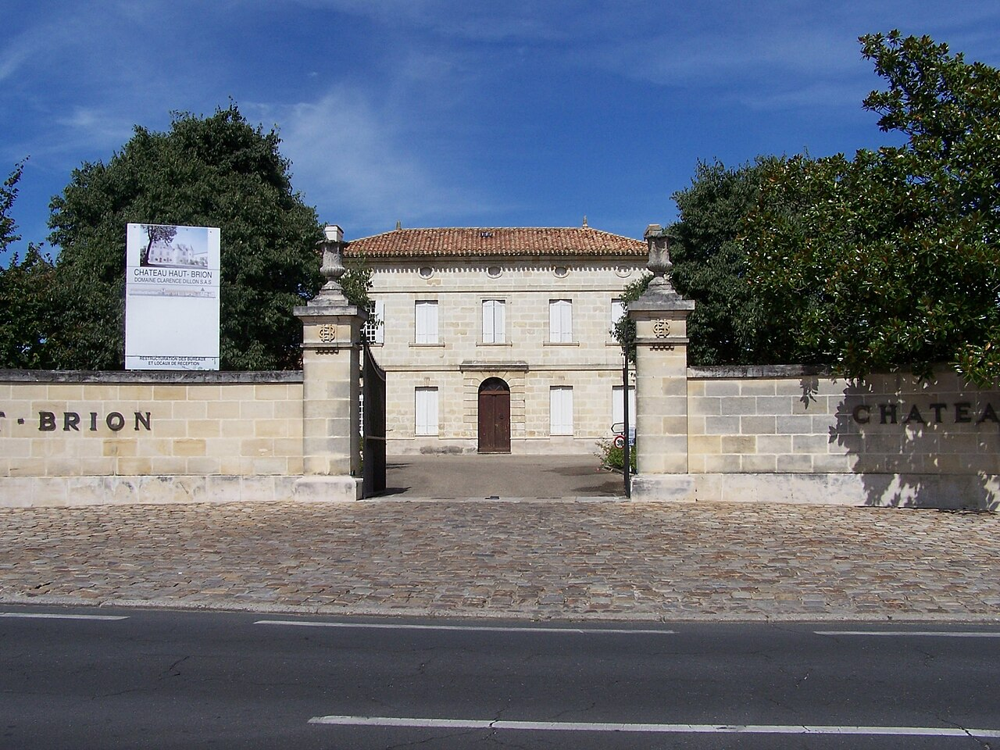

# 奥比昂古堡

奥比昂古堡（Château Haut-Brion）是法国波尔多佩萨克-雷奥良的列级庄，在 1855 年分级中列为一等，也是这份名单中唯一不在梅多克的酒庄。酒款属于[红葡萄酒](ref:red-wine)，以[赤霞珠](ref:cabernet)与[梅洛](ref:merlot)为主的混酿，风格常被描述为带有烟熏、雪茄盒与矿石气息。常见 750 mL 瓶装、酒精度约 13% vol，具体年份、装瓶批次与酒标信息以瓶标为准。

图：奥比昂古堡。图片：Henry Salomé，CC BY-SA 4.0，via Wikimedia Commons（[原图页面](https://commons.wikimedia.org/wiki/File:Pessac_Ch%C3%A2teau_Haut-Brion.jpg)）。

## 定义与定位

奥比昂古堡既是酒庄名，也是正牌酒的名字。酒庄位于[波尔多](ref:bordeaux)左岸南部的佩萨克-雷奥良，属于格拉夫产区，在法国 AOC/AOP 体系内以佩萨克-雷奥良（Pessac-Léognan）产区名销售。正牌之外还有副牌酒与干白，三者来自不同筛选标准，不能混为一谈。

在[葡萄酒](ref:wine)的分类里，它属于静态红葡萄酒。一级庄是 1855 年分级给出的历史身份，不是现代评审；年份、地块与装瓶批次仍然是判断具体酒款的前提。格拉夫产区的红葡萄酒在历史上常被单独讨论，理解它需要同时看左岸的共性与此处的差异。

## 产区与分级

佩萨克-雷奥良位于波尔多城南部，格拉夫北部，土壤由砾石、砂与黏土混合而成。与梅多克的深厚砾石相比，这里的土壤类型更复杂，部分地块的排水与升温条件适合赤霞珠，另一些地块更适合梅洛。

1855 年分级由波尔多商会制定，主要覆盖梅多克的酒庄，格拉夫只有少数入选。奥比昂古堡在这份名单中列为一等，与[玛歌古堡](ref:margaux)等同级，也是名单中唯一位于梅多克之外的酒庄。这个例外让它成为讨论分级地理范围时的常见例子。

## 品种与混酿

正牌以赤霞珠与梅洛为主体，常搭配品丽珠与小维多。赤霞珠提供骨架、颜色与陈年潜力，梅洛补充圆润度与果味，品丽珠带来香气层次，小维多增加颜色与香料感。

比例会随年份调整，不同地块也分别处理。比例本身不是质量指标，最终要看酒款的平衡。调配是酒庄的工艺决定，具体比例通常不会完整标注在瓶标上；瓶标上的年份与产区，才是核对身份的基本项。

## 「奥比昂古堡」怎么做出来
采收通常人工进行，经过分选、除梗与破碎后进入控温[发酵](ref:fermentation)。浸渍时间与发酵温度影响颜色、单宁与香气的提取强度；不同地块、不同品种往往分罐处理，再进入[调配](ref:blending)。

发酵完成后，酒液进入[橡木桶陈酿](ref:oak-ageing)。新桶比例、陈酿时长与换桶频率属于酒庄工艺安排，公开资料未必逐年披露。橡木桶的作用是柔化单宁并增加香气层次，不能替代葡萄本身的成熟度。

## 「奥比昂古堡」的瓶型与标签
常见规格为 750 mL 瓶装，酒精度约 13% vol，属干型红葡萄酒。瓶标通常包含酒庄名、年份、产区名、酒精度、净含量与生产信息；法国 AOC 酒款还会标注原产地命名。

副牌酒有独立的名称与包装，价格与正牌差距明显。购买时应分清正牌、副牌与酒庄的干白，不要把副牌当作“便宜的正牌”，也不要用正牌的年份表现推断副牌。

## 「奥比昂古堡」的闻与喝
年轻时常呈现黑加仑、李子、烟熏与矿石气息，单宁细密而有支撑。陈年后逐渐发展出雪茄盒、烟草、皮革与松露的气息，酒体由紧致转向柔顺，余味较长。

就「奥比昂古堡」而言，建议在 16-18°C 饮用。温度过高会让酒精感突出，过低会压抑香气。年轻酒款可以醒酒一段时间，老酒则应缩短与空气接触的时间，避免香气过快散失。

## 「奥比昂古堡」的饮用与搭配
奥比昂古堡适合搭配牛排、烤羊排、鸭胸与硬质奶酪。奥比昂古堡的单宁与蛋白质结合可以缓和涩感，酸度则能切割油脂。搭配蘑菇、松露等带有土壤气息的菜式，也容易与陈年香气形成呼应。

奥比昂开瓶后应塞紧瓶塞冷藏，最好两天内喝完；老年份更应减少与空气接触。红葡萄酒氧化后，果香会转向酸味与坚果味；分装小瓶或真空塞可减缓，但不能让老酒恢复。

## 「奥比昂古堡」的购买与保存
波尔多一级庄主要通过酒商体系与期酒市场流通，价格受年份、产量与市场预期影响。购买时应核对酒庄名、年份、产区、酒精度与防伪信息，并留意渠道是否可靠。

奥比昂未开瓶应避光、卧放于 12–16°C 的稳定环境，避免温差与震动；软木塞需要湿度。家庭存放难以复制酒窖条件，长期陈年需要稳定温湿度，购买年份不等于瓶中状态。

## 「奥比昂古堡」容易被读错的地方
第一，把一级庄当作每年固定的质量保证。分级是历史身份，年份差异仍然明显。

第二，以为一级庄都在梅多克。奥比昂位于格拉夫的佩萨克-雷奥良。

第三，把副牌当作正牌的廉价版本。副牌来自不同地块与不同筛选标准。

第四，只看价格或名庄名判断质量。奥比昂不同年份差异大，渠道、瓶况与保存历史同样重要；老年份还要看液面、酒标与进口记录。

第五，把“列级庄”当作无限期陈年保证。奥比昂的适饮窗口因年份而异，过了最佳期香气会衰退；存放条件比酒庄名更能决定瓶中状态。

**关键事实。**

| 项目 | 内容 |
| --- | --- |
| 一句话定位 | 法国波尔多佩萨克-雷奥良的列级庄，1855 年分级列为一等，是名单中唯一不在梅多克的酒庄；以赤霞珠与梅洛为主的混酿，常见 750 mL、酒精度约 13% vol，具体年份与批次以瓶标为准 |
| 酒种/风格 | 红葡萄酒 |
| 产区 | 法国、波尔多 |

**来源与边界。** 本页关于「奥比昂古堡」的关键事实，主要由以下来源交叉核对：Conseil Interprofessionnel du Vin de Bordeaux (CIVB)（波尔多产区分级与品种的基本表述）、INAO（法国原产地命名控制制度的基本框架）、European Union（欧盟葡萄酒类别、地理标志与标签规则）等 6 条来源。价格、批次与状态会变，涉及这些字段时以页面所列来源的最新版本为准。正文为项目自写，来源只作核验，不复制原文。

## 参考资料
- [红葡萄酒](ref:red-wine)：类别与基本工艺。
- [葡萄酒](ref:wine)：大类与分类体系。
- [法国](ref:france)：法国葡萄酒的整体格局。
- [波尔多](ref:bordeaux)：左岸与右岸、分级与市场。
- [赤霞珠](ref:cabernet)：品种特征与风格。
- [梅洛](ref:merlot)：圆润度与果味的来源。
- [发酵](ref:fermentation)：带皮发酵与浸渍。
- [橡木桶陈酿](ref:oak-ageing)：香气与单宁的塑造。
- [调配](ref:blending)：平衡品种与地块差异。
- [玛歌古堡](ref:margaux)：同为 1855 年一级庄的代表。
