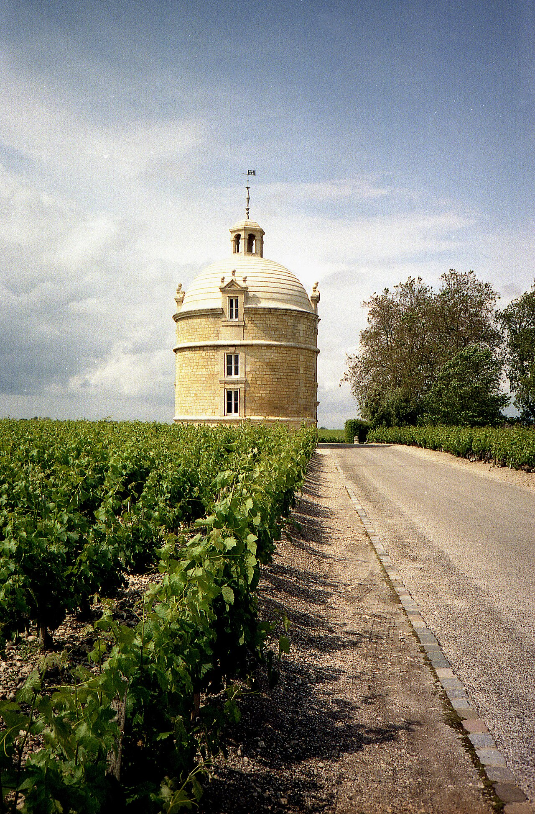

# 拉图古堡

拉图古堡（Château Latour）在[法国](ref:france)[波尔多](ref:bordeaux)左岸的[波亚克](ref:pauillac)村南端，葡萄园距吉伦特河口只有约 300 米。它属于静态[红葡萄酒](ref:red-wine)，在[葡萄酒](ref:wine)分类里没有加强或起泡的额外工艺。它的正牌并不是整个庄园的泛称，而是 47 公顷 Enclos 围场里、平均约 60 年老藤的产物；理解拉图，先要理解这道围墙。

图：拉图古堡。图片：Benjamin Zingg, Switzerland，CC BY-SA 2.5，via Wikimedia Commons（[原图页面](https://commons.wikimedia.org/wiki/File:Ch%C3%A2teau_La_Tour.jpg)）。

## 1331 年的塔与 900,000 株藤

现存最早提到拉图的文件写于 1331 年：领主 Pons 授权 Gaucelme de Castillon 在圣莫贝尔教区修建一座设防塔楼。1378 年，这座“圣莫贝尔塔”又出现在傅华萨的《闻见录》里，当时是英法百年战争中扼守河口的堡垒。今天的酒庄建筑旁只剩一座鸽舍，原塔早已不存，“Latour”这个名字却留了下来。

18 世纪初，拉图随婚姻与继承进入 Ségur 家族。1714 年，一桶拉图的售价比普通波尔多酒高四到五倍；到 1767 年，这个倍数扩大到二十倍。1759 年葡萄园为 38 公顷，1794 年扩至 47 公顷，正好是今天 Enclos 的规模。如今全园约 900,000 株藤，每年补植约 3%，2008 年重新引入马匹耕作，2015 年 8 月起全园按有机方式管理，2018 年 8 月获得 Ecocert 认证，认证范围也覆盖酒窖与酿造。

## Enclos 围场里的 47 公顷

酒庄目前有 96.5 公顷葡萄园，其中 47 公顷围绕城堡，称作 Enclos；其余约 50 公顷是历史上陆续购入的外围地块，包括 Piñada、Petit Batailley、St. Anne，以及 2005 年购入的 Artigues 7 公顷和 2012 年增购的约 5 公顷。正牌只从 Enclos 中挑选，副牌和三牌则可以使用外围地块。

Enclos 是一座高出河口 12–16 米的丘顶，北、南两侧各有溪流，东侧是河口沼泽。土壤分两类：核心是黏土质砾石，砾石比例随海拔在 50%–80% 之间；边缘是较年轻的砾砂，更适合[梅洛](ref:merlot)。砾石层下是泥灰黏土，老藤根系可扎到 3 米深，在 2003、2010 这样的干旱年份仍能保持水分供应。19 世纪修建的全园排水系统至今仍在工作。

## 只取 60 年老藤的正牌

正牌 Château Latour 只来自 Enclos 内的老藤，平均树龄约 60 年；官方点名的地块包括 Gravettes、Sarmentier 与 Pièce du Château。赤霞珠在正牌中通常超过 90%，提供颜色、浓度与单宁骨架；全园种植比例则是约 76% [赤霞珠](ref:cabernet)、22% 梅洛、2% 小维多。

产量方面，酒庄不逐年公布固定瓶数。按第三方长期估算，正牌约 10,000–12,000 箱，即 12 万–14.4 万瓶，约占当年收成的 37%（近年典型值，以酒庄技术资料为准）。这个数字会随年份剧烈波动：2000 年约 15,000 箱，2009 年则只有约 8,000 箱。

## Les Forts、Pauillac 与三档筛选

副牌 Les Forts de Latour 的名字来自 Enclos 内一块历史地块，1966 年首次以这个名字装瓶。它的来源有三部分：Enclos 边缘地块、在调配品鉴中未达到正牌标准的地块，以及围场外的列级地块。Piñada、Petit Batailley、St. Anne 的平均树龄约 40 年；2005 年购入的 Artigues 砾石台地有 7 公顷，2012 年又补入约 5 公顷。Les Forts 的梅洛比例通常为 25%–30%，新桶比例为 50%–60%，明显高于正牌的赤霞珠倾向。

三牌 Pauillac de Château Latour 自 1989 年起每年生产，最初主要面向餐厅渠道，使用较年轻的风土与未进入 Les Forts 的酒液。它通常含近 45% 梅洛，新桶约 20%，风格更偏果味，适合较早饮用。

## 100% 新桶与 22–25 个月

正牌只在法国中部森林的橡木桶中陈年，而且每年全部更换新桶，也就是 100% 新桶；这套[橡木桶陈酿](ref:oak-ageing)做法是拉图风格的一部分。采收后的第一年，酒液待在一号陈酿窖；最初几个月只用玻璃塞轻掩桶口，让微量氧气缓慢进入。初夏之后转入二号窖，再陈 10–13 个月，合计约 22–25 个月。期间每 45 天换桶一次，并用蛋清下胶，每桶用量 1–6 个蛋清，按单宁强度调整。[发酵](ref:fermentation)在 80 多个不锈钢罐中分地块进行，罐容从 12 到 164 百升不等，这种精度是后续[调配](ref:blending)的基础。

## 2012 年退出期酒体系

2012 年起，拉图不再按期酒节奏销售，而是等酒在酒庄认为适饮时再放货；同一时期酒庄扩建了陈酿窖。装瓶后，三款酒的上市节奏也不同：Pauillac 陈放 4–6 年，Les Forts 6–8 年，正牌 8–10 年。2012 年之后，酒庄还为每瓶酒建立追溯记录，2007 年份起可查。

这一决定改变了购买方式：买家不再为“两年后的期货”付款，而是购买已经过瓶陈的酒。它也意味着拉图的现金流与库存压力由酒庄承担，而不是由酒商承担。

## 结构、单宁与“十年才开头”

年轻的正牌常给出黑加仑、黑樱桃、雪松与石墨的气息，单宁量大而细密，酸度把酒体撑得很直。酒庄自己的说法是，正牌往往需要十年才开始进入适饮期；优秀年份可以继续发展数十年。陈年后，果味退到背景，烟草、皮革、铅笔芯与干花逐渐出现，单宁从“紧”转为“粉状”。

这种结构来自几个叠加因素：Enclos 深砾石与黏土底层带来的水分调节、超过九成的赤霞珠、较晚的采收，以及 100% 新桶的缓慢氧化。它们共同把拉图推向“长寿”而不是“早开”。

## 与玛歌、木桐的分岔

同在波亚克或邻近村庄，拉图与[玛歌](ref:margaux)、[木桐](ref:mouton)的差别不在“谁更好”，而在结构取向。拉图以单宁与酸度为骨架，香气偏雪松、石墨与烟草，年轻时显得封闭；玛歌的香气更早打开，单宁更细滑，常以紫罗兰与覆盆子起头；木桐则更浓郁、更香料化，并叠加艺术酒标的收藏属性。

因果也清楚：拉图的正牌几乎只取 Enclos 老藤，赤霞珠比例最高，新桶 100%，上市最晚；玛歌的地块更分散、土壤类型更多，正牌筛选率约四成；木桐的葡萄园更靠北、砾石层更厚，成熟度更高，酒体更外放。三者的价格带因此接近，但风格很少被混淆。

## 价格带：正牌与两款副线

Decanter 在 2016 年给出的英国市场参考是：正牌每瓶约 £300–900，具体取决于年份。近年这一区间大体仍在 £300–900，稀有年份更高；Les Forts de Latour 常见约 £100–350，通常是正牌的三分之一到二分之一；Pauillac de Château Latour 常见约 £50–120。以上为近年典型零售区间，拍卖与稀有年份会大幅偏离，不能当作固定报价。

## 常见误读

第一，96.5 公顷是全部葡萄园，不是正牌面积；正牌只来自 47 公顷 Enclos。第二，Les Forts 不是“降级酒”，它有独立的地块与调配逻辑。第三，退出期酒不等于停止销售，只是改变放货时点。第四，一级庄身份来自 1855 年名单，不代表每个年份同一水平。第五，老藤不等于无限耐放，储存条件与年份同样重要。

## 饮用、醒酒与搭配

建议在 16–18°C 饮用。年轻正牌可醒酒 1–2 小时，让单宁与香气展开；老酒只需短暂换瓶，避免香气过快散失。配餐上，牛排、烤羊排、野味与硬质奶酪都能与单宁结合；蘑菇、松露等带土壤气息的菜式，容易与陈年香气呼应。

开瓶后若喝不完，应塞紧瓶塞冷藏，并在数日内喝完；分装到小瓶或使用真空塞可以减缓氧化。未开瓶的酒应避光、卧放、恒温 12–16°C 存放。

## 资料来源

1. Château Latour，*The land of Pauillac*：https://www.chateau-latour.com/en/in-the-beginning/the-land-of-pauillac
2. Château Latour，*Since 1331*：https://www.chateau-latour.com/en/in-the-beginning/since-1331
3. Château Latour，*Le Grand Vin*：https://www.chateau-latour.com/en/a-time-for-sharing/le-grand-vin-de-chateau-latour
4. Château Latour，*Les Forts de Latour*：https://www.chateau-latour.com/en/a-time-for-sharing/les-forts-de-latour
5. Decanter China，*拉图酒庄*（Jane Anson）：https://www.decanterchina.com/zh/%E8%91%A1%E8%90%84%E9%85%92%E5%AD%A6%E4%B9%A0/%E5%90%8D%E5%BA%84%E6%A1%A3%E6%A1%88/%E6%8B%89%E5%9B%BE%E9%85%92%E5%BA%84
6. The Wine Cellar Insider，*Château Latour, Pauillac, Complete Guide*：https://www.thewinecellarinsider.com/bordeaux-wine-producer-profiles/bordeaux/pauillac/latour/
