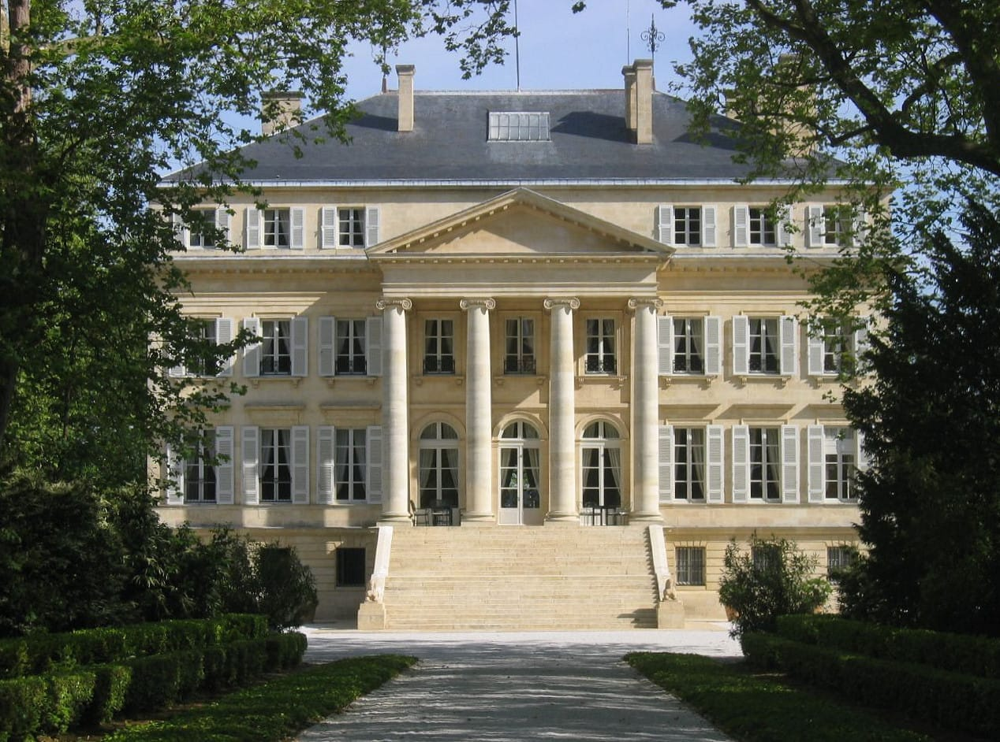

# 玛歌古堡

玛歌古堡（Château Margaux）在[法国](ref:france)[波尔多](ref:bordeaux)左岸的[玛歌村](ref:margaux-village)北侧，1855 年分级时拿到全场唯一的 20/20。它属于静态[红葡萄酒](ref:red-wine)，在[葡萄酒](ref:wine)分类里没有加强或起泡的额外工艺。它的正牌常被形容为“香气先到、单宁后至”；这不是修辞，而是 126 个地块、35 年平均树龄与 21 个月新桶共同作用的结果。

图：玛歌古堡。图片：BillBl，CC BY 2.0，via Wikimedia Commons（[原图页面](https://commons.wikimedia.org/wiki/File:Margaux_exterior.jpg)）。

> **先给结论**
> **一句话：** 这页判断玛歌古堡适不适合你，以及怎么喝、怎么搭。
>
> - **适合谁：** 想弄懂玛歌古堡是什么、怎么喝、适合什么场景的人。
> - **不适合谁：** 只找最低价购买链接、不关心风味和使用场景的人。
> - **先看这两点：**
>   - 正牌的品种结构随年份微调：2023 年份为 89% 赤霞珠、5% 梅洛、4% 品丽珠、2% 小维多；2025 年份为 89%、6%、4%、1%。
>   - Decanter 在 2016 年给出的英国市场参考是：正牌每瓶约 £150–700，视年份而定。

## 从 La Mothe 到 1810 年的新帕拉第奥

庄园在 12 世纪已以“La Mothe de Margaux”之名出现，名字指的是梅多克平原上一处便于排水的小高地。1572 至 1582 年，Pierre de Lestonnac 把田庄与葡萄园彻底重组，赶上梅多克从谷物转向葡萄的历史转折；到 17 世纪末，庄园面积达到 265 公顷，并保持至今。17 世纪初的管家 Berlon 还率先把白葡萄与红葡萄分开酿造。

1801 年，La Colonilla 家族取得庄园；1810 年，其成员委托波尔多建筑师 Louis Combes 兴建今天的新帕拉第奥式主楼，工程延续到 1816 年。1830 年 Alejandro Aguado 买下庄园，1879 年转入 Pillet-Will 伯爵家族；1908 年由一批波尔多酒商组成的财团接手，1925 年开始在酒庄内装瓶。1946 年，主楼列为历史建筑。1950 年前后 Ginestet 家族取得完整控制权，1977 年 André Mentzelopoulos 购入，1980 年他去世后由女儿 Corinne 接手。

## 1855 年唯一的 20/20

1855 年巴黎世博会期间，波尔多商会按彼时的市场价格制定分级，梅多克与格拉夫的红葡萄酒被分为五级，玛歌、拉菲、拉图与奥比昂列为一等。玛歌是名单中唯一获得 20/20 评价的酒庄，拉菲与拉图均为 19/20；这个细节常被用来解释“玛歌为什么总被放在优雅的一端”。

需要强调的是，1855 年名单评价的是当时的交易价格与声誉，不是今天的盲品结果。名单此后极少变动，1973 年木桐由二等升为一等是唯一一次升级；因此“一级庄”是历史身份，年份差异仍然巨大。

## 265 公顷里的 126 个地块

庄园总面积 265 公顷，其中约 87 公顷红葡萄、12 公顷白葡萄，其余是林地、草地、建筑与道路。红葡萄被细分为 126 个地块，其中 72 个种[赤霞珠](ref:cabernet)，其余种[梅洛](ref:merlot)、[品丽珠](ref:cabernet-franc)与小维多；这种细分让酒庄可以按地块而非按品种统一处理。

土壤是两类地质的叠加：第三纪石灰岩与黏土，以及第四纪贡兹冰期留下的砾石、砂与黏土。所谓“Type 4”台地的深砾石是玛歌的标志，排水快、根系深；黏土则在中层保住水分。红葡萄平均树龄 35 年，最老的地块“The Cuvier”种于 1951 年；白葡萄平均 50 年，最老种于 1970 年。种植密度每公顷 6,666 至 10,000 株，视土壤与长势而定。酒庄正在完成有机认证转换，行向也在重植时调整为 45°–60° 东北/西南，以减少日灼。

## 正牌：89% 赤霞珠与 40% 筛选率

正牌的品种结构随年份微调：2023 年份为 89% 赤霞珠、5% 梅洛、4% 品丽珠、2% 小维多；2025 年份为 89%、6%、4%、1%。赤霞珠提供骨架与黑色果味，梅洛补圆润，品丽珠给香气，小维多增加颜色与辛香。

筛选极其严格：2023 年只有 41% 的收成进入正牌，2025 年只有 37%，长期平均约 40%。正牌在全新法国橡木桶中陈年平均 21 个月，年产量约 120,000 瓶。2025 年因夏季干旱，产量降到 22 hl/ha，仅为正常年份的一半左右（近年典型值，以酒庄技术资料为准）。

## Pavillon Rouge：梅多克最老的副牌

副牌 Pavillon Rouge du Château Margaux 自称梅多克最古老的副牌：酒庄从 17 世纪就开始生产第二款酒，1906 年份起固定使用“Pavillon Rouge”这个名字。它并非“正牌的下脚料”，而是来自酒庄最具代表性的地块，葡萄藤年龄与正牌相近，由同一批团队酿造。

Pavillon Rouge 的赤霞珠比例约 75%–80%，梅洛 15%–20%，再加少量品丽珠与小维多；陈年约 20 个月，其中近 60% 为新法国橡木桶。这套[橡木桶陈酿](ref:oak-ageing)与精细的[发酵](ref:fermentation)、[调配](ref:blending)一起，构成副牌与正牌共享的工艺底盘。年产量约 100,000 瓶，2025 年只选入 28% 的收成。它比正牌更早适饮，但优秀年份仍有 30–40 年的陈年潜力。酒庄还有第三款酒 Margaux du Château Margaux，使用更年轻的藤与更宽松的筛选。

## Pavillon Blanc 的 AOC 例外

玛歌的白葡萄酒历史可追到 17 世纪末，当时酒窖主管已把白葡萄单独发酵。19 世纪它以“Château Margaux vin de sauvignon”出售，1920 年起固定为 Pavillon Blanc du Château Margaux，酒标几乎未变。葡萄园约 11–12 公顷，100% 种[长相思](ref:sauvignon-blanc)，位于历史上曾因霜冻风险而拔除红葡萄的地块。

最容易被忽略的一点是产区名：玛歌 AOC 只覆盖红葡萄酒，因此 Pavillon Blanc 以 Bordeaux AOC 出售，而不是 Margaux AOC。酒庄只把约三分之一的收成装瓶，年产量不超过约 1,000 箱；其余以散酒出售。2022 年份起，酒庄还推出了第二款白葡萄酒 Pavillon Blanc Second Vin。

## 2015 年 Foster 酒窖

2015 年，英国建筑师 Norman Foster 设计的酒窖落成，向东翼延伸，屋顶瓦片与细柱回应了 19 世纪建筑，同时把发酵间、陈酿窖、研发实验室与品鉴室集中在一处。这是自 1810 年 Louis Combes 建堡以来，酒庄最重要的一次建筑改动；主楼在 1946 年已列为历史建筑，新建筑必须在不破坏景观的前提下完成。

新酒窖带来的不是风格突变，而是精度：更多小容量发酵罐可以按地块、甚至按藤龄分开处理，白葡萄酒也回到主酒窖酿造。玛歌的“香气细腻”因此更依赖筛选，而不是靠后期修饰。

## 香气先开、单宁如丝

年轻正牌常给出紫罗兰、黑加仑、覆盆子与石墨的气息，入口的单宁细而密，酸度不高却很直，酒体中等偏上。与拉图相比，玛歌的单宁更早变得柔顺，香气也更早从果味转向花香；陈年后出现雪松、烟草、皮革、干花与松露。

这种“早开”并不意味着短命。优秀年份的玛歌可以陈放数十年，只是它在年轻时就愿意给出香气，不像拉图那样先关上十年。饮用温度建议 16–18°C；年轻酒款醒酒 1–2 小时，老酒只需短暂换瓶。

## 与拉图、木桐的分岔

把三家庄放在一起，差异很像三种结构选择。[拉图](ref:latour)以单宁和酸度为骨架，香气偏雪松、石墨，年轻时封闭；玛歌以香气开场，单宁更细滑，酒体更适中；[木桐](ref:mouton)更浓郁、更香料化，并叠加艺术酒标的收藏维度。

原因可以落到地块与工艺：玛歌的 126 个地块土壤更杂，赤霞珠比例略低于拉图，正牌筛选率约四成，新桶虽为 100% 但陈年 21 个月，萃取更克制；拉图只取 Enclos 老藤，赤霞珠超过九成，陈年 22–25 个月；木桐的砾石层更厚、成熟度更高，酒体更外放。三者的价格带接近，风格却很少被混淆。

## 价格带：正牌、副牌与白

Decanter 在 2016 年给出的英国市场参考是：正牌每瓶约 £150–700，视年份而定。近年常见区间大体仍在 £150–800，稀有年份更高；Pavillon Rouge 常见约 £80–200；Pavillon Blanc 约 £100–200；Margaux du Château Margaux 约 £40–80。以上为近年典型零售区间，拍卖与稀有年份会大幅偏离，不能当作固定报价。

## 常见误读

第一，玛歌古堡与“玛歌产区”不是同一个概念；产区有众多酒庄，一级庄只有这一家。第二，Pavillon Rouge 不是廉价版正牌，它有独立筛选与陈年。第三，Pavillon Blanc 是 Bordeaux AOC，不是 Margaux AOC。第四，1855 年的 20/20 是历史评价，不等于每个年份都同分。第五，白葡萄酒的“只装三分之一”指的是收成比例，不是每瓶只装三分之一。

## 饮用与搭配

正牌适合搭配烤羊排、鸭胸、牛肉与松露菜式；Pavillon Rouge 更适合日常餐桌，配烤肉、禽类与中等硬度奶酪；Pavillon Blanc 适合海鲜、白肉与带奶油酱汁的鱼。红葡萄酒建议 16–18°C，白葡萄酒 10–12°C。

开瓶后若喝不完，应塞紧瓶塞冷藏，并在数日内喝完；白葡萄酒尤其怕温度回升。未开瓶的酒应避光、卧放、恒温 12–16°C 存放，长期陈年需要稳定湿度。

**关键事实。**

| 项目 | 内容 |
| --- | --- |
| 一句话定位 | 玛歌村的 1855 年一级庄，1855 年分级中唯一拿到 20/20；265 公顷庄园内有约 87 公顷红葡萄与 12 公顷白葡萄，正牌赤霞珠常近九成、筛选率约四成，21 个月全新法国橡木桶，年均约 12 万瓶 |
| 酒种/风格 | 红葡萄酒 |
| 产区 | 法国、波尔多 |

## 资料来源

1. Château Margaux，*Our history*：https://chateau-margaux.com/en/le-domaine/histoire
2. Château Margaux，*Our terroir*：https://chateau-margaux.com/en/le-domaine/le-terroir
3. Château Margaux，*Grand Vin du Château Margaux*：https://chateau-margaux.com/en/vins/grand-vin-du-chateau-margaux
4. Château Margaux，*Pavillon Rouge du Château Margaux*：https://chateau-margaux.com/en/vins/pavillon-rouge-du-chateau-margaux
5. Château Margaux，*Pavillon Blanc du Château Margaux*：https://chateau-margaux.com/en/vins/pavillon-blanc-du-chateau-margaux
6. Decanter China，*Chateau Margaux*（Jane Anson）：https://www.decanterchina.com/en/knowledge/producers/chateau-margaux
