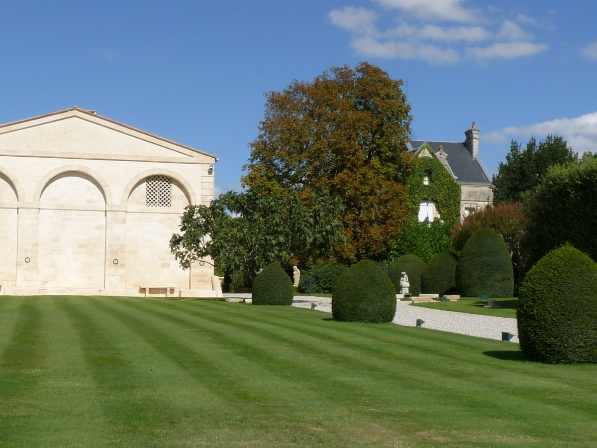

# 木桐古堡

木桐古堡（Château Mouton Rothschild）在[法国](ref:france)[波尔多](ref:bordeaux)左岸的[波亚克](ref:pauillac)北端，与拉菲只隔一条小路。它属于静态[红葡萄酒](ref:red-wine)，在[葡萄酒](ref:wine)分类里没有加强或起泡的额外工艺。它最容易被记住的是艺术酒标，但真正让它与众不同的是 1973 年那次分级升级——1855 年名单里唯一一次把二等庄提为一等庄。

图：木桐古堡。图片：Jack ma，CC BY-SA 3.0，via Wikimedia Commons（[原图页面](https://commons.wikimedia.org/wiki/File:Jardin_de_Ch%C3%A2teau_de_Mouton-Rothschild,_Pauillac._2012.jpg)）。

## 1853 年拍卖会上的 Brane-Mouton

1853 年，纳塔涅·德·罗思柴尔德男爵为了在自家餐桌上招待贵客，在拍卖会上买下 Brane-Mouton。庄园此前因 Joseph de Brane 而得名，交易之后改称 Château Mouton Rothschild。这次购买属于罗思柴尔德家族在波尔多扩张的一部分，也解释了为什么木桐与拉菲、拉图同处波亚克却分属不同家族支系。

1922 年，22 岁的菲利普男爵接手酒庄。他后来把木桐带向两个方向：一是把酒庄从“酒商供货者”变成“自己装瓶、自己定价”的品牌；二是把艺术引入酒标。这两条线至今仍是木桐最鲜明的身份。

## 1924 年酒庄装瓶与 1926 年 Grand Chai

1924 年，菲利普男爵决定所有正牌都在酒庄内装瓶，不再以桶装卖给酒商。这在当时的波尔多是激进做法：顶级酒庄普遍把酒卖给酒商，由酒商决定陈年与装瓶。为了容纳装瓶后的酒，酒庄在 1926 年建成 Grand Chai，由建筑师 Charles Siclis 设计，长约 100 米，成为木桐的建筑标志。

同一条“自己掌控”的逻辑延续到品牌与产业：1930 年创建 Mouton Cadet，1933 年买下 Château Mouton d'Armailhacq（1989 年改名 Château d'Armailhac），1970 年购入 Château Clerc Milon，1979 年与美国酒商 Robert Mondavi 合作创建 Opus One。Mouton Cadet 是商业品牌，不是木桐副牌，这一点常被误解。

## 1973 年唯一一次分级升级

木桐在 1855 年名单中原本列二等。菲利普男爵为此游说了二十年，理由很直接：木桐的市场价格早已与一等庄并肩，名单却停留在 1855 年。1973 年，法国农业部长 Jacques Chirac 签署法令，木桐正式升为一等庄；这是 1855 年名单历史上唯一一次升级，也是至今唯一一次等级变动。

菲利普男爵用一句拉丁文概括这件事：“Premier ne puis, second ne daigne, Mouton suis.”（我成不了一等，又不屑做二等，我是木桐。）升级之后，这句话被改成：“Premier je suis, second je fus, Mouton ne change.”（我现在是一等，曾经是二等，木桐不变。）

## 艺术家酒标的 1945 年起点

1945 年，为庆祝二战胜利，菲利普男爵请画家 Philippe Jullian 设计正标，画面是一个巨大的“V”。此后，除少数特殊年份外，木桐每年邀请一位艺术家为当年正标创作原作，1973 年毕加索、1975 年安迪·沃霍尔、2004 年查尔斯王子都曾参与。1981 年起，这些原作被组织成巡回展，在四十多座博物馆展出。

艺术酒标是收藏维度，不是质量指标。同一酒庄不同年份的酒体差异，来自葡萄成熟度、筛选与陈年，而不是画作；拍卖市场上的“艺术溢价”也确实存在，但它与瓶中的酒是两件事。

## Plateau de Mouton 的 84–90 公顷

木桐的葡萄园主要位于名为 Plateau de Mouton 的丘地，最高处约高出海平面 27 米。官网不同页面分别给出 84 公顷与 90 公顷两种口径，差异可能来自统计时点与是否计入新植地块；引用时应保留这一区间。

土壤是数米深的砾石，混有砂与少量黏土，底下是黏土—石灰岩基岩。砾石白天吸热、夜间释放，帮助赤霞珠成熟；排水过快则迫使根系向下找水，形成较深的根系。葡萄园北面与拉菲相邻，东面朝向河口，属于典型的波亚克砾石台地。每公顷种植约 10,000 株，高于许多梅多克酒庄。

## 81% 赤霞珠与 44 年平均树龄

全园品种比例为[赤霞珠](ref:cabernet) 81%、[梅洛](ref:merlot) 15%、[品丽珠](ref:cabernet-franc) 3%、小维多 1%。这是种植比例，不是每年正牌的调配比例；正牌中赤霞珠通常更高，具体随年份变化。赤霞珠提供单宁、黑色果味与陈年能力，梅洛补柔顺与长度，品丽珠给香气，小维多增加颜色与香料感。

葡萄平均树龄约 44 年。采收全部手工，葡萄放入开口筐以保持果粒完整，除梗后在振动台上人工挑选，再靠重力进入发酵罐，减少机械泵送对果实的挤压。这套“重力送料”是 2012 年新发酵间投入使用后最直观的变化。

## 正牌、小木桐与银翼

正牌 Château Mouton Rothschild 只取最佳地块、最老藤与最佳发酵罐的酒液，约占总产量一半以上；第三方估算年产量约 2 万箱，即 24 万瓶左右（近年典型值，以酒庄技术资料为准）。

副牌 Le Petit Mouton de Mouton Rothschild 于 1993 年推出，使用较年轻的藤，采收早于正牌、单独发酵，筛选标准与正牌同样严格；剩余酒液用于另一款波亚克命名酒 Baron Nathaniel。干白 Aile d'Argent 于 1991 年首次装瓶，来自园内约 7 公顷白葡萄地块，以[长相思](ref:sauvignon-blanc)为主，混有赛美蓉与少量密斯卡岱，新桶比例约 50%。

## 重力送料与 20 个月新桶

2012 年启用的新发酵间由舞台设计师 Richard Peduzzi 与波尔多建筑师 Bernard Mazières 设计，长约 70 米，两层结构以金属柱连接，保留木与钢的梅多克语汇。内部有 44 个橡木发酵罐与 20 个不锈钢罐，罐容对应不同地块，方便分地块[发酵](ref:fermentation)与后续[调配](ref:blending)。

发酵结束后，酒液进入新橡木桶陈年约 20 个月；木桐的正牌全程使用新桶，这套[橡木桶陈酿](ref:oak-ageing)与拉图一致，但陈年时间略短。陈年期间进行补酒、换桶与蛋清下胶，之后从 Grand Chai 转入第二年窖继续静置。新桶带来香草、烘烤与香料气息，也增加微量氧化，使单宁更早变得圆润。

## 异域香料从哪里来

年轻木桐常给出黑加仑、黑樱桃、紫罗兰与石墨，入口比拉图更宽、更浓，单宁量大但表面更柔。陈年后出现雪松、烟草、皮革、可可与一种常被形容为“异域香料”的甜辛香——它来自成熟度较高的赤霞珠、新桶烘烤与较长瓶陈的共同作用，而不是添加物。

这也是木桐与玛歌的分水岭：玛歌以花香与丝滑开场，木桐以浓度与香料压场，拉图则以结构与封闭感见长。三者都可以陈年数十年，但年轻时的表达完全不同。

## 与拉图、玛歌的分岔

[拉图](ref:latour)的正牌只取 Enclos 47 公顷老藤，赤霞珠超过九成，单宁与酸度构成骨架，常常十年才打开；[玛歌](ref:margaux)的 126 个地块土壤更杂，香气更早开放，单宁更细滑；木桐的葡萄园更靠北、砾石层更厚、平均树龄约 44 年，酒体更浓，香料感更明显。

工艺上也有差别：木桐正牌新桶陈年约 20 个月，拉图 22–25 个月，玛歌 21 个月；木桐的正牌占总产量一半以上，玛歌约四成，拉图约 37%。这些比例决定了三家的“可得性”与价格结构，也解释了为什么木桐在商业上更外放。

## 价格带与艺术溢价

Wine-Searcher 在 2026 年 11 月页面上给出的正牌平均零售价约为 US$794/750 mL；实际成交会因年份从约 US$400 到 US$1,200 不等，稀有年份更高。副牌 Le Petit Mouton 常见约 US$120–250；干白 Aile d'Argent 约 US$80–150。以上为近年典型零售区间，拍卖与稀有年份会大幅偏离，不能当作固定报价。

艺术酒标年份在收藏市场另有溢价，但溢价幅度取决于艺术家、年份与品相，不能简单按“有画就贵”判断。购买时应先确认酒款身份、年份与防伪信息，再考虑酒标版本。

## 常见误读

第一，木桐 1855 年是二等，1973 年才升一等，不是“天生一级庄”。第二，艺术酒标不等于更好喝，也不等于每个年份都有。第三，Le Petit Mouton 是副牌，Mouton Cadet 是商业品牌，两者不是一回事。第四，官网 84 与 90 公顷是两种统计口径，不是笔误。第五，木桐并非无限耐放，储存条件与年份同样关键。

1973 年升为一等庄是分级史上的例外，不是常规规则；艺术家酒标从 1945 年起每年更换，酒标艺术不等于酒质排名，正牌与副牌要分开看，价格里也包含艺术与稀缺溢价，分级与酒标都要回到具体年份。

## 资料来源

1. Château Mouton Rothschild，*Key date 1853*：https://www.chateau-mouton-rothschild.com/the-history/key-dates/key-date-1853
2. Château Mouton Rothschild，*From Baron Philippe*：https://www.chateau-mouton-rothschild.com/the-history/the-history-of-mouton/from-baron-philippe
3. Château Mouton Rothschild，*To Baroness Philippine*：https://www.chateau-mouton-rothschild.com/the-history/the-history-of-mouton/to-baroness-philippine
4. Château Mouton Rothschild，*The terroir*：https://www.chateau-mouton-rothschild.com/the-vineyard/the-terroir
5. Château Mouton Rothschild，*From vine to wine*：https://www.chateau-mouton-rothschild.com/the-vineyard/from-vine-to-wine
6. Wine-Searcher，*Chateau Mouton Rothschild, Pauillac*：https://www.wine-searcher.com/find/mouton+rothschild+pauillac+medoc+bordeaux+france
