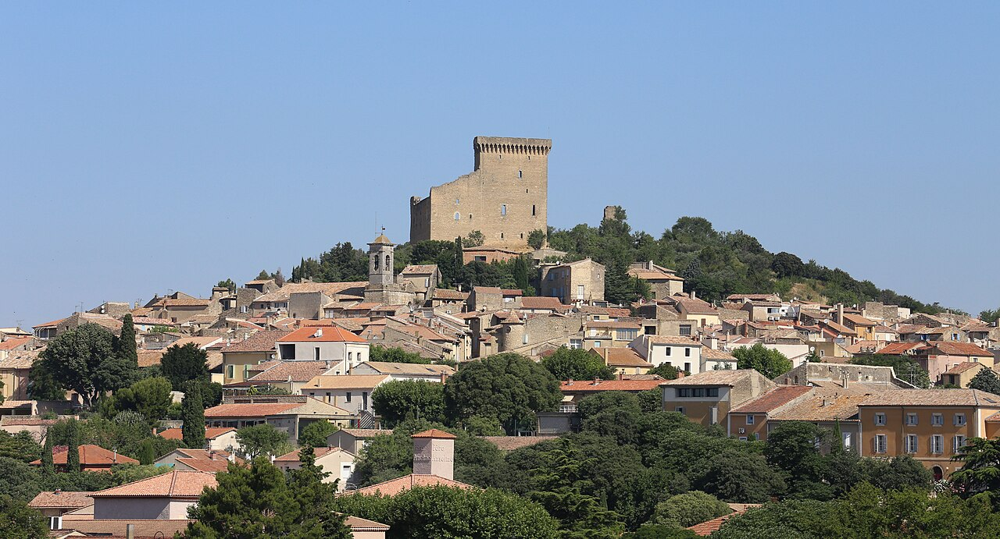

# 教皇新堡

教皇新堡是法国罗讷河谷南部的法定产区红葡萄酒，以歌海娜为主体、常与西拉等品种混酿，酒体饱满、酒精度高，以成熟黑果、普罗旺斯香草与皮革香气著称。常见 750 mL、酒精度约 14%–15.5% vol；产区规范规定的最低酒精度为 12.5% vol，允许品种多达十余个。

图：教皇新堡。图片：Aa77zz，CC0，via Wikimedia Commons（[原图页面](https://commons.wikimedia.org/wiki/File:Village_of_Chateauneuf-du-Pape.JPG)）。

## 定义与定位

先分层：[红葡萄酒](ref:red-wine)是大类，歌海娜等品种是原料，罗讷河谷南部是产区，教皇新堡是法定产区（AOC），酒庄与具体酒款是生产者层面。教皇新堡是地名与产区标识，不是品牌，也不是单一品种名。

1936 年，教皇新堡成为法国最早一批获得原产地命名控制的产区之一。它既是村庄级产区，也是独立的地理标志；与罗讷河谷大区级或其他村庄级产区相比，它的规则更严、产量上限更低。

## 生产者与品牌

产区内有大量家族酒庄、合作社与酒商，规模从几公顷到数十公顷不等。酒庄常以“Domaine”“Château”等字样出现在酒标上，装瓶者信息与是否在酒庄内装瓶，是判断身份的依据。

产区名称与阿维尼翁教廷历史相关：14 世纪教廷迁至阿维尼翁后，教皇约翰二十二世在此修建城堡，地名“新堡”即由此而来，现存城堡为废墟。瓶身常带浮雕纹章，但纹章属于产区标识，不能单独作为真伪或品质依据。

## 「教皇新堡」的产地与原料
产区位于[法国](ref:france)东南部沃克吕兹省，阿维尼翁以北，罗讷河左岸。气候为地中海型，日照充足、降雨集中，密史脱拉风常年吹拂，降低湿度并减少病害压力，也让葡萄园更干燥。

地表覆盖大块圆形石英卵石（galets roulés），白天吸热、夜间释放，帮助果实成熟；土壤下层为黏土与石灰岩，保水能力影响旱季表现。原料是[葡萄](ref:grape)，主要品种为[歌海娜](ref:grenache)与[西拉](ref:syrah)，另有慕合怀特、神索、克莱雷特等允许品种；产区也产少量白葡萄酒。

## 「教皇新堡」怎么做出来
采收通常在九月，去梗后浸皮，时间与温度决定萃取强度；歌海娜皮薄、色素与单宁中等，西拉提供颜色、结构与黑色果香，混酿比例影响最终风格。发酵完成后进行苹果酸乳酸发酵以柔化酸度。

之后进入[橡木桶陈年](ref:oak-ageing)。传统使用大型旧桶或水泥罐，强调果味与缓慢氧化；现代做法部分使用小桶，增加香草与香料气息。产区规范对最低酒精度、产量与允许品种作出限定，具体陈年要求以最新规范为准。

## 「教皇新堡」的瓶型与标签
常见容量为 750 mL，[酒精度](ref:abv)约 14%–15.5% vol，部分年份更高。标签应核对产区名 Châteauneuf-du-Pape、年份、酒庄名、装瓶者、净含量、酒精度与进口商信息；部分酒款标注“Clos”“Domaine”或特定园地名。

中文背标与进口商信息是核对身份的入口。不同市场的标签语言与法规不同，同一款酒在不同国家可能标注不同，以瓶身实际标注为准。以“教皇新堡风格”描述的其他产品，不属于法定产区酒。

## 「教皇新堡」的闻与喝
典型香气是黑莓、黑樱桃、李子、普罗旺斯香草、甘草、胡椒与皮革，陈年后发展出松露、干果与泥土气息。入口酒体饱满、酒精感明显、单宁圆润，酸度中等，余味长而温暖。

品鉴温度建议在 16–18 摄氏度，使用较大的酒杯让香气展开；年轻酒款可醒酒一至两小时，老年份则宜缩短。高酒精度会让香气显得更甜熟，搭配食物后平衡感更好。

## 「教皇新堡」的饮用与搭配
适合搭配炖羊肉、烤牛肉、野味、香草烤鸡、炖菜与硬质干酪；香草与肉类的呼应能突出产区的灌木香气。不宜搭配清蒸海鲜、清淡蔬菜或重甜点心，高酒精与浓郁果味容易压制食材。

开瓶后应冷藏保存并尽量在数日内饮用完毕。多数酒款在瓶中短期陈放后更融合，但具体适饮窗口取决于年份、酒庄与混酿比例。本页关于教皇新堡的内容涉及酒精饮料；过量饮酒有害健康，未成年人不应饮酒。

## 「教皇新堡」的购买与保存
购买时优先选择正规渠道，核对年份、酒庄名、装瓶者与进口商信息。价格随年份、酒庄声誉与渠道波动，本页不给出具体数字；合作社酒与名庄酒属于不同层级，不能用一款概括整个产区。

未开瓶应避光平放，存放于 13–16 摄氏度的阴凉处，避免高温与剧烈温差。软木塞封瓶需保持湿度；开瓶后冷藏并尽快饮用，高酒精度的酒更怕反复回温。

## 「教皇新堡」容易被读错的地方
第一，把教皇新堡当成单一品种酒。它允许十余个品种，歌海娜通常只是主体。
第二，把产区名当成品牌。它是地理标志，产区内有大量酒庄与合作社。
第三，认为酒精度越高品质越好。成熟度与平衡感才是判断依据。
第四，把瓶身浮雕纹章当成真伪证明。渠道与标签信息更可靠。
第五，认为所有教皇新堡都必须长期陈年。不同酒庄与年份的适饮期差异很大。

对照阅读：[红葡萄酒](ref:red-wine)、[歌海娜](ref:grenache)。

**关键事实。**

| 项目 | 内容 |
| --- | --- |
| 一句话定位 | 法国罗讷河谷南部教皇新堡法定产区的红葡萄酒，以歌海娜为主体、常与西拉等品种混酿，酒体饱满、酒精度高，以成熟黑果、普罗旺斯香草与皮革香气著称；产区允许十余个品种，法定最低酒精度 12.5% vol，常见 750 mL、约 14%–15.5% vol |
| 酒种/风格 | 红葡萄酒 |
| 产区 | 法国 |
| 酒精度 | 14–15.5% vol |

**来源与边界。** 本页关于「教皇新堡」的关键事实，主要由以下来源交叉核对：Inter Rhône（罗讷河谷南部产区体系与教皇新堡的品种框架）、INAO（教皇新堡法定产区的范围、允许品种与最低酒精度）、Oxford University Press（提供关于教皇新堡、歌海娜与南罗讷的条目；由原条目末尾参考资料迁移，未逐条复核访问日期）等 6 条来源。价格、批次与状态会变，涉及这些字段时以页面所列来源的最新版本为准。正文为项目自写，来源只作核验，不复制原文。

## 参考资料
- [红葡萄酒](ref:red-wine)：教皇新堡的分类、单宁与基本工艺。
- [法国](ref:france)：法国葡萄酒版图与 AOC/AOP 制度。
- [歌海娜](ref:grenache)：南罗讷主体品种的特征与香气。
- [西拉](ref:syrah)：提供结构与黑色果香的混酿品种。
- [葡萄](ref:grape)：教皇新堡所用葡萄的成熟度、酸度与单宁判断。
- [发酵](ref:fermentation)：教皇新堡的浸皮、温控与苹果酸乳酸发酵。
- [橡木桶陈年](ref:oak-ageing)：大桶与小桶对风格的影响。
- [酒精度](ref:abv)：14%–15.5% vol 与法定最低 12.5% vol 的含义。
