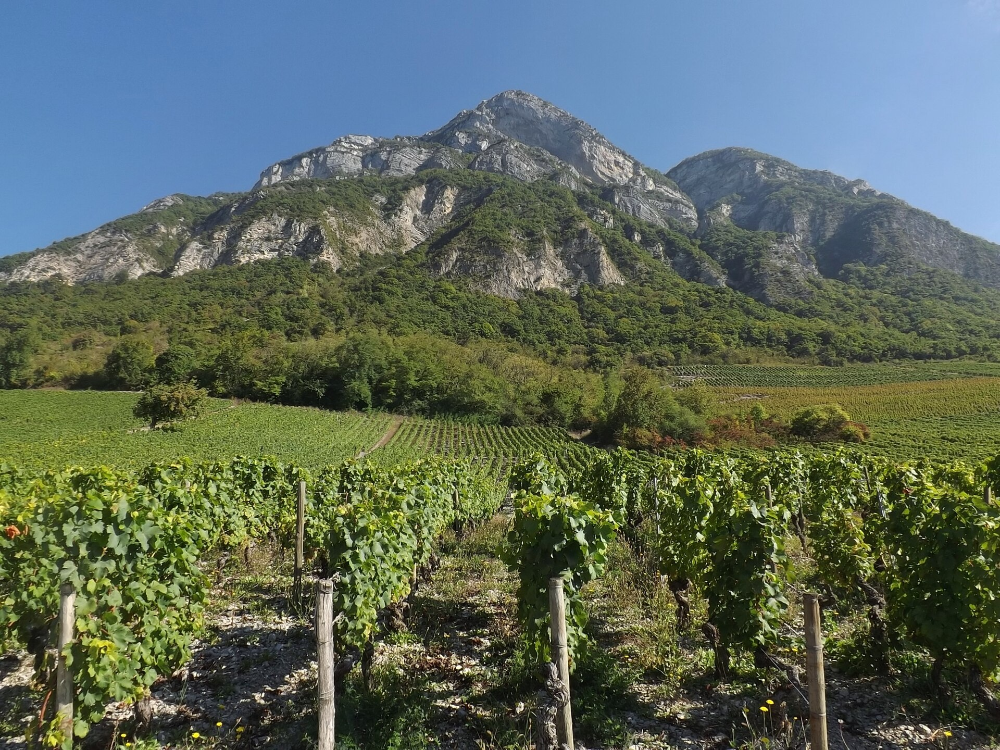

# 希尼安-贝热龙

希尼安-贝热龙（Chignin-Bergeron）是[法国](ref:france)[萨瓦](ref:savoie)产区内的白葡萄酒地理命名，只使用当地称为贝热龙的胡珊（Roussanne）酿造。葡萄园位于希尼安一带朝南或东南的石灰岩坡地上。常见 750 mL，[酒精度](ref:abv)约 12.5%–13.5% vol。

图：希尼安-贝热龙相关实景照片。图片：Florian Pépellin，CC BY-SA 3.0，via Wikimedia Commons（[原图页面](https://commons.wikimedia.org/wiki/File:Vignobles_chignin-bergeron.JPG)）。

## 定义与定位

先分层：[白葡萄酒](ref:white-wine)是类型，胡珊是品种，希尼安-贝热龙是地理命名，具体酒庄与酒款是生产者层面。它属于[萨瓦葡萄酒](ref:vin-de-savoie)产区框架，但在酒标上可以单独标注自己的名称。

“贝热龙”不是独立品种，而是胡珊在萨瓦当地的叫法。希尼安-贝热龙只允许白葡萄酒，且必须使用胡珊，因此它是萨瓦产区中品种与风格最明确的命名之一。

## 生产者与品牌

命名范围内以家族酒庄为主，也有合作社与酒商参与。希尼安一带坡地面积有限，不少酒庄同时生产雅克儿、阿尔泰斯与胡珊多条产品线。

生产者、产区与产品是三个层级：产区回答法规与范围，生产者回答种植、酿造与装瓶，产品回答年份与规格。同为希尼安-贝热龙，不同酒庄的成熟度管理与桶陈比例会有差别。

## 「希尼安-贝热龙」的产地与原料
葡萄园位于萨瓦希尼安村一带，分布在朝南或东南的坡地上，海拔约 250–500 米。土壤以石灰岩与碎石为主，排水好、肥力低，日照充足。

原料是[葡萄](ref:grape)，品种只有胡珊。胡珊成熟较晚、皮薄，容易积累糖分与香气，同时保留一定酸度；在萨瓦的凉爽气候下，它比在罗讷河谷更清爽，但仍比雅克儿更饱满。

## 「希尼安-贝热龙」怎么做出来
白葡萄酒通常在不锈钢罐或旧桶中发酵，温度控制以保留香气为主。是否使用[橡木桶](ref:oak-ageing)决定风格走向：不使用桶时更强调果味与矿物感，使用旧桶或带酒泥搅拌时更圆润。

胡珊的酸度相对较低，因此苹果酸乳酸发酵的取舍更谨慎；部分酒庄保留苹果酸以维持骨架。发酵的基本逻辑可参见[发酵](ref:fermentation)。

## 「希尼安-贝热龙」的瓶型与标签
常见容量为 750 mL，[酒精度](ref:abv)约 12.5%–13.5% vol，具体随年份与酒庄变化。标签应核对“Chignin-Bergeron”名称、年份、装瓶者与进口商信息。

部分酒标会同时标注“Vin de Savoie”，但地理命名本身已足够识别。核对希尼安-贝热龙时，中文背标与进口商信息是身份依据，以瓶身实际标注为准。

## 「希尼安-贝热龙」的闻与喝
典型香气是白花、杏、黄桃、蜂蜜与杏仁，部分酒款带柑橘与矿物感；入口酸度中等、酒体中等偏饱满，余味带坚果与蜂蜡气息。与雅克儿的清瘦高酸相比，希尼安-贝热龙更圆润、更成熟。

品鉴建议温度约 8–10 摄氏度，用郁金香形或勃艮第形酒杯。温度过低会掩盖香气，过高则显得松散；注意区分果味与桶带来的香草、坚果气息。

## 「希尼安-贝热龙」的饮用与搭配
适合海鲜、禽肉、奶油类菜肴、软质奶酪与带杏子或坚果的菜式。酸度中等，不适合搭配过辣或强酸的菜肴。

多数酒款适合在 5–10 年内饮用，具体窗口因年份与酒庄而异。开瓶后应冷藏并在数日内喝完；本页关于希尼安-贝热龙的内容涉及酒精饮料；过量饮酒有害健康，未成年人不应饮酒。

## 「希尼安-贝热龙」的购买与保存
购买时核对“Chignin-Bergeron”名称、年份与装瓶者。该命名产量小、品种单一，价格通常高于萨瓦产区级白葡萄酒，本页不给出具体数字。

就「希尼安-贝热龙」而言，未开瓶应避光、平放于阴凉处，理想温度为 12–15 摄氏度。开瓶后抽真空或充惰性气体并冷藏，不宜反复回温。

## 「希尼安-贝热龙」容易被读错的地方
第一，把贝热龙当成一个独立品种。它是胡珊在萨瓦的当地叫法。
第二，把希尼安-贝热龙与希尼安产区等同。后者可以包含其他品种与风格。
第三，认为胡珊只能酿甜酒。这里酿的是干型白葡萄酒。
第四，认为萨瓦白葡萄酒都很清瘦。胡珊带来更饱满的酒体。
第五，只用价格判断质量。年份、酒庄与装瓶信息更具体。

希尼安-贝热龙容易和“希尼安”或“胡珊”混淆：它是萨瓦产区内的独立地理命名，只用当地称为贝热龙的胡珊酿造。朝南或东南的石灰岩坡地给酒体带来白花、杏与杏仁气息；它比雅克儿更饱满，但不能因此把“贝热龙”当成一个独立的葡萄品种。贝热龙是当地对胡珊的叫法，不是另一个可以独立种植的品种；希尼安-贝热龙的地理命名把地块、品种与酿造方法绑定。把它简化为“萨瓦白葡萄酒”，会丢失品种与坡地带来的差异。

对照阅读：[法国](ref:france)、[白葡萄酒](ref:white-wine)。

**关键事实。**

| 项目 | 内容 |
| --- | --- |
| 一句话定位 | 法国萨瓦产区内的白葡萄酒地理命名，只使用当地称为贝热龙的胡珊（Roussanne）酿造；葡萄园位于希尼安一带朝南或东南的石灰岩坡地上，风格以白花、杏、蜂蜜与杏仁为主，酸度低于雅克儿，常见 750 mL、酒精度约 12.5%–13.5% vol |
| 酒种/风格 | 白葡萄酒 |
| 产区 | 法国、萨瓦 |
| 酒精度 | 12.5–13.5% vol |

**来源与边界。** 本页关于「希尼安-贝热龙」的关键事实，主要由以下来源交叉核对：INAO（希尼安-贝热龙地理命名的范围、品种与规则；由原条目末尾参考资料迁移，未逐条复核访问日期）、European Union（欧盟葡萄酒类别、地理标志与标签规则）、Oxford University Press（提供关于希尼安、贝热龙与胡珊的条目；由原条目末尾参考资料迁移，未逐条复核访问日期）。价格、批次与状态会变，涉及这些字段时以页面所列来源的最新版本为准。正文为项目自写，来源只作核验，不复制原文。

## 参考资料
- [萨瓦](ref:savoie)：希尼安-贝热龙所属产区的整体框架。
- [萨瓦葡萄酒](ref:vin-de-savoie)：覆盖范围更广的萨瓦区域级产区。
- [萨瓦胡塞特](ref:roussette)：以阿尔泰斯酿造的萨瓦白葡萄酒产区。
- [白葡萄酒](ref:white-wine)：希尼安-贝热龙所属的类型。
- [葡萄](ref:grape)：希尼安-贝热龙所用葡萄的成熟度、酸度与单宁判断。
- [发酵](ref:fermentation)与[橡木桶陈年](ref:oak-ageing)：白葡萄酒的基础工艺环节。
- [酒精度](ref:abv)：12.5%–13.5% vol 在标签上的含义。
