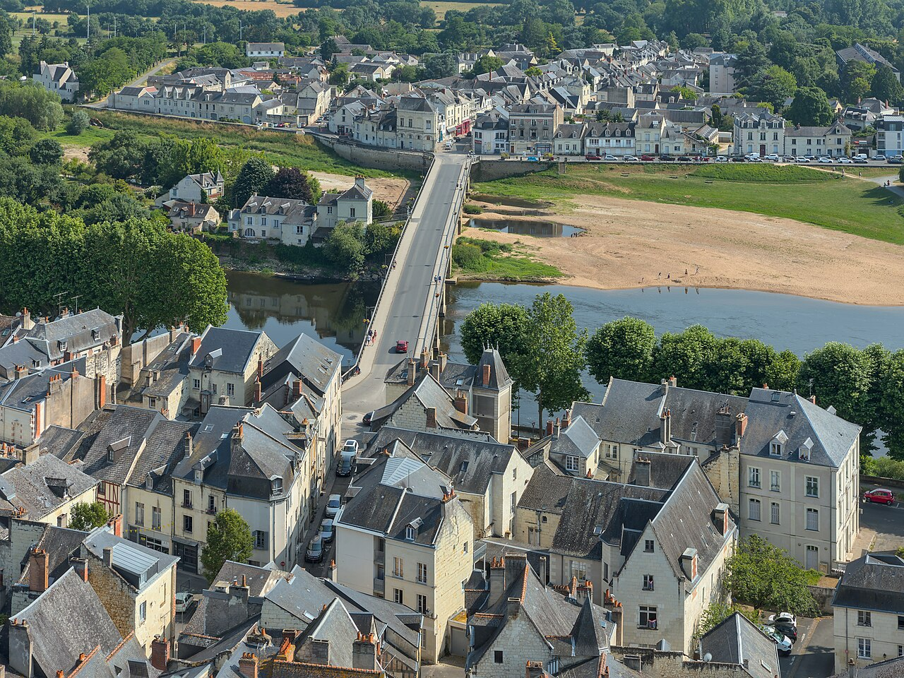

# 希农

希农（Chinon）是[法国](ref:france)[卢瓦尔河谷](ref:loire)都兰地区最重要的[红葡萄酒](ref:red-wine)法定产区之一：约 2,400 公顷葡萄园、26 个市镇，沿维埃纳河两岸铺开。它以[品丽珠](ref:cabernet-franc)为主体，也允许不超过 10% 的赤霞珠，并保留桃红与少量白诗南白葡萄酒。常见 750 mL，[酒精度](ref:abv)多在 12%–13.5%。

图：希农。图片：Benjamin Smith，CC BY-SA 4.0，via Wikimedia Commons（[原图页面](https://commons.wikimedia.org/wiki/File:Chinon_-_View_from_the_castle_-_07.jpg)）。

## 维埃纳河两岸的 26 个市镇

希农的边界不是一座城，而是一条河。26 个市镇分布在维埃纳河两岸，从卢瓦尔河汇流处的 Candes-Saint-Martin 向上游延伸，北面以安德尔河为界，背后是 5,140 公顷森林。森林挡住北风，两条河在霜冻夜形成冷空气排水通道，因此产区把 610 公顷——超过四分之一种植面积——纳入防霜体系。年日照约 2,100 小时，年降雨 500–600 毫米，比都兰其他地方更暖、更干。这些数字说明，“希农”不是一块均质风土，而是由河流、森林与坡向拼成的马赛克。

## 一份 1937 年的法令，和它后来补上的边界

希农在 1937 年 7 月 31 日获得 AOC，是都兰最早一批法定产区。但“法定”不等于边界一次画完：现行 cahier des charges 的地块边界以 INAO 1996 年 5 月与 2016 年 2 月批准的图为准，文本本身则经 2011 年 11 月 15 日法令 homologué、2016 与 2018 年两次修订。今天看到的 26 个市镇与 2,400 公顷，是八十多年里一层层补出来的。读旧书时看到更小的面积或更宽的品种名单，先别当成错误，先看年份。

## 三种土，三种成熟节奏

希农的土壤可以粗分三类，成熟节奏各不相同。河谷里是砂砾台地，排水快、白天升温快，品丽珠容易达到成熟，青椒气息被压低，酒轻快、果味向前。坡地是覆盖在图法岩上的黏土-石灰岩，保水与保热都更好，成熟更慢，单宁更硬，适合陈年。高原上还有一层晚白垩世与始新世的砂质黏土及含燧石黏土，排水差、产量低，却常给出最紧的骨架。同一酒庄把三种土分开[发酵](ref:fermentation)，风格差异会比年份差异还大。原料是[葡萄](ref:grape)，红与桃红只用[品丽珠](ref:cabernet-franc)（赤霞珠为辅助品种），白葡萄酒只用白诗南。

## Puys：8 座石灰岩小丘，最高 88 米

“Puys”在拉丁语里是“台座”。希农汇流区有 8 座石灰岩小丘，比周围高出约 30 米，最高一座 88 米，分布在 Chinon、Beaumont-en-Véron 与 Huismes 三个市镇，并列入 Natura 2000。石灰岩多孔，白天吸热、夜间释放，形成非常温和、少风的小气候；坡上甚至能看到杜松、杏树、海松与野生百里香——一块“地中海飞地”。这里的酒结构更强、寿命更长，是希农“轻酒体”叙事之外的另一极。

## 希农的图法岩为什么比索米尔更“暖”

图法岩是约 9,000 万年前形成的石灰岩，在希农地下厚约 100 米。同样是图法岩，希农的色调偏赭、偏黄，质地更暖、不那么“严峻”，也不如索米尔的白。这个差别不是修辞：它影响反光与升温，也影响酒的口感走向。开采图法岩留下的洞窟被改造成酒窖，常年恒温、湿度稳定、光线微弱，成为陈年酒的天然仓库。把希农、[布尔格伊](ref:bourgueil)与[索米尔-尚皮尼](ref:saumur-champigny)都写成“卢瓦尔品丽珠”，就把这一层地质差别抹掉了。

## 在品丽珠之前：荷兰商人与白诗南的两个世纪

今天希农以红酒闻名，但它的白葡萄酒史比红酒更早进入出口账本。16 世纪到 18 世纪，南特的荷兰商人把希农酒运往北欧；当时白葡萄酒更易酿造、更易运输，也更受英国与荷兰买家欢迎，因此白诗南很可能是当时的主力品种。今天白诗南只占希农葡萄园约 5%，且只做干型静止白；法律上它仍是 AOC 认可的品种，只是被红酒的光芒盖住了。了解这段历史，就不会把“希农有白葡萄酒”当成新潮流。

## 法规：55 hl/ha、10.5% 与 10% 的上限

现行文本的关键数字：基础产量 55 hl/ha，红酒与桃红的上限 67 hl/ha，白葡萄酒 69 hl/ha；最低天然酒精度红与桃红 10.5%，白 10.0%；种植密度至少 4,500 株/公顷，每株最多 11 个结果枝，每公顷最大负载 9,500 公斤。品种上，品丽珠是主品种，赤霞珠为辅助品种且不得超过种植面积的 10%，白葡萄酒只用白诗南。数字会随 cahier des charges 修订，买酒时以最新版本为准。

## Joguet、Baudry、Raffault：三种“地块观”

Charles Joguet 由 Charles Joguet 于 1957 年创立，1985 年起归 Genet 家族，现有 30 公顷品丽珠与 2 公顷白诗南，2008 年起转向有机、2016 年获认证，是最早按地块分别酿造与陈年的酒庄之一；其 Silènes 约 €16、Les Charmes 约 €32。Bernard Baudry 1975 年以 2 公顷起家，今天有 32 公顷，90% 品丽珠、10% 白诗南，葡萄园分布在河谷砾石、坡地黏土-石灰岩与高原砂质石灰岩三类土上，2006 年起全面有机，儿子 Matthieu 于 2000 年加入。Olga Raffault 已传五代，24 公顷中 23 公顷是品丽珠红与桃红、1 公顷是白诗南，平均藤龄 30 年，按三块风土做三款红酒，Les Barnabés 与 Les 2 Roches 是常见酒款。三家规模不同，却都把“地块”当成比品牌更小的单位，[橡木桶](ref:oak-ageing)通常只是容器，不是风味主角。

## 轻与重之间：为什么它不是“只能做轻酒体”

希农的跨度很大：砾石台地的酒可以在年轻时喝，红色果味、单宁圆、酸度清晰；坡地与 Puys 的酒年轻时紧，5–10 年后才展开石墨、雪松、烟草与干花。说“希农只能做轻酒体”，通常只喝过砾石型。另一种误读是“希农的红酒都很青”——青椒是品丽珠的品种特征，适度是风格，过度才说明采收过早。真正决定轻重的是地块、藤龄与萃取，不是产区名。与隔河相望的布尔格伊相比，希农面积更大、土类更杂、风格跨度更宽；与索米尔-尚皮尼相比，它少了图法岩的粉感，多了砾石与高原黏土的棱角。

## 配餐、价格带与两个误解

轻酒体的希农适合熟肉酱、烤鸡、白肉与山羊奶酪，稍冷藏到 14–16°C；结构型适合羊排、野猪炖锅、红酒炖牛肉与硬奶酪，16–18°C。价格上，酒庄直营样本从约 €16 的入门款到约 €32 的中档地块酒，名庄老藤特酿更高；这些数字随年份、渠道与汇率波动，只作量级参考。两个误解值得纠正：第一，“希农是布尔格伊的翻版”——两者隔河相望，风土与法律边界都不一样；第二，“希农只有红酒”——它合法生产桃红与白葡萄酒，白诗南白虽然只占约 5%，却是理解产区历史的钥匙。

## 引用来源与打开记录

本页数字取自希农产区协会官网的历史页、2024 年英文新闻资料、都兰葡萄农联合会发布的 cahier des charges，以及 Charles Joguet、Bernard Baudry、Olga Raffault 三家酒庄官网；价格仅取 Joguet 官网在售样本。所有来源均在 2026 年 11 月 8 日实际打开核对。
