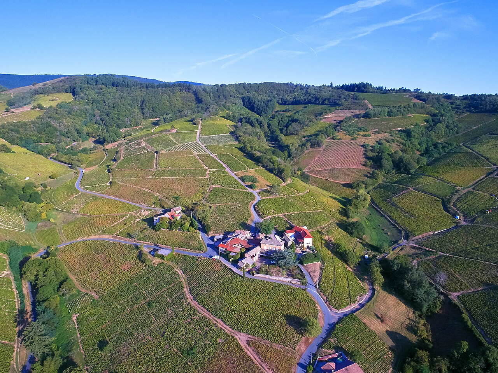

# 希鲁布勒

把希鲁布勒（Chiroubles）的酒倒进杯子之前，先看它的葡萄园长在多高。博若莱的 cru 带整体贴着山脚铺开，而希鲁布勒的坡面一路爬升，在十个 cru 里属于海拔最高的一档，山坡高处可达约 400 米。这个高度差，解释了它为什么常被当作博若莱“轻盈、透气”风格的代表。

图：希鲁布勒。图片：Cruchiroubles，CC BY-SA 4.0，via Wikimedia Commons（[原图页面](https://commons.wikimedia.org/wiki/File:Chiroubles_0259.jpg)）。

## 海拔最高的 cru

希鲁布勒是[博若莱](ref:beaujolais)十个村庄级 cru 之一，村内没有一级园或特级园分级，所有地块都在同一个村庄级 AOC 框架下。它的特别之处不在分级，而在高度：当其他村子还在山脚缓坡上，希鲁布勒的葡萄已经种到更高的坡面，空气更凉、昼夜温差更明显。

高度带来的不是简单的“酸”，而是更慢的成熟曲线。采收通常偏晚，糖分积累与酸度保留之间更容易拉开差距，这也是同一村名内部风格差异的来源。具体边界以产区官方划界为准。

## 花岗岩砂土与坡顶地块

希鲁布勒位于[法国](ref:france)的博若莱北部，葡萄园分布在村周围的高坡上。土壤以浅色花岗岩风化砂为主，土层薄、排水快、肥力低，葡萄根系必须往岩缝里扎；这种“贫瘠”反而抑制了过旺的长势，让果串更小、风味更集中。

坡顶地块与坡腰地块的差别很明显：坡顶风大、土层更薄，成熟慢，酒更清爽；坡腰避风、日照足，果味更圆。原料是[葡萄](ref:grape)，品种为佳美，皮薄、酸度高，在这样的土壤上常呈现红樱桃、覆盆子与很突出的花香。

## 朝南坡面的成熟账

朝南的坡面在希鲁布勒尤其重要。高海拔本来会推迟成熟，朝南的朝向则补回一部分日照，让葡萄在凉爽的底层气候里仍能到达足够成熟度；坡向偏北或背阴的地块，则更依赖年份的温暖程度。

这也意味着“高海拔一定更酸”并不成立。冷年里，高海拔地块可能显得清瘦；暖年里，它们反而因为夜间凉爽而保住了清爽感。读一瓶希鲁布勒，先看年份的冷暖，再看酒标背后的坡位，比单看村名有效。

## 与弗勒里的“花香之别”

希鲁布勒与[弗勒里](ref:fleurie)相邻，两者都以花香著称，但路数不同。弗勒里的花香更浓、更圆，酒体通常更丰满一些；希鲁布勒则更瘦、更透气，香气更“飘”，单宁更细，入口的存在感更轻。

如果说弗勒里像一整束花，希鲁布勒更像风穿过花丛。与[佳美](ref:gamay)的其他表达相比，它把品种里最轻盈的一面放大了：红果清亮、酸度挺立、收尾干净，几乎没有厚重的橡木或酒精压迫感。

## 轻酒体怎样被酿出来

希鲁布勒常用整串发酵，部分酒庄采用半二氧化碳浸渍：整串葡萄在充满二氧化碳的容器中先行细胞内发酵，再进入压榨与常规[发酵](ref:fermentation)。这种方式天然带来直接的果香与很轻的单宁，正好贴合村子本身的骨架。

想做得更“厚”的酒庄会延长浸渍、增加萃取；但多数酒款仍走短浸渍、轻萃取的路线。部分酒款进入[橡木桶陈年](ref:oak-ageing)，新桶比例通常很低，因为一旦橡木味过重，希鲁布勒最值钱的花香就会被盖住。装瓶者信息仍要核对：酒商酒与酒庄酒在同样的村名下，浓度可能差很多。

## 香气里的鸢尾、牡丹与红果

典型香气是红樱桃、覆盆子、草莓，以及紫罗兰、鸢尾与牡丹一类的花香，部分酒款带轻微矿物感。入口酸度清晰，单宁很细，酒体轻，口感柔顺，收尾以果味与花香为主，酒精感通常不突出。

[红葡萄酒](ref:red-wine)的整体框架在这里被压到最轻的一档：颜色偏亮，结构靠酸度而不是单宁支撑。品鉴时建议温度约 14–16 摄氏度，年轻酒款可以轻微冰镇，不必长时间醒酒；闻香时先找花香，再找红果，顺序反过来容易被酸度抢走注意力。

## 冷年与暖年：高海拔如何改写酒风

冷年里，希鲁布勒的酸度更锋利，红果偏酸樱桃与蔓越莓，花香更清冷，酒体显得更薄，适合早饮；暖年里，果味转向草莓与覆盆子果酱，花香更甜，酒精感略高，但高海拔的夜间凉爽仍能保住一定的清新度。

判断年份不需要评分：看酒精度是否明显升高、看果味是清亮还是偏熟、看收尾是否仍然干净。同一村名在冷年与暖年可以是两种气质，这也是它不适合用单一样板去理解的原因。

## 温度、配餐与适饮

建议温度约 14–16 摄氏度，用郁金香形或勃艮第形酒杯。配餐适合禽肉、烤猪肉、熟食、菌菇与软质奶酪；轻快酒体也能搭配沙拉与清淡海鲜。避免重辣或强酸菜肴，它们会压住花香。

多数酒款适合在 3–7 年内饮用，核心地块可以稍久，但整体宜早饮。开瓶后应冷藏并在数日内喝完。本页关于希鲁布勒的内容涉及酒精饮料；过量饮酒有害健康，未成年人不应饮酒。

## 价格带与选购：轻酒体的定价

在博若莱 cru 的价格序列里，希鲁布勒通常处于中等或中等偏下的档位：产量小、酒体轻，常被当作日常饮用的 cru 入门，但核心坡位与老藤酒款会明显更贵。价格随地块、酒庄与年份变化，本页不写具体数字。常见容量为 750 mL，[酒精度](ref:abv)约 12.5%–13% vol，具体随年份与酒庄变化。

选购时先确认酒标单独标注 cru 名，再看装瓶者与年份；酒精度长期偏低、果味清亮，是它风格一致性的线索。未开瓶应避光、平放于 12–15 摄氏度的阴凉处，避免高温与剧烈温差；开瓶后抽真空或充惰性气体并冷藏。

## 关于希鲁布勒的常见误区

第一，把希鲁布勒当成博若莱新酒。它是独立的村庄级 cru，强调花香与细腻，不是当年果味型的轻松酒。

第二，认为酒体轻就不能陈年。核心地块可以存放数年，但整体仍以早饮为主，不宜期待它变成厚重型。

第三，认为海拔最高就一定最酸。年份与坡向的差异很大，暖年里的高海拔地块反而更平衡。

第四，把希鲁布勒与弗勒里混为一谈。两者相邻、都偏花香，但希鲁布勒更瘦、更透气，弗勒里更圆、更丰满。

希鲁布勒产量小、酒体轻，产区名容易被普通博若莱借用；看酒标是否明确写“Chiroubles”而不是“Beaujolais”，并核对装瓶者与进口商。低价“Chiroubles”多半是酒商拼配，不是酒庄酒。
