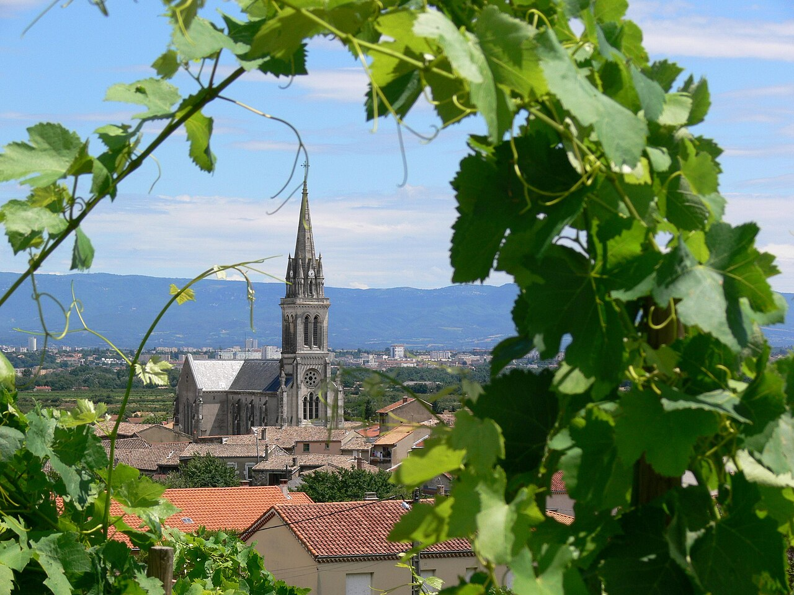

# 科尔纳斯

科尔纳斯是法国北罗讷河谷的[红葡萄酒](ref:red-wine)法定产区，位于罗讷河西岸、瓦朗斯以北的陡坡地带，以[叙拉](ref:syrah)单独酿造。产区面积小、产量有限，风格紧实，常见 750 mL，[酒精度](ref:abv)约 12.5%–14% vol。

图：科尔纳斯。图片：Jacques Forêt，CC BY-SA 4.0，via Wikimedia Commons（[原图页面](https://commons.wikimedia.org/wiki/File:Cornas_2007-06-16_018.jpg)）。

## 定义与定位

先分层：[红葡萄酒](ref:red-wine)是大类，叙拉是品种，科尔纳斯是法定产区（AOC），具体酒庄与酒款是生产者层面。科尔纳斯既是地名，也是酒标上的产区名，不能与某个品牌混同。

在北罗讷河谷，科尔纳斯与罗第丘、埃米塔日、圣约瑟夫并列，但范围最小。它只产红葡萄酒，且以叙拉单独酿造，风格比圣约瑟夫更集中、更紧实。

## 生产者与品牌

产区内以小型家族酒庄为主，地块分散在陡坡梯田上，机械化程度低。酒庄多为自有地块并自行装瓶，酒商与合作社的数量相对有限。

科尔纳斯面积小，生产者以家族酒庄为主，也有少量酒商收购酒液。产区法规规定葡萄来源与最低酒精度的框架，但装瓶者、葡萄园位置与陈年方式决定风格；读酒标时先看是否为酒庄装瓶，再看年份与葡萄园地块。

## 「科尔纳斯」的产地与原料
科尔纳斯位于[法国](ref:france)北罗讷河谷，罗讷河西岸、瓦朗斯以北。气候为典型的大陆性，夏季炎热、秋季较为稳定，陡坡朝向与日照影响成熟度。

土壤以花岗岩为主，部分地块含石灰岩与砂质；砾石与风化花岗岩排水性强，迫使根系深扎。原料是[葡萄](ref:grape)，红葡萄酒以[叙拉](ref:syrah)单独酿造。

## 「科尔纳斯」怎么做出来
科尔纳斯红酒以[发酵](ref:fermentation)为基础，常采用较长浸渍以获取颜色与单宁；部分酒庄带梗发酵，增加香料与草本层次。之后多使用[橡木桶陈年](ref:oak-ageing)，其中一部分为新桶，增加香草、烟熏与质地。

科尔纳斯的浸渍时长、带梗比例与新桶比例没有统一配方；叙拉的单宁强，酒庄若追求果味就会缩短浸渍，追求结构则相反，具体以酒庄资料与瓶标为准。叙拉的单宁与酸度都较高，采收时机与浸渍强度决定酒体是紧实还是过重。

## 「科尔纳斯」的瓶型与标签
常见容量为 750 mL，[酒精度](ref:abv)约 12.5%–14% vol。标签应核对产区名、年份、装瓶者与进口商信息，部分酒款会标注地块或酒庄自有园地。

科尔纳斯酒标常见“Appellation Cornas Contrôlée”，通常只标产区与年份，不标葡萄品种；酒庄名、装瓶者与地块信息比“Cornas”更能区分风格。中文背标应核对进口商与酒精度。

## 「科尔纳斯」的闻与喝
年轻科尔纳斯以黑橄榄、黑胡椒、紫罗兰与烟熏气息为主，单宁强、酸度高；成熟后会转向黑色果味、皮革与松露气息。与圣约瑟夫相比，科尔纳斯常见更深的颜色与更强的结构。

品鉴时建议温度约 16–18 摄氏度。闻香时注意果味与胡椒气息的清晰度，过度橡木或过熟果味会让酒显得厚重。结构强的酒款可提前醒酒。

## 「科尔纳斯」的饮用与搭配
科尔纳斯适合搭配红肉、烤肉、野味与硬质奶酪；强单宁与高酸度适合脂肪含量较高的菜肴。配餐时以单宁强度为准，不必强求固定搭配。

多数酒款适合在 5–12 年内饮用，结构强的年份可以更久；具体适饮窗口因年份与酒庄而异。开瓶后可醒酒，剩余酒液应密封冷藏并尽快饮用。本页关于科尔纳斯的内容涉及酒精饮料；过量饮酒有害健康，未成年人不应饮酒。

## 「科尔纳斯」的购买与保存
购买时优先选择正规渠道，核对产区名、年份与装瓶者信息。因产量小，价格通常高于同河谷的大产区酒款，本页不给出具体数字。科尔纳斯的产区名与包装只能证明法定范围，不能替代对具体酒庄、年份与装瓶者的核对。

科尔纳斯以叙拉酿造，风格紧实、黑胡椒与烟熏味明显。未开瓶可平放在 12–15°C 的避光处，保持温度稳定；软木塞需要湿度。开瓶后密封冷藏，并在两三天内喝完，紧实的单宁会在反复回温后显得更干。

## 「科尔纳斯」容易被读错的地方
第一，把科尔纳斯与圣约瑟夫当成同一风格。两者同为北罗讷叙拉产区，但科尔纳斯面积更小、风格更集中。
第二，认为科尔纳斯可以混酿其他品种。红葡萄酒以叙拉单独酿造。
第三，把黑胡椒气息当成缺陷。它是叙拉与北罗讷的典型特征。
第四，认为所有科尔纳斯都必须长期陈年。不同酒庄与年份的适饮窗口差异明显。
第五，用价格或包装判断真伪。渠道、背标与装瓶者信息更可靠。

科尔纳斯是北罗讷河谷的小产区，读它要抓住“叙拉单酿、陡坡、紧实”三个关键词。它和罗讷河谷大区酒、圣约瑟夫等相邻产区共享品种与河谷气候，但产量小、坡度陡，风格更集中；酒标上的产区名不是质量等级，具体年份与酒庄才是判断入口。

**关键事实。**

| 项目 | 内容 |
| --- | --- |
| 一句话定位 | 法国北罗讷河谷的叙拉红葡萄酒法定产区，位于罗讷河西岸、瓦朗斯以北的陡坡地带；产量小、风格紧实，以黑橄榄、黑胡椒、紫罗兰与烟熏气息著称，常见 750 mL、酒精度约 12.5%–14% vol |
| 酒种/风格 | 红葡萄酒 |
| 产区 | 法国、罗讷河谷 |
| 酒精度 | 12.5–14% vol |

**来源与边界。** 本页关于「科尔纳斯」的关键事实，主要由以下来源交叉核对：INAO（科尔纳斯法定产区的范围与品种规则；由原条目末尾参考资料迁移，未逐条复核访问日期）、Inter Rhône（科尔纳斯的陡坡地形、土壤与风格特征；由原条目末尾参考资料迁移，未逐条复核访问日期）、Oxford University Press（提供关于科尔纳斯与叙拉的条目；由原条目末尾参考资料迁移，未逐条复核访问日期）。价格、批次与状态会变，涉及这些字段时以页面所列来源的最新版本为准。正文为项目自写，来源只作核验，不复制原文。

## 参考资料
- [红葡萄酒](ref:red-wine)：科尔纳斯所属的葡萄酒大类。
- [叙拉](ref:syrah)：科尔纳斯红葡萄酒的唯一品种。
- [法国](ref:france)：法国葡萄酒法规与产区体系。
- [罗讷河谷](ref:rhone)：南北罗讷的产区框架、品种与法规。
- [葡萄](ref:grape)：科尔纳斯所用葡萄的成熟度、酸度与单宁判断。
- [发酵](ref:fermentation)：浸渍与萃取的基本逻辑。
- [橡木桶陈年](ref:oak-ageing)：烟熏与质地的来源之一。
- [酒精度](ref:abv)：12.5%–14% vol 在标签上的含义。
